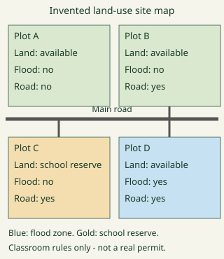
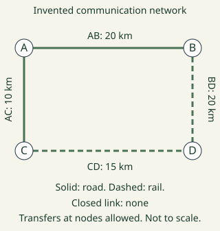
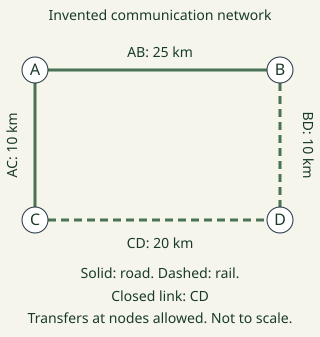

# Geography Form 5, Form Five Geography: authored answers for review

Every answer fixed by a person, not computed. Part 1: the tables, conventions and rules that computed answers come from.
Part 2: every authored question template, with all its data (keys, statements, pairs, choices and feedback) and sources.
Regenerate with `npm run review:f5-geography`. Item IDs (TR-…) match `docs/teacher-review.md`.

## Part 1

Rules the computed answers use are listed in the subject’s library tests; every authored answer is in Part 2.

## Part 2: authored question templates

| # | Template | Lesson | Type, level | Sources |
|---|---|---|---|---|
| 1 | `g5-1-terms` | 1 | multiple choice, 1 | industry |
| 2 | `g5-1-cases` | 1 | multiple choice, 1 | industry |
| 3 | `g5-1-explain` | 1 | multiple choice, 2 | industry |
| 4 | `g5-1-apply` | 1 | multiple choice, 2 | industry |
| 5 | `g5-1-assess` | 1 | spot the error, 3 | industry |
| 6 | `g5-1-explain-card` (card g5-1-c3) | 1 | multiple choice, 1 | industry |
| 7 | `g5-2-terms` | 2 | multiple choice, 1 | industry |
| 8 | `g5-2-cases` | 2 | multiple choice, 1 | industry |
| 9 | `g5-2-explain` | 2 | multiple choice, 2 | industry |
| 10 | `g5-2-apply` | 2 | multiple choice, 2 | industry |
| 11 | `g5-2-assess` | 2 | spot the error, 3 | industry |
| 12 | `g5-2-explain-card` (card g5-2-c3) | 2 | multiple choice, 1 | industry |
| 13 | `g5-3-terms` | 3 | multiple choice, 1 | industry |
| 14 | `g5-3-cases` | 3 | multiple choice, 1 | industry |
| 15 | `g5-3-explain` | 3 | multiple choice, 2 | industry |
| 16 | `g5-3-apply` | 3 | multiple choice, 2 | industry |
| 17 | `g5-3-assess` | 3 | spot the error, 3 | industry |
| 18 | `g5-3-explain-card` (card g5-3-c3) | 3 | multiple choice, 1 | industry |
| 19 | `g5-4-terms` | 4 | multiple choice, 1 | industry |
| 20 | `g5-4-cases` | 4 | multiple choice, 1 | industry |
| 21 | `g5-4-explain` | 4 | multiple choice, 2 | industry |
| 22 | `g5-4-apply` | 4 | multiple choice, 2 | industry |
| 23 | `g5-4-assess` | 4 | spot the error, 3 | industry |
| 24 | `g5-4-explain-card` (card g5-4-c3) | 4 | multiple choice, 1 | industry |
| 25 | `g5-5-terms` | 5 | multiple choice, 1 | industry |
| 26 | `g5-5-cases` | 5 | multiple choice, 1 | industry |
| 27 | `g5-5-explain` | 5 | multiple choice, 2 | industry |
| 28 | `g5-5-assess` | 5 | spot the error, 3 | industry |
| 29 | `g5-5-explain-card` (card g5-5-c3) | 5 | multiple choice, 1 | industry |
| 30 | `g5-6-terms` | 6 | multiple choice, 1 | industry |
| 31 | `g5-6-cases` | 6 | multiple choice, 1 | industry |
| 32 | `g5-6-explain` | 6 | multiple choice, 2 | industry |
| 33 | `g5-6-apply` | 6 | multiple choice, 2 | industry |
| 34 | `g5-6-assess` | 6 | spot the error, 3 | industry |
| 35 | `g5-6-explain-card` (card g5-6-c3) | 6 | multiple choice, 1 | industry |
| 36 | `g5-7-terms` | 7 | multiple choice, 1 | industry |
| 37 | `g5-7-cases` | 7 | multiple choice, 1 | industry |
| 38 | `g5-7-explain` | 7 | multiple choice, 2 | industry |
| 39 | `g5-7-map` | 7 | multiple choice, 2 | industry |
| 40 | `g5-7-assess` | 7 | spot the error, 3 | industry |
| 41 | `g5-7-explain-card` (card g5-7-c3) | 7 | multiple choice, 1 | industry |
| 42 | `g5-8-terms` | 8 | multiple choice, 1 | communication |
| 43 | `g5-8-cases` | 8 | multiple choice, 1 | communication |
| 44 | `g5-8-explain` | 8 | multiple choice, 2 | communication |
| 45 | `g5-8-apply` | 8 | multiple choice, 2 | communication |
| 46 | `g5-8-assess` | 8 | spot the error, 3 | communication |
| 47 | `g5-8-explain-card` (card g5-8-c3) | 8 | multiple choice, 1 | communication |
| 48 | `g5-9-terms` | 9 | multiple choice, 1 | transport |
| 49 | `g5-9-cases` | 9 | multiple choice, 1 | transport |
| 50 | `g5-9-explain` | 9 | multiple choice, 2 | transport |
| 51 | `g5-9-assess` | 9 | spot the error, 3 | transport |
| 52 | `g5-9-explain-card` (card g5-9-c3) | 9 | multiple choice, 1 | transport |
| 53 | `g5-10-terms` | 10 | multiple choice, 1 | transport |
| 54 | `g5-10-cases` | 10 | multiple choice, 1 | transport |
| 55 | `g5-10-explain` | 10 | multiple choice, 2 | transport |
| 56 | `g5-10-assess` | 10 | spot the error, 3 | transport |
| 57 | `g5-10-explain-card` (card g5-10-c3) | 10 | multiple choice, 1 | transport |
| 58 | `g5-11-terms` | 11 | multiple choice, 1 | transport |
| 59 | `g5-11-cases` | 11 | multiple choice, 1 | transport |
| 60 | `g5-11-explain` | 11 | multiple choice, 2 | transport |
| 61 | `g5-11-assess` | 11 | spot the error, 3 | transport |
| 62 | `g5-11-explain-card` (card g5-11-c3) | 11 | multiple choice, 1 | transport |
| 63 | `g5-12-terms` | 12 | multiple choice, 1 | transport |
| 64 | `g5-12-cases` | 12 | multiple choice, 1 | transport |
| 65 | `g5-12-explain` | 12 | multiple choice, 2 | transport |
| 66 | `g5-12-apply` | 12 | multiple choice, 2 | transport |
| 67 | `g5-12-assess` | 12 | spot the error, 3 | transport |
| 68 | `g5-12-explain-card` (card g5-12-c3) | 12 | multiple choice, 1 | transport |
| 69 | `g5-14-terms` | 14 | multiple choice, 1 | transport |
| 70 | `g5-14-cases` | 14 | multiple choice, 1 | transport |
| 71 | `g5-14-explain` | 14 | multiple choice, 2 | transport |
| 72 | `g5-14-apply` | 14 | multiple choice, 2 | transport |
| 73 | `g5-14-assess` | 14 | spot the error, 3 | transport |
| 74 | `g5-14-explain-card` (card g5-14-c3) | 14 | multiple choice, 1 | transport |
| 75 | `g5-15-terms` | 15 | multiple choice, 1 | transport |
| 76 | `g5-15-cases` | 15 | multiple choice, 1 | transport |
| 77 | `g5-15-explain` | 15 | multiple choice, 2 | transport |
| 78 | `g5-15-apply` | 15 | multiple choice, 2 | transport |
| 79 | `g5-15-assess` | 15 | spot the error, 3 | transport |
| 80 | `g5-15-explain-card` (card g5-15-c3) | 15 | multiple choice, 1 | transport |
| 81 | `g5-16-terms` | 16 | multiple choice, 1 | communication, trade |
| 82 | `g5-16-cases` | 16 | multiple choice, 1 | communication, trade |
| 83 | `g5-16-explain` | 16 | multiple choice, 2 | communication, trade |
| 84 | `g5-16-apply` | 16 | multiple choice, 2 | communication, trade |
| 85 | `g5-16-assess` | 16 | spot the error, 3 | communication, trade |
| 86 | `g5-16-explain-card` (card g5-16-c3) | 16 | multiple choice, 1 | communication, trade |
| 87 | `g5-17-terms` | 17 | multiple choice, 1 | communication |
| 88 | `g5-17-cases` | 17 | multiple choice, 1 | communication |
| 89 | `g5-17-explain` | 17 | multiple choice, 2 | communication |
| 90 | `g5-17-apply` | 17 | multiple choice, 2 | communication |
| 91 | `g5-17-assess` | 17 | spot the error, 3 | communication |
| 92 | `g5-17-explain-card` (card g5-17-c3) | 17 | multiple choice, 1 | communication |
| 93 | `g5-18-terms` | 18 | multiple choice, 1 | transport |
| 94 | `g5-18-cases` | 18 | multiple choice, 1 | transport |
| 95 | `g5-18-explain` | 18 | multiple choice, 2 | transport |
| 96 | `g5-18-apply` | 18 | multiple choice, 2 | transport |
| 97 | `g5-18-assess` | 18 | spot the error, 3 | transport |
| 98 | `g5-18-explain-card` (card g5-18-c3) | 18 | multiple choice, 1 | transport |
| 99 | `g5-19-terms` | 19 | multiple choice, 1 | communication |
| 100 | `g5-19-cases` | 19 | multiple choice, 1 | communication |
| 101 | `g5-19-explain` | 19 | multiple choice, 2 | communication |
| 102 | `g5-19-apply` | 19 | multiple choice, 2 | communication |
| 103 | `g5-19-assess` | 19 | spot the error, 3 | communication |
| 104 | `g5-19-explain-card` (card g5-19-c3) | 19 | multiple choice, 1 | communication |
| 105 | `g5-20-terms` | 20 | multiple choice, 1 | transport |
| 106 | `g5-20-cases` | 20 | multiple choice, 1 | transport |
| 107 | `g5-20-explain` | 20 | multiple choice, 2 | transport |
| 108 | `g5-20-apply` | 20 | multiple choice, 2 | transport |
| 109 | `g5-20-assess` | 20 | spot the error, 3 | transport |
| 110 | `g5-20-explain-card` (card g5-20-c3) | 20 | multiple choice, 1 | transport |
| 111 | `g5-21-terms` | 21 | multiple choice, 1 | transport |
| 112 | `g5-21-cases` | 21 | multiple choice, 1 | transport |
| 113 | `g5-21-explain` | 21 | multiple choice, 2 | transport |
| 114 | `g5-21-network` | 21 | multiple choice, 2 | transport |
| 115 | `g5-21-assess` | 21 | spot the error, 3 | transport |
| 116 | `g5-21-explain-card` (card g5-21-c3) | 21 | multiple choice, 1 | transport |
| 117 | `g5-22-terms` | 22 | multiple choice, 1 | trade |
| 118 | `g5-22-cases` | 22 | multiple choice, 1 | trade |
| 119 | `g5-22-explain` | 22 | multiple choice, 2 | trade |
| 120 | `g5-22-assess` | 22 | spot the error, 3 | trade |
| 121 | `g5-22-explain-card` (card g5-22-c3) | 22 | multiple choice, 1 | trade |
| 122 | `g5-23-terms` | 23 | multiple choice, 1 | trade |
| 123 | `g5-23-cases` | 23 | multiple choice, 1 | trade |
| 124 | `g5-23-explain` | 23 | multiple choice, 2 | trade |
| 125 | `g5-23-apply` | 23 | multiple choice, 2 | trade |
| 126 | `g5-23-assess` | 23 | spot the error, 3 | trade |
| 127 | `g5-23-explain-card` (card g5-23-c3) | 23 | multiple choice, 1 | trade |
| 128 | `g5-24-terms` | 24 | multiple choice, 1 | trade |
| 129 | `g5-24-cases` | 24 | multiple choice, 1 | trade |
| 130 | `g5-24-explain` | 24 | multiple choice, 2 | trade |
| 131 | `g5-24-assess` | 24 | spot the error, 3 | trade |
| 132 | `g5-24-explain-card` (card g5-24-c3) | 24 | multiple choice, 1 | trade |

### `g5-1-terms` · Lesson 1 · multiple choice, level 1

Prompt: {X.q}

Table `X` (one row is picked each time):

| q | r | w | e | y |
|---|---|---|---|---|
| Which term means a substance used to make a product? | material input | manufacturing process · manufactured output · service activity | That concerns transformation or assembly that makes a product, rather than the feature asked for. · That concerns a product resulting from transformation or assembly, rather than the feature asked for. · That concerns work such as transport or retail rather than making this product, rather than the feature asked for. | Materials enter the production process. |
| Which term means transformation or assembly that makes a product? | manufacturing process | material input · manufactured output · service activity | That concerns a substance used to make a product, rather than the feature asked for. · That concerns a product resulting from transformation or assembly, rather than the feature asked for. · That concerns work such as transport or retail rather than making this product, rather than the feature asked for. | The material is transformed into a manufactured output. |
| Which term means a product resulting from transformation or assembly? | manufactured output | material input · manufacturing process · service activity | That concerns a substance used to make a product, rather than the feature asked for. · That concerns transformation or assembly that makes a product, rather than the feature asked for. · That concerns work such as transport or retail rather than making this product, rather than the feature asked for. | An output is the result of the specified manufacturing process. |
| Which term means work such as transport or retail rather than making this product? | service activity | material input · manufacturing process · manufactured output | That concerns a substance used to make a product, rather than the feature asked for. · That concerns transformation or assembly that makes a product, rather than the feature asked for. · That concerns a product resulting from transformation or assembly, rather than the feature asked for. | Delivery moves the product rather than making it. |

Right answer: `{X.r}`; wrong choices: `{X.w[0]}`, `{X.w[1]}`, `{X.w[2]}`

- Feedback `w0`: “{X.e[0]}”
- Feedback `w1`: “{X.e[1]}”
- Feedback `w2`: “{X.e[2]}”

Three generated variants:

> Which term means transformation or assembly that makes a product?

- ◻️ manufactured output  
  _↳ feedback if chosen: That concerns a product resulting from transformation or assembly, rather than the feature asked for._
- ◻️ material input  
  _↳ feedback if chosen: That concerns a substance used to make a product, rather than the feature asked for._
- ✅ manufacturing process
- ◻️ service activity  
  _↳ feedback if chosen: That concerns work such as transport or retail rather than making this product, rather than the feature asked for._

Full working after a second miss:

> The material is transformed into a manufactured output.  
> So the answer is “manufacturing process”.  

> Which term means transformation or assembly that makes a product?

- ◻️ material input  
  _↳ feedback if chosen: That concerns a substance used to make a product, rather than the feature asked for._
- ◻️ service activity  
  _↳ feedback if chosen: That concerns work such as transport or retail rather than making this product, rather than the feature asked for._
- ◻️ manufactured output  
  _↳ feedback if chosen: That concerns a product resulting from transformation or assembly, rather than the feature asked for._
- ✅ manufacturing process

Full working after a second miss:

> The material is transformed into a manufactured output.  
> So the answer is “manufacturing process”.  

> Which term means transformation or assembly that makes a product?

- ◻️ manufactured output  
  _↳ feedback if chosen: That concerns a product resulting from transformation or assembly, rather than the feature asked for._
- ◻️ service activity  
  _↳ feedback if chosen: That concerns work such as transport or retail rather than making this product, rather than the feature asked for._
- ✅ manufacturing process
- ◻️ material input  
  _↳ feedback if chosen: That concerns a substance used to make a product, rather than the feature asked for._

Full working after a second miss:

> The material is transformed into a manufactured output.  
> So the answer is “manufacturing process”.  

Sources: industry (Original classroom cases and schematics; Rodrigue transport geography location model; UIA parks; UNESCO historical industrial landscape; dated World Bank income categories; ALUCAM plant identification.)

### `g5-1-cases` · Lesson 1 · multiple choice, level 1

Prompt: {X.q}

Table `X` (one row is picked each time):

| q | r | w | e | y |
|---|---|---|---|---|
| A furniture workshop receives timber.
Which feature is illustrated? | material input | manufacturing process · manufactured output · service activity | That identifies transformation or assembly that makes a product. Read the case for evidence of a substance used to make a product. · That identifies a product resulting from transformation or assembly. Read the case for evidence of a substance used to make a product. · That identifies work such as transport or retail rather than making this product. Read the case for evidence of a substance used to make a product. | Materials enter the production process. |
| Workers cut and join timber into tables.
Which feature is illustrated? | manufacturing process | material input · manufactured output · service activity | That identifies a substance used to make a product. Read the case for evidence of transformation or assembly that makes a product. · That identifies a product resulting from transformation or assembly. Read the case for evidence of transformation or assembly that makes a product. · That identifies work such as transport or retail rather than making this product. Read the case for evidence of transformation or assembly that makes a product. | The material is transformed into a manufactured output. |
| Finished tables leave the workshop.
Which feature is illustrated? | manufactured output | material input · manufacturing process · service activity | That identifies a substance used to make a product. Read the case for evidence of a product resulting from transformation or assembly. · That identifies transformation or assembly that makes a product. Read the case for evidence of a product resulting from transformation or assembly. · That identifies work such as transport or retail rather than making this product. Read the case for evidence of a product resulting from transformation or assembly. | An output is the result of the specified manufacturing process. |
| A carrier delivers the finished tables.
Which feature is illustrated? | service activity | material input · manufacturing process · manufactured output | That identifies a substance used to make a product. Read the case for evidence of work such as transport or retail rather than making this product. · That identifies transformation or assembly that makes a product. Read the case for evidence of work such as transport or retail rather than making this product. · That identifies a product resulting from transformation or assembly. Read the case for evidence of work such as transport or retail rather than making this product. | Delivery moves the product rather than making it. |

Right answer: `{X.r}`; wrong choices: `{X.w[0]}`, `{X.w[1]}`, `{X.w[2]}`

- Feedback `w0`: “{X.e[0]}”
- Feedback `w1`: “{X.e[1]}”
- Feedback `w2`: “{X.e[2]}”

Three generated variants:

> A furniture workshop receives timber.
> Which feature is illustrated?

- ◻️ manufactured output  
  _↳ feedback if chosen: That identifies a product resulting from transformation or assembly. Read the case for evidence of a substance used to make a product._
- ✅ material input
- ◻️ service activity  
  _↳ feedback if chosen: That identifies work such as transport or retail rather than making this product. Read the case for evidence of a substance used to make a product._
- ◻️ manufacturing process  
  _↳ feedback if chosen: That identifies transformation or assembly that makes a product. Read the case for evidence of a substance used to make a product._

Full working after a second miss:

> Materials enter the production process.  
> So the answer is “material input”.  

> A carrier delivers the finished tables.
> Which feature is illustrated?

- ◻️ manufactured output  
  _↳ feedback if chosen: That identifies a product resulting from transformation or assembly. Read the case for evidence of work such as transport or retail rather than making this product._
- ✅ service activity
- ◻️ material input  
  _↳ feedback if chosen: That identifies a substance used to make a product. Read the case for evidence of work such as transport or retail rather than making this product._
- ◻️ manufacturing process  
  _↳ feedback if chosen: That identifies transformation or assembly that makes a product. Read the case for evidence of work such as transport or retail rather than making this product._

Full working after a second miss:

> Delivery moves the product rather than making it.  
> So the answer is “service activity”.  

> Finished tables leave the workshop.
> Which feature is illustrated?

- ◻️ manufacturing process  
  _↳ feedback if chosen: That identifies transformation or assembly that makes a product. Read the case for evidence of a product resulting from transformation or assembly._
- ◻️ service activity  
  _↳ feedback if chosen: That identifies work such as transport or retail rather than making this product. Read the case for evidence of a product resulting from transformation or assembly._
- ✅ manufactured output
- ◻️ material input  
  _↳ feedback if chosen: That identifies a substance used to make a product. Read the case for evidence of a product resulting from transformation or assembly._

Full working after a second miss:

> An output is the result of the specified manufacturing process.  
> So the answer is “manufactured output”.  

Sources: industry (Original classroom cases and schematics; Rodrigue transport geography location model; UIA parks; UNESCO historical industrial landscape; dated World Bank income categories; ALUCAM plant identification.)

### `g5-1-explain` · Lesson 1 · multiple choice, level 2

Prompt: {X.q}

Table `X` (one row is picked each time):

| q | r | w | e | y |
|---|---|---|---|---|
| A furniture workshop receives timber.
Which explanation follows? | Materials enter the production process. | The material is transformed into a manufactured output. · An output is the result of the specified manufacturing process. · Delivery moves the product rather than making it. | That explanation addresses manufacturing process, rather than the process or relationship in this case. · That explanation addresses manufactured output, rather than the process or relationship in this case. · That explanation addresses service activity, rather than the process or relationship in this case. | a substance used to make a product. |
| Workers cut and join timber into tables.
Which explanation follows? | The material is transformed into a manufactured output. | Materials enter the production process. · An output is the result of the specified manufacturing process. · Delivery moves the product rather than making it. | That explanation addresses material input, rather than the process or relationship in this case. · That explanation addresses manufactured output, rather than the process or relationship in this case. · That explanation addresses service activity, rather than the process or relationship in this case. | transformation or assembly that makes a product. |
| Finished tables leave the workshop.
Which explanation follows? | An output is the result of the specified manufacturing process. | Materials enter the production process. · The material is transformed into a manufactured output. · Delivery moves the product rather than making it. | That explanation addresses material input, rather than the process or relationship in this case. · That explanation addresses manufacturing process, rather than the process or relationship in this case. · That explanation addresses service activity, rather than the process or relationship in this case. | a product resulting from transformation or assembly. |
| A carrier delivers the finished tables.
Which explanation follows? | Delivery moves the product rather than making it. | Materials enter the production process. · The material is transformed into a manufactured output. · An output is the result of the specified manufacturing process. | That explanation addresses material input, rather than the process or relationship in this case. · That explanation addresses manufacturing process, rather than the process or relationship in this case. · That explanation addresses manufactured output, rather than the process or relationship in this case. | work such as transport or retail rather than making this product. |

Right answer: `{X.r}`; wrong choices: `{X.w[0]}`, `{X.w[1]}`, `{X.w[2]}`

- Feedback `w0`: “{X.e[0]}”
- Feedback `w1`: “{X.e[1]}”
- Feedback `w2`: “{X.e[2]}”

Three generated variants:

> Finished tables leave the workshop.
> Which explanation follows?

- ◻️ Delivery moves the product rather than making it.  
  _↳ feedback if chosen: That explanation addresses service activity, rather than the process or relationship in this case._
- ◻️ Materials enter the production process.  
  _↳ feedback if chosen: That explanation addresses material input, rather than the process or relationship in this case._
- ✅ An output is the result of the specified manufacturing process.
- ◻️ The material is transformed into a manufactured output.  
  _↳ feedback if chosen: That explanation addresses manufacturing process, rather than the process or relationship in this case._

Full working after a second miss:

> a product resulting from transformation or assembly.  
> So the answer is “An output is the result of the specified manufacturing process.”.  

> Finished tables leave the workshop.
> Which explanation follows?

- ◻️ The material is transformed into a manufactured output.  
  _↳ feedback if chosen: That explanation addresses manufacturing process, rather than the process or relationship in this case._
- ✅ An output is the result of the specified manufacturing process.
- ◻️ Materials enter the production process.  
  _↳ feedback if chosen: That explanation addresses material input, rather than the process or relationship in this case._
- ◻️ Delivery moves the product rather than making it.  
  _↳ feedback if chosen: That explanation addresses service activity, rather than the process or relationship in this case._

Full working after a second miss:

> a product resulting from transformation or assembly.  
> So the answer is “An output is the result of the specified manufacturing process.”.  

> A carrier delivers the finished tables.
> Which explanation follows?

- ◻️ Materials enter the production process.  
  _↳ feedback if chosen: That explanation addresses material input, rather than the process or relationship in this case._
- ◻️ An output is the result of the specified manufacturing process.  
  _↳ feedback if chosen: That explanation addresses manufactured output, rather than the process or relationship in this case._
- ◻️ The material is transformed into a manufactured output.  
  _↳ feedback if chosen: That explanation addresses manufacturing process, rather than the process or relationship in this case._
- ✅ Delivery moves the product rather than making it.

Full working after a second miss:

> work such as transport or retail rather than making this product.  
> So the answer is “Delivery moves the product rather than making it.”.  

Sources: industry (Original classroom cases and schematics; Rodrigue transport geography location model; UIA parks; UNESCO historical industrial landscape; dated World Bank income categories; ALUCAM plant identification.)

### `g5-1-apply` · Lesson 1 · multiple choice, level 2

Prompt: {X.q}

Table `X` (one row is picked each time):

| q | r | w | e | y |
|---|---|---|---|---|
| An invented firm washes, presses and packages fruit as juice. Which operation is manufacturing? | Processing fruit into packaged juice | Growing the fruit · Carrying sealed cartons · Selling the cartons | Growing fruit is primary production. · Carrying goods is a transport service. · Selling is distribution rather than processing. | Fruit is transformed into a different marketable product. |
| Ayuk assembles purchased components into radios. Which classification fits assembly? | Manufacturing | Mining · Retail alone · Passenger transport | No mineral is being extracted. · Assembly changes components into a product. · The activity makes radios rather than moving passengers. | Manufacturing can assemble components without extracting their materials. |
| Bih compares quarrying stone with making cement. Which operation transforms materials into a manufactured product? | Making cement | Extracting stone alone · Carrying cement · Advertising cement | Extraction obtains a raw material. · Transport moves an already made product. · Advertising supplies a service. | The distinction concerns the operation, not whether both firms use machinery. |

Right answer: `{X.r}`; wrong choices: `{X.w[0]}`, `{X.w[1]}`, `{X.w[2]}`

- Feedback `w0`: “{X.e[0]}”
- Feedback `w1`: “{X.e[1]}”
- Feedback `w2`: “{X.e[2]}”

Three generated variants:

> Bih compares quarrying stone with making cement. Which operation transforms materials into a manufactured product?

- ◻️ Carrying cement  
  _↳ feedback if chosen: Transport moves an already made product._
- ◻️ Advertising cement  
  _↳ feedback if chosen: Advertising supplies a service._
- ◻️ Extracting stone alone  
  _↳ feedback if chosen: Extraction obtains a raw material._
- ✅ Making cement

Full working after a second miss:

> The distinction concerns the operation, not whether both firms use machinery.  
> So the answer is “Making cement”.  

> Ayuk assembles purchased components into radios. Which classification fits assembly?

- ◻️ Mining  
  _↳ feedback if chosen: No mineral is being extracted._
- ◻️ Passenger transport  
  _↳ feedback if chosen: The activity makes radios rather than moving passengers._
- ✅ Manufacturing
- ◻️ Retail alone  
  _↳ feedback if chosen: Assembly changes components into a product._

Full working after a second miss:

> Manufacturing can assemble components without extracting their materials.  
> So the answer is “Manufacturing”.  

> An invented firm washes, presses and packages fruit as juice. Which operation is manufacturing?

- ◻️ Carrying sealed cartons  
  _↳ feedback if chosen: Carrying goods is a transport service._
- ◻️ Selling the cartons  
  _↳ feedback if chosen: Selling is distribution rather than processing._
- ◻️ Growing the fruit  
  _↳ feedback if chosen: Growing fruit is primary production._
- ✅ Processing fruit into packaged juice

Full working after a second miss:

> Fruit is transformed into a different marketable product.  
> So the answer is “Processing fruit into packaged juice”.  

Sources: industry (Original classroom cases and schematics; Rodrigue transport geography location model; UIA parks; UNESCO historical industrial landscape; dated World Bank income categories; ALUCAM plant identification.)

### `g5-1-assess` · Lesson 1 · spot the error, level 3

Prompt: Find the incorrect geographical claim.

Shows 3 correct and 1 wrong statement(s), drawn from:

- ✅ material input: a substance used to make a product.
- ✅ manufacturing process: transformation or assembly that makes a product.
- ✅ manufactured output: a product resulting from transformation or assembly.
- ✅ service activity: work such as transport or retail rather than making this product.
- ❌ An input must always be a finished retail product.  
  _↳ Materials enter the production process._
- ❌ Cutting and assembling a table is retail alone.  
  _↳ The material is transformed into a manufactured output._
- ❌ The finished table is the same operation as felling a tree.  
  _↳ An output is the result of the specified manufacturing process._
- ❌ Carrying a finished table is itself its manufacture.  
  _↳ Delivery moves the product rather than making it._

Three generated variants:

> Find the incorrect geographical claim.

- ◻️ manufacturing process: transformation or assembly that makes a product.  
  _↳ explanation: This distinction is correct: The material is transformed into a manufactured output. Look for a claim that reverses the process or makes an unsupported generalisation._
- ✅ Carrying a finished table is itself its manufacture.  
  _↳ explanation: Delivery moves the product rather than making it._
- ◻️ material input: a substance used to make a product.  
  _↳ explanation: This distinction is correct: Materials enter the production process. Look for a claim that reverses the process or makes an unsupported generalisation._
- ◻️ service activity: work such as transport or retail rather than making this product.  
  _↳ explanation: This distinction is correct: Delivery moves the product rather than making it. Look for a claim that reverses the process or makes an unsupported generalisation._

Full working after a second miss:

> The wrong statement is “Carrying a finished table is itself its manufacture.”.  
> Delivery moves the product rather than making it.  

> Find the incorrect geographical claim.

- ◻️ material input: a substance used to make a product.  
  _↳ explanation: This distinction is correct: Materials enter the production process. Look for a claim that reverses the process or makes an unsupported generalisation._
- ◻️ service activity: work such as transport or retail rather than making this product.  
  _↳ explanation: This distinction is correct: Delivery moves the product rather than making it. Look for a claim that reverses the process or makes an unsupported generalisation._
- ◻️ manufacturing process: transformation or assembly that makes a product.  
  _↳ explanation: This distinction is correct: The material is transformed into a manufactured output. Look for a claim that reverses the process or makes an unsupported generalisation._
- ✅ The finished table is the same operation as felling a tree.  
  _↳ explanation: An output is the result of the specified manufacturing process._

Full working after a second miss:

> The wrong statement is “The finished table is the same operation as felling a tree.”.  
> An output is the result of the specified manufacturing process.  

> Find the incorrect geographical claim.

- ◻️ manufacturing process: transformation or assembly that makes a product.  
  _↳ explanation: This distinction is correct: The material is transformed into a manufactured output. Look for a claim that reverses the process or makes an unsupported generalisation._
- ◻️ manufactured output: a product resulting from transformation or assembly.  
  _↳ explanation: This distinction is correct: An output is the result of the specified manufacturing process. Look for a claim that reverses the process or makes an unsupported generalisation._
- ◻️ service activity: work such as transport or retail rather than making this product.  
  _↳ explanation: This distinction is correct: Delivery moves the product rather than making it. Look for a claim that reverses the process or makes an unsupported generalisation._
- ✅ Cutting and assembling a table is retail alone.  
  _↳ explanation: The material is transformed into a manufactured output._

Full working after a second miss:

> The wrong statement is “Cutting and assembling a table is retail alone.”.  
> The material is transformed into a manufactured output.  

Sources: industry (Original classroom cases and schematics; Rodrigue transport geography location model; UIA parks; UNESCO historical industrial landscape; dated World Bank income categories; ALUCAM plant identification.)

### `g5-1-explain-card` · Lesson 1 · multiple choice, level 1

Prompt: {X.q}

Table `X` (one row is picked each time):

| q | r | w | e | y |
|---|---|---|---|---|
| A furniture workshop receives timber.
Which explanation follows? | Materials enter the production process. | The material is transformed into a manufactured output. · An output is the result of the specified manufacturing process. · Delivery moves the product rather than making it. | That explanation addresses manufacturing process, rather than the process or relationship in this case. · That explanation addresses manufactured output, rather than the process or relationship in this case. · That explanation addresses service activity, rather than the process or relationship in this case. | a substance used to make a product. |
| Workers cut and join timber into tables.
Which explanation follows? | The material is transformed into a manufactured output. | Materials enter the production process. · An output is the result of the specified manufacturing process. · Delivery moves the product rather than making it. | That explanation addresses material input, rather than the process or relationship in this case. · That explanation addresses manufactured output, rather than the process or relationship in this case. · That explanation addresses service activity, rather than the process or relationship in this case. | transformation or assembly that makes a product. |
| Finished tables leave the workshop.
Which explanation follows? | An output is the result of the specified manufacturing process. | Materials enter the production process. · The material is transformed into a manufactured output. · Delivery moves the product rather than making it. | That explanation addresses material input, rather than the process or relationship in this case. · That explanation addresses manufacturing process, rather than the process or relationship in this case. · That explanation addresses service activity, rather than the process or relationship in this case. | a product resulting from transformation or assembly. |
| A carrier delivers the finished tables.
Which explanation follows? | Delivery moves the product rather than making it. | Materials enter the production process. · The material is transformed into a manufactured output. · An output is the result of the specified manufacturing process. | That explanation addresses material input, rather than the process or relationship in this case. · That explanation addresses manufacturing process, rather than the process or relationship in this case. · That explanation addresses manufactured output, rather than the process or relationship in this case. | work such as transport or retail rather than making this product. |

Right answer: `{X.r}`; wrong choices: `{X.w[0]}`, `{X.w[1]}`, `{X.w[2]}`

- Feedback `w0`: “{X.e[0]}”
- Feedback `w1`: “{X.e[1]}”
- Feedback `w2`: “{X.e[2]}”

Three generated variants:

> A furniture workshop receives timber.
> Which explanation follows?

- ✅ Materials enter the production process.
- ◻️ An output is the result of the specified manufacturing process.  
  _↳ feedback if chosen: That explanation addresses manufactured output, rather than the process or relationship in this case._
- ◻️ The material is transformed into a manufactured output.  
  _↳ feedback if chosen: That explanation addresses manufacturing process, rather than the process or relationship in this case._
- ◻️ Delivery moves the product rather than making it.  
  _↳ feedback if chosen: That explanation addresses service activity, rather than the process or relationship in this case._

Full working after a second miss:

> a substance used to make a product.  
> So the answer is “Materials enter the production process.”.  

> A carrier delivers the finished tables.
> Which explanation follows?

- ◻️ An output is the result of the specified manufacturing process.  
  _↳ feedback if chosen: That explanation addresses manufactured output, rather than the process or relationship in this case._
- ✅ Delivery moves the product rather than making it.
- ◻️ The material is transformed into a manufactured output.  
  _↳ feedback if chosen: That explanation addresses manufacturing process, rather than the process or relationship in this case._
- ◻️ Materials enter the production process.  
  _↳ feedback if chosen: That explanation addresses material input, rather than the process or relationship in this case._

Full working after a second miss:

> work such as transport or retail rather than making this product.  
> So the answer is “Delivery moves the product rather than making it.”.  

> A carrier delivers the finished tables.
> Which explanation follows?

- ◻️ Materials enter the production process.  
  _↳ feedback if chosen: That explanation addresses material input, rather than the process or relationship in this case._
- ◻️ An output is the result of the specified manufacturing process.  
  _↳ feedback if chosen: That explanation addresses manufactured output, rather than the process or relationship in this case._
- ◻️ The material is transformed into a manufactured output.  
  _↳ feedback if chosen: That explanation addresses manufacturing process, rather than the process or relationship in this case._
- ✅ Delivery moves the product rather than making it.

Full working after a second miss:

> work such as transport or retail rather than making this product.  
> So the answer is “Delivery moves the product rather than making it.”.  

Sources: industry (Original classroom cases and schematics; Rodrigue transport geography location model; UIA parks; UNESCO historical industrial landscape; dated World Bank income categories; ALUCAM plant identification.)

### `g5-2-terms` · Lesson 2 · multiple choice, level 1

Prompt: {X.q}

Table `X` (one row is picked each time):

| q | r | w | e | y |
|---|---|---|---|---|
| Which term means nearby firms supplying inputs or specialist services? | supplier linkage | labour pool · shared infrastructure · agglomeration diseconomy | That concerns a concentration of workers with relevant skills, rather than the feature asked for. · That concerns facilities serving several activities, rather than the feature asked for. · That concerns a cost caused by excessive concentration or pressure, rather than the feature asked for. | Proximity can support repeated specialist transactions. |
| Which term means a concentration of workers with relevant skills? | labour pool | supplier linkage · shared infrastructure · agglomeration diseconomy | That concerns nearby firms supplying inputs or specialist services, rather than the feature asked for. · That concerns facilities serving several activities, rather than the feature asked for. · That concerns a cost caused by excessive concentration or pressure, rather than the feature asked for. | Skills may be easier to find but wages still matter. |
| Which term means facilities serving several activities? | shared infrastructure | supplier linkage · labour pool · agglomeration diseconomy | That concerns nearby firms supplying inputs or specialist services, rather than the feature asked for. · That concerns a concentration of workers with relevant skills, rather than the feature asked for. · That concerns a cost caused by excessive concentration or pressure, rather than the feature asked for. | Infrastructure can support activity without guaranteeing profit. |
| Which term means a cost caused by excessive concentration or pressure? | agglomeration diseconomy | supplier linkage · labour pool · shared infrastructure | That concerns nearby firms supplying inputs or specialist services, rather than the feature asked for. · That concerns a concentration of workers with relevant skills, rather than the feature asked for. · That concerns facilities serving several activities, rather than the feature asked for. | Congestion can offset some benefits of proximity. |

Right answer: `{X.r}`; wrong choices: `{X.w[0]}`, `{X.w[1]}`, `{X.w[2]}`

- Feedback `w0`: “{X.e[0]}”
- Feedback `w1`: “{X.e[1]}”
- Feedback `w2`: “{X.e[2]}”

Three generated variants:

> Which term means facilities serving several activities?

- ◻️ supplier linkage  
  _↳ feedback if chosen: That concerns nearby firms supplying inputs or specialist services, rather than the feature asked for._
- ◻️ labour pool  
  _↳ feedback if chosen: That concerns a concentration of workers with relevant skills, rather than the feature asked for._
- ✅ shared infrastructure
- ◻️ agglomeration diseconomy  
  _↳ feedback if chosen: That concerns a cost caused by excessive concentration or pressure, rather than the feature asked for._

Full working after a second miss:

> Infrastructure can support activity without guaranteeing profit.  
> So the answer is “shared infrastructure”.  

> Which term means a cost caused by excessive concentration or pressure?

- ◻️ supplier linkage  
  _↳ feedback if chosen: That concerns nearby firms supplying inputs or specialist services, rather than the feature asked for._
- ◻️ labour pool  
  _↳ feedback if chosen: That concerns a concentration of workers with relevant skills, rather than the feature asked for._
- ◻️ shared infrastructure  
  _↳ feedback if chosen: That concerns facilities serving several activities, rather than the feature asked for._
- ✅ agglomeration diseconomy

Full working after a second miss:

> Congestion can offset some benefits of proximity.  
> So the answer is “agglomeration diseconomy”.  

> Which term means a cost caused by excessive concentration or pressure?

- ◻️ shared infrastructure  
  _↳ feedback if chosen: That concerns facilities serving several activities, rather than the feature asked for._
- ✅ agglomeration diseconomy
- ◻️ supplier linkage  
  _↳ feedback if chosen: That concerns nearby firms supplying inputs or specialist services, rather than the feature asked for._
- ◻️ labour pool  
  _↳ feedback if chosen: That concerns a concentration of workers with relevant skills, rather than the feature asked for._

Full working after a second miss:

> Congestion can offset some benefits of proximity.  
> So the answer is “agglomeration diseconomy”.  

Sources: industry (Original classroom cases and schematics; Rodrigue transport geography location model; UIA parks; UNESCO historical industrial landscape; dated World Bank income categories; ALUCAM plant identification.)

### `g5-2-cases` · Lesson 2 · multiple choice, level 1

Prompt: {X.q}

Table `X` (one row is picked each time):

| q | r | w | e | y |
|---|---|---|---|---|
| An invented cluster shares a machinery-repair business.
Which feature is illustrated? | supplier linkage | labour pool · shared infrastructure · agglomeration diseconomy | That identifies a concentration of workers with relevant skills. Read the case for evidence of nearby firms supplying inputs or specialist services. · That identifies facilities serving several activities. Read the case for evidence of nearby firms supplying inputs or specialist services. · That identifies a cost caused by excessive concentration or pressure. Read the case for evidence of nearby firms supplying inputs or specialist services. | Proximity can support repeated specialist transactions. |
| Several workshops recruit locally trained technicians.
Which feature is illustrated? | labour pool | supplier linkage · shared infrastructure · agglomeration diseconomy | That identifies nearby firms supplying inputs or specialist services. Read the case for evidence of a concentration of workers with relevant skills. · That identifies facilities serving several activities. Read the case for evidence of a concentration of workers with relevant skills. · That identifies a cost caused by excessive concentration or pressure. Read the case for evidence of a concentration of workers with relevant skills. | Skills may be easier to find but wages still matter. |
| Firms use a common serviced access road.
Which feature is illustrated? | shared infrastructure | supplier linkage · labour pool · agglomeration diseconomy | That identifies nearby firms supplying inputs or specialist services. Read the case for evidence of facilities serving several activities. · That identifies a concentration of workers with relevant skills. Read the case for evidence of facilities serving several activities. · That identifies a cost caused by excessive concentration or pressure. Read the case for evidence of facilities serving several activities. | Infrastructure can support activity without guaranteeing profit. |
| Delivery vehicles lose time in congestion.
Which feature is illustrated? | agglomeration diseconomy | supplier linkage · labour pool · shared infrastructure | That identifies nearby firms supplying inputs or specialist services. Read the case for evidence of a cost caused by excessive concentration or pressure. · That identifies a concentration of workers with relevant skills. Read the case for evidence of a cost caused by excessive concentration or pressure. · That identifies facilities serving several activities. Read the case for evidence of a cost caused by excessive concentration or pressure. | Congestion can offset some benefits of proximity. |

Right answer: `{X.r}`; wrong choices: `{X.w[0]}`, `{X.w[1]}`, `{X.w[2]}`

- Feedback `w0`: “{X.e[0]}”
- Feedback `w1`: “{X.e[1]}”
- Feedback `w2`: “{X.e[2]}”

Three generated variants:

> An invented cluster shares a machinery-repair business.
> Which feature is illustrated?

- ◻️ labour pool  
  _↳ feedback if chosen: That identifies a concentration of workers with relevant skills. Read the case for evidence of nearby firms supplying inputs or specialist services._
- ◻️ agglomeration diseconomy  
  _↳ feedback if chosen: That identifies a cost caused by excessive concentration or pressure. Read the case for evidence of nearby firms supplying inputs or specialist services._
- ✅ supplier linkage
- ◻️ shared infrastructure  
  _↳ feedback if chosen: That identifies facilities serving several activities. Read the case for evidence of nearby firms supplying inputs or specialist services._

Full working after a second miss:

> Proximity can support repeated specialist transactions.  
> So the answer is “supplier linkage”.  

> Delivery vehicles lose time in congestion.
> Which feature is illustrated?

- ✅ agglomeration diseconomy
- ◻️ labour pool  
  _↳ feedback if chosen: That identifies a concentration of workers with relevant skills. Read the case for evidence of a cost caused by excessive concentration or pressure._
- ◻️ shared infrastructure  
  _↳ feedback if chosen: That identifies facilities serving several activities. Read the case for evidence of a cost caused by excessive concentration or pressure._
- ◻️ supplier linkage  
  _↳ feedback if chosen: That identifies nearby firms supplying inputs or specialist services. Read the case for evidence of a cost caused by excessive concentration or pressure._

Full working after a second miss:

> Congestion can offset some benefits of proximity.  
> So the answer is “agglomeration diseconomy”.  

> An invented cluster shares a machinery-repair business.
> Which feature is illustrated?

- ◻️ shared infrastructure  
  _↳ feedback if chosen: That identifies facilities serving several activities. Read the case for evidence of nearby firms supplying inputs or specialist services._
- ✅ supplier linkage
- ◻️ agglomeration diseconomy  
  _↳ feedback if chosen: That identifies a cost caused by excessive concentration or pressure. Read the case for evidence of nearby firms supplying inputs or specialist services._
- ◻️ labour pool  
  _↳ feedback if chosen: That identifies a concentration of workers with relevant skills. Read the case for evidence of nearby firms supplying inputs or specialist services._

Full working after a second miss:

> Proximity can support repeated specialist transactions.  
> So the answer is “supplier linkage”.  

Sources: industry (Original classroom cases and schematics; Rodrigue transport geography location model; UIA parks; UNESCO historical industrial landscape; dated World Bank income categories; ALUCAM plant identification.)

### `g5-2-explain` · Lesson 2 · multiple choice, level 2

Prompt: {X.q}

Table `X` (one row is picked each time):

| q | r | w | e | y |
|---|---|---|---|---|
| An invented cluster shares a machinery-repair business.
Which explanation follows? | Proximity can support repeated specialist transactions. | Skills may be easier to find but wages still matter. · Infrastructure can support activity without guaranteeing profit. · Congestion can offset some benefits of proximity. | That explanation addresses labour pool, rather than the process or relationship in this case. · That explanation addresses shared infrastructure, rather than the process or relationship in this case. · That explanation addresses agglomeration diseconomy, rather than the process or relationship in this case. | nearby firms supplying inputs or specialist services. |
| Several workshops recruit locally trained technicians.
Which explanation follows? | Skills may be easier to find but wages still matter. | Proximity can support repeated specialist transactions. · Infrastructure can support activity without guaranteeing profit. · Congestion can offset some benefits of proximity. | That explanation addresses supplier linkage, rather than the process or relationship in this case. · That explanation addresses shared infrastructure, rather than the process or relationship in this case. · That explanation addresses agglomeration diseconomy, rather than the process or relationship in this case. | a concentration of workers with relevant skills. |
| Firms use a common serviced access road.
Which explanation follows? | Infrastructure can support activity without guaranteeing profit. | Proximity can support repeated specialist transactions. · Skills may be easier to find but wages still matter. · Congestion can offset some benefits of proximity. | That explanation addresses supplier linkage, rather than the process or relationship in this case. · That explanation addresses labour pool, rather than the process or relationship in this case. · That explanation addresses agglomeration diseconomy, rather than the process or relationship in this case. | facilities serving several activities. |
| Delivery vehicles lose time in congestion.
Which explanation follows? | Congestion can offset some benefits of proximity. | Proximity can support repeated specialist transactions. · Skills may be easier to find but wages still matter. · Infrastructure can support activity without guaranteeing profit. | That explanation addresses supplier linkage, rather than the process or relationship in this case. · That explanation addresses labour pool, rather than the process or relationship in this case. · That explanation addresses shared infrastructure, rather than the process or relationship in this case. | a cost caused by excessive concentration or pressure. |

Right answer: `{X.r}`; wrong choices: `{X.w[0]}`, `{X.w[1]}`, `{X.w[2]}`

- Feedback `w0`: “{X.e[0]}”
- Feedback `w1`: “{X.e[1]}”
- Feedback `w2`: “{X.e[2]}”

Three generated variants:

> Several workshops recruit locally trained technicians.
> Which explanation follows?

- ◻️ Proximity can support repeated specialist transactions.  
  _↳ feedback if chosen: That explanation addresses supplier linkage, rather than the process or relationship in this case._
- ✅ Skills may be easier to find but wages still matter.
- ◻️ Infrastructure can support activity without guaranteeing profit.  
  _↳ feedback if chosen: That explanation addresses shared infrastructure, rather than the process or relationship in this case._
- ◻️ Congestion can offset some benefits of proximity.  
  _↳ feedback if chosen: That explanation addresses agglomeration diseconomy, rather than the process or relationship in this case._

Full working after a second miss:

> a concentration of workers with relevant skills.  
> So the answer is “Skills may be easier to find but wages still matter.”.  

> Delivery vehicles lose time in congestion.
> Which explanation follows?

- ◻️ Infrastructure can support activity without guaranteeing profit.  
  _↳ feedback if chosen: That explanation addresses shared infrastructure, rather than the process or relationship in this case._
- ◻️ Proximity can support repeated specialist transactions.  
  _↳ feedback if chosen: That explanation addresses supplier linkage, rather than the process or relationship in this case._
- ✅ Congestion can offset some benefits of proximity.
- ◻️ Skills may be easier to find but wages still matter.  
  _↳ feedback if chosen: That explanation addresses labour pool, rather than the process or relationship in this case._

Full working after a second miss:

> a cost caused by excessive concentration or pressure.  
> So the answer is “Congestion can offset some benefits of proximity.”.  

> An invented cluster shares a machinery-repair business.
> Which explanation follows?

- ◻️ Infrastructure can support activity without guaranteeing profit.  
  _↳ feedback if chosen: That explanation addresses shared infrastructure, rather than the process or relationship in this case._
- ✅ Proximity can support repeated specialist transactions.
- ◻️ Congestion can offset some benefits of proximity.  
  _↳ feedback if chosen: That explanation addresses agglomeration diseconomy, rather than the process or relationship in this case._
- ◻️ Skills may be easier to find but wages still matter.  
  _↳ feedback if chosen: That explanation addresses labour pool, rather than the process or relationship in this case._

Full working after a second miss:

> nearby firms supplying inputs or specialist services.  
> So the answer is “Proximity can support repeated specialist transactions.”.  

Sources: industry (Original classroom cases and schematics; Rodrigue transport geography location model; UIA parks; UNESCO historical industrial landscape; dated World Bank income categories; ALUCAM plant identification.)

### `g5-2-apply` · Lesson 2 · multiple choice, level 2

Prompt: {X.q}

Table `X` (one row is picked each time):

| q | r | w | e | y |
|---|---|---|---|---|
| Fictional workshops share a repair supplier. Why might clustering help? | Specialist repair services can serve several nearby customers | All inputs become free · Every firm must make the same product · Competition disappears | Shared access still has a cost. · Related firms can perform different operations. · Proximity can increase competition. | A shared supplier is a mechanism, not a guarantee. |
| A fictional estate’s access road becomes congested. What should the assessment include? | Delivery delays may offset some shared-service savings | Congestion is proof of lower journey time · Only the number of buildings matters · Shared facilities remove every cost | Congestion adds delay. · Links and performance matter as well as buildings. · Shared facilities do not eliminate all costs. | Evaluate both external economies and diseconomies. |
| A map shows many unrelated buildings with no evidence of supplier or labour links. What can be concluded? | Concentration is visible; the claimed linkages need evidence | All firms share specialist suppliers · All firms have identical profits · The place has no service needs | The map alone does not show purchases. · Profit needs financial evidence. · Concentrated activity still needs services. | Do not infer every cluster benefit from proximity alone. |

Right answer: `{X.r}`; wrong choices: `{X.w[0]}`, `{X.w[1]}`, `{X.w[2]}`

- Feedback `w0`: “{X.e[0]}”
- Feedback `w1`: “{X.e[1]}”
- Feedback `w2`: “{X.e[2]}”

Three generated variants:

> A map shows many unrelated buildings with no evidence of supplier or labour links. What can be concluded?

- ◻️ All firms have identical profits  
  _↳ feedback if chosen: Profit needs financial evidence._
- ◻️ All firms share specialist suppliers  
  _↳ feedback if chosen: The map alone does not show purchases._
- ◻️ The place has no service needs  
  _↳ feedback if chosen: Concentrated activity still needs services._
- ✅ Concentration is visible; the claimed linkages need evidence

Full working after a second miss:

> Do not infer every cluster benefit from proximity alone.  
> So the answer is “Concentration is visible; the claimed linkages need evidence”.  

> Fictional workshops share a repair supplier. Why might clustering help?

- ◻️ All inputs become free  
  _↳ feedback if chosen: Shared access still has a cost._
- ◻️ Competition disappears  
  _↳ feedback if chosen: Proximity can increase competition._
- ✅ Specialist repair services can serve several nearby customers
- ◻️ Every firm must make the same product  
  _↳ feedback if chosen: Related firms can perform different operations._

Full working after a second miss:

> A shared supplier is a mechanism, not a guarantee.  
> So the answer is “Specialist repair services can serve several nearby customers”.  

> A map shows many unrelated buildings with no evidence of supplier or labour links. What can be concluded?

- ✅ Concentration is visible; the claimed linkages need evidence
- ◻️ The place has no service needs  
  _↳ feedback if chosen: Concentrated activity still needs services._
- ◻️ All firms have identical profits  
  _↳ feedback if chosen: Profit needs financial evidence._
- ◻️ All firms share specialist suppliers  
  _↳ feedback if chosen: The map alone does not show purchases._

Full working after a second miss:

> Do not infer every cluster benefit from proximity alone.  
> So the answer is “Concentration is visible; the claimed linkages need evidence”.  

Sources: industry (Original classroom cases and schematics; Rodrigue transport geography location model; UIA parks; UNESCO historical industrial landscape; dated World Bank income categories; ALUCAM plant identification.)

### `g5-2-assess` · Lesson 2 · spot the error, level 3

Prompt: Find the incorrect geographical claim.

Shows 3 correct and 1 wrong statement(s), drawn from:

- ✅ supplier linkage: nearby firms supplying inputs or specialist services.
- ✅ labour pool: a concentration of workers with relevant skills.
- ✅ shared infrastructure: facilities serving several activities.
- ✅ agglomeration diseconomy: a cost caused by excessive concentration or pressure.
- ❌ Nearby firms never purchase services from each other.  
  _↳ Proximity can support repeated specialist transactions._
- ❌ A labour pool means all workers are free of cost.  
  _↳ Skills may be easier to find but wages still matter._
- ❌ A shared road proves every factory is profitable.  
  _↳ Infrastructure can support activity without guaranteeing profit._
- ❌ Concentration can only reduce costs.  
  _↳ Congestion can offset some benefits of proximity._

Three generated variants:

> Find the incorrect geographical claim.

- ✅ A labour pool means all workers are free of cost.  
  _↳ explanation: Skills may be easier to find but wages still matter._
- ◻️ supplier linkage: nearby firms supplying inputs or specialist services.  
  _↳ explanation: This distinction is correct: Proximity can support repeated specialist transactions. Look for a claim that reverses the process or makes an unsupported generalisation._
- ◻️ shared infrastructure: facilities serving several activities.  
  _↳ explanation: This distinction is correct: Infrastructure can support activity without guaranteeing profit. Look for a claim that reverses the process or makes an unsupported generalisation._
- ◻️ labour pool: a concentration of workers with relevant skills.  
  _↳ explanation: This distinction is correct: Skills may be easier to find but wages still matter. Look for a claim that reverses the process or makes an unsupported generalisation._

Full working after a second miss:

> The wrong statement is “A labour pool means all workers are free of cost.”.  
> Skills may be easier to find but wages still matter.  

> Find the incorrect geographical claim.

- ◻️ supplier linkage: nearby firms supplying inputs or specialist services.  
  _↳ explanation: This distinction is correct: Proximity can support repeated specialist transactions. Look for a claim that reverses the process or makes an unsupported generalisation._
- ◻️ labour pool: a concentration of workers with relevant skills.  
  _↳ explanation: This distinction is correct: Skills may be easier to find but wages still matter. Look for a claim that reverses the process or makes an unsupported generalisation._
- ◻️ agglomeration diseconomy: a cost caused by excessive concentration or pressure.  
  _↳ explanation: This distinction is correct: Congestion can offset some benefits of proximity. Look for a claim that reverses the process or makes an unsupported generalisation._
- ✅ Concentration can only reduce costs.  
  _↳ explanation: Congestion can offset some benefits of proximity._

Full working after a second miss:

> The wrong statement is “Concentration can only reduce costs.”.  
> Congestion can offset some benefits of proximity.  

> Find the incorrect geographical claim.

- ◻️ shared infrastructure: facilities serving several activities.  
  _↳ explanation: This distinction is correct: Infrastructure can support activity without guaranteeing profit. Look for a claim that reverses the process or makes an unsupported generalisation._
- ✅ A labour pool means all workers are free of cost.  
  _↳ explanation: Skills may be easier to find but wages still matter._
- ◻️ agglomeration diseconomy: a cost caused by excessive concentration or pressure.  
  _↳ explanation: This distinction is correct: Congestion can offset some benefits of proximity. Look for a claim that reverses the process or makes an unsupported generalisation._
- ◻️ labour pool: a concentration of workers with relevant skills.  
  _↳ explanation: This distinction is correct: Skills may be easier to find but wages still matter. Look for a claim that reverses the process or makes an unsupported generalisation._

Full working after a second miss:

> The wrong statement is “A labour pool means all workers are free of cost.”.  
> Skills may be easier to find but wages still matter.  

Sources: industry (Original classroom cases and schematics; Rodrigue transport geography location model; UIA parks; UNESCO historical industrial landscape; dated World Bank income categories; ALUCAM plant identification.)

### `g5-2-explain-card` · Lesson 2 · multiple choice, level 1

Prompt: {X.q}

Table `X` (one row is picked each time):

| q | r | w | e | y |
|---|---|---|---|---|
| An invented cluster shares a machinery-repair business.
Which explanation follows? | Proximity can support repeated specialist transactions. | Skills may be easier to find but wages still matter. · Infrastructure can support activity without guaranteeing profit. · Congestion can offset some benefits of proximity. | That explanation addresses labour pool, rather than the process or relationship in this case. · That explanation addresses shared infrastructure, rather than the process or relationship in this case. · That explanation addresses agglomeration diseconomy, rather than the process or relationship in this case. | nearby firms supplying inputs or specialist services. |
| Several workshops recruit locally trained technicians.
Which explanation follows? | Skills may be easier to find but wages still matter. | Proximity can support repeated specialist transactions. · Infrastructure can support activity without guaranteeing profit. · Congestion can offset some benefits of proximity. | That explanation addresses supplier linkage, rather than the process or relationship in this case. · That explanation addresses shared infrastructure, rather than the process or relationship in this case. · That explanation addresses agglomeration diseconomy, rather than the process or relationship in this case. | a concentration of workers with relevant skills. |
| Firms use a common serviced access road.
Which explanation follows? | Infrastructure can support activity without guaranteeing profit. | Proximity can support repeated specialist transactions. · Skills may be easier to find but wages still matter. · Congestion can offset some benefits of proximity. | That explanation addresses supplier linkage, rather than the process or relationship in this case. · That explanation addresses labour pool, rather than the process or relationship in this case. · That explanation addresses agglomeration diseconomy, rather than the process or relationship in this case. | facilities serving several activities. |
| Delivery vehicles lose time in congestion.
Which explanation follows? | Congestion can offset some benefits of proximity. | Proximity can support repeated specialist transactions. · Skills may be easier to find but wages still matter. · Infrastructure can support activity without guaranteeing profit. | That explanation addresses supplier linkage, rather than the process or relationship in this case. · That explanation addresses labour pool, rather than the process or relationship in this case. · That explanation addresses shared infrastructure, rather than the process or relationship in this case. | a cost caused by excessive concentration or pressure. |

Right answer: `{X.r}`; wrong choices: `{X.w[0]}`, `{X.w[1]}`, `{X.w[2]}`

- Feedback `w0`: “{X.e[0]}”
- Feedback `w1`: “{X.e[1]}”
- Feedback `w2`: “{X.e[2]}”

Three generated variants:

> Firms use a common serviced access road.
> Which explanation follows?

- ✅ Infrastructure can support activity without guaranteeing profit.
- ◻️ Proximity can support repeated specialist transactions.  
  _↳ feedback if chosen: That explanation addresses supplier linkage, rather than the process or relationship in this case._
- ◻️ Congestion can offset some benefits of proximity.  
  _↳ feedback if chosen: That explanation addresses agglomeration diseconomy, rather than the process or relationship in this case._
- ◻️ Skills may be easier to find but wages still matter.  
  _↳ feedback if chosen: That explanation addresses labour pool, rather than the process or relationship in this case._

Full working after a second miss:

> facilities serving several activities.  
> So the answer is “Infrastructure can support activity without guaranteeing profit.”.  

> Firms use a common serviced access road.
> Which explanation follows?

- ◻️ Skills may be easier to find but wages still matter.  
  _↳ feedback if chosen: That explanation addresses labour pool, rather than the process or relationship in this case._
- ◻️ Proximity can support repeated specialist transactions.  
  _↳ feedback if chosen: That explanation addresses supplier linkage, rather than the process or relationship in this case._
- ✅ Infrastructure can support activity without guaranteeing profit.
- ◻️ Congestion can offset some benefits of proximity.  
  _↳ feedback if chosen: That explanation addresses agglomeration diseconomy, rather than the process or relationship in this case._

Full working after a second miss:

> facilities serving several activities.  
> So the answer is “Infrastructure can support activity without guaranteeing profit.”.  

> An invented cluster shares a machinery-repair business.
> Which explanation follows?

- ✅ Proximity can support repeated specialist transactions.
- ◻️ Infrastructure can support activity without guaranteeing profit.  
  _↳ feedback if chosen: That explanation addresses shared infrastructure, rather than the process or relationship in this case._
- ◻️ Skills may be easier to find but wages still matter.  
  _↳ feedback if chosen: That explanation addresses labour pool, rather than the process or relationship in this case._
- ◻️ Congestion can offset some benefits of proximity.  
  _↳ feedback if chosen: That explanation addresses agglomeration diseconomy, rather than the process or relationship in this case._

Full working after a second miss:

> nearby firms supplying inputs or specialist services.  
> So the answer is “Proximity can support repeated specialist transactions.”.  

Sources: industry (Original classroom cases and schematics; Rodrigue transport geography location model; UIA parks; UNESCO historical industrial landscape; dated World Bank income categories; ALUCAM plant identification.)

### `g5-3-terms` · Lesson 3 · multiple choice, level 1

Prompt: {X.q}

Table `X` (one row is picked each time):

| q | r | w | e | y |
|---|---|---|---|---|
| Which term means unreliable energy supply interrupting production? | power constraint | transport constraint · skills constraint · finance constraint | That concerns cost or unreliability in moving inputs and outputs, rather than the feature asked for. · That concerns a shortage of relevant technical capabilities, rather than the feature asked for. · That concerns limited access to funds for viable equipment or working needs, rather than the feature asked for. | Energy reliability can limit output independently of workers’ ability. |
| Which term means cost or unreliability in moving inputs and outputs? | transport constraint | power constraint · skills constraint · finance constraint | That concerns unreliable energy supply interrupting production, rather than the feature asked for. · That concerns a shortage of relevant technical capabilities, rather than the feature asked for. · That concerns limited access to funds for viable equipment or working needs, rather than the feature asked for. | Production also depends on links beyond the factory. |
| Which term means a shortage of relevant technical capabilities? | skills constraint | power constraint · transport constraint · finance constraint | That concerns unreliable energy supply interrupting production, rather than the feature asked for. · That concerns cost or unreliability in moving inputs and outputs, rather than the feature asked for. · That concerns limited access to funds for viable equipment or working needs, rather than the feature asked for. | Relevant training can help, but demand and other constraints remain. |
| Which term means limited access to funds for viable equipment or working needs? | finance constraint | power constraint · transport constraint · skills constraint | That concerns unreliable energy supply interrupting production, rather than the feature asked for. · That concerns cost or unreliability in moving inputs and outputs, rather than the feature asked for. · That concerns a shortage of relevant technical capabilities, rather than the feature asked for. | Resources and accessible investment finance are different. |

Right answer: `{X.r}`; wrong choices: `{X.w[0]}`, `{X.w[1]}`, `{X.w[2]}`

- Feedback `w0`: “{X.e[0]}”
- Feedback `w1`: “{X.e[1]}”
- Feedback `w2`: “{X.e[2]}”

Three generated variants:

> Which term means cost or unreliability in moving inputs and outputs?

- ◻️ power constraint  
  _↳ feedback if chosen: That concerns unreliable energy supply interrupting production, rather than the feature asked for._
- ✅ transport constraint
- ◻️ finance constraint  
  _↳ feedback if chosen: That concerns limited access to funds for viable equipment or working needs, rather than the feature asked for._
- ◻️ skills constraint  
  _↳ feedback if chosen: That concerns a shortage of relevant technical capabilities, rather than the feature asked for._

Full working after a second miss:

> Production also depends on links beyond the factory.  
> So the answer is “transport constraint”.  

> Which term means cost or unreliability in moving inputs and outputs?

- ◻️ skills constraint  
  _↳ feedback if chosen: That concerns a shortage of relevant technical capabilities, rather than the feature asked for._
- ◻️ finance constraint  
  _↳ feedback if chosen: That concerns limited access to funds for viable equipment or working needs, rather than the feature asked for._
- ◻️ power constraint  
  _↳ feedback if chosen: That concerns unreliable energy supply interrupting production, rather than the feature asked for._
- ✅ transport constraint

Full working after a second miss:

> Production also depends on links beyond the factory.  
> So the answer is “transport constraint”.  

> Which term means limited access to funds for viable equipment or working needs?

- ◻️ power constraint  
  _↳ feedback if chosen: That concerns unreliable energy supply interrupting production, rather than the feature asked for._
- ◻️ transport constraint  
  _↳ feedback if chosen: That concerns cost or unreliability in moving inputs and outputs, rather than the feature asked for._
- ✅ finance constraint
- ◻️ skills constraint  
  _↳ feedback if chosen: That concerns a shortage of relevant technical capabilities, rather than the feature asked for._

Full working after a second miss:

> Resources and accessible investment finance are different.  
> So the answer is “finance constraint”.  

Sources: industry (Original classroom cases and schematics; Rodrigue transport geography location model; UIA parks; UNESCO historical industrial landscape; dated World Bank income categories; ALUCAM plant identification.)

### `g5-3-cases` · Lesson 3 · multiple choice, level 1

Prompt: {X.q}

Table `X` (one row is picked each time):

| q | r | w | e | y |
|---|---|---|---|---|
| Machinery stops during outages in an invented workshop.
Which feature is illustrated? | power constraint | transport constraint · skills constraint · finance constraint | That identifies cost or unreliability in moving inputs and outputs. Read the case for evidence of unreliable energy supply interrupting production. · That identifies a shortage of relevant technical capabilities. Read the case for evidence of unreliable energy supply interrupting production. · That identifies limited access to funds for viable equipment or working needs. Read the case for evidence of unreliable energy supply interrupting production. | Energy reliability can limit output independently of workers’ ability. |
| Inputs arrive late over an unreliable access route.
Which feature is illustrated? | transport constraint | power constraint · skills constraint · finance constraint | That identifies unreliable energy supply interrupting production. Read the case for evidence of cost or unreliability in moving inputs and outputs. · That identifies a shortage of relevant technical capabilities. Read the case for evidence of cost or unreliability in moving inputs and outputs. · That identifies limited access to funds for viable equipment or working needs. Read the case for evidence of cost or unreliability in moving inputs and outputs. | Production also depends on links beyond the factory. |
| A firm cannot find technicians to maintain its equipment.
Which feature is illustrated? | skills constraint | power constraint · transport constraint · finance constraint | That identifies unreliable energy supply interrupting production. Read the case for evidence of a shortage of relevant technical capabilities. · That identifies cost or unreliability in moving inputs and outputs. Read the case for evidence of a shortage of relevant technical capabilities. · That identifies limited access to funds for viable equipment or working needs. Read the case for evidence of a shortage of relevant technical capabilities. | Relevant training can help, but demand and other constraints remain. |
| A processor cannot fund suitable machinery.
Which feature is illustrated? | finance constraint | power constraint · transport constraint · skills constraint | That identifies unreliable energy supply interrupting production. Read the case for evidence of limited access to funds for viable equipment or working needs. · That identifies cost or unreliability in moving inputs and outputs. Read the case for evidence of limited access to funds for viable equipment or working needs. · That identifies a shortage of relevant technical capabilities. Read the case for evidence of limited access to funds for viable equipment or working needs. | Resources and accessible investment finance are different. |

Right answer: `{X.r}`; wrong choices: `{X.w[0]}`, `{X.w[1]}`, `{X.w[2]}`

- Feedback `w0`: “{X.e[0]}”
- Feedback `w1`: “{X.e[1]}”
- Feedback `w2`: “{X.e[2]}”

Three generated variants:

> A processor cannot fund suitable machinery.
> Which feature is illustrated?

- ✅ finance constraint
- ◻️ transport constraint  
  _↳ feedback if chosen: That identifies cost or unreliability in moving inputs and outputs. Read the case for evidence of limited access to funds for viable equipment or working needs._
- ◻️ skills constraint  
  _↳ feedback if chosen: That identifies a shortage of relevant technical capabilities. Read the case for evidence of limited access to funds for viable equipment or working needs._
- ◻️ power constraint  
  _↳ feedback if chosen: That identifies unreliable energy supply interrupting production. Read the case for evidence of limited access to funds for viable equipment or working needs._

Full working after a second miss:

> Resources and accessible investment finance are different.  
> So the answer is “finance constraint”.  

> A firm cannot find technicians to maintain its equipment.
> Which feature is illustrated?

- ◻️ finance constraint  
  _↳ feedback if chosen: That identifies limited access to funds for viable equipment or working needs. Read the case for evidence of a shortage of relevant technical capabilities._
- ◻️ power constraint  
  _↳ feedback if chosen: That identifies unreliable energy supply interrupting production. Read the case for evidence of a shortage of relevant technical capabilities._
- ✅ skills constraint
- ◻️ transport constraint  
  _↳ feedback if chosen: That identifies cost or unreliability in moving inputs and outputs. Read the case for evidence of a shortage of relevant technical capabilities._

Full working after a second miss:

> Relevant training can help, but demand and other constraints remain.  
> So the answer is “skills constraint”.  

> A processor cannot fund suitable machinery.
> Which feature is illustrated?

- ◻️ skills constraint  
  _↳ feedback if chosen: That identifies a shortage of relevant technical capabilities. Read the case for evidence of limited access to funds for viable equipment or working needs._
- ◻️ transport constraint  
  _↳ feedback if chosen: That identifies cost or unreliability in moving inputs and outputs. Read the case for evidence of limited access to funds for viable equipment or working needs._
- ✅ finance constraint
- ◻️ power constraint  
  _↳ feedback if chosen: That identifies unreliable energy supply interrupting production. Read the case for evidence of limited access to funds for viable equipment or working needs._

Full working after a second miss:

> Resources and accessible investment finance are different.  
> So the answer is “finance constraint”.  

Sources: industry (Original classroom cases and schematics; Rodrigue transport geography location model; UIA parks; UNESCO historical industrial landscape; dated World Bank income categories; ALUCAM plant identification.)

### `g5-3-explain` · Lesson 3 · multiple choice, level 2

Prompt: {X.q}

Table `X` (one row is picked each time):

| q | r | w | e | y |
|---|---|---|---|---|
| Machinery stops during outages in an invented workshop.
Which explanation follows? | Energy reliability can limit output independently of workers’ ability. | Production also depends on links beyond the factory. · Relevant training can help, but demand and other constraints remain. · Resources and accessible investment finance are different. | That explanation addresses transport constraint, rather than the process or relationship in this case. · That explanation addresses skills constraint, rather than the process or relationship in this case. · That explanation addresses finance constraint, rather than the process or relationship in this case. | unreliable energy supply interrupting production. |
| Inputs arrive late over an unreliable access route.
Which explanation follows? | Production also depends on links beyond the factory. | Energy reliability can limit output independently of workers’ ability. · Relevant training can help, but demand and other constraints remain. · Resources and accessible investment finance are different. | That explanation addresses power constraint, rather than the process or relationship in this case. · That explanation addresses skills constraint, rather than the process or relationship in this case. · That explanation addresses finance constraint, rather than the process or relationship in this case. | cost or unreliability in moving inputs and outputs. |
| A firm cannot find technicians to maintain its equipment.
Which explanation follows? | Relevant training can help, but demand and other constraints remain. | Energy reliability can limit output independently of workers’ ability. · Production also depends on links beyond the factory. · Resources and accessible investment finance are different. | That explanation addresses power constraint, rather than the process or relationship in this case. · That explanation addresses transport constraint, rather than the process or relationship in this case. · That explanation addresses finance constraint, rather than the process or relationship in this case. | a shortage of relevant technical capabilities. |
| A processor cannot fund suitable machinery.
Which explanation follows? | Resources and accessible investment finance are different. | Energy reliability can limit output independently of workers’ ability. · Production also depends on links beyond the factory. · Relevant training can help, but demand and other constraints remain. | That explanation addresses power constraint, rather than the process or relationship in this case. · That explanation addresses transport constraint, rather than the process or relationship in this case. · That explanation addresses skills constraint, rather than the process or relationship in this case. | limited access to funds for viable equipment or working needs. |

Right answer: `{X.r}`; wrong choices: `{X.w[0]}`, `{X.w[1]}`, `{X.w[2]}`

- Feedback `w0`: “{X.e[0]}”
- Feedback `w1`: “{X.e[1]}”
- Feedback `w2`: “{X.e[2]}”

Three generated variants:

> A firm cannot find technicians to maintain its equipment.
> Which explanation follows?

- ◻️ Production also depends on links beyond the factory.  
  _↳ feedback if chosen: That explanation addresses transport constraint, rather than the process or relationship in this case._
- ◻️ Energy reliability can limit output independently of workers’ ability.  
  _↳ feedback if chosen: That explanation addresses power constraint, rather than the process or relationship in this case._
- ✅ Relevant training can help, but demand and other constraints remain.
- ◻️ Resources and accessible investment finance are different.  
  _↳ feedback if chosen: That explanation addresses finance constraint, rather than the process or relationship in this case._

Full working after a second miss:

> a shortage of relevant technical capabilities.  
> So the answer is “Relevant training can help, but demand and other constraints remain.”.  

> A processor cannot fund suitable machinery.
> Which explanation follows?

- ◻️ Energy reliability can limit output independently of workers’ ability.  
  _↳ feedback if chosen: That explanation addresses power constraint, rather than the process or relationship in this case._
- ◻️ Relevant training can help, but demand and other constraints remain.  
  _↳ feedback if chosen: That explanation addresses skills constraint, rather than the process or relationship in this case._
- ✅ Resources and accessible investment finance are different.
- ◻️ Production also depends on links beyond the factory.  
  _↳ feedback if chosen: That explanation addresses transport constraint, rather than the process or relationship in this case._

Full working after a second miss:

> limited access to funds for viable equipment or working needs.  
> So the answer is “Resources and accessible investment finance are different.”.  

> A processor cannot fund suitable machinery.
> Which explanation follows?

- ✅ Resources and accessible investment finance are different.
- ◻️ Energy reliability can limit output independently of workers’ ability.  
  _↳ feedback if chosen: That explanation addresses power constraint, rather than the process or relationship in this case._
- ◻️ Production also depends on links beyond the factory.  
  _↳ feedback if chosen: That explanation addresses transport constraint, rather than the process or relationship in this case._
- ◻️ Relevant training can help, but demand and other constraints remain.  
  _↳ feedback if chosen: That explanation addresses skills constraint, rather than the process or relationship in this case._

Full working after a second miss:

> limited access to funds for viable equipment or working needs.  
> So the answer is “Resources and accessible investment finance are different.”.  

Sources: industry (Original classroom cases and schematics; Rodrigue transport geography location model; UIA parks; UNESCO historical industrial landscape; dated World Bank income categories; ALUCAM plant identification.)

### `g5-3-apply` · Lesson 3 · multiple choice, level 2

Prompt: {X.q}

Table `X` (one row is picked each time):

| q | r | w | e | y |
|---|---|---|---|---|
| A fictional machine repeatedly stops because supply voltage fails. Which response directly targets the stated constraint? | Improve reliable power provision | Change only the company logo · Assume workers are unwilling · Open an unrelated shop | A logo does not restore electricity. · The evidence identifies electricity, not motivation. · An unrelated shop does not power the machine. | Match the intervention to the observed mechanism. |
| A fictional processor lacks maintenance skills. Which proposal is most relevant? | Train technicians for the actual equipment | Assume raw-material exports supply the skills · Measure only the number of roads · Declare every course equally useful | Exports do not automatically create maintenance capability. · Road counts do not identify technical skills. · Training relevance matters. | Training should address the identified equipment and skill need. |
| A report calls Cameroon a World Bank low-income country and treats that as a manufacturing measure. What correction is needed? | The FY{2027} income label is lower-middle income; industrial structure requires separate evidence | Income and industry are identical measures · Every country has the same industrial structure · Only factory names determine income classification | Income groups and industrial measures answer different questions. · Industrial structures vary. · The income grouping uses income per person. | Use the dated income classification accurately and assess industry separately. |

Right answer: `{X.r}`; wrong choices: `{X.w[0]}`, `{X.w[1]}`, `{X.w[2]}`

- Feedback `w0`: “{X.e[0]}”
- Feedback `w1`: “{X.e[1]}”
- Feedback `w2`: “{X.e[2]}”

Three generated variants:

> A fictional machine repeatedly stops because supply voltage fails. Which response directly targets the stated constraint?

- ◻️ Change only the company logo  
  _↳ feedback if chosen: A logo does not restore electricity._
- ◻️ Assume workers are unwilling  
  _↳ feedback if chosen: The evidence identifies electricity, not motivation._
- ✅ Improve reliable power provision
- ◻️ Open an unrelated shop  
  _↳ feedback if chosen: An unrelated shop does not power the machine._

Full working after a second miss:

> Match the intervention to the observed mechanism.  
> So the answer is “Improve reliable power provision”.  

> A report calls Cameroon a World Bank low-income country and treats that as a manufacturing measure. What correction is needed?

- ✅ The FY2027 income label is lower-middle income; industrial structure requires separate evidence
- ◻️ Every country has the same industrial structure  
  _↳ feedback if chosen: Industrial structures vary._
- ◻️ Only factory names determine income classification  
  _↳ feedback if chosen: The income grouping uses income per person._
- ◻️ Income and industry are identical measures  
  _↳ feedback if chosen: Income groups and industrial measures answer different questions._

Full working after a second miss:

> Use the dated income classification accurately and assess industry separately.  
> So the answer is “The FY2027 income label is lower-middle income; industrial structure requires separate evidence”.  

> A fictional machine repeatedly stops because supply voltage fails. Which response directly targets the stated constraint?

- ✅ Improve reliable power provision
- ◻️ Open an unrelated shop  
  _↳ feedback if chosen: An unrelated shop does not power the machine._
- ◻️ Change only the company logo  
  _↳ feedback if chosen: A logo does not restore electricity._
- ◻️ Assume workers are unwilling  
  _↳ feedback if chosen: The evidence identifies electricity, not motivation._

Full working after a second miss:

> Match the intervention to the observed mechanism.  
> So the answer is “Improve reliable power provision”.  

Sources: industry (Original classroom cases and schematics; Rodrigue transport geography location model; UIA parks; UNESCO historical industrial landscape; dated World Bank income categories; ALUCAM plant identification.)

### `g5-3-assess` · Lesson 3 · spot the error, level 3

Prompt: Find the incorrect geographical claim.

Shows 3 correct and 1 wrong statement(s), drawn from:

- ✅ power constraint: unreliable energy supply interrupting production.
- ✅ transport constraint: cost or unreliability in moving inputs and outputs.
- ✅ skills constraint: a shortage of relevant technical capabilities.
- ✅ finance constraint: limited access to funds for viable equipment or working needs.
- ❌ Every interruption proves workers lack ability.  
  _↳ Energy reliability can limit output independently of workers’ ability._
- ❌ Building a factory automatically repairs every access road.  
  _↳ Production also depends on links beyond the factory._
- ❌ Any training guarantees an immediate job for everyone.  
  _↳ Relevant training can help, but demand and other constraints remain._
- ❌ Natural resources alone provide every firm’s investment funds.  
  _↳ Resources and accessible investment finance are different._

Three generated variants:

> Find the incorrect geographical claim.

- ◻️ transport constraint: cost or unreliability in moving inputs and outputs.  
  _↳ explanation: This distinction is correct: Production also depends on links beyond the factory. Look for a claim that reverses the process or makes an unsupported generalisation._
- ✅ Every interruption proves workers lack ability.  
  _↳ explanation: Energy reliability can limit output independently of workers’ ability._
- ◻️ skills constraint: a shortage of relevant technical capabilities.  
  _↳ explanation: This distinction is correct: Relevant training can help, but demand and other constraints remain. Look for a claim that reverses the process or makes an unsupported generalisation._
- ◻️ finance constraint: limited access to funds for viable equipment or working needs.  
  _↳ explanation: This distinction is correct: Resources and accessible investment finance are different. Look for a claim that reverses the process or makes an unsupported generalisation._

Full working after a second miss:

> The wrong statement is “Every interruption proves workers lack ability.”.  
> Energy reliability can limit output independently of workers’ ability.  

> Find the incorrect geographical claim.

- ◻️ transport constraint: cost or unreliability in moving inputs and outputs.  
  _↳ explanation: This distinction is correct: Production also depends on links beyond the factory. Look for a claim that reverses the process or makes an unsupported generalisation._
- ✅ Any training guarantees an immediate job for everyone.  
  _↳ explanation: Relevant training can help, but demand and other constraints remain._
- ◻️ skills constraint: a shortage of relevant technical capabilities.  
  _↳ explanation: This distinction is correct: Relevant training can help, but demand and other constraints remain. Look for a claim that reverses the process or makes an unsupported generalisation._
- ◻️ power constraint: unreliable energy supply interrupting production.  
  _↳ explanation: This distinction is correct: Energy reliability can limit output independently of workers’ ability. Look for a claim that reverses the process or makes an unsupported generalisation._

Full working after a second miss:

> The wrong statement is “Any training guarantees an immediate job for everyone.”.  
> Relevant training can help, but demand and other constraints remain.  

> Find the incorrect geographical claim.

- ◻️ skills constraint: a shortage of relevant technical capabilities.  
  _↳ explanation: This distinction is correct: Relevant training can help, but demand and other constraints remain. Look for a claim that reverses the process or makes an unsupported generalisation._
- ◻️ transport constraint: cost or unreliability in moving inputs and outputs.  
  _↳ explanation: This distinction is correct: Production also depends on links beyond the factory. Look for a claim that reverses the process or makes an unsupported generalisation._
- ◻️ finance constraint: limited access to funds for viable equipment or working needs.  
  _↳ explanation: This distinction is correct: Resources and accessible investment finance are different. Look for a claim that reverses the process or makes an unsupported generalisation._
- ✅ Any training guarantees an immediate job for everyone.  
  _↳ explanation: Relevant training can help, but demand and other constraints remain._

Full working after a second miss:

> The wrong statement is “Any training guarantees an immediate job for everyone.”.  
> Relevant training can help, but demand and other constraints remain.  

Sources: industry (Original classroom cases and schematics; Rodrigue transport geography location model; UIA parks; UNESCO historical industrial landscape; dated World Bank income categories; ALUCAM plant identification.)

### `g5-3-explain-card` · Lesson 3 · multiple choice, level 1

Prompt: {X.q}

Table `X` (one row is picked each time):

| q | r | w | e | y |
|---|---|---|---|---|
| Machinery stops during outages in an invented workshop.
Which explanation follows? | Energy reliability can limit output independently of workers’ ability. | Production also depends on links beyond the factory. · Relevant training can help, but demand and other constraints remain. · Resources and accessible investment finance are different. | That explanation addresses transport constraint, rather than the process or relationship in this case. · That explanation addresses skills constraint, rather than the process or relationship in this case. · That explanation addresses finance constraint, rather than the process or relationship in this case. | unreliable energy supply interrupting production. |
| Inputs arrive late over an unreliable access route.
Which explanation follows? | Production also depends on links beyond the factory. | Energy reliability can limit output independently of workers’ ability. · Relevant training can help, but demand and other constraints remain. · Resources and accessible investment finance are different. | That explanation addresses power constraint, rather than the process or relationship in this case. · That explanation addresses skills constraint, rather than the process or relationship in this case. · That explanation addresses finance constraint, rather than the process or relationship in this case. | cost or unreliability in moving inputs and outputs. |
| A firm cannot find technicians to maintain its equipment.
Which explanation follows? | Relevant training can help, but demand and other constraints remain. | Energy reliability can limit output independently of workers’ ability. · Production also depends on links beyond the factory. · Resources and accessible investment finance are different. | That explanation addresses power constraint, rather than the process or relationship in this case. · That explanation addresses transport constraint, rather than the process or relationship in this case. · That explanation addresses finance constraint, rather than the process or relationship in this case. | a shortage of relevant technical capabilities. |
| A processor cannot fund suitable machinery.
Which explanation follows? | Resources and accessible investment finance are different. | Energy reliability can limit output independently of workers’ ability. · Production also depends on links beyond the factory. · Relevant training can help, but demand and other constraints remain. | That explanation addresses power constraint, rather than the process or relationship in this case. · That explanation addresses transport constraint, rather than the process or relationship in this case. · That explanation addresses skills constraint, rather than the process or relationship in this case. | limited access to funds for viable equipment or working needs. |

Right answer: `{X.r}`; wrong choices: `{X.w[0]}`, `{X.w[1]}`, `{X.w[2]}`

- Feedback `w0`: “{X.e[0]}”
- Feedback `w1`: “{X.e[1]}”
- Feedback `w2`: “{X.e[2]}”

Three generated variants:

> A firm cannot find technicians to maintain its equipment.
> Which explanation follows?

- ◻️ Energy reliability can limit output independently of workers’ ability.  
  _↳ feedback if chosen: That explanation addresses power constraint, rather than the process or relationship in this case._
- ◻️ Resources and accessible investment finance are different.  
  _↳ feedback if chosen: That explanation addresses finance constraint, rather than the process or relationship in this case._
- ✅ Relevant training can help, but demand and other constraints remain.
- ◻️ Production also depends on links beyond the factory.  
  _↳ feedback if chosen: That explanation addresses transport constraint, rather than the process or relationship in this case._

Full working after a second miss:

> a shortage of relevant technical capabilities.  
> So the answer is “Relevant training can help, but demand and other constraints remain.”.  

> A processor cannot fund suitable machinery.
> Which explanation follows?

- ✅ Resources and accessible investment finance are different.
- ◻️ Production also depends on links beyond the factory.  
  _↳ feedback if chosen: That explanation addresses transport constraint, rather than the process or relationship in this case._
- ◻️ Energy reliability can limit output independently of workers’ ability.  
  _↳ feedback if chosen: That explanation addresses power constraint, rather than the process or relationship in this case._
- ◻️ Relevant training can help, but demand and other constraints remain.  
  _↳ feedback if chosen: That explanation addresses skills constraint, rather than the process or relationship in this case._

Full working after a second miss:

> limited access to funds for viable equipment or working needs.  
> So the answer is “Resources and accessible investment finance are different.”.  

> Inputs arrive late over an unreliable access route.
> Which explanation follows?

- ◻️ Resources and accessible investment finance are different.  
  _↳ feedback if chosen: That explanation addresses finance constraint, rather than the process or relationship in this case._
- ◻️ Energy reliability can limit output independently of workers’ ability.  
  _↳ feedback if chosen: That explanation addresses power constraint, rather than the process or relationship in this case._
- ✅ Production also depends on links beyond the factory.
- ◻️ Relevant training can help, but demand and other constraints remain.  
  _↳ feedback if chosen: That explanation addresses skills constraint, rather than the process or relationship in this case._

Full working after a second miss:

> cost or unreliability in moving inputs and outputs.  
> So the answer is “Production also depends on links beyond the factory.”.  

Sources: industry (Original classroom cases and schematics; Rodrigue transport geography location model; UIA parks; UNESCO historical industrial landscape; dated World Bank income categories; ALUCAM plant identification.)

### `g5-4-terms` · Lesson 4 · multiple choice, level 1

Prompt: {X.q}

Table `X` (one row is picked each time):

| q | r | w | e | y |
|---|---|---|---|---|
| Which term means output produced per worker or unit of labour time? | labour productivity | research linkage · employment share · industrial restructuring | That concerns connections between investigation, design and production, rather than the feature asked for. · That concerns manufacturing jobs as a proportion of all employment, rather than the feature asked for. · That concerns changes in industrial activities, organisation or technology, rather than the feature asked for. | Productivity relates output to labour input. |
| Which term means connections between investigation, design and production? | research linkage | labour productivity · employment share · industrial restructuring | That concerns output produced per worker or unit of labour time, rather than the feature asked for. · That concerns manufacturing jobs as a proportion of all employment, rather than the feature asked for. · That concerns changes in industrial activities, organisation or technology, rather than the feature asked for. | Design support can improve capability without guaranteeing demand. |
| Which term means manufacturing jobs as a proportion of all employment? | employment share | labour productivity · research linkage · industrial restructuring | That concerns output produced per worker or unit of labour time, rather than the feature asked for. · That concerns connections between investigation, design and production, rather than the feature asked for. · That concerns changes in industrial activities, organisation or technology, rather than the feature asked for. | A share can fall because its denominator grows. |
| Which term means changes in industrial activities, organisation or technology? | industrial restructuring | labour productivity · research linkage · employment share | That concerns output produced per worker or unit of labour time, rather than the feature asked for. · That concerns connections between investigation, design and production, rather than the feature asked for. · That concerns manufacturing jobs as a proportion of all employment, rather than the feature asked for. | New activities and adjustment costs can be uneven. |

Right answer: `{X.r}`; wrong choices: `{X.w[0]}`, `{X.w[1]}`, `{X.w[2]}`

- Feedback `w0`: “{X.e[0]}”
- Feedback `w1`: “{X.e[1]}”
- Feedback `w2`: “{X.e[2]}”

Three generated variants:

> Which term means manufacturing jobs as a proportion of all employment?

- ◻️ research linkage  
  _↳ feedback if chosen: That concerns connections between investigation, design and production, rather than the feature asked for._
- ✅ employment share
- ◻️ labour productivity  
  _↳ feedback if chosen: That concerns output produced per worker or unit of labour time, rather than the feature asked for._
- ◻️ industrial restructuring  
  _↳ feedback if chosen: That concerns changes in industrial activities, organisation or technology, rather than the feature asked for._

Full working after a second miss:

> A share can fall because its denominator grows.  
> So the answer is “employment share”.  

> Which term means output produced per worker or unit of labour time?

- ◻️ employment share  
  _↳ feedback if chosen: That concerns manufacturing jobs as a proportion of all employment, rather than the feature asked for._
- ✅ labour productivity
- ◻️ industrial restructuring  
  _↳ feedback if chosen: That concerns changes in industrial activities, organisation or technology, rather than the feature asked for._
- ◻️ research linkage  
  _↳ feedback if chosen: That concerns connections between investigation, design and production, rather than the feature asked for._

Full working after a second miss:

> Productivity relates output to labour input.  
> So the answer is “labour productivity”.  

> Which term means manufacturing jobs as a proportion of all employment?

- ◻️ labour productivity  
  _↳ feedback if chosen: That concerns output produced per worker or unit of labour time, rather than the feature asked for._
- ◻️ industrial restructuring  
  _↳ feedback if chosen: That concerns changes in industrial activities, organisation or technology, rather than the feature asked for._
- ✅ employment share
- ◻️ research linkage  
  _↳ feedback if chosen: That concerns connections between investigation, design and production, rather than the feature asked for._

Full working after a second miss:

> A share can fall because its denominator grows.  
> So the answer is “employment share”.  

Sources: industry (Original classroom cases and schematics; Rodrigue transport geography location model; UIA parks; UNESCO historical industrial landscape; dated World Bank income categories; ALUCAM plant identification.)

### `g5-4-cases` · Lesson 4 · multiple choice, level 1

Prompt: {X.q}

Table `X` (one row is picked each time):

| q | r | w | e | y |
|---|---|---|---|---|
| An invented plant produces more per labour hour.
Which feature is illustrated? | labour productivity | research linkage · employment share · industrial restructuring | That identifies connections between investigation, design and production. Read the case for evidence of output produced per worker or unit of labour time. · That identifies manufacturing jobs as a proportion of all employment. Read the case for evidence of output produced per worker or unit of labour time. · That identifies changes in industrial activities, organisation or technology. Read the case for evidence of output produced per worker or unit of labour time. | Productivity relates output to labour input. |
| A laboratory helps a factory improve a process.
Which feature is illustrated? | research linkage | labour productivity · employment share · industrial restructuring | That identifies output produced per worker or unit of labour time. Read the case for evidence of connections between investigation, design and production. · That identifies manufacturing jobs as a proportion of all employment. Read the case for evidence of connections between investigation, design and production. · That identifies changes in industrial activities, organisation or technology. Read the case for evidence of connections between investigation, design and production. | Design support can improve capability without guaranteeing demand. |
| Services grow faster while factory job numbers stay unchanged.
Which feature is illustrated? | employment share | labour productivity · research linkage · industrial restructuring | That identifies output produced per worker or unit of labour time. Read the case for evidence of manufacturing jobs as a proportion of all employment. · That identifies connections between investigation, design and production. Read the case for evidence of manufacturing jobs as a proportion of all employment. · That identifies changes in industrial activities, organisation or technology. Read the case for evidence of manufacturing jobs as a proportion of all employment. | A share can fall because its denominator grows. |
| A region moves from older heavy plants towards specialised production.
Which feature is illustrated? | industrial restructuring | labour productivity · research linkage · employment share | That identifies output produced per worker or unit of labour time. Read the case for evidence of changes in industrial activities, organisation or technology. · That identifies connections between investigation, design and production. Read the case for evidence of changes in industrial activities, organisation or technology. · That identifies manufacturing jobs as a proportion of all employment. Read the case for evidence of changes in industrial activities, organisation or technology. | New activities and adjustment costs can be uneven. |

Right answer: `{X.r}`; wrong choices: `{X.w[0]}`, `{X.w[1]}`, `{X.w[2]}`

- Feedback `w0`: “{X.e[0]}”
- Feedback `w1`: “{X.e[1]}”
- Feedback `w2`: “{X.e[2]}”

Three generated variants:

> Services grow faster while factory job numbers stay unchanged.
> Which feature is illustrated?

- ◻️ research linkage  
  _↳ feedback if chosen: That identifies connections between investigation, design and production. Read the case for evidence of manufacturing jobs as a proportion of all employment._
- ◻️ labour productivity  
  _↳ feedback if chosen: That identifies output produced per worker or unit of labour time. Read the case for evidence of manufacturing jobs as a proportion of all employment._
- ◻️ industrial restructuring  
  _↳ feedback if chosen: That identifies changes in industrial activities, organisation or technology. Read the case for evidence of manufacturing jobs as a proportion of all employment._
- ✅ employment share

Full working after a second miss:

> A share can fall because its denominator grows.  
> So the answer is “employment share”.  

> Services grow faster while factory job numbers stay unchanged.
> Which feature is illustrated?

- ◻️ industrial restructuring  
  _↳ feedback if chosen: That identifies changes in industrial activities, organisation or technology. Read the case for evidence of manufacturing jobs as a proportion of all employment._
- ◻️ labour productivity  
  _↳ feedback if chosen: That identifies output produced per worker or unit of labour time. Read the case for evidence of manufacturing jobs as a proportion of all employment._
- ◻️ research linkage  
  _↳ feedback if chosen: That identifies connections between investigation, design and production. Read the case for evidence of manufacturing jobs as a proportion of all employment._
- ✅ employment share

Full working after a second miss:

> A share can fall because its denominator grows.  
> So the answer is “employment share”.  

> A laboratory helps a factory improve a process.
> Which feature is illustrated?

- ◻️ labour productivity  
  _↳ feedback if chosen: That identifies output produced per worker or unit of labour time. Read the case for evidence of connections between investigation, design and production._
- ◻️ industrial restructuring  
  _↳ feedback if chosen: That identifies changes in industrial activities, organisation or technology. Read the case for evidence of connections between investigation, design and production._
- ✅ research linkage
- ◻️ employment share  
  _↳ feedback if chosen: That identifies manufacturing jobs as a proportion of all employment. Read the case for evidence of connections between investigation, design and production._

Full working after a second miss:

> Design support can improve capability without guaranteeing demand.  
> So the answer is “research linkage”.  

Sources: industry (Original classroom cases and schematics; Rodrigue transport geography location model; UIA parks; UNESCO historical industrial landscape; dated World Bank income categories; ALUCAM plant identification.)

### `g5-4-explain` · Lesson 4 · multiple choice, level 2

Prompt: {X.q}

Table `X` (one row is picked each time):

| q | r | w | e | y |
|---|---|---|---|---|
| An invented plant produces more per labour hour.
Which explanation follows? | Productivity relates output to labour input. | Design support can improve capability without guaranteeing demand. · A share can fall because its denominator grows. · New activities and adjustment costs can be uneven. | That explanation addresses research linkage, rather than the process or relationship in this case. · That explanation addresses employment share, rather than the process or relationship in this case. · That explanation addresses industrial restructuring, rather than the process or relationship in this case. | output produced per worker or unit of labour time. |
| A laboratory helps a factory improve a process.
Which explanation follows? | Design support can improve capability without guaranteeing demand. | Productivity relates output to labour input. · A share can fall because its denominator grows. · New activities and adjustment costs can be uneven. | That explanation addresses labour productivity, rather than the process or relationship in this case. · That explanation addresses employment share, rather than the process or relationship in this case. · That explanation addresses industrial restructuring, rather than the process or relationship in this case. | connections between investigation, design and production. |
| Services grow faster while factory job numbers stay unchanged.
Which explanation follows? | A share can fall because its denominator grows. | Productivity relates output to labour input. · Design support can improve capability without guaranteeing demand. · New activities and adjustment costs can be uneven. | That explanation addresses labour productivity, rather than the process or relationship in this case. · That explanation addresses research linkage, rather than the process or relationship in this case. · That explanation addresses industrial restructuring, rather than the process or relationship in this case. | manufacturing jobs as a proportion of all employment. |
| A region moves from older heavy plants towards specialised production.
Which explanation follows? | New activities and adjustment costs can be uneven. | Productivity relates output to labour input. · Design support can improve capability without guaranteeing demand. · A share can fall because its denominator grows. | That explanation addresses labour productivity, rather than the process or relationship in this case. · That explanation addresses research linkage, rather than the process or relationship in this case. · That explanation addresses employment share, rather than the process or relationship in this case. | changes in industrial activities, organisation or technology. |

Right answer: `{X.r}`; wrong choices: `{X.w[0]}`, `{X.w[1]}`, `{X.w[2]}`

- Feedback `w0`: “{X.e[0]}”
- Feedback `w1`: “{X.e[1]}”
- Feedback `w2`: “{X.e[2]}”

Three generated variants:

> Services grow faster while factory job numbers stay unchanged.
> Which explanation follows?

- ◻️ Productivity relates output to labour input.  
  _↳ feedback if chosen: That explanation addresses labour productivity, rather than the process or relationship in this case._
- ✅ A share can fall because its denominator grows.
- ◻️ Design support can improve capability without guaranteeing demand.  
  _↳ feedback if chosen: That explanation addresses research linkage, rather than the process or relationship in this case._
- ◻️ New activities and adjustment costs can be uneven.  
  _↳ feedback if chosen: That explanation addresses industrial restructuring, rather than the process or relationship in this case._

Full working after a second miss:

> manufacturing jobs as a proportion of all employment.  
> So the answer is “A share can fall because its denominator grows.”.  

> Services grow faster while factory job numbers stay unchanged.
> Which explanation follows?

- ✅ A share can fall because its denominator grows.
- ◻️ New activities and adjustment costs can be uneven.  
  _↳ feedback if chosen: That explanation addresses industrial restructuring, rather than the process or relationship in this case._
- ◻️ Productivity relates output to labour input.  
  _↳ feedback if chosen: That explanation addresses labour productivity, rather than the process or relationship in this case._
- ◻️ Design support can improve capability without guaranteeing demand.  
  _↳ feedback if chosen: That explanation addresses research linkage, rather than the process or relationship in this case._

Full working after a second miss:

> manufacturing jobs as a proportion of all employment.  
> So the answer is “A share can fall because its denominator grows.”.  

> Services grow faster while factory job numbers stay unchanged.
> Which explanation follows?

- ◻️ Productivity relates output to labour input.  
  _↳ feedback if chosen: That explanation addresses labour productivity, rather than the process or relationship in this case._
- ✅ A share can fall because its denominator grows.
- ◻️ New activities and adjustment costs can be uneven.  
  _↳ feedback if chosen: That explanation addresses industrial restructuring, rather than the process or relationship in this case._
- ◻️ Design support can improve capability without guaranteeing demand.  
  _↳ feedback if chosen: That explanation addresses research linkage, rather than the process or relationship in this case._

Full working after a second miss:

> manufacturing jobs as a proportion of all employment.  
> So the answer is “A share can fall because its denominator grows.”.  

Sources: industry (Original classroom cases and schematics; Rodrigue transport geography location model; UIA parks; UNESCO historical industrial landscape; dated World Bank income categories; ALUCAM plant identification.)

### `g5-4-apply` · Lesson 4 · multiple choice, level 2

Prompt: {X.q}

Table `X` (one row is picked each time):

| q | r | w | e | y |
|---|---|---|---|---|
| Factory output rises while labour hours fall in an invented record. What follows? | Output per labour hour rises | Output per labour hour must fall · The record proves every worker benefits · Manufacturing has disappeared | More output from less labour raises this ratio. · Distributional outcomes require additional evidence. · The record still describes manufacturing. | Separate productivity from employment and welfare. |
| Manufacturing jobs stay constant while service jobs rise. Why can the manufacturing job share fall? | Total employment grows faster than manufacturing employment | All factories must have closed · Shares ignore the denominator · Every service is manufacturing | Constant manufacturing jobs do not imply closure. · The denominator is total employment. · Services and manufacturing are distinct categories. | A proportion depends on both numerator and denominator. |
| A region gains research-linked factories while older plants close. Which conclusion is supported? | Its industrial structure is changing | Every resident gains equally · No retraining can be necessary · Industry has no connection to services | Benefits and losses can be uneven. · Changing techniques may require new skills. · Research and other services can support industry. | Restructuring describes change, not a guarantee of universal benefit. |

Right answer: `{X.r}`; wrong choices: `{X.w[0]}`, `{X.w[1]}`, `{X.w[2]}`

- Feedback `w0`: “{X.e[0]}”
- Feedback `w1`: “{X.e[1]}”
- Feedback `w2`: “{X.e[2]}”

Three generated variants:

> Factory output rises while labour hours fall in an invented record. What follows?

- ◻️ Manufacturing has disappeared  
  _↳ feedback if chosen: The record still describes manufacturing._
- ✅ Output per labour hour rises
- ◻️ Output per labour hour must fall  
  _↳ feedback if chosen: More output from less labour raises this ratio._
- ◻️ The record proves every worker benefits  
  _↳ feedback if chosen: Distributional outcomes require additional evidence._

Full working after a second miss:

> Separate productivity from employment and welfare.  
> So the answer is “Output per labour hour rises”.  

> Manufacturing jobs stay constant while service jobs rise. Why can the manufacturing job share fall?

- ✅ Total employment grows faster than manufacturing employment
- ◻️ Every service is manufacturing  
  _↳ feedback if chosen: Services and manufacturing are distinct categories._
- ◻️ Shares ignore the denominator  
  _↳ feedback if chosen: The denominator is total employment._
- ◻️ All factories must have closed  
  _↳ feedback if chosen: Constant manufacturing jobs do not imply closure._

Full working after a second miss:

> A proportion depends on both numerator and denominator.  
> So the answer is “Total employment grows faster than manufacturing employment”.  

> Factory output rises while labour hours fall in an invented record. What follows?

- ◻️ Manufacturing has disappeared  
  _↳ feedback if chosen: The record still describes manufacturing._
- ◻️ The record proves every worker benefits  
  _↳ feedback if chosen: Distributional outcomes require additional evidence._
- ✅ Output per labour hour rises
- ◻️ Output per labour hour must fall  
  _↳ feedback if chosen: More output from less labour raises this ratio._

Full working after a second miss:

> Separate productivity from employment and welfare.  
> So the answer is “Output per labour hour rises”.  

Sources: industry (Original classroom cases and schematics; Rodrigue transport geography location model; UIA parks; UNESCO historical industrial landscape; dated World Bank income categories; ALUCAM plant identification.)

### `g5-4-assess` · Lesson 4 · spot the error, level 3

Prompt: Find the incorrect geographical claim.

Shows 3 correct and 1 wrong statement(s), drawn from:

- ✅ labour productivity: output produced per worker or unit of labour time.
- ✅ research linkage: connections between investigation, design and production.
- ✅ employment share: manufacturing jobs as a proportion of all employment.
- ✅ industrial restructuring: changes in industrial activities, organisation or technology.
- ❌ Productivity means the total population of the city.  
  _↳ Productivity relates output to labour input._
- ❌ Research guarantees every invention will sell.  
  _↳ Design support can improve capability without guaranteeing demand._
- ❌ A lower job share always proves lower factory output.  
  _↳ A share can fall because its denominator grows._
- ❌ Industrial restructuring always benefits every worker equally.  
  _↳ New activities and adjustment costs can be uneven._

Three generated variants:

> Find the incorrect geographical claim.

- ◻️ employment share: manufacturing jobs as a proportion of all employment.  
  _↳ explanation: This distinction is correct: A share can fall because its denominator grows. Look for a claim that reverses the process or makes an unsupported generalisation._
- ✅ Industrial restructuring always benefits every worker equally.  
  _↳ explanation: New activities and adjustment costs can be uneven._
- ◻️ labour productivity: output produced per worker or unit of labour time.  
  _↳ explanation: This distinction is correct: Productivity relates output to labour input. Look for a claim that reverses the process or makes an unsupported generalisation._
- ◻️ industrial restructuring: changes in industrial activities, organisation or technology.  
  _↳ explanation: This distinction is correct: New activities and adjustment costs can be uneven. Look for a claim that reverses the process or makes an unsupported generalisation._

Full working after a second miss:

> The wrong statement is “Industrial restructuring always benefits every worker equally.”.  
> New activities and adjustment costs can be uneven.  

> Find the incorrect geographical claim.

- ◻️ employment share: manufacturing jobs as a proportion of all employment.  
  _↳ explanation: This distinction is correct: A share can fall because its denominator grows. Look for a claim that reverses the process or makes an unsupported generalisation._
- ✅ Productivity means the total population of the city.  
  _↳ explanation: Productivity relates output to labour input._
- ◻️ industrial restructuring: changes in industrial activities, organisation or technology.  
  _↳ explanation: This distinction is correct: New activities and adjustment costs can be uneven. Look for a claim that reverses the process or makes an unsupported generalisation._
- ◻️ labour productivity: output produced per worker or unit of labour time.  
  _↳ explanation: This distinction is correct: Productivity relates output to labour input. Look for a claim that reverses the process or makes an unsupported generalisation._

Full working after a second miss:

> The wrong statement is “Productivity means the total population of the city.”.  
> Productivity relates output to labour input.  

> Find the incorrect geographical claim.

- ◻️ employment share: manufacturing jobs as a proportion of all employment.  
  _↳ explanation: This distinction is correct: A share can fall because its denominator grows. Look for a claim that reverses the process or makes an unsupported generalisation._
- ◻️ labour productivity: output produced per worker or unit of labour time.  
  _↳ explanation: This distinction is correct: Productivity relates output to labour input. Look for a claim that reverses the process or makes an unsupported generalisation._
- ✅ Industrial restructuring always benefits every worker equally.  
  _↳ explanation: New activities and adjustment costs can be uneven._
- ◻️ industrial restructuring: changes in industrial activities, organisation or technology.  
  _↳ explanation: This distinction is correct: New activities and adjustment costs can be uneven. Look for a claim that reverses the process or makes an unsupported generalisation._

Full working after a second miss:

> The wrong statement is “Industrial restructuring always benefits every worker equally.”.  
> New activities and adjustment costs can be uneven.  

Sources: industry (Original classroom cases and schematics; Rodrigue transport geography location model; UIA parks; UNESCO historical industrial landscape; dated World Bank income categories; ALUCAM plant identification.)

### `g5-4-explain-card` · Lesson 4 · multiple choice, level 1

Prompt: {X.q}

Table `X` (one row is picked each time):

| q | r | w | e | y |
|---|---|---|---|---|
| An invented plant produces more per labour hour.
Which explanation follows? | Productivity relates output to labour input. | Design support can improve capability without guaranteeing demand. · A share can fall because its denominator grows. · New activities and adjustment costs can be uneven. | That explanation addresses research linkage, rather than the process or relationship in this case. · That explanation addresses employment share, rather than the process or relationship in this case. · That explanation addresses industrial restructuring, rather than the process or relationship in this case. | output produced per worker or unit of labour time. |
| A laboratory helps a factory improve a process.
Which explanation follows? | Design support can improve capability without guaranteeing demand. | Productivity relates output to labour input. · A share can fall because its denominator grows. · New activities and adjustment costs can be uneven. | That explanation addresses labour productivity, rather than the process or relationship in this case. · That explanation addresses employment share, rather than the process or relationship in this case. · That explanation addresses industrial restructuring, rather than the process or relationship in this case. | connections between investigation, design and production. |
| Services grow faster while factory job numbers stay unchanged.
Which explanation follows? | A share can fall because its denominator grows. | Productivity relates output to labour input. · Design support can improve capability without guaranteeing demand. · New activities and adjustment costs can be uneven. | That explanation addresses labour productivity, rather than the process or relationship in this case. · That explanation addresses research linkage, rather than the process or relationship in this case. · That explanation addresses industrial restructuring, rather than the process or relationship in this case. | manufacturing jobs as a proportion of all employment. |
| A region moves from older heavy plants towards specialised production.
Which explanation follows? | New activities and adjustment costs can be uneven. | Productivity relates output to labour input. · Design support can improve capability without guaranteeing demand. · A share can fall because its denominator grows. | That explanation addresses labour productivity, rather than the process or relationship in this case. · That explanation addresses research linkage, rather than the process or relationship in this case. · That explanation addresses employment share, rather than the process or relationship in this case. | changes in industrial activities, organisation or technology. |

Right answer: `{X.r}`; wrong choices: `{X.w[0]}`, `{X.w[1]}`, `{X.w[2]}`

- Feedback `w0`: “{X.e[0]}”
- Feedback `w1`: “{X.e[1]}”
- Feedback `w2`: “{X.e[2]}”

Three generated variants:

> Services grow faster while factory job numbers stay unchanged.
> Which explanation follows?

- ◻️ New activities and adjustment costs can be uneven.  
  _↳ feedback if chosen: That explanation addresses industrial restructuring, rather than the process or relationship in this case._
- ✅ A share can fall because its denominator grows.
- ◻️ Productivity relates output to labour input.  
  _↳ feedback if chosen: That explanation addresses labour productivity, rather than the process or relationship in this case._
- ◻️ Design support can improve capability without guaranteeing demand.  
  _↳ feedback if chosen: That explanation addresses research linkage, rather than the process or relationship in this case._

Full working after a second miss:

> manufacturing jobs as a proportion of all employment.  
> So the answer is “A share can fall because its denominator grows.”.  

> An invented plant produces more per labour hour.
> Which explanation follows?

- ✅ Productivity relates output to labour input.
- ◻️ New activities and adjustment costs can be uneven.  
  _↳ feedback if chosen: That explanation addresses industrial restructuring, rather than the process or relationship in this case._
- ◻️ A share can fall because its denominator grows.  
  _↳ feedback if chosen: That explanation addresses employment share, rather than the process or relationship in this case._
- ◻️ Design support can improve capability without guaranteeing demand.  
  _↳ feedback if chosen: That explanation addresses research linkage, rather than the process or relationship in this case._

Full working after a second miss:

> output produced per worker or unit of labour time.  
> So the answer is “Productivity relates output to labour input.”.  

> An invented plant produces more per labour hour.
> Which explanation follows?

- ◻️ Design support can improve capability without guaranteeing demand.  
  _↳ feedback if chosen: That explanation addresses research linkage, rather than the process or relationship in this case._
- ◻️ New activities and adjustment costs can be uneven.  
  _↳ feedback if chosen: That explanation addresses industrial restructuring, rather than the process or relationship in this case._
- ✅ Productivity relates output to labour input.
- ◻️ A share can fall because its denominator grows.  
  _↳ feedback if chosen: That explanation addresses employment share, rather than the process or relationship in this case._

Full working after a second miss:

> output produced per worker or unit of labour time.  
> So the answer is “Productivity relates output to labour input.”.  

Sources: industry (Original classroom cases and schematics; Rodrigue transport geography location model; UIA parks; UNESCO historical industrial landscape; dated World Bank income categories; ALUCAM plant identification.)

### `g5-5-terms` · Lesson 5 · multiple choice, level 1

Prompt: {X.q}

Table `X` (one row is picked each time):

| q | r | w | e | y |
|---|---|---|---|---|
| Which term means a fixed origin of an industrial input? | material source | market · transport effort · model assumption | That concerns a destination where the model’s output is demanded, rather than the feature asked for. · That concerns the sum of each flow’s weight multiplied by its distance, rather than the feature asked for. · That concerns a simplifying condition used in an explanation, rather than the feature asked for. | An input source and product destination can differ. |
| Which term means a destination where the model’s output is demanded? | market | material source · transport effort · model assumption | That concerns a fixed origin of an industrial input, rather than the feature asked for. · That concerns the sum of each flow’s weight multiplied by its distance, rather than the feature asked for. · That concerns a simplifying condition used in an explanation, rather than the feature asked for. | Demand location differs from material supply. |
| Which term means the sum of each flow’s weight multiplied by its distance? | transport effort | material source · market · model assumption | That concerns a fixed origin of an industrial input, rather than the feature asked for. · That concerns a destination where the model’s output is demanded, rather than the feature asked for. · That concerns a simplifying condition used in an explanation, rather than the feature asked for. | Both input and output journeys can create transport cost. |
| Which term means a simplifying condition used in an explanation? | model assumption | material source · market · transport effort | That concerns a fixed origin of an industrial input, rather than the feature asked for. · That concerns a destination where the model’s output is demanded, rather than the feature asked for. · That concerns the sum of each flow’s weight multiplied by its distance, rather than the feature asked for. | Real terrain, wages, policies and networks can alter location. |

Right answer: `{X.r}`; wrong choices: `{X.w[0]}`, `{X.w[1]}`, `{X.w[2]}`

- Feedback `w0`: “{X.e[0]}”
- Feedback `w1`: “{X.e[1]}”
- Feedback `w2`: “{X.e[2]}”

Three generated variants:

> Which term means a fixed origin of an industrial input?

- ◻️ market  
  _↳ feedback if chosen: That concerns a destination where the model’s output is demanded, rather than the feature asked for._
- ◻️ transport effort  
  _↳ feedback if chosen: That concerns the sum of each flow’s weight multiplied by its distance, rather than the feature asked for._
- ✅ material source
- ◻️ model assumption  
  _↳ feedback if chosen: That concerns a simplifying condition used in an explanation, rather than the feature asked for._

Full working after a second miss:

> An input source and product destination can differ.  
> So the answer is “material source”.  

> Which term means a destination where the model’s output is demanded?

- ◻️ material source  
  _↳ feedback if chosen: That concerns a fixed origin of an industrial input, rather than the feature asked for._
- ◻️ model assumption  
  _↳ feedback if chosen: That concerns a simplifying condition used in an explanation, rather than the feature asked for._
- ✅ market
- ◻️ transport effort  
  _↳ feedback if chosen: That concerns the sum of each flow’s weight multiplied by its distance, rather than the feature asked for._

Full working after a second miss:

> Demand location differs from material supply.  
> So the answer is “market”.  

> Which term means a simplifying condition used in an explanation?

- ✅ model assumption
- ◻️ material source  
  _↳ feedback if chosen: That concerns a fixed origin of an industrial input, rather than the feature asked for._
- ◻️ transport effort  
  _↳ feedback if chosen: That concerns the sum of each flow’s weight multiplied by its distance, rather than the feature asked for._
- ◻️ market  
  _↳ feedback if chosen: That concerns a destination where the model’s output is demanded, rather than the feature asked for._

Full working after a second miss:

> Real terrain, wages, policies and networks can alter location.  
> So the answer is “model assumption”.  

Sources: industry (Original classroom cases and schematics; Rodrigue transport geography location model; UIA parks; UNESCO historical industrial landscape; dated World Bank income categories; ALUCAM plant identification.)

### `g5-5-cases` · Lesson 5 · multiple choice, level 1

Prompt: {X.q}

Table `X` (one row is picked each time):

| q | r | w | e | y |
|---|---|---|---|---|
| A in the classroom triangle supplies an input.
Which feature is illustrated? | material source | market · transport effort · model assumption | That identifies a destination where the model’s output is demanded. Read the case for evidence of a fixed origin of an industrial input. · That identifies the sum of each flow’s weight multiplied by its distance. Read the case for evidence of a fixed origin of an industrial input. · That identifies a simplifying condition used in an explanation. Read the case for evidence of a fixed origin of an industrial input. | An input source and product destination can differ. |
| M receives the finished output.
Which feature is illustrated? | market | material source · transport effort · model assumption | That identifies a fixed origin of an industrial input. Read the case for evidence of a destination where the model’s output is demanded. · That identifies the sum of each flow’s weight multiplied by its distance. Read the case for evidence of a destination where the model’s output is demanded. · That identifies a simplifying condition used in an explanation. Read the case for evidence of a destination where the model’s output is demanded. | Demand location differs from material supply. |
| A candidate calculation includes inputs and finished product.
Which feature is illustrated? | transport effort | material source · market · model assumption | That identifies a fixed origin of an industrial input. Read the case for evidence of the sum of each flow’s weight multiplied by its distance. · That identifies a destination where the model’s output is demanded. Read the case for evidence of the sum of each flow’s weight multiplied by its distance. · That identifies a simplifying condition used in an explanation. Read the case for evidence of the sum of each flow’s weight multiplied by its distance. | Both input and output journeys can create transport cost. |
| Equal charges and fixed sites simplify the invented comparison.
Which feature is illustrated? | model assumption | material source · market · transport effort | That identifies a fixed origin of an industrial input. Read the case for evidence of a simplifying condition used in an explanation. · That identifies a destination where the model’s output is demanded. Read the case for evidence of a simplifying condition used in an explanation. · That identifies the sum of each flow’s weight multiplied by its distance. Read the case for evidence of a simplifying condition used in an explanation. | Real terrain, wages, policies and networks can alter location. |

Right answer: `{X.r}`; wrong choices: `{X.w[0]}`, `{X.w[1]}`, `{X.w[2]}`

- Feedback `w0`: “{X.e[0]}”
- Feedback `w1`: “{X.e[1]}”
- Feedback `w2`: “{X.e[2]}”

Three generated variants:

> A candidate calculation includes inputs and finished product.
> Which feature is illustrated?

- ◻️ market  
  _↳ feedback if chosen: That identifies a destination where the model’s output is demanded. Read the case for evidence of the sum of each flow’s weight multiplied by its distance._
- ◻️ model assumption  
  _↳ feedback if chosen: That identifies a simplifying condition used in an explanation. Read the case for evidence of the sum of each flow’s weight multiplied by its distance._
- ✅ transport effort
- ◻️ material source  
  _↳ feedback if chosen: That identifies a fixed origin of an industrial input. Read the case for evidence of the sum of each flow’s weight multiplied by its distance._

Full working after a second miss:

> Both input and output journeys can create transport cost.  
> So the answer is “transport effort”.  

> M receives the finished output.
> Which feature is illustrated?

- ✅ market
- ◻️ transport effort  
  _↳ feedback if chosen: That identifies the sum of each flow’s weight multiplied by its distance. Read the case for evidence of a destination where the model’s output is demanded._
- ◻️ model assumption  
  _↳ feedback if chosen: That identifies a simplifying condition used in an explanation. Read the case for evidence of a destination where the model’s output is demanded._
- ◻️ material source  
  _↳ feedback if chosen: That identifies a fixed origin of an industrial input. Read the case for evidence of a destination where the model’s output is demanded._

Full working after a second miss:

> Demand location differs from material supply.  
> So the answer is “market”.  

> A candidate calculation includes inputs and finished product.
> Which feature is illustrated?

- ◻️ market  
  _↳ feedback if chosen: That identifies a destination where the model’s output is demanded. Read the case for evidence of the sum of each flow’s weight multiplied by its distance._
- ✅ transport effort
- ◻️ material source  
  _↳ feedback if chosen: That identifies a fixed origin of an industrial input. Read the case for evidence of the sum of each flow’s weight multiplied by its distance._
- ◻️ model assumption  
  _↳ feedback if chosen: That identifies a simplifying condition used in an explanation. Read the case for evidence of the sum of each flow’s weight multiplied by its distance._

Full working after a second miss:

> Both input and output journeys can create transport cost.  
> So the answer is “transport effort”.  

Sources: industry (Original classroom cases and schematics; Rodrigue transport geography location model; UIA parks; UNESCO historical industrial landscape; dated World Bank income categories; ALUCAM plant identification.)

### `g5-5-explain` · Lesson 5 · multiple choice, level 2

Prompt: {X.q}

Table `X` (one row is picked each time):

| q | r | w | e | y |
|---|---|---|---|---|
| A in the classroom triangle supplies an input.
Which explanation follows? | An input source and product destination can differ. | Demand location differs from material supply. · Both input and output journeys can create transport cost. · Real terrain, wages, policies and networks can alter location. | That explanation addresses market, rather than the process or relationship in this case. · That explanation addresses transport effort, rather than the process or relationship in this case. · That explanation addresses model assumption, rather than the process or relationship in this case. | a fixed origin of an industrial input. |
| M receives the finished output.
Which explanation follows? | Demand location differs from material supply. | An input source and product destination can differ. · Both input and output journeys can create transport cost. · Real terrain, wages, policies and networks can alter location. | That explanation addresses material source, rather than the process or relationship in this case. · That explanation addresses transport effort, rather than the process or relationship in this case. · That explanation addresses model assumption, rather than the process or relationship in this case. | a destination where the model’s output is demanded. |
| A candidate calculation includes inputs and finished product.
Which explanation follows? | Both input and output journeys can create transport cost. | An input source and product destination can differ. · Demand location differs from material supply. · Real terrain, wages, policies and networks can alter location. | That explanation addresses material source, rather than the process or relationship in this case. · That explanation addresses market, rather than the process or relationship in this case. · That explanation addresses model assumption, rather than the process or relationship in this case. | the sum of each flow’s weight multiplied by its distance. |
| Equal charges and fixed sites simplify the invented comparison.
Which explanation follows? | Real terrain, wages, policies and networks can alter location. | An input source and product destination can differ. · Demand location differs from material supply. · Both input and output journeys can create transport cost. | That explanation addresses material source, rather than the process or relationship in this case. · That explanation addresses market, rather than the process or relationship in this case. · That explanation addresses transport effort, rather than the process or relationship in this case. | a simplifying condition used in an explanation. |

Right answer: `{X.r}`; wrong choices: `{X.w[0]}`, `{X.w[1]}`, `{X.w[2]}`

- Feedback `w0`: “{X.e[0]}”
- Feedback `w1`: “{X.e[1]}”
- Feedback `w2`: “{X.e[2]}”

Three generated variants:

> Equal charges and fixed sites simplify the invented comparison.
> Which explanation follows?

- ✅ Real terrain, wages, policies and networks can alter location.
- ◻️ Both input and output journeys can create transport cost.  
  _↳ feedback if chosen: That explanation addresses transport effort, rather than the process or relationship in this case._
- ◻️ Demand location differs from material supply.  
  _↳ feedback if chosen: That explanation addresses market, rather than the process or relationship in this case._
- ◻️ An input source and product destination can differ.  
  _↳ feedback if chosen: That explanation addresses material source, rather than the process or relationship in this case._

Full working after a second miss:

> a simplifying condition used in an explanation.  
> So the answer is “Real terrain, wages, policies and networks can alter location.”.  

> A candidate calculation includes inputs and finished product.
> Which explanation follows?

- ◻️ Demand location differs from material supply.  
  _↳ feedback if chosen: That explanation addresses market, rather than the process or relationship in this case._
- ✅ Both input and output journeys can create transport cost.
- ◻️ An input source and product destination can differ.  
  _↳ feedback if chosen: That explanation addresses material source, rather than the process or relationship in this case._
- ◻️ Real terrain, wages, policies and networks can alter location.  
  _↳ feedback if chosen: That explanation addresses model assumption, rather than the process or relationship in this case._

Full working after a second miss:

> the sum of each flow’s weight multiplied by its distance.  
> So the answer is “Both input and output journeys can create transport cost.”.  

> A candidate calculation includes inputs and finished product.
> Which explanation follows?

- ◻️ Real terrain, wages, policies and networks can alter location.  
  _↳ feedback if chosen: That explanation addresses model assumption, rather than the process or relationship in this case._
- ✅ Both input and output journeys can create transport cost.
- ◻️ An input source and product destination can differ.  
  _↳ feedback if chosen: That explanation addresses material source, rather than the process or relationship in this case._
- ◻️ Demand location differs from material supply.  
  _↳ feedback if chosen: That explanation addresses market, rather than the process or relationship in this case._

Full working after a second miss:

> the sum of each flow’s weight multiplied by its distance.  
> So the answer is “Both input and output journeys can create transport cost.”.  

Sources: industry (Original classroom cases and schematics; Rodrigue transport geography location model; UIA parks; UNESCO historical industrial landscape; dated World Bank income categories; ALUCAM plant identification.)

### `g5-5-assess` · Lesson 5 · spot the error, level 3

Prompt: Find the incorrect geographical claim.

Shows 3 correct and 1 wrong statement(s), drawn from:

- ✅ material source: a fixed origin of an industrial input.
- ✅ market: a destination where the model’s output is demanded.
- ✅ transport effort: the sum of each flow’s weight multiplied by its distance.
- ✅ model assumption: a simplifying condition used in an explanation.
- ❌ Every raw material starts at the market.  
  _↳ An input source and product destination can differ._
- ❌ The market must supply both raw materials.  
  _↳ Demand location differs from material supply._
- ❌ Only incoming flows ever count.  
  _↳ Both input and output journeys can create transport cost._
- ❌ The simplified diagram proves the best real site everywhere.  
  _↳ Real terrain, wages, policies and networks can alter location._

Three generated variants:

> Find the incorrect geographical claim.

- ◻️ material source: a fixed origin of an industrial input.  
  _↳ explanation: This distinction is correct: An input source and product destination can differ. Look for a claim that reverses the process or makes an unsupported generalisation._
- ◻️ model assumption: a simplifying condition used in an explanation.  
  _↳ explanation: This distinction is correct: Real terrain, wages, policies and networks can alter location. Look for a claim that reverses the process or makes an unsupported generalisation._
- ◻️ market: a destination where the model’s output is demanded.  
  _↳ explanation: This distinction is correct: Demand location differs from material supply. Look for a claim that reverses the process or makes an unsupported generalisation._
- ✅ Only incoming flows ever count.  
  _↳ explanation: Both input and output journeys can create transport cost._

Full working after a second miss:

> The wrong statement is “Only incoming flows ever count.”.  
> Both input and output journeys can create transport cost.  

> Find the incorrect geographical claim.

- ✅ Every raw material starts at the market.  
  _↳ explanation: An input source and product destination can differ._
- ◻️ model assumption: a simplifying condition used in an explanation.  
  _↳ explanation: This distinction is correct: Real terrain, wages, policies and networks can alter location. Look for a claim that reverses the process or makes an unsupported generalisation._
- ◻️ market: a destination where the model’s output is demanded.  
  _↳ explanation: This distinction is correct: Demand location differs from material supply. Look for a claim that reverses the process or makes an unsupported generalisation._
- ◻️ material source: a fixed origin of an industrial input.  
  _↳ explanation: This distinction is correct: An input source and product destination can differ. Look for a claim that reverses the process or makes an unsupported generalisation._

Full working after a second miss:

> The wrong statement is “Every raw material starts at the market.”.  
> An input source and product destination can differ.  

> Find the incorrect geographical claim.

- ◻️ material source: a fixed origin of an industrial input.  
  _↳ explanation: This distinction is correct: An input source and product destination can differ. Look for a claim that reverses the process or makes an unsupported generalisation._
- ✅ Every raw material starts at the market.  
  _↳ explanation: An input source and product destination can differ._
- ◻️ transport effort: the sum of each flow’s weight multiplied by its distance.  
  _↳ explanation: This distinction is correct: Both input and output journeys can create transport cost. Look for a claim that reverses the process or makes an unsupported generalisation._
- ◻️ model assumption: a simplifying condition used in an explanation.  
  _↳ explanation: This distinction is correct: Real terrain, wages, policies and networks can alter location. Look for a claim that reverses the process or makes an unsupported generalisation._

Full working after a second miss:

> The wrong statement is “Every raw material starts at the market.”.  
> An input source and product destination can differ.  

Sources: industry (Original classroom cases and schematics; Rodrigue transport geography location model; UIA parks; UNESCO historical industrial landscape; dated World Bank income categories; ALUCAM plant identification.)

### `g5-5-explain-card` · Lesson 5 · multiple choice, level 1

Prompt: {X.q}

Table `X` (one row is picked each time):

| q | r | w | e | y |
|---|---|---|---|---|
| A in the classroom triangle supplies an input.
Which explanation follows? | An input source and product destination can differ. | Demand location differs from material supply. · Both input and output journeys can create transport cost. · Real terrain, wages, policies and networks can alter location. | That explanation addresses market, rather than the process or relationship in this case. · That explanation addresses transport effort, rather than the process or relationship in this case. · That explanation addresses model assumption, rather than the process or relationship in this case. | a fixed origin of an industrial input. |
| M receives the finished output.
Which explanation follows? | Demand location differs from material supply. | An input source and product destination can differ. · Both input and output journeys can create transport cost. · Real terrain, wages, policies and networks can alter location. | That explanation addresses material source, rather than the process or relationship in this case. · That explanation addresses transport effort, rather than the process or relationship in this case. · That explanation addresses model assumption, rather than the process or relationship in this case. | a destination where the model’s output is demanded. |
| A candidate calculation includes inputs and finished product.
Which explanation follows? | Both input and output journeys can create transport cost. | An input source and product destination can differ. · Demand location differs from material supply. · Real terrain, wages, policies and networks can alter location. | That explanation addresses material source, rather than the process or relationship in this case. · That explanation addresses market, rather than the process or relationship in this case. · That explanation addresses model assumption, rather than the process or relationship in this case. | the sum of each flow’s weight multiplied by its distance. |
| Equal charges and fixed sites simplify the invented comparison.
Which explanation follows? | Real terrain, wages, policies and networks can alter location. | An input source and product destination can differ. · Demand location differs from material supply. · Both input and output journeys can create transport cost. | That explanation addresses material source, rather than the process or relationship in this case. · That explanation addresses market, rather than the process or relationship in this case. · That explanation addresses transport effort, rather than the process or relationship in this case. | a simplifying condition used in an explanation. |

Right answer: `{X.r}`; wrong choices: `{X.w[0]}`, `{X.w[1]}`, `{X.w[2]}`

- Feedback `w0`: “{X.e[0]}”
- Feedback `w1`: “{X.e[1]}”
- Feedback `w2`: “{X.e[2]}”

Three generated variants:

> Equal charges and fixed sites simplify the invented comparison.
> Which explanation follows?

- ◻️ Demand location differs from material supply.  
  _↳ feedback if chosen: That explanation addresses market, rather than the process or relationship in this case._
- ◻️ Both input and output journeys can create transport cost.  
  _↳ feedback if chosen: That explanation addresses transport effort, rather than the process or relationship in this case._
- ◻️ An input source and product destination can differ.  
  _↳ feedback if chosen: That explanation addresses material source, rather than the process or relationship in this case._
- ✅ Real terrain, wages, policies and networks can alter location.

Full working after a second miss:

> a simplifying condition used in an explanation.  
> So the answer is “Real terrain, wages, policies and networks can alter location.”.  

> M receives the finished output.
> Which explanation follows?

- ✅ Demand location differs from material supply.
- ◻️ An input source and product destination can differ.  
  _↳ feedback if chosen: That explanation addresses material source, rather than the process or relationship in this case._
- ◻️ Both input and output journeys can create transport cost.  
  _↳ feedback if chosen: That explanation addresses transport effort, rather than the process or relationship in this case._
- ◻️ Real terrain, wages, policies and networks can alter location.  
  _↳ feedback if chosen: That explanation addresses model assumption, rather than the process or relationship in this case._

Full working after a second miss:

> a destination where the model’s output is demanded.  
> So the answer is “Demand location differs from material supply.”.  

> M receives the finished output.
> Which explanation follows?

- ✅ Demand location differs from material supply.
- ◻️ Real terrain, wages, policies and networks can alter location.  
  _↳ feedback if chosen: That explanation addresses model assumption, rather than the process or relationship in this case._
- ◻️ Both input and output journeys can create transport cost.  
  _↳ feedback if chosen: That explanation addresses transport effort, rather than the process or relationship in this case._
- ◻️ An input source and product destination can differ.  
  _↳ feedback if chosen: That explanation addresses material source, rather than the process or relationship in this case._

Full working after a second miss:

> a destination where the model’s output is demanded.  
> So the answer is “Demand location differs from material supply.”.  

Sources: industry (Original classroom cases and schematics; Rodrigue transport geography location model; UIA parks; UNESCO historical industrial landscape; dated World Bank income categories; ALUCAM plant identification.)

### `g5-6-terms` · Lesson 6 · multiple choice, level 1

Prompt: {X.q}

Table `X` (one row is picked each time):

| q | r | w | e | y |
|---|---|---|---|---|
| Which term means manufacture that transforms agricultural products? | food processing | wood manufacture · energy linkage · industrial impact | That concerns making products from wood inputs, rather than the feature asked for. · That concerns dependence of a process on suitable power provision, rather than the feature asked for. · That concerns a consequence for people, services or the environment, rather than the feature asked for. | Processing transforms agricultural inputs. |
| Which term means making products from wood inputs? | wood manufacture | food processing · energy linkage · industrial impact | That concerns manufacture that transforms agricultural products, rather than the feature asked for. · That concerns dependence of a process on suitable power provision, rather than the feature asked for. · That concerns a consequence for people, services or the environment, rather than the feature asked for. | Making doors differs from extracting trees. |
| Which term means dependence of a process on suitable power provision? | energy linkage | food processing · wood manufacture · industrial impact | That concerns manufacture that transforms agricultural products, rather than the feature asked for. · That concerns making products from wood inputs, rather than the feature asked for. · That concerns a consequence for people, services or the environment, rather than the feature asked for. | Power is a factor alongside materials, labour and markets. |
| Which term means a consequence for people, services or the environment? | industrial impact | food processing · wood manufacture · energy linkage | That concerns manufacture that transforms agricultural products, rather than the feature asked for. · That concerns making products from wood inputs, rather than the feature asked for. · That concerns dependence of a process on suitable power provision, rather than the feature asked for. | Benefits and environmental costs can occur together. |

Right answer: `{X.r}`; wrong choices: `{X.w[0]}`, `{X.w[1]}`, `{X.w[2]}`

- Feedback `w0`: “{X.e[0]}”
- Feedback `w1`: “{X.e[1]}”
- Feedback `w2`: “{X.e[2]}”

Three generated variants:

> Which term means making products from wood inputs?

- ◻️ energy linkage  
  _↳ feedback if chosen: That concerns dependence of a process on suitable power provision, rather than the feature asked for._
- ◻️ food processing  
  _↳ feedback if chosen: That concerns manufacture that transforms agricultural products, rather than the feature asked for._
- ◻️ industrial impact  
  _↳ feedback if chosen: That concerns a consequence for people, services or the environment, rather than the feature asked for._
- ✅ wood manufacture

Full working after a second miss:

> Making doors differs from extracting trees.  
> So the answer is “wood manufacture”.  

> Which term means manufacture that transforms agricultural products?

- ◻️ wood manufacture  
  _↳ feedback if chosen: That concerns making products from wood inputs, rather than the feature asked for._
- ✅ food processing
- ◻️ industrial impact  
  _↳ feedback if chosen: That concerns a consequence for people, services or the environment, rather than the feature asked for._
- ◻️ energy linkage  
  _↳ feedback if chosen: That concerns dependence of a process on suitable power provision, rather than the feature asked for._

Full working after a second miss:

> Processing transforms agricultural inputs.  
> So the answer is “food processing”.  

> Which term means making products from wood inputs?

- ✅ wood manufacture
- ◻️ food processing  
  _↳ feedback if chosen: That concerns manufacture that transforms agricultural products, rather than the feature asked for._
- ◻️ industrial impact  
  _↳ feedback if chosen: That concerns a consequence for people, services or the environment, rather than the feature asked for._
- ◻️ energy linkage  
  _↳ feedback if chosen: That concerns dependence of a process on suitable power provision, rather than the feature asked for._

Full working after a second miss:

> Making doors differs from extracting trees.  
> So the answer is “wood manufacture”.  

Sources: industry (Original classroom cases and schematics; Rodrigue transport geography location model; UIA parks; UNESCO historical industrial landscape; dated World Bank income categories; ALUCAM plant identification.)

### `g5-6-cases` · Lesson 6 · multiple choice, level 1

Prompt: {X.q}

Table `X` (one row is picked each time):

| q | r | w | e | y |
|---|---|---|---|---|
| An invented firm turns fruit into packaged juice.
Which feature is illustrated? | food processing | wood manufacture · energy linkage · industrial impact | That identifies making products from wood inputs. Read the case for evidence of manufacture that transforms agricultural products. · That identifies dependence of a process on suitable power provision. Read the case for evidence of manufacture that transforms agricultural products. · That identifies a consequence for people, services or the environment. Read the case for evidence of manufacture that transforms agricultural products. | Processing transforms agricultural inputs. |
| A workshop joins timber into doors.
Which feature is illustrated? | wood manufacture | food processing · energy linkage · industrial impact | That identifies manufacture that transforms agricultural products. Read the case for evidence of making products from wood inputs. · That identifies dependence of a process on suitable power provision. Read the case for evidence of making products from wood inputs. · That identifies a consequence for people, services or the environment. Read the case for evidence of making products from wood inputs. | Making doors differs from extracting trees. |
| A metal-processing proposal assesses power reliability.
Which feature is illustrated? | energy linkage | food processing · wood manufacture · industrial impact | That identifies manufacture that transforms agricultural products. Read the case for evidence of dependence of a process on suitable power provision. · That identifies making products from wood inputs. Read the case for evidence of dependence of a process on suitable power provision. · That identifies a consequence for people, services or the environment. Read the case for evidence of dependence of a process on suitable power provision. | Power is a factor alongside materials, labour and markets. |
| A fictional processing site provides jobs but needs waste treatment.
Which feature is illustrated? | industrial impact | food processing · wood manufacture · energy linkage | That identifies manufacture that transforms agricultural products. Read the case for evidence of a consequence for people, services or the environment. · That identifies making products from wood inputs. Read the case for evidence of a consequence for people, services or the environment. · That identifies dependence of a process on suitable power provision. Read the case for evidence of a consequence for people, services or the environment. | Benefits and environmental costs can occur together. |

Right answer: `{X.r}`; wrong choices: `{X.w[0]}`, `{X.w[1]}`, `{X.w[2]}`

- Feedback `w0`: “{X.e[0]}”
- Feedback `w1`: “{X.e[1]}”
- Feedback `w2`: “{X.e[2]}”

Three generated variants:

> An invented firm turns fruit into packaged juice.
> Which feature is illustrated?

- ✅ food processing
- ◻️ industrial impact  
  _↳ feedback if chosen: That identifies a consequence for people, services or the environment. Read the case for evidence of manufacture that transforms agricultural products._
- ◻️ energy linkage  
  _↳ feedback if chosen: That identifies dependence of a process on suitable power provision. Read the case for evidence of manufacture that transforms agricultural products._
- ◻️ wood manufacture  
  _↳ feedback if chosen: That identifies making products from wood inputs. Read the case for evidence of manufacture that transforms agricultural products._

Full working after a second miss:

> Processing transforms agricultural inputs.  
> So the answer is “food processing”.  

> A metal-processing proposal assesses power reliability.
> Which feature is illustrated?

- ✅ energy linkage
- ◻️ industrial impact  
  _↳ feedback if chosen: That identifies a consequence for people, services or the environment. Read the case for evidence of dependence of a process on suitable power provision._
- ◻️ wood manufacture  
  _↳ feedback if chosen: That identifies making products from wood inputs. Read the case for evidence of dependence of a process on suitable power provision._
- ◻️ food processing  
  _↳ feedback if chosen: That identifies manufacture that transforms agricultural products. Read the case for evidence of dependence of a process on suitable power provision._

Full working after a second miss:

> Power is a factor alongside materials, labour and markets.  
> So the answer is “energy linkage”.  

> A fictional processing site provides jobs but needs waste treatment.
> Which feature is illustrated?

- ✅ industrial impact
- ◻️ food processing  
  _↳ feedback if chosen: That identifies manufacture that transforms agricultural products. Read the case for evidence of a consequence for people, services or the environment._
- ◻️ energy linkage  
  _↳ feedback if chosen: That identifies dependence of a process on suitable power provision. Read the case for evidence of a consequence for people, services or the environment._
- ◻️ wood manufacture  
  _↳ feedback if chosen: That identifies making products from wood inputs. Read the case for evidence of a consequence for people, services or the environment._

Full working after a second miss:

> Benefits and environmental costs can occur together.  
> So the answer is “industrial impact”.  

Sources: industry (Original classroom cases and schematics; Rodrigue transport geography location model; UIA parks; UNESCO historical industrial landscape; dated World Bank income categories; ALUCAM plant identification.)

### `g5-6-explain` · Lesson 6 · multiple choice, level 2

Prompt: {X.q}

Table `X` (one row is picked each time):

| q | r | w | e | y |
|---|---|---|---|---|
| An invented firm turns fruit into packaged juice.
Which explanation follows? | Processing transforms agricultural inputs. | Making doors differs from extracting trees. · Power is a factor alongside materials, labour and markets. · Benefits and environmental costs can occur together. | That explanation addresses wood manufacture, rather than the process or relationship in this case. · That explanation addresses energy linkage, rather than the process or relationship in this case. · That explanation addresses industrial impact, rather than the process or relationship in this case. | manufacture that transforms agricultural products. |
| A workshop joins timber into doors.
Which explanation follows? | Making doors differs from extracting trees. | Processing transforms agricultural inputs. · Power is a factor alongside materials, labour and markets. · Benefits and environmental costs can occur together. | That explanation addresses food processing, rather than the process or relationship in this case. · That explanation addresses energy linkage, rather than the process or relationship in this case. · That explanation addresses industrial impact, rather than the process or relationship in this case. | making products from wood inputs. |
| A metal-processing proposal assesses power reliability.
Which explanation follows? | Power is a factor alongside materials, labour and markets. | Processing transforms agricultural inputs. · Making doors differs from extracting trees. · Benefits and environmental costs can occur together. | That explanation addresses food processing, rather than the process or relationship in this case. · That explanation addresses wood manufacture, rather than the process or relationship in this case. · That explanation addresses industrial impact, rather than the process or relationship in this case. | dependence of a process on suitable power provision. |
| A fictional processing site provides jobs but needs waste treatment.
Which explanation follows? | Benefits and environmental costs can occur together. | Processing transforms agricultural inputs. · Making doors differs from extracting trees. · Power is a factor alongside materials, labour and markets. | That explanation addresses food processing, rather than the process or relationship in this case. · That explanation addresses wood manufacture, rather than the process or relationship in this case. · That explanation addresses energy linkage, rather than the process or relationship in this case. | a consequence for people, services or the environment. |

Right answer: `{X.r}`; wrong choices: `{X.w[0]}`, `{X.w[1]}`, `{X.w[2]}`

- Feedback `w0`: “{X.e[0]}”
- Feedback `w1`: “{X.e[1]}”
- Feedback `w2`: “{X.e[2]}”

Three generated variants:

> A fictional processing site provides jobs but needs waste treatment.
> Which explanation follows?

- ✅ Benefits and environmental costs can occur together.
- ◻️ Making doors differs from extracting trees.  
  _↳ feedback if chosen: That explanation addresses wood manufacture, rather than the process or relationship in this case._
- ◻️ Power is a factor alongside materials, labour and markets.  
  _↳ feedback if chosen: That explanation addresses energy linkage, rather than the process or relationship in this case._
- ◻️ Processing transforms agricultural inputs.  
  _↳ feedback if chosen: That explanation addresses food processing, rather than the process or relationship in this case._

Full working after a second miss:

> a consequence for people, services or the environment.  
> So the answer is “Benefits and environmental costs can occur together.”.  

> A workshop joins timber into doors.
> Which explanation follows?

- ◻️ Processing transforms agricultural inputs.  
  _↳ feedback if chosen: That explanation addresses food processing, rather than the process or relationship in this case._
- ◻️ Benefits and environmental costs can occur together.  
  _↳ feedback if chosen: That explanation addresses industrial impact, rather than the process or relationship in this case._
- ◻️ Power is a factor alongside materials, labour and markets.  
  _↳ feedback if chosen: That explanation addresses energy linkage, rather than the process or relationship in this case._
- ✅ Making doors differs from extracting trees.

Full working after a second miss:

> making products from wood inputs.  
> So the answer is “Making doors differs from extracting trees.”.  

> An invented firm turns fruit into packaged juice.
> Which explanation follows?

- ✅ Processing transforms agricultural inputs.
- ◻️ Making doors differs from extracting trees.  
  _↳ feedback if chosen: That explanation addresses wood manufacture, rather than the process or relationship in this case._
- ◻️ Power is a factor alongside materials, labour and markets.  
  _↳ feedback if chosen: That explanation addresses energy linkage, rather than the process or relationship in this case._
- ◻️ Benefits and environmental costs can occur together.  
  _↳ feedback if chosen: That explanation addresses industrial impact, rather than the process or relationship in this case._

Full working after a second miss:

> manufacture that transforms agricultural products.  
> So the answer is “Processing transforms agricultural inputs.”.  

Sources: industry (Original classroom cases and schematics; Rodrigue transport geography location model; UIA parks; UNESCO historical industrial landscape; dated World Bank income categories; ALUCAM plant identification.)

### `g5-6-apply` · Lesson 6 · multiple choice, level 2

Prompt: {X.q}

Table `X` (one row is picked each time):

| q | r | w | e | y |
|---|---|---|---|---|
| An invented fruit processor near a producing area still has unreliable power. Which assessment is sound? | Material access helps, but power reliability remains a constraint | Raw materials solve every constraint · The firm cannot be manufacturing · Waste needs disappear | Location advantages do not remove unrelated constraints. · Fruit processing is manufacturing. · Processing can still produce waste. | Consider combinations of location factors. |
| A fictional Douala factory uses imported components. What does this show? | Port access can matter even when inputs are imported | All manufacturing inputs must be mined locally · Imports make assembly a primary activity · A port guarantees profit | Industries can import inputs. · Assembly remains manufacturing. · Costs, demand and other factors still matter. | A transport link connects sources and production. |
| A proposed wood-products workshop offers jobs beside a stream. What else needs assessment? | Waste and water impacts as well as employment | Jobs prove no environmental effect · Only the company name matters · Extraction and processing cannot be distinguished | Employment does not rule out pollution. · Process and site evidence matter. · The described operation can be classified. | Evaluate a benefit and a potential cost separately. |

Right answer: `{X.r}`; wrong choices: `{X.w[0]}`, `{X.w[1]}`, `{X.w[2]}`

- Feedback `w0`: “{X.e[0]}”
- Feedback `w1`: “{X.e[1]}”
- Feedback `w2`: “{X.e[2]}”

Three generated variants:

> An invented fruit processor near a producing area still has unreliable power. Which assessment is sound?

- ◻️ The firm cannot be manufacturing  
  _↳ feedback if chosen: Fruit processing is manufacturing._
- ◻️ Raw materials solve every constraint  
  _↳ feedback if chosen: Location advantages do not remove unrelated constraints._
- ◻️ Waste needs disappear  
  _↳ feedback if chosen: Processing can still produce waste._
- ✅ Material access helps, but power reliability remains a constraint

Full working after a second miss:

> Consider combinations of location factors.  
> So the answer is “Material access helps, but power reliability remains a constraint”.  

> An invented fruit processor near a producing area still has unreliable power. Which assessment is sound?

- ◻️ Raw materials solve every constraint  
  _↳ feedback if chosen: Location advantages do not remove unrelated constraints._
- ✅ Material access helps, but power reliability remains a constraint
- ◻️ The firm cannot be manufacturing  
  _↳ feedback if chosen: Fruit processing is manufacturing._
- ◻️ Waste needs disappear  
  _↳ feedback if chosen: Processing can still produce waste._

Full working after a second miss:

> Consider combinations of location factors.  
> So the answer is “Material access helps, but power reliability remains a constraint”.  

> A fictional Douala factory uses imported components. What does this show?

- ◻️ A port guarantees profit  
  _↳ feedback if chosen: Costs, demand and other factors still matter._
- ◻️ All manufacturing inputs must be mined locally  
  _↳ feedback if chosen: Industries can import inputs._
- ◻️ Imports make assembly a primary activity  
  _↳ feedback if chosen: Assembly remains manufacturing._
- ✅ Port access can matter even when inputs are imported

Full working after a second miss:

> A transport link connects sources and production.  
> So the answer is “Port access can matter even when inputs are imported”.  

Sources: industry (Original classroom cases and schematics; Rodrigue transport geography location model; UIA parks; UNESCO historical industrial landscape; dated World Bank income categories; ALUCAM plant identification.)

### `g5-6-assess` · Lesson 6 · spot the error, level 3

Prompt: Find the incorrect geographical claim.

Shows 3 correct and 1 wrong statement(s), drawn from:

- ✅ food processing: manufacture that transforms agricultural products.
- ✅ wood manufacture: making products from wood inputs.
- ✅ energy linkage: dependence of a process on suitable power provision.
- ✅ industrial impact: a consequence for people, services or the environment.
- ❌ Growing fruit and making juice are the same sector operation.  
  _↳ Processing transforms agricultural inputs._
- ❌ All timber-related activity is forest extraction.  
  _↳ Making doors differs from extracting trees._
- ❌ A nearby power source removes every other location factor.  
  _↳ Power is a factor alongside materials, labour and markets._
- ❌ Employment makes waste treatment unnecessary.  
  _↳ Benefits and environmental costs can occur together._

Three generated variants:

> Find the incorrect geographical claim.

- ✅ Growing fruit and making juice are the same sector operation.  
  _↳ explanation: Processing transforms agricultural inputs._
- ◻️ wood manufacture: making products from wood inputs.  
  _↳ explanation: This distinction is correct: Making doors differs from extracting trees. Look for a claim that reverses the process or makes an unsupported generalisation._
- ◻️ industrial impact: a consequence for people, services or the environment.  
  _↳ explanation: This distinction is correct: Benefits and environmental costs can occur together. Look for a claim that reverses the process or makes an unsupported generalisation._
- ◻️ food processing: manufacture that transforms agricultural products.  
  _↳ explanation: This distinction is correct: Processing transforms agricultural inputs. Look for a claim that reverses the process or makes an unsupported generalisation._

Full working after a second miss:

> The wrong statement is “Growing fruit and making juice are the same sector operation.”.  
> Processing transforms agricultural inputs.  

> Find the incorrect geographical claim.

- ◻️ energy linkage: dependence of a process on suitable power provision.  
  _↳ explanation: This distinction is correct: Power is a factor alongside materials, labour and markets. Look for a claim that reverses the process or makes an unsupported generalisation._
- ✅ Employment makes waste treatment unnecessary.  
  _↳ explanation: Benefits and environmental costs can occur together._
- ◻️ food processing: manufacture that transforms agricultural products.  
  _↳ explanation: This distinction is correct: Processing transforms agricultural inputs. Look for a claim that reverses the process or makes an unsupported generalisation._
- ◻️ wood manufacture: making products from wood inputs.  
  _↳ explanation: This distinction is correct: Making doors differs from extracting trees. Look for a claim that reverses the process or makes an unsupported generalisation._

Full working after a second miss:

> The wrong statement is “Employment makes waste treatment unnecessary.”.  
> Benefits and environmental costs can occur together.  

> Find the incorrect geographical claim.

- ◻️ wood manufacture: making products from wood inputs.  
  _↳ explanation: This distinction is correct: Making doors differs from extracting trees. Look for a claim that reverses the process or makes an unsupported generalisation._
- ✅ All timber-related activity is forest extraction.  
  _↳ explanation: Making doors differs from extracting trees._
- ◻️ industrial impact: a consequence for people, services or the environment.  
  _↳ explanation: This distinction is correct: Benefits and environmental costs can occur together. Look for a claim that reverses the process or makes an unsupported generalisation._
- ◻️ food processing: manufacture that transforms agricultural products.  
  _↳ explanation: This distinction is correct: Processing transforms agricultural inputs. Look for a claim that reverses the process or makes an unsupported generalisation._

Full working after a second miss:

> The wrong statement is “All timber-related activity is forest extraction.”.  
> Making doors differs from extracting trees.  

Sources: industry (Original classroom cases and schematics; Rodrigue transport geography location model; UIA parks; UNESCO historical industrial landscape; dated World Bank income categories; ALUCAM plant identification.)

### `g5-6-explain-card` · Lesson 6 · multiple choice, level 1

Prompt: {X.q}

Table `X` (one row is picked each time):

| q | r | w | e | y |
|---|---|---|---|---|
| An invented firm turns fruit into packaged juice.
Which explanation follows? | Processing transforms agricultural inputs. | Making doors differs from extracting trees. · Power is a factor alongside materials, labour and markets. · Benefits and environmental costs can occur together. | That explanation addresses wood manufacture, rather than the process or relationship in this case. · That explanation addresses energy linkage, rather than the process or relationship in this case. · That explanation addresses industrial impact, rather than the process or relationship in this case. | manufacture that transforms agricultural products. |
| A workshop joins timber into doors.
Which explanation follows? | Making doors differs from extracting trees. | Processing transforms agricultural inputs. · Power is a factor alongside materials, labour and markets. · Benefits and environmental costs can occur together. | That explanation addresses food processing, rather than the process or relationship in this case. · That explanation addresses energy linkage, rather than the process or relationship in this case. · That explanation addresses industrial impact, rather than the process or relationship in this case. | making products from wood inputs. |
| A metal-processing proposal assesses power reliability.
Which explanation follows? | Power is a factor alongside materials, labour and markets. | Processing transforms agricultural inputs. · Making doors differs from extracting trees. · Benefits and environmental costs can occur together. | That explanation addresses food processing, rather than the process or relationship in this case. · That explanation addresses wood manufacture, rather than the process or relationship in this case. · That explanation addresses industrial impact, rather than the process or relationship in this case. | dependence of a process on suitable power provision. |
| A fictional processing site provides jobs but needs waste treatment.
Which explanation follows? | Benefits and environmental costs can occur together. | Processing transforms agricultural inputs. · Making doors differs from extracting trees. · Power is a factor alongside materials, labour and markets. | That explanation addresses food processing, rather than the process or relationship in this case. · That explanation addresses wood manufacture, rather than the process or relationship in this case. · That explanation addresses energy linkage, rather than the process or relationship in this case. | a consequence for people, services or the environment. |

Right answer: `{X.r}`; wrong choices: `{X.w[0]}`, `{X.w[1]}`, `{X.w[2]}`

- Feedback `w0`: “{X.e[0]}”
- Feedback `w1`: “{X.e[1]}”
- Feedback `w2`: “{X.e[2]}”

Three generated variants:

> A metal-processing proposal assesses power reliability.
> Which explanation follows?

- ◻️ Benefits and environmental costs can occur together.  
  _↳ feedback if chosen: That explanation addresses industrial impact, rather than the process or relationship in this case._
- ◻️ Making doors differs from extracting trees.  
  _↳ feedback if chosen: That explanation addresses wood manufacture, rather than the process or relationship in this case._
- ◻️ Processing transforms agricultural inputs.  
  _↳ feedback if chosen: That explanation addresses food processing, rather than the process or relationship in this case._
- ✅ Power is a factor alongside materials, labour and markets.

Full working after a second miss:

> dependence of a process on suitable power provision.  
> So the answer is “Power is a factor alongside materials, labour and markets.”.  

> A fictional processing site provides jobs but needs waste treatment.
> Which explanation follows?

- ◻️ Making doors differs from extracting trees.  
  _↳ feedback if chosen: That explanation addresses wood manufacture, rather than the process or relationship in this case._
- ✅ Benefits and environmental costs can occur together.
- ◻️ Processing transforms agricultural inputs.  
  _↳ feedback if chosen: That explanation addresses food processing, rather than the process or relationship in this case._
- ◻️ Power is a factor alongside materials, labour and markets.  
  _↳ feedback if chosen: That explanation addresses energy linkage, rather than the process or relationship in this case._

Full working after a second miss:

> a consequence for people, services or the environment.  
> So the answer is “Benefits and environmental costs can occur together.”.  

> A workshop joins timber into doors.
> Which explanation follows?

- ✅ Making doors differs from extracting trees.
- ◻️ Power is a factor alongside materials, labour and markets.  
  _↳ feedback if chosen: That explanation addresses energy linkage, rather than the process or relationship in this case._
- ◻️ Benefits and environmental costs can occur together.  
  _↳ feedback if chosen: That explanation addresses industrial impact, rather than the process or relationship in this case._
- ◻️ Processing transforms agricultural inputs.  
  _↳ feedback if chosen: That explanation addresses food processing, rather than the process or relationship in this case._

Full working after a second miss:

> making products from wood inputs.  
> So the answer is “Making doors differs from extracting trees.”.  

Sources: industry (Original classroom cases and schematics; Rodrigue transport geography location model; UIA parks; UNESCO historical industrial landscape; dated World Bank income categories; ALUCAM plant identification.)

### `g5-7-terms` · Lesson 7 · multiple choice, level 1

Prompt: {X.q}

Table `X` (one row is picked each time):

| q | r | w | e | y |
|---|---|---|---|---|
| Which term means a competing or reserved use limiting a proposal? | land-use constraint | hazard evidence · access criterion · decision record | That concerns information about a possible damaging process, rather than the feature asked for. · That concerns a stated requirement for connection to transport, rather than the feature asked for. · That concerns a comparison showing how each option meets the criteria, rather than the feature asked for. | A competing designated use can rule out a classroom candidate. |
| Which term means information about a possible damaging process? | hazard evidence | land-use constraint · access criterion · decision record | That concerns a competing or reserved use limiting a proposal, rather than the feature asked for. · That concerns a stated requirement for connection to transport, rather than the feature asked for. · That concerns a comparison showing how each option meets the criteria, rather than the feature asked for. | Road access does not remove a separate flood constraint. |
| Which term means a stated requirement for connection to transport? | access criterion | land-use constraint · hazard evidence · decision record | That concerns a competing or reserved use limiting a proposal, rather than the feature asked for. · That concerns information about a possible damaging process, rather than the feature asked for. · That concerns a comparison showing how each option meets the criteria, rather than the feature asked for. | Access is only one of the stated criteria. |
| Which term means a comparison showing how each option meets the criteria? | decision record | land-use constraint · hazard evidence · access criterion | That concerns a competing or reserved use limiting a proposal, rather than the feature asked for. · That concerns information about a possible damaging process, rather than the feature asked for. · That concerns a stated requirement for connection to transport, rather than the feature asked for. | Recording each criterion makes the choice checkable. |

Right answer: `{X.r}`; wrong choices: `{X.w[0]}`, `{X.w[1]}`, `{X.w[2]}`

- Feedback `w0`: “{X.e[0]}”
- Feedback `w1`: “{X.e[1]}”
- Feedback `w2`: “{X.e[2]}”

Three generated variants:

> Which term means a competing or reserved use limiting a proposal?

- ◻️ decision record  
  _↳ feedback if chosen: That concerns a comparison showing how each option meets the criteria, rather than the feature asked for._
- ◻️ hazard evidence  
  _↳ feedback if chosen: That concerns information about a possible damaging process, rather than the feature asked for._
- ◻️ access criterion  
  _↳ feedback if chosen: That concerns a stated requirement for connection to transport, rather than the feature asked for._
- ✅ land-use constraint

Full working after a second miss:

> A competing designated use can rule out a classroom candidate.  
> So the answer is “land-use constraint”.  

> Which term means a comparison showing how each option meets the criteria?

- ✅ decision record
- ◻️ access criterion  
  _↳ feedback if chosen: That concerns a stated requirement for connection to transport, rather than the feature asked for._
- ◻️ hazard evidence  
  _↳ feedback if chosen: That concerns information about a possible damaging process, rather than the feature asked for._
- ◻️ land-use constraint  
  _↳ feedback if chosen: That concerns a competing or reserved use limiting a proposal, rather than the feature asked for._

Full working after a second miss:

> Recording each criterion makes the choice checkable.  
> So the answer is “decision record”.  

> Which term means a comparison showing how each option meets the criteria?

- ◻️ access criterion  
  _↳ feedback if chosen: That concerns a stated requirement for connection to transport, rather than the feature asked for._
- ◻️ hazard evidence  
  _↳ feedback if chosen: That concerns information about a possible damaging process, rather than the feature asked for._
- ◻️ land-use constraint  
  _↳ feedback if chosen: That concerns a competing or reserved use limiting a proposal, rather than the feature asked for._
- ✅ decision record

Full working after a second miss:

> Recording each criterion makes the choice checkable.  
> So the answer is “decision record”.  

Sources: industry (Original classroom cases and schematics; Rodrigue transport geography location model; UIA parks; UNESCO historical industrial landscape; dated World Bank income categories; ALUCAM plant identification.)

### `g5-7-cases` · Lesson 7 · multiple choice, level 1

Prompt: {X.q}

Table `X` (one row is picked each time):

| q | r | w | e | y |
|---|---|---|---|---|
| The invented map marks a plot as a school reserve.
Which feature is illustrated? | land-use constraint | hazard evidence · access criterion · decision record | That identifies information about a possible damaging process. Read the case for evidence of a competing or reserved use limiting a proposal. · That identifies a stated requirement for connection to transport. Read the case for evidence of a competing or reserved use limiting a proposal. · That identifies a comparison showing how each option meets the criteria. Read the case for evidence of a competing or reserved use limiting a proposal. | A competing designated use can rule out a classroom candidate. |
| A plot lies in the map’s marked flood zone.
Which feature is illustrated? | hazard evidence | land-use constraint · access criterion · decision record | That identifies a competing or reserved use limiting a proposal. Read the case for evidence of information about a possible damaging process. · That identifies a stated requirement for connection to transport. Read the case for evidence of information about a possible damaging process. · That identifies a comparison showing how each option meets the criteria. Read the case for evidence of information about a possible damaging process. | Road access does not remove a separate flood constraint. |
| A plot has the required road connection.
Which feature is illustrated? | access criterion | land-use constraint · hazard evidence · decision record | That identifies a competing or reserved use limiting a proposal. Read the case for evidence of a stated requirement for connection to transport. · That identifies information about a possible damaging process. Read the case for evidence of a stated requirement for connection to transport. · That identifies a comparison showing how each option meets the criteria. Read the case for evidence of a stated requirement for connection to transport. | Access is only one of the stated criteria. |
| Bih records each plot’s land, flood and road status.
Which feature is illustrated? | decision record | land-use constraint · hazard evidence · access criterion | That identifies a competing or reserved use limiting a proposal. Read the case for evidence of a comparison showing how each option meets the criteria. · That identifies information about a possible damaging process. Read the case for evidence of a comparison showing how each option meets the criteria. · That identifies a stated requirement for connection to transport. Read the case for evidence of a comparison showing how each option meets the criteria. | Recording each criterion makes the choice checkable. |

Right answer: `{X.r}`; wrong choices: `{X.w[0]}`, `{X.w[1]}`, `{X.w[2]}`

- Feedback `w0`: “{X.e[0]}”
- Feedback `w1`: “{X.e[1]}”
- Feedback `w2`: “{X.e[2]}”

Three generated variants:

> A plot has the required road connection.
> Which feature is illustrated?

- ✅ access criterion
- ◻️ decision record  
  _↳ feedback if chosen: That identifies a comparison showing how each option meets the criteria. Read the case for evidence of a stated requirement for connection to transport._
- ◻️ land-use constraint  
  _↳ feedback if chosen: That identifies a competing or reserved use limiting a proposal. Read the case for evidence of a stated requirement for connection to transport._
- ◻️ hazard evidence  
  _↳ feedback if chosen: That identifies information about a possible damaging process. Read the case for evidence of a stated requirement for connection to transport._

Full working after a second miss:

> Access is only one of the stated criteria.  
> So the answer is “access criterion”.  

> The invented map marks a plot as a school reserve.
> Which feature is illustrated?

- ◻️ access criterion  
  _↳ feedback if chosen: That identifies a stated requirement for connection to transport. Read the case for evidence of a competing or reserved use limiting a proposal._
- ✅ land-use constraint
- ◻️ decision record  
  _↳ feedback if chosen: That identifies a comparison showing how each option meets the criteria. Read the case for evidence of a competing or reserved use limiting a proposal._
- ◻️ hazard evidence  
  _↳ feedback if chosen: That identifies information about a possible damaging process. Read the case for evidence of a competing or reserved use limiting a proposal._

Full working after a second miss:

> A competing designated use can rule out a classroom candidate.  
> So the answer is “land-use constraint”.  

> Bih records each plot’s land, flood and road status.
> Which feature is illustrated?

- ✅ decision record
- ◻️ hazard evidence  
  _↳ feedback if chosen: That identifies information about a possible damaging process. Read the case for evidence of a comparison showing how each option meets the criteria._
- ◻️ access criterion  
  _↳ feedback if chosen: That identifies a stated requirement for connection to transport. Read the case for evidence of a comparison showing how each option meets the criteria._
- ◻️ land-use constraint  
  _↳ feedback if chosen: That identifies a competing or reserved use limiting a proposal. Read the case for evidence of a comparison showing how each option meets the criteria._

Full working after a second miss:

> Recording each criterion makes the choice checkable.  
> So the answer is “decision record”.  

Sources: industry (Original classroom cases and schematics; Rodrigue transport geography location model; UIA parks; UNESCO historical industrial landscape; dated World Bank income categories; ALUCAM plant identification.)

### `g5-7-explain` · Lesson 7 · multiple choice, level 2

Prompt: {X.q}

Table `X` (one row is picked each time):

| q | r | w | e | y |
|---|---|---|---|---|
| The invented map marks a plot as a school reserve.
Which explanation follows? | A competing designated use can rule out a classroom candidate. | Road access does not remove a separate flood constraint. · Access is only one of the stated criteria. · Recording each criterion makes the choice checkable. | That explanation addresses hazard evidence, rather than the process or relationship in this case. · That explanation addresses access criterion, rather than the process or relationship in this case. · That explanation addresses decision record, rather than the process or relationship in this case. | a competing or reserved use limiting a proposal. |
| A plot lies in the map’s marked flood zone.
Which explanation follows? | Road access does not remove a separate flood constraint. | A competing designated use can rule out a classroom candidate. · Access is only one of the stated criteria. · Recording each criterion makes the choice checkable. | That explanation addresses land-use constraint, rather than the process or relationship in this case. · That explanation addresses access criterion, rather than the process or relationship in this case. · That explanation addresses decision record, rather than the process or relationship in this case. | information about a possible damaging process. |
| A plot has the required road connection.
Which explanation follows? | Access is only one of the stated criteria. | A competing designated use can rule out a classroom candidate. · Road access does not remove a separate flood constraint. · Recording each criterion makes the choice checkable. | That explanation addresses land-use constraint, rather than the process or relationship in this case. · That explanation addresses hazard evidence, rather than the process or relationship in this case. · That explanation addresses decision record, rather than the process or relationship in this case. | a stated requirement for connection to transport. |
| Bih records each plot’s land, flood and road status.
Which explanation follows? | Recording each criterion makes the choice checkable. | A competing designated use can rule out a classroom candidate. · Road access does not remove a separate flood constraint. · Access is only one of the stated criteria. | That explanation addresses land-use constraint, rather than the process or relationship in this case. · That explanation addresses hazard evidence, rather than the process or relationship in this case. · That explanation addresses access criterion, rather than the process or relationship in this case. | a comparison showing how each option meets the criteria. |

Right answer: `{X.r}`; wrong choices: `{X.w[0]}`, `{X.w[1]}`, `{X.w[2]}`

- Feedback `w0`: “{X.e[0]}”
- Feedback `w1`: “{X.e[1]}”
- Feedback `w2`: “{X.e[2]}”

Three generated variants:

> Bih records each plot’s land, flood and road status.
> Which explanation follows?

- ◻️ Access is only one of the stated criteria.  
  _↳ feedback if chosen: That explanation addresses access criterion, rather than the process or relationship in this case._
- ◻️ Road access does not remove a separate flood constraint.  
  _↳ feedback if chosen: That explanation addresses hazard evidence, rather than the process or relationship in this case._
- ◻️ A competing designated use can rule out a classroom candidate.  
  _↳ feedback if chosen: That explanation addresses land-use constraint, rather than the process or relationship in this case._
- ✅ Recording each criterion makes the choice checkable.

Full working after a second miss:

> a comparison showing how each option meets the criteria.  
> So the answer is “Recording each criterion makes the choice checkable.”.  

> Bih records each plot’s land, flood and road status.
> Which explanation follows?

- ◻️ Access is only one of the stated criteria.  
  _↳ feedback if chosen: That explanation addresses access criterion, rather than the process or relationship in this case._
- ✅ Recording each criterion makes the choice checkable.
- ◻️ A competing designated use can rule out a classroom candidate.  
  _↳ feedback if chosen: That explanation addresses land-use constraint, rather than the process or relationship in this case._
- ◻️ Road access does not remove a separate flood constraint.  
  _↳ feedback if chosen: That explanation addresses hazard evidence, rather than the process or relationship in this case._

Full working after a second miss:

> a comparison showing how each option meets the criteria.  
> So the answer is “Recording each criterion makes the choice checkable.”.  

> A plot lies in the map’s marked flood zone.
> Which explanation follows?

- ◻️ Recording each criterion makes the choice checkable.  
  _↳ feedback if chosen: That explanation addresses decision record, rather than the process or relationship in this case._
- ◻️ Access is only one of the stated criteria.  
  _↳ feedback if chosen: That explanation addresses access criterion, rather than the process or relationship in this case._
- ✅ Road access does not remove a separate flood constraint.
- ◻️ A competing designated use can rule out a classroom candidate.  
  _↳ feedback if chosen: That explanation addresses land-use constraint, rather than the process or relationship in this case._

Full working after a second miss:

> information about a possible damaging process.  
> So the answer is “Road access does not remove a separate flood constraint.”.  

Sources: industry (Original classroom cases and schematics; Rodrigue transport geography location model; UIA parks; UNESCO historical industrial landscape; dated World Bank income categories; ALUCAM plant identification.)

### `g5-7-map` · Lesson 7 · multiple choice, level 2

Prompt: {X.q}

Table `X` (one row is picked each time):

| q | r | w | e | y | svg |
|---|---|---|---|---|---|
| Invented map: use only available land outside the flood zone with road access. Which plot meets every classroom rule? | Plot A | Plot B · Plot C · Plot D | This plot is a school reserve. · This plot lies in the marked flood zone. · This plot lacks the required road access. | The selected plot is available, outside the marked flood zone and has road access. These are invented classroom rules, not a real planning permit. | <svg xmlns="http://www.w3.org/2000/svg" viewBox="0 0 320 370" role="img" aria-label="Invented land-use decision map with plot status and road access"><rect width="320" height="370" fill="#f5f5eb"/><g font-family="sans-serif" fill="#193a2a"><text x="160" y="20" text-anchor="middle" font-size="14">Invented land-use site map</text><path d="M8 170H312" stroke="#555" stroke-width="5"/><text x="160" y="160" text-anchor="middle" font-size="12">Main road</text><rect x="12" y="36" width="145" height="116" fill="#d9e8ce" stroke="#547466"/><g font-size="13"><text x="20" y="56">Plot A</text><text x="20" y="80">Land: available</text><text x="20" y="104">Flood: no</text><text x="20" y="128">Road: yes</text></g><path d="M84 152V170" stroke="#555" stroke-width="3"/><rect x="170" y="36" width="145" height="116" fill="#f4deb0" stroke="#547466"/><g font-size="13"><text x="178" y="56">Plot B</text><text x="178" y="80">Land: school reserve</text><text x="178" y="104">Flood: no</text><text x="178" y="128">Road: yes</text></g><path d="M242 152V170" stroke="#555" stroke-width="3"/><rect x="12" y="196" width="145" height="116" fill="#c5e1f2" stroke="#547466"/><g font-size="13"><text x="20" y="216">Plot C</text><text x="20" y="240">Land: available</text><text x="20" y="264">Flood: yes</text><text x="20" y="288">Road: yes</text></g><path d="M84 196V170" stroke="#555" stroke-width="3"/><rect x="170" y="196" width="145" height="116" fill="#d9e8ce" stroke="#547466"/><g font-size="13"><text x="178" y="216">Plot D</text><text x="178" y="240">Land: available</text><text x="178" y="264">Flood: no</text><text x="178" y="288">Road: no</text></g><g font-size="12"><text x="12" y="337">Blue: flood zone. Gold: school reserve.</text><text x="12" y="358">Classroom rules only - not a real permit.</text></g></g></svg> |
| Invented map: use only available land outside the flood zone with road access. Which plot meets every classroom rule? | Plot B | Plot A · Plot C · Plot D | This plot lacks the required road access. · This plot is a school reserve. · This plot lies in the marked flood zone. | The selected plot is available, outside the marked flood zone and has road access. These are invented classroom rules, not a real planning permit. | <svg xmlns="http://www.w3.org/2000/svg" viewBox="0 0 320 370" role="img" aria-label="Invented land-use decision map with plot status and road access"><rect width="320" height="370" fill="#f5f5eb"/><g font-family="sans-serif" fill="#193a2a"><text x="160" y="20" text-anchor="middle" font-size="14">Invented land-use site map</text><path d="M8 170H312" stroke="#555" stroke-width="5"/><text x="160" y="160" text-anchor="middle" font-size="12">Main road</text><rect x="12" y="36" width="145" height="116" fill="#d9e8ce" stroke="#547466"/><g font-size="13"><text x="20" y="56">Plot A</text><text x="20" y="80">Land: available</text><text x="20" y="104">Flood: no</text><text x="20" y="128">Road: no</text></g><rect x="170" y="36" width="145" height="116" fill="#d9e8ce" stroke="#547466"/><g font-size="13"><text x="178" y="56">Plot B</text><text x="178" y="80">Land: available</text><text x="178" y="104">Flood: no</text><text x="178" y="128">Road: yes</text></g><path d="M242 152V170" stroke="#555" stroke-width="3"/><rect x="12" y="196" width="145" height="116" fill="#f4deb0" stroke="#547466"/><g font-size="13"><text x="20" y="216">Plot C</text><text x="20" y="240">Land: school reserve</text><text x="20" y="264">Flood: no</text><text x="20" y="288">Road: yes</text></g><path d="M84 196V170" stroke="#555" stroke-width="3"/><rect x="170" y="196" width="145" height="116" fill="#c5e1f2" stroke="#547466"/><g font-size="13"><text x="178" y="216">Plot D</text><text x="178" y="240">Land: available</text><text x="178" y="264">Flood: yes</text><text x="178" y="288">Road: yes</text></g><path d="M242 196V170" stroke="#555" stroke-width="3"/><g font-size="12"><text x="12" y="337">Blue: flood zone. Gold: school reserve.</text><text x="12" y="358">Classroom rules only - not a real permit.</text></g></g></svg> |
| Invented map: use only available land outside the flood zone with road access. Which plot meets every classroom rule? | Plot C | Plot A · Plot B · Plot D | This plot lies in the marked flood zone. · This plot lacks the required road access. · This plot is a school reserve. | The selected plot is available, outside the marked flood zone and has road access. These are invented classroom rules, not a real planning permit. | <svg xmlns="http://www.w3.org/2000/svg" viewBox="0 0 320 370" role="img" aria-label="Invented land-use decision map with plot status and road access"><rect width="320" height="370" fill="#f5f5eb"/><g font-family="sans-serif" fill="#193a2a"><text x="160" y="20" text-anchor="middle" font-size="14">Invented land-use site map</text><path d="M8 170H312" stroke="#555" stroke-width="5"/><text x="160" y="160" text-anchor="middle" font-size="12">Main road</text><rect x="12" y="36" width="145" height="116" fill="#c5e1f2" stroke="#547466"/><g font-size="13"><text x="20" y="56">Plot A</text><text x="20" y="80">Land: available</text><text x="20" y="104">Flood: yes</text><text x="20" y="128">Road: yes</text></g><path d="M84 152V170" stroke="#555" stroke-width="3"/><rect x="170" y="36" width="145" height="116" fill="#d9e8ce" stroke="#547466"/><g font-size="13"><text x="178" y="56">Plot B</text><text x="178" y="80">Land: available</text><text x="178" y="104">Flood: no</text><text x="178" y="128">Road: no</text></g><rect x="12" y="196" width="145" height="116" fill="#d9e8ce" stroke="#547466"/><g font-size="13"><text x="20" y="216">Plot C</text><text x="20" y="240">Land: available</text><text x="20" y="264">Flood: no</text><text x="20" y="288">Road: yes</text></g><path d="M84 196V170" stroke="#555" stroke-width="3"/><rect x="170" y="196" width="145" height="116" fill="#f4deb0" stroke="#547466"/><g font-size="13"><text x="178" y="216">Plot D</text><text x="178" y="240">Land: school reserve</text><text x="178" y="264">Flood: no</text><text x="178" y="288">Road: yes</text></g><path d="M242 196V170" stroke="#555" stroke-width="3"/><g font-size="12"><text x="12" y="337">Blue: flood zone. Gold: school reserve.</text><text x="12" y="358">Classroom rules only - not a real permit.</text></g></g></svg> |
| Invented map: use only available land outside the flood zone with road access. Which plot meets every classroom rule? | Plot D | Plot A · Plot B · Plot C | This plot is a school reserve. · This plot lies in the marked flood zone. · This plot lacks the required road access. | The selected plot is available, outside the marked flood zone and has road access. These are invented classroom rules, not a real planning permit. | <svg xmlns="http://www.w3.org/2000/svg" viewBox="0 0 320 370" role="img" aria-label="Invented land-use decision map with plot status and road access"><rect width="320" height="370" fill="#f5f5eb"/><g font-family="sans-serif" fill="#193a2a"><text x="160" y="20" text-anchor="middle" font-size="14">Invented land-use site map</text><path d="M8 170H312" stroke="#555" stroke-width="5"/><text x="160" y="160" text-anchor="middle" font-size="12">Main road</text><rect x="12" y="36" width="145" height="116" fill="#f4deb0" stroke="#547466"/><g font-size="13"><text x="20" y="56">Plot A</text><text x="20" y="80">Land: school reserve</text><text x="20" y="104">Flood: no</text><text x="20" y="128">Road: yes</text></g><path d="M84 152V170" stroke="#555" stroke-width="3"/><rect x="170" y="36" width="145" height="116" fill="#c5e1f2" stroke="#547466"/><g font-size="13"><text x="178" y="56">Plot B</text><text x="178" y="80">Land: available</text><text x="178" y="104">Flood: yes</text><text x="178" y="128">Road: yes</text></g><path d="M242 152V170" stroke="#555" stroke-width="3"/><rect x="12" y="196" width="145" height="116" fill="#d9e8ce" stroke="#547466"/><g font-size="13"><text x="20" y="216">Plot C</text><text x="20" y="240">Land: available</text><text x="20" y="264">Flood: no</text><text x="20" y="288">Road: no</text></g><rect x="170" y="196" width="145" height="116" fill="#d9e8ce" stroke="#547466"/><g font-size="13"><text x="178" y="216">Plot D</text><text x="178" y="240">Land: available</text><text x="178" y="264">Flood: no</text><text x="178" y="288">Road: yes</text></g><path d="M242 196V170" stroke="#555" stroke-width="3"/><g font-size="12"><text x="12" y="337">Blue: flood zone. Gold: school reserve.</text><text x="12" y="358">Classroom rules only - not a real permit.</text></g></g></svg> |

Right answer: `{X.r}`; wrong choices: `{X.w[0]}`, `{X.w[1]}`, `{X.w[2]}`

- Feedback `w0`: “{X.e[0]}”
- Feedback `w1`: “{X.e[1]}”
- Feedback `w2`: “{X.e[2]}”

Three generated variants:

> Invented map: use only available land outside the flood zone with road access. Which plot meets every classroom rule?

- ◻️ Plot A  
  _↳ feedback if chosen: This plot lacks the required road access._
- ✅ Plot B
- ◻️ Plot D  
  _↳ feedback if chosen: This plot lies in the marked flood zone._
- ◻️ Plot C  
  _↳ feedback if chosen: This plot is a school reserve._

Full working after a second miss:

> The selected plot is available, outside the marked flood zone and has road access. These are invented classroom rules, not a real planning permit.  
> So the answer is “Plot B”.  

> Invented map: use only available land outside the flood zone with road access. Which plot meets every classroom rule?

- ✅ Plot C
- ◻️ Plot B  
  _↳ feedback if chosen: This plot lacks the required road access._
- ◻️ Plot A  
  _↳ feedback if chosen: This plot lies in the marked flood zone._
- ◻️ Plot D  
  _↳ feedback if chosen: This plot is a school reserve._

Full working after a second miss:

> The selected plot is available, outside the marked flood zone and has road access. These are invented classroom rules, not a real planning permit.  
> So the answer is “Plot C”.  

> Invented map: use only available land outside the flood zone with road access. Which plot meets every classroom rule?

- ◻️ Plot A  
  _↳ feedback if chosen: This plot lies in the marked flood zone._
- ◻️ Plot B  
  _↳ feedback if chosen: This plot lacks the required road access._
- ◻️ Plot D  
  _↳ feedback if chosen: This plot is a school reserve._
- ✅ Plot C

Full working after a second miss:

> The selected plot is available, outside the marked flood zone and has road access. These are invented classroom rules, not a real planning permit.  
> So the answer is “Plot C”.  

Sources: industry (Original classroom cases and schematics; Rodrigue transport geography location model; UIA parks; UNESCO historical industrial landscape; dated World Bank income categories; ALUCAM plant identification.)

### `g5-7-assess` · Lesson 7 · spot the error, level 3

Prompt: Find the incorrect geographical claim.

Shows 3 correct and 1 wrong statement(s), drawn from:

- ✅ land-use constraint: a competing or reserved use limiting a proposal.
- ✅ hazard evidence: information about a possible damaging process.
- ✅ access criterion: a stated requirement for connection to transport.
- ✅ decision record: a comparison showing how each option meets the criteria.
- ❌ A reserved site is automatically available for a factory.  
  _↳ A competing designated use can rule out a classroom candidate._
- ❌ Any plot close to a road is free of flood risk.  
  _↳ Road access does not remove a separate flood constraint._
- ❌ Access alone satisfies every site rule.  
  _↳ Access is only one of the stated criteria._
- ❌ A decision requires no explanation of rejected options.  
  _↳ Recording each criterion makes the choice checkable._

Three generated variants:

> Find the incorrect geographical claim.

- ✅ Any plot close to a road is free of flood risk.  
  _↳ explanation: Road access does not remove a separate flood constraint._
- ◻️ access criterion: a stated requirement for connection to transport.  
  _↳ explanation: This distinction is correct: Access is only one of the stated criteria. Look for a claim that reverses the process or makes an unsupported generalisation._
- ◻️ hazard evidence: information about a possible damaging process.  
  _↳ explanation: This distinction is correct: Road access does not remove a separate flood constraint. Look for a claim that reverses the process or makes an unsupported generalisation._
- ◻️ land-use constraint: a competing or reserved use limiting a proposal.  
  _↳ explanation: This distinction is correct: A competing designated use can rule out a classroom candidate. Look for a claim that reverses the process or makes an unsupported generalisation._

Full working after a second miss:

> The wrong statement is “Any plot close to a road is free of flood risk.”.  
> Road access does not remove a separate flood constraint.  

> Find the incorrect geographical claim.

- ◻️ decision record: a comparison showing how each option meets the criteria.  
  _↳ explanation: This distinction is correct: Recording each criterion makes the choice checkable. Look for a claim that reverses the process or makes an unsupported generalisation._
- ◻️ land-use constraint: a competing or reserved use limiting a proposal.  
  _↳ explanation: This distinction is correct: A competing designated use can rule out a classroom candidate. Look for a claim that reverses the process or makes an unsupported generalisation._
- ◻️ access criterion: a stated requirement for connection to transport.  
  _↳ explanation: This distinction is correct: Access is only one of the stated criteria. Look for a claim that reverses the process or makes an unsupported generalisation._
- ✅ A decision requires no explanation of rejected options.  
  _↳ explanation: Recording each criterion makes the choice checkable._

Full working after a second miss:

> The wrong statement is “A decision requires no explanation of rejected options.”.  
> Recording each criterion makes the choice checkable.  

> Find the incorrect geographical claim.

- ◻️ decision record: a comparison showing how each option meets the criteria.  
  _↳ explanation: This distinction is correct: Recording each criterion makes the choice checkable. Look for a claim that reverses the process or makes an unsupported generalisation._
- ◻️ access criterion: a stated requirement for connection to transport.  
  _↳ explanation: This distinction is correct: Access is only one of the stated criteria. Look for a claim that reverses the process or makes an unsupported generalisation._
- ◻️ hazard evidence: information about a possible damaging process.  
  _↳ explanation: This distinction is correct: Road access does not remove a separate flood constraint. Look for a claim that reverses the process or makes an unsupported generalisation._
- ✅ Access alone satisfies every site rule.  
  _↳ explanation: Access is only one of the stated criteria._

Full working after a second miss:

> The wrong statement is “Access alone satisfies every site rule.”.  
> Access is only one of the stated criteria.  

Sources: industry (Original classroom cases and schematics; Rodrigue transport geography location model; UIA parks; UNESCO historical industrial landscape; dated World Bank income categories; ALUCAM plant identification.)

### `g5-7-explain-card` · Lesson 7 · multiple choice, level 1

Prompt: {X.q}

Table `X` (one row is picked each time):

| q | r | w | e | y |
|---|---|---|---|---|
| The invented map marks a plot as a school reserve.
Which explanation follows? | A competing designated use can rule out a classroom candidate. | Road access does not remove a separate flood constraint. · Access is only one of the stated criteria. · Recording each criterion makes the choice checkable. | That explanation addresses hazard evidence, rather than the process or relationship in this case. · That explanation addresses access criterion, rather than the process or relationship in this case. · That explanation addresses decision record, rather than the process or relationship in this case. | a competing or reserved use limiting a proposal. |
| A plot lies in the map’s marked flood zone.
Which explanation follows? | Road access does not remove a separate flood constraint. | A competing designated use can rule out a classroom candidate. · Access is only one of the stated criteria. · Recording each criterion makes the choice checkable. | That explanation addresses land-use constraint, rather than the process or relationship in this case. · That explanation addresses access criterion, rather than the process or relationship in this case. · That explanation addresses decision record, rather than the process or relationship in this case. | information about a possible damaging process. |
| A plot has the required road connection.
Which explanation follows? | Access is only one of the stated criteria. | A competing designated use can rule out a classroom candidate. · Road access does not remove a separate flood constraint. · Recording each criterion makes the choice checkable. | That explanation addresses land-use constraint, rather than the process or relationship in this case. · That explanation addresses hazard evidence, rather than the process or relationship in this case. · That explanation addresses decision record, rather than the process or relationship in this case. | a stated requirement for connection to transport. |
| Bih records each plot’s land, flood and road status.
Which explanation follows? | Recording each criterion makes the choice checkable. | A competing designated use can rule out a classroom candidate. · Road access does not remove a separate flood constraint. · Access is only one of the stated criteria. | That explanation addresses land-use constraint, rather than the process or relationship in this case. · That explanation addresses hazard evidence, rather than the process or relationship in this case. · That explanation addresses access criterion, rather than the process or relationship in this case. | a comparison showing how each option meets the criteria. |

Right answer: `{X.r}`; wrong choices: `{X.w[0]}`, `{X.w[1]}`, `{X.w[2]}`

- Feedback `w0`: “{X.e[0]}”
- Feedback `w1`: “{X.e[1]}”
- Feedback `w2`: “{X.e[2]}”

Three generated variants:

> A plot lies in the map’s marked flood zone.
> Which explanation follows?

- ◻️ Access is only one of the stated criteria.  
  _↳ feedback if chosen: That explanation addresses access criterion, rather than the process or relationship in this case._
- ✅ Road access does not remove a separate flood constraint.
- ◻️ A competing designated use can rule out a classroom candidate.  
  _↳ feedback if chosen: That explanation addresses land-use constraint, rather than the process or relationship in this case._
- ◻️ Recording each criterion makes the choice checkable.  
  _↳ feedback if chosen: That explanation addresses decision record, rather than the process or relationship in this case._

Full working after a second miss:

> information about a possible damaging process.  
> So the answer is “Road access does not remove a separate flood constraint.”.  

> Bih records each plot’s land, flood and road status.
> Which explanation follows?

- ◻️ Road access does not remove a separate flood constraint.  
  _↳ feedback if chosen: That explanation addresses hazard evidence, rather than the process or relationship in this case._
- ✅ Recording each criterion makes the choice checkable.
- ◻️ A competing designated use can rule out a classroom candidate.  
  _↳ feedback if chosen: That explanation addresses land-use constraint, rather than the process or relationship in this case._
- ◻️ Access is only one of the stated criteria.  
  _↳ feedback if chosen: That explanation addresses access criterion, rather than the process or relationship in this case._

Full working after a second miss:

> a comparison showing how each option meets the criteria.  
> So the answer is “Recording each criterion makes the choice checkable.”.  

> The invented map marks a plot as a school reserve.
> Which explanation follows?

- ✅ A competing designated use can rule out a classroom candidate.
- ◻️ Recording each criterion makes the choice checkable.  
  _↳ feedback if chosen: That explanation addresses decision record, rather than the process or relationship in this case._
- ◻️ Road access does not remove a separate flood constraint.  
  _↳ feedback if chosen: That explanation addresses hazard evidence, rather than the process or relationship in this case._
- ◻️ Access is only one of the stated criteria.  
  _↳ feedback if chosen: That explanation addresses access criterion, rather than the process or relationship in this case._

Full working after a second miss:

> a competing or reserved use limiting a proposal.  
> So the answer is “A competing designated use can rule out a classroom candidate.”.  

Sources: industry (Original classroom cases and schematics; Rodrigue transport geography location model; UIA parks; UNESCO historical industrial landscape; dated World Bank income categories; ALUCAM plant identification.)

### `g5-8-terms` · Lesson 8 · multiple choice, level 1

Prompt: {X.q}

Table `X` (one row is picked each time):

| q | r | w | e | y |
|---|---|---|---|---|
| Which term means sending and receiving a message? | information exchange | physical transport · network node · feedback | That concerns movement of people or goods between places, rather than the feature asked for. · That concerns a place where links meet or movements begin or end, rather than the feature asked for. · That concerns a response that helps confirm or clarify a message, rather than the feature asked for. | The message moves through the call; the sacks need transport. |
| Which term means movement of people or goods between places? | physical transport | information exchange · network node · feedback | That concerns sending and receiving a message, rather than the feature asked for. · That concerns a place where links meet or movements begin or end, rather than the feature asked for. · That concerns a response that helps confirm or clarify a message, rather than the feature asked for. | Goods and information use different movement processes. |
| Which term means a place where links meet or movements begin or end? | network node | information exchange · physical transport · feedback | That concerns sending and receiving a message, rather than the feature asked for. · That concerns movement of people or goods between places, rather than the feature asked for. · That concerns a response that helps confirm or clarify a message, rather than the feature asked for. | A node is a connecting point rather than a route link. |
| Which term means a response that helps confirm or clarify a message? | feedback | information exchange · physical transport · network node | That concerns sending and receiving a message, rather than the feature asked for. · That concerns movement of people or goods between places, rather than the feature asked for. · That concerns a place where links meet or movements begin or end, rather than the feature asked for. | A response can expose misunderstanding. |

Right answer: `{X.r}`; wrong choices: `{X.w[0]}`, `{X.w[1]}`, `{X.w[2]}`

- Feedback `w0`: “{X.e[0]}”
- Feedback `w1`: “{X.e[1]}”
- Feedback `w2`: “{X.e[2]}”

Three generated variants:

> Which term means a place where links meet or movements begin or end?

- ◻️ feedback  
  _↳ feedback if chosen: That concerns a response that helps confirm or clarify a message, rather than the feature asked for._
- ◻️ information exchange  
  _↳ feedback if chosen: That concerns sending and receiving a message, rather than the feature asked for._
- ◻️ physical transport  
  _↳ feedback if chosen: That concerns movement of people or goods between places, rather than the feature asked for._
- ✅ network node

Full working after a second miss:

> A node is a connecting point rather than a route link.  
> So the answer is “network node”.  

> Which term means sending and receiving a message?

- ✅ information exchange
- ◻️ feedback  
  _↳ feedback if chosen: That concerns a response that helps confirm or clarify a message, rather than the feature asked for._
- ◻️ network node  
  _↳ feedback if chosen: That concerns a place where links meet or movements begin or end, rather than the feature asked for._
- ◻️ physical transport  
  _↳ feedback if chosen: That concerns movement of people or goods between places, rather than the feature asked for._

Full working after a second miss:

> The message moves through the call; the sacks need transport.  
> So the answer is “information exchange”.  

> Which term means movement of people or goods between places?

- ◻️ information exchange  
  _↳ feedback if chosen: That concerns sending and receiving a message, rather than the feature asked for._
- ◻️ feedback  
  _↳ feedback if chosen: That concerns a response that helps confirm or clarify a message, rather than the feature asked for._
- ◻️ network node  
  _↳ feedback if chosen: That concerns a place where links meet or movements begin or end, rather than the feature asked for._
- ✅ physical transport

Full working after a second miss:

> Goods and information use different movement processes.  
> So the answer is “physical transport”.  

Sources: communication (Original message/network cases; ITU meaningful connectivity, affordability, skills and digital divides.)

### `g5-8-cases` · Lesson 8 · multiple choice, level 1

Prompt: {X.q}

Table `X` (one row is picked each time):

| q | r | w | e | y |
|---|---|---|---|---|
| Bih phones a supplier with an order.
Which feature is illustrated? | information exchange | physical transport · network node · feedback | That identifies movement of people or goods between places. Read the case for evidence of sending and receiving a message. · That identifies a place where links meet or movements begin or end. Read the case for evidence of sending and receiving a message. · That identifies a response that helps confirm or clarify a message. Read the case for evidence of sending and receiving a message. | The message moves through the call; the sacks need transport. |
| A carrier delivers sacks from the depot to the shop.
Which feature is illustrated? | physical transport | information exchange · network node · feedback | That identifies sending and receiving a message. Read the case for evidence of movement of people or goods between places. · That identifies a place where links meet or movements begin or end. Read the case for evidence of movement of people or goods between places. · That identifies a response that helps confirm or clarify a message. Read the case for evidence of movement of people or goods between places. | Goods and information use different movement processes. |
| The depot connects several delivery routes.
Which feature is illustrated? | network node | information exchange · physical transport · feedback | That identifies sending and receiving a message. Read the case for evidence of a place where links meet or movements begin or end. · That identifies movement of people or goods between places. Read the case for evidence of a place where links meet or movements begin or end. · That identifies a response that helps confirm or clarify a message. Read the case for evidence of a place where links meet or movements begin or end. | A node is a connecting point rather than a route link. |
| The supplier repeats the order to check it.
Which feature is illustrated? | feedback | information exchange · physical transport · network node | That identifies sending and receiving a message. Read the case for evidence of a response that helps confirm or clarify a message. · That identifies movement of people or goods between places. Read the case for evidence of a response that helps confirm or clarify a message. · That identifies a place where links meet or movements begin or end. Read the case for evidence of a response that helps confirm or clarify a message. | A response can expose misunderstanding. |

Right answer: `{X.r}`; wrong choices: `{X.w[0]}`, `{X.w[1]}`, `{X.w[2]}`

- Feedback `w0`: “{X.e[0]}”
- Feedback `w1`: “{X.e[1]}”
- Feedback `w2`: “{X.e[2]}”

Three generated variants:

> The supplier repeats the order to check it.
> Which feature is illustrated?

- ◻️ physical transport  
  _↳ feedback if chosen: That identifies movement of people or goods between places. Read the case for evidence of a response that helps confirm or clarify a message._
- ◻️ information exchange  
  _↳ feedback if chosen: That identifies sending and receiving a message. Read the case for evidence of a response that helps confirm or clarify a message._
- ◻️ network node  
  _↳ feedback if chosen: That identifies a place where links meet or movements begin or end. Read the case for evidence of a response that helps confirm or clarify a message._
- ✅ feedback

Full working after a second miss:

> A response can expose misunderstanding.  
> So the answer is “feedback”.  

> The depot connects several delivery routes.
> Which feature is illustrated?

- ✅ network node
- ◻️ feedback  
  _↳ feedback if chosen: That identifies a response that helps confirm or clarify a message. Read the case for evidence of a place where links meet or movements begin or end._
- ◻️ physical transport  
  _↳ feedback if chosen: That identifies movement of people or goods between places. Read the case for evidence of a place where links meet or movements begin or end._
- ◻️ information exchange  
  _↳ feedback if chosen: That identifies sending and receiving a message. Read the case for evidence of a place where links meet or movements begin or end._

Full working after a second miss:

> A node is a connecting point rather than a route link.  
> So the answer is “network node”.  

> The depot connects several delivery routes.
> Which feature is illustrated?

- ◻️ information exchange  
  _↳ feedback if chosen: That identifies sending and receiving a message. Read the case for evidence of a place where links meet or movements begin or end._
- ◻️ feedback  
  _↳ feedback if chosen: That identifies a response that helps confirm or clarify a message. Read the case for evidence of a place where links meet or movements begin or end._
- ◻️ physical transport  
  _↳ feedback if chosen: That identifies movement of people or goods between places. Read the case for evidence of a place where links meet or movements begin or end._
- ✅ network node

Full working after a second miss:

> A node is a connecting point rather than a route link.  
> So the answer is “network node”.  

Sources: communication (Original message/network cases; ITU meaningful connectivity, affordability, skills and digital divides.)

### `g5-8-explain` · Lesson 8 · multiple choice, level 2

Prompt: {X.q}

Table `X` (one row is picked each time):

| q | r | w | e | y |
|---|---|---|---|---|
| Bih phones a supplier with an order.
Which explanation follows? | The message moves through the call; the sacks need transport. | Goods and information use different movement processes. · A node is a connecting point rather than a route link. · A response can expose misunderstanding. | That explanation addresses physical transport, rather than the process or relationship in this case. · That explanation addresses network node, rather than the process or relationship in this case. · That explanation addresses feedback, rather than the process or relationship in this case. | sending and receiving a message. |
| A carrier delivers sacks from the depot to the shop.
Which explanation follows? | Goods and information use different movement processes. | The message moves through the call; the sacks need transport. · A node is a connecting point rather than a route link. · A response can expose misunderstanding. | That explanation addresses information exchange, rather than the process or relationship in this case. · That explanation addresses network node, rather than the process or relationship in this case. · That explanation addresses feedback, rather than the process or relationship in this case. | movement of people or goods between places. |
| The depot connects several delivery routes.
Which explanation follows? | A node is a connecting point rather than a route link. | The message moves through the call; the sacks need transport. · Goods and information use different movement processes. · A response can expose misunderstanding. | That explanation addresses information exchange, rather than the process or relationship in this case. · That explanation addresses physical transport, rather than the process or relationship in this case. · That explanation addresses feedback, rather than the process or relationship in this case. | a place where links meet or movements begin or end. |
| The supplier repeats the order to check it.
Which explanation follows? | A response can expose misunderstanding. | The message moves through the call; the sacks need transport. · Goods and information use different movement processes. · A node is a connecting point rather than a route link. | That explanation addresses information exchange, rather than the process or relationship in this case. · That explanation addresses physical transport, rather than the process or relationship in this case. · That explanation addresses network node, rather than the process or relationship in this case. | a response that helps confirm or clarify a message. |

Right answer: `{X.r}`; wrong choices: `{X.w[0]}`, `{X.w[1]}`, `{X.w[2]}`

- Feedback `w0`: “{X.e[0]}”
- Feedback `w1`: “{X.e[1]}”
- Feedback `w2`: “{X.e[2]}”

Three generated variants:

> Bih phones a supplier with an order.
> Which explanation follows?

- ◻️ A node is a connecting point rather than a route link.  
  _↳ feedback if chosen: That explanation addresses network node, rather than the process or relationship in this case._
- ◻️ Goods and information use different movement processes.  
  _↳ feedback if chosen: That explanation addresses physical transport, rather than the process or relationship in this case._
- ◻️ A response can expose misunderstanding.  
  _↳ feedback if chosen: That explanation addresses feedback, rather than the process or relationship in this case._
- ✅ The message moves through the call; the sacks need transport.

Full working after a second miss:

> sending and receiving a message.  
> So the answer is “The message moves through the call; the sacks need transport.”.  

> Bih phones a supplier with an order.
> Which explanation follows?

- ◻️ A response can expose misunderstanding.  
  _↳ feedback if chosen: That explanation addresses feedback, rather than the process or relationship in this case._
- ✅ The message moves through the call; the sacks need transport.
- ◻️ A node is a connecting point rather than a route link.  
  _↳ feedback if chosen: That explanation addresses network node, rather than the process or relationship in this case._
- ◻️ Goods and information use different movement processes.  
  _↳ feedback if chosen: That explanation addresses physical transport, rather than the process or relationship in this case._

Full working after a second miss:

> sending and receiving a message.  
> So the answer is “The message moves through the call; the sacks need transport.”.  

> The depot connects several delivery routes.
> Which explanation follows?

- ◻️ The message moves through the call; the sacks need transport.  
  _↳ feedback if chosen: That explanation addresses information exchange, rather than the process or relationship in this case._
- ✅ A node is a connecting point rather than a route link.
- ◻️ A response can expose misunderstanding.  
  _↳ feedback if chosen: That explanation addresses feedback, rather than the process or relationship in this case._
- ◻️ Goods and information use different movement processes.  
  _↳ feedback if chosen: That explanation addresses physical transport, rather than the process or relationship in this case._

Full working after a second miss:

> a place where links meet or movements begin or end.  
> So the answer is “A node is a connecting point rather than a route link.”.  

Sources: communication (Original message/network cases; ITU meaningful connectivity, affordability, skills and digital divides.)

### `g5-8-apply` · Lesson 8 · multiple choice, level 2

Prompt: {X.q}

Table `X` (one row is picked each time):

| q | r | w | e | y |
|---|---|---|---|---|
| Ayuk sends a delivery address by message, then a truck takes cartons there. What does the message do? | Transmits information to organise transport | Transports the cartons itself · Removes the need for a route · Proves delivery is complete | The cartons still require physical movement. · The vehicle still needs an accessible route. · An instruction is not proof of arrival. | Communication can coordinate transport without replacing it. |
| A route map shows several roads meeting at a depot. What is the depot in this network? | A node | The whole road network · A radio signal · The distance unit | A node is one connecting location within the network. · The map describes road connections. · The depot is a place, not a unit. | Identify points and links separately. |
| A supplier repeats a spoken order and Bih corrects an item. What function did the reply perform? | Feedback that detected a misunderstanding | Physical delivery of the item · Proof no channel was used · A substitute for every transport service | The reply concerns information, not delivery. · Speech used a channel. · The ordered goods still need transport. | Feedback checks interpretation rather than simply assuming success. |

Right answer: `{X.r}`; wrong choices: `{X.w[0]}`, `{X.w[1]}`, `{X.w[2]}`

- Feedback `w0`: “{X.e[0]}”
- Feedback `w1`: “{X.e[1]}”
- Feedback `w2`: “{X.e[2]}”

Three generated variants:

> Ayuk sends a delivery address by message, then a truck takes cartons there. What does the message do?

- ◻️ Proves delivery is complete  
  _↳ feedback if chosen: An instruction is not proof of arrival._
- ◻️ Removes the need for a route  
  _↳ feedback if chosen: The vehicle still needs an accessible route._
- ✅ Transmits information to organise transport
- ◻️ Transports the cartons itself  
  _↳ feedback if chosen: The cartons still require physical movement._

Full working after a second miss:

> Communication can coordinate transport without replacing it.  
> So the answer is “Transmits information to organise transport”.  

> A route map shows several roads meeting at a depot. What is the depot in this network?

- ◻️ A radio signal  
  _↳ feedback if chosen: The map describes road connections._
- ◻️ The distance unit  
  _↳ feedback if chosen: The depot is a place, not a unit._
- ◻️ The whole road network  
  _↳ feedback if chosen: A node is one connecting location within the network._
- ✅ A node

Full working after a second miss:

> Identify points and links separately.  
> So the answer is “A node”.  

> Ayuk sends a delivery address by message, then a truck takes cartons there. What does the message do?

- ◻️ Transports the cartons itself  
  _↳ feedback if chosen: The cartons still require physical movement._
- ✅ Transmits information to organise transport
- ◻️ Removes the need for a route  
  _↳ feedback if chosen: The vehicle still needs an accessible route._
- ◻️ Proves delivery is complete  
  _↳ feedback if chosen: An instruction is not proof of arrival._

Full working after a second miss:

> Communication can coordinate transport without replacing it.  
> So the answer is “Transmits information to organise transport”.  

Sources: communication (Original message/network cases; ITU meaningful connectivity, affordability, skills and digital divides.)

### `g5-8-assess` · Lesson 8 · spot the error, level 3

Prompt: Find the incorrect geographical claim.

Shows 3 correct and 1 wrong statement(s), drawn from:

- ✅ information exchange: sending and receiving a message.
- ✅ physical transport: movement of people or goods between places.
- ✅ network node: a place where links meet or movements begin or end.
- ✅ feedback: a response that helps confirm or clarify a message.
- ❌ A telephone call physically carries the ordered sacks.  
  _↳ The message moves through the call; the sacks need transport._
- ❌ Delivering goods is identical to sending their price by phone.  
  _↳ Goods and information use different movement processes._
- ❌ A node is always the whole length of a road.  
  _↳ A node is a connecting point rather than a route link._
- ❌ Sending a message guarantees it is understood.  
  _↳ A response can expose misunderstanding._

Three generated variants:

> Find the incorrect geographical claim.

- ◻️ network node: a place where links meet or movements begin or end.  
  _↳ explanation: This distinction is correct: A node is a connecting point rather than a route link. Look for a claim that reverses the process or makes an unsupported generalisation._
- ◻️ information exchange: sending and receiving a message.  
  _↳ explanation: This distinction is correct: The message moves through the call; the sacks need transport. Look for a claim that reverses the process or makes an unsupported generalisation._
- ✅ Delivering goods is identical to sending their price by phone.  
  _↳ explanation: Goods and information use different movement processes._
- ◻️ physical transport: movement of people or goods between places.  
  _↳ explanation: This distinction is correct: Goods and information use different movement processes. Look for a claim that reverses the process or makes an unsupported generalisation._

Full working after a second miss:

> The wrong statement is “Delivering goods is identical to sending their price by phone.”.  
> Goods and information use different movement processes.  

> Find the incorrect geographical claim.

- ◻️ information exchange: sending and receiving a message.  
  _↳ explanation: This distinction is correct: The message moves through the call; the sacks need transport. Look for a claim that reverses the process or makes an unsupported generalisation._
- ◻️ physical transport: movement of people or goods between places.  
  _↳ explanation: This distinction is correct: Goods and information use different movement processes. Look for a claim that reverses the process or makes an unsupported generalisation._
- ◻️ feedback: a response that helps confirm or clarify a message.  
  _↳ explanation: This distinction is correct: A response can expose misunderstanding. Look for a claim that reverses the process or makes an unsupported generalisation._
- ✅ Sending a message guarantees it is understood.  
  _↳ explanation: A response can expose misunderstanding._

Full working after a second miss:

> The wrong statement is “Sending a message guarantees it is understood.”.  
> A response can expose misunderstanding.  

> Find the incorrect geographical claim.

- ◻️ information exchange: sending and receiving a message.  
  _↳ explanation: This distinction is correct: The message moves through the call; the sacks need transport. Look for a claim that reverses the process or makes an unsupported generalisation._
- ◻️ physical transport: movement of people or goods between places.  
  _↳ explanation: This distinction is correct: Goods and information use different movement processes. Look for a claim that reverses the process or makes an unsupported generalisation._
- ◻️ network node: a place where links meet or movements begin or end.  
  _↳ explanation: This distinction is correct: A node is a connecting point rather than a route link. Look for a claim that reverses the process or makes an unsupported generalisation._
- ✅ Delivering goods is identical to sending their price by phone.  
  _↳ explanation: Goods and information use different movement processes._

Full working after a second miss:

> The wrong statement is “Delivering goods is identical to sending their price by phone.”.  
> Goods and information use different movement processes.  

Sources: communication (Original message/network cases; ITU meaningful connectivity, affordability, skills and digital divides.)

### `g5-8-explain-card` · Lesson 8 · multiple choice, level 1

Prompt: {X.q}

Table `X` (one row is picked each time):

| q | r | w | e | y |
|---|---|---|---|---|
| Bih phones a supplier with an order.
Which explanation follows? | The message moves through the call; the sacks need transport. | Goods and information use different movement processes. · A node is a connecting point rather than a route link. · A response can expose misunderstanding. | That explanation addresses physical transport, rather than the process or relationship in this case. · That explanation addresses network node, rather than the process or relationship in this case. · That explanation addresses feedback, rather than the process or relationship in this case. | sending and receiving a message. |
| A carrier delivers sacks from the depot to the shop.
Which explanation follows? | Goods and information use different movement processes. | The message moves through the call; the sacks need transport. · A node is a connecting point rather than a route link. · A response can expose misunderstanding. | That explanation addresses information exchange, rather than the process or relationship in this case. · That explanation addresses network node, rather than the process or relationship in this case. · That explanation addresses feedback, rather than the process or relationship in this case. | movement of people or goods between places. |
| The depot connects several delivery routes.
Which explanation follows? | A node is a connecting point rather than a route link. | The message moves through the call; the sacks need transport. · Goods and information use different movement processes. · A response can expose misunderstanding. | That explanation addresses information exchange, rather than the process or relationship in this case. · That explanation addresses physical transport, rather than the process or relationship in this case. · That explanation addresses feedback, rather than the process or relationship in this case. | a place where links meet or movements begin or end. |
| The supplier repeats the order to check it.
Which explanation follows? | A response can expose misunderstanding. | The message moves through the call; the sacks need transport. · Goods and information use different movement processes. · A node is a connecting point rather than a route link. | That explanation addresses information exchange, rather than the process or relationship in this case. · That explanation addresses physical transport, rather than the process or relationship in this case. · That explanation addresses network node, rather than the process or relationship in this case. | a response that helps confirm or clarify a message. |

Right answer: `{X.r}`; wrong choices: `{X.w[0]}`, `{X.w[1]}`, `{X.w[2]}`

- Feedback `w0`: “{X.e[0]}”
- Feedback `w1`: “{X.e[1]}”
- Feedback `w2`: “{X.e[2]}”

Three generated variants:

> The supplier repeats the order to check it.
> Which explanation follows?

- ✅ A response can expose misunderstanding.
- ◻️ A node is a connecting point rather than a route link.  
  _↳ feedback if chosen: That explanation addresses network node, rather than the process or relationship in this case._
- ◻️ Goods and information use different movement processes.  
  _↳ feedback if chosen: That explanation addresses physical transport, rather than the process or relationship in this case._
- ◻️ The message moves through the call; the sacks need transport.  
  _↳ feedback if chosen: That explanation addresses information exchange, rather than the process or relationship in this case._

Full working after a second miss:

> a response that helps confirm or clarify a message.  
> So the answer is “A response can expose misunderstanding.”.  

> A carrier delivers sacks from the depot to the shop.
> Which explanation follows?

- ◻️ A node is a connecting point rather than a route link.  
  _↳ feedback if chosen: That explanation addresses network node, rather than the process or relationship in this case._
- ◻️ A response can expose misunderstanding.  
  _↳ feedback if chosen: That explanation addresses feedback, rather than the process or relationship in this case._
- ◻️ The message moves through the call; the sacks need transport.  
  _↳ feedback if chosen: That explanation addresses information exchange, rather than the process or relationship in this case._
- ✅ Goods and information use different movement processes.

Full working after a second miss:

> movement of people or goods between places.  
> So the answer is “Goods and information use different movement processes.”.  

> A carrier delivers sacks from the depot to the shop.
> Which explanation follows?

- ◻️ A response can expose misunderstanding.  
  _↳ feedback if chosen: That explanation addresses feedback, rather than the process or relationship in this case._
- ◻️ A node is a connecting point rather than a route link.  
  _↳ feedback if chosen: That explanation addresses network node, rather than the process or relationship in this case._
- ✅ Goods and information use different movement processes.
- ◻️ The message moves through the call; the sacks need transport.  
  _↳ feedback if chosen: That explanation addresses information exchange, rather than the process or relationship in this case._

Full working after a second miss:

> movement of people or goods between places.  
> So the answer is “Goods and information use different movement processes.”.  

Sources: communication (Original message/network cases; ITU meaningful connectivity, affordability, skills and digital divides.)

### `g5-9-terms` · Lesson 9 · multiple choice, level 1

Prompt: {X.q}

Table `X` (one row is picked each time):

| q | r | w | e | y |
|---|---|---|---|---|
| Which term means the chosen course of a road? | route alignment | drainage · maintenance · accessibility | That concerns removal or control of water around a road, rather than the feature asked for. · That concerns continued work to keep a road usable, rather than the feature asked for. · That concerns the ease of reaching places or services, rather than the feature asked for. | Terrain and access needs can favour a different alignment. |
| Which term means removal or control of water around a road? | drainage | route alignment · maintenance · accessibility | That concerns the chosen course of a road, rather than the feature asked for. · That concerns continued work to keep a road usable, rather than the feature asked for. · That concerns the ease of reaching places or services, rather than the feature asked for. | Water can weaken a road and interrupt access. |
| Which term means continued work to keep a road usable? | maintenance | route alignment · drainage · accessibility | That concerns the chosen course of a road, rather than the feature asked for. · That concerns removal or control of water around a road, rather than the feature asked for. · That concerns the ease of reaching places or services, rather than the feature asked for. | Road condition changes through use and weather. |
| Which term means the ease of reaching places or services? | accessibility | route alignment · drainage · maintenance | That concerns the chosen course of a road, rather than the feature asked for. · That concerns removal or control of water around a road, rather than the feature asked for. · That concerns continued work to keep a road usable, rather than the feature asked for. | Service quality depends on condition, cost and available transport. |

Right answer: `{X.r}`; wrong choices: `{X.w[0]}`, `{X.w[1]}`, `{X.w[2]}`

- Feedback `w0`: “{X.e[0]}”
- Feedback `w1`: “{X.e[1]}”
- Feedback `w2`: “{X.e[2]}”

Three generated variants:

> Which term means removal or control of water around a road?

- ✅ drainage
- ◻️ maintenance  
  _↳ feedback if chosen: That concerns continued work to keep a road usable, rather than the feature asked for._
- ◻️ accessibility  
  _↳ feedback if chosen: That concerns the ease of reaching places or services, rather than the feature asked for._
- ◻️ route alignment  
  _↳ feedback if chosen: That concerns the chosen course of a road, rather than the feature asked for._

Full working after a second miss:

> Water can weaken a road and interrupt access.  
> So the answer is “drainage”.  

> Which term means the chosen course of a road?

- ◻️ drainage  
  _↳ feedback if chosen: That concerns removal or control of water around a road, rather than the feature asked for._
- ◻️ accessibility  
  _↳ feedback if chosen: That concerns the ease of reaching places or services, rather than the feature asked for._
- ◻️ maintenance  
  _↳ feedback if chosen: That concerns continued work to keep a road usable, rather than the feature asked for._
- ✅ route alignment

Full working after a second miss:

> Terrain and access needs can favour a different alignment.  
> So the answer is “route alignment”.  

> Which term means the chosen course of a road?

- ◻️ drainage  
  _↳ feedback if chosen: That concerns removal or control of water around a road, rather than the feature asked for._
- ✅ route alignment
- ◻️ accessibility  
  _↳ feedback if chosen: That concerns the ease of reaching places or services, rather than the feature asked for._
- ◻️ maintenance  
  _↳ feedback if chosen: That concerns continued work to keep a road usable, rather than the feature asked for._

Full working after a second miss:

> Terrain and access needs can favour a different alignment.  
> So the answer is “route alignment”.  

Sources: transport (Original invented transport calculations and maps; Camrail selected network; World Bank historical Chad–Cameroon pipeline investigation; JICA Douala transport study. No current fares, timetables, speeds or route guarantees.)

### `g5-9-cases` · Lesson 9 · multiple choice, level 1

Prompt: {X.q}

Table `X` (one row is picked each time):

| q | r | w | e | y |
|---|---|---|---|---|
| A planner compares slopes and settlement connections.
Which feature is illustrated? | route alignment | drainage · maintenance · accessibility | That identifies removal or control of water around a road. Read the case for evidence of the chosen course of a road. · That identifies continued work to keep a road usable. Read the case for evidence of the chosen course of a road. · That identifies the ease of reaching places or services. Read the case for evidence of the chosen course of a road. | Terrain and access needs can favour a different alignment. |
| Side drains reduce water damage in an invented case.
Which feature is illustrated? | drainage | route alignment · maintenance · accessibility | That identifies the chosen course of a road. Read the case for evidence of removal or control of water around a road. · That identifies continued work to keep a road usable. Read the case for evidence of removal or control of water around a road. · That identifies the ease of reaching places or services. Read the case for evidence of removal or control of water around a road. | Water can weaken a road and interrupt access. |
| A community reports damage for planned repair.
Which feature is illustrated? | maintenance | route alignment · drainage · accessibility | That identifies the chosen course of a road. Read the case for evidence of continued work to keep a road usable. · That identifies removal or control of water around a road. Read the case for evidence of continued work to keep a road usable. · That identifies the ease of reaching places or services. Read the case for evidence of continued work to keep a road usable. | Road condition changes through use and weather. |
| A reliable access road helps a village reach its market.
Which feature is illustrated? | accessibility | route alignment · drainage · maintenance | That identifies the chosen course of a road. Read the case for evidence of the ease of reaching places or services. · That identifies removal or control of water around a road. Read the case for evidence of the ease of reaching places or services. · That identifies continued work to keep a road usable. Read the case for evidence of the ease of reaching places or services. | Service quality depends on condition, cost and available transport. |

Right answer: `{X.r}`; wrong choices: `{X.w[0]}`, `{X.w[1]}`, `{X.w[2]}`

- Feedback `w0`: “{X.e[0]}”
- Feedback `w1`: “{X.e[1]}”
- Feedback `w2`: “{X.e[2]}”

Three generated variants:

> Side drains reduce water damage in an invented case.
> Which feature is illustrated?

- ✅ drainage
- ◻️ route alignment  
  _↳ feedback if chosen: That identifies the chosen course of a road. Read the case for evidence of removal or control of water around a road._
- ◻️ accessibility  
  _↳ feedback if chosen: That identifies the ease of reaching places or services. Read the case for evidence of removal or control of water around a road._
- ◻️ maintenance  
  _↳ feedback if chosen: That identifies continued work to keep a road usable. Read the case for evidence of removal or control of water around a road._

Full working after a second miss:

> Water can weaken a road and interrupt access.  
> So the answer is “drainage”.  

> A planner compares slopes and settlement connections.
> Which feature is illustrated?

- ◻️ drainage  
  _↳ feedback if chosen: That identifies removal or control of water around a road. Read the case for evidence of the chosen course of a road._
- ✅ route alignment
- ◻️ accessibility  
  _↳ feedback if chosen: That identifies the ease of reaching places or services. Read the case for evidence of the chosen course of a road._
- ◻️ maintenance  
  _↳ feedback if chosen: That identifies continued work to keep a road usable. Read the case for evidence of the chosen course of a road._

Full working after a second miss:

> Terrain and access needs can favour a different alignment.  
> So the answer is “route alignment”.  

> A planner compares slopes and settlement connections.
> Which feature is illustrated?

- ✅ route alignment
- ◻️ maintenance  
  _↳ feedback if chosen: That identifies continued work to keep a road usable. Read the case for evidence of the chosen course of a road._
- ◻️ accessibility  
  _↳ feedback if chosen: That identifies the ease of reaching places or services. Read the case for evidence of the chosen course of a road._
- ◻️ drainage  
  _↳ feedback if chosen: That identifies removal or control of water around a road. Read the case for evidence of the chosen course of a road._

Full working after a second miss:

> Terrain and access needs can favour a different alignment.  
> So the answer is “route alignment”.  

Sources: transport (Original invented transport calculations and maps; Camrail selected network; World Bank historical Chad–Cameroon pipeline investigation; JICA Douala transport study. No current fares, timetables, speeds or route guarantees.)

### `g5-9-explain` · Lesson 9 · multiple choice, level 2

Prompt: {X.q}

Table `X` (one row is picked each time):

| q | r | w | e | y |
|---|---|---|---|---|
| A planner compares slopes and settlement connections.
Which explanation follows? | Terrain and access needs can favour a different alignment. | Water can weaken a road and interrupt access. · Road condition changes through use and weather. · Service quality depends on condition, cost and available transport. | That explanation addresses drainage, rather than the process or relationship in this case. · That explanation addresses maintenance, rather than the process or relationship in this case. · That explanation addresses accessibility, rather than the process or relationship in this case. | the chosen course of a road. |
| Side drains reduce water damage in an invented case.
Which explanation follows? | Water can weaken a road and interrupt access. | Terrain and access needs can favour a different alignment. · Road condition changes through use and weather. · Service quality depends on condition, cost and available transport. | That explanation addresses route alignment, rather than the process or relationship in this case. · That explanation addresses maintenance, rather than the process or relationship in this case. · That explanation addresses accessibility, rather than the process or relationship in this case. | removal or control of water around a road. |
| A community reports damage for planned repair.
Which explanation follows? | Road condition changes through use and weather. | Terrain and access needs can favour a different alignment. · Water can weaken a road and interrupt access. · Service quality depends on condition, cost and available transport. | That explanation addresses route alignment, rather than the process or relationship in this case. · That explanation addresses drainage, rather than the process or relationship in this case. · That explanation addresses accessibility, rather than the process or relationship in this case. | continued work to keep a road usable. |
| A reliable access road helps a village reach its market.
Which explanation follows? | Service quality depends on condition, cost and available transport. | Terrain and access needs can favour a different alignment. · Water can weaken a road and interrupt access. · Road condition changes through use and weather. | That explanation addresses route alignment, rather than the process or relationship in this case. · That explanation addresses drainage, rather than the process or relationship in this case. · That explanation addresses maintenance, rather than the process or relationship in this case. | the ease of reaching places or services. |

Right answer: `{X.r}`; wrong choices: `{X.w[0]}`, `{X.w[1]}`, `{X.w[2]}`

- Feedback `w0`: “{X.e[0]}”
- Feedback `w1`: “{X.e[1]}”
- Feedback `w2`: “{X.e[2]}”

Three generated variants:

> A reliable access road helps a village reach its market.
> Which explanation follows?

- ◻️ Water can weaken a road and interrupt access.  
  _↳ feedback if chosen: That explanation addresses drainage, rather than the process or relationship in this case._
- ✅ Service quality depends on condition, cost and available transport.
- ◻️ Terrain and access needs can favour a different alignment.  
  _↳ feedback if chosen: That explanation addresses route alignment, rather than the process or relationship in this case._
- ◻️ Road condition changes through use and weather.  
  _↳ feedback if chosen: That explanation addresses maintenance, rather than the process or relationship in this case._

Full working after a second miss:

> the ease of reaching places or services.  
> So the answer is “Service quality depends on condition, cost and available transport.”.  

> A community reports damage for planned repair.
> Which explanation follows?

- ◻️ Service quality depends on condition, cost and available transport.  
  _↳ feedback if chosen: That explanation addresses accessibility, rather than the process or relationship in this case._
- ◻️ Terrain and access needs can favour a different alignment.  
  _↳ feedback if chosen: That explanation addresses route alignment, rather than the process or relationship in this case._
- ◻️ Water can weaken a road and interrupt access.  
  _↳ feedback if chosen: That explanation addresses drainage, rather than the process or relationship in this case._
- ✅ Road condition changes through use and weather.

Full working after a second miss:

> continued work to keep a road usable.  
> So the answer is “Road condition changes through use and weather.”.  

> A planner compares slopes and settlement connections.
> Which explanation follows?

- ◻️ Road condition changes through use and weather.  
  _↳ feedback if chosen: That explanation addresses maintenance, rather than the process or relationship in this case._
- ◻️ Service quality depends on condition, cost and available transport.  
  _↳ feedback if chosen: That explanation addresses accessibility, rather than the process or relationship in this case._
- ◻️ Water can weaken a road and interrupt access.  
  _↳ feedback if chosen: That explanation addresses drainage, rather than the process or relationship in this case._
- ✅ Terrain and access needs can favour a different alignment.

Full working after a second miss:

> the chosen course of a road.  
> So the answer is “Terrain and access needs can favour a different alignment.”.  

Sources: transport (Original invented transport calculations and maps; Camrail selected network; World Bank historical Chad–Cameroon pipeline investigation; JICA Douala transport study. No current fares, timetables, speeds or route guarantees.)

### `g5-9-assess` · Lesson 9 · spot the error, level 3

Prompt: Find the incorrect geographical claim.

Shows 3 correct and 1 wrong statement(s), drawn from:

- ✅ route alignment: the chosen course of a road.
- ✅ drainage: removal or control of water around a road.
- ✅ maintenance: continued work to keep a road usable.
- ✅ accessibility: the ease of reaching places or services.
- ❌ Every straight line on a map is the easiest road to build.  
  _↳ Terrain and access needs can favour a different alignment._
- ❌ A surface needs no drainage in a rainy area.  
  _↳ Water can weaken a road and interrupt access._
- ❌ Construction ends all future repair needs.  
  _↳ Road condition changes through use and weather._
- ❌ A drawn road line proves affordable year-round service.  
  _↳ Service quality depends on condition, cost and available transport._

Three generated variants:

> Find the incorrect geographical claim.

- ◻️ maintenance: continued work to keep a road usable.  
  _↳ explanation: This distinction is correct: Road condition changes through use and weather. Look for a claim that reverses the process or makes an unsupported generalisation._
- ◻️ drainage: removal or control of water around a road.  
  _↳ explanation: This distinction is correct: Water can weaken a road and interrupt access. Look for a claim that reverses the process or makes an unsupported generalisation._
- ✅ Every straight line on a map is the easiest road to build.  
  _↳ explanation: Terrain and access needs can favour a different alignment._
- ◻️ accessibility: the ease of reaching places or services.  
  _↳ explanation: This distinction is correct: Service quality depends on condition, cost and available transport. Look for a claim that reverses the process or makes an unsupported generalisation._

Full working after a second miss:

> The wrong statement is “Every straight line on a map is the easiest road to build.”.  
> Terrain and access needs can favour a different alignment.  

> Find the incorrect geographical claim.

- ◻️ maintenance: continued work to keep a road usable.  
  _↳ explanation: This distinction is correct: Road condition changes through use and weather. Look for a claim that reverses the process or makes an unsupported generalisation._
- ✅ Every straight line on a map is the easiest road to build.  
  _↳ explanation: Terrain and access needs can favour a different alignment._
- ◻️ accessibility: the ease of reaching places or services.  
  _↳ explanation: This distinction is correct: Service quality depends on condition, cost and available transport. Look for a claim that reverses the process or makes an unsupported generalisation._
- ◻️ route alignment: the chosen course of a road.  
  _↳ explanation: This distinction is correct: Terrain and access needs can favour a different alignment. Look for a claim that reverses the process or makes an unsupported generalisation._

Full working after a second miss:

> The wrong statement is “Every straight line on a map is the easiest road to build.”.  
> Terrain and access needs can favour a different alignment.  

> Find the incorrect geographical claim.

- ◻️ maintenance: continued work to keep a road usable.  
  _↳ explanation: This distinction is correct: Road condition changes through use and weather. Look for a claim that reverses the process or makes an unsupported generalisation._
- ◻️ accessibility: the ease of reaching places or services.  
  _↳ explanation: This distinction is correct: Service quality depends on condition, cost and available transport. Look for a claim that reverses the process or makes an unsupported generalisation._
- ◻️ drainage: removal or control of water around a road.  
  _↳ explanation: This distinction is correct: Water can weaken a road and interrupt access. Look for a claim that reverses the process or makes an unsupported generalisation._
- ✅ Every straight line on a map is the easiest road to build.  
  _↳ explanation: Terrain and access needs can favour a different alignment._

Full working after a second miss:

> The wrong statement is “Every straight line on a map is the easiest road to build.”.  
> Terrain and access needs can favour a different alignment.  

Sources: transport (Original invented transport calculations and maps; Camrail selected network; World Bank historical Chad–Cameroon pipeline investigation; JICA Douala transport study. No current fares, timetables, speeds or route guarantees.)

### `g5-9-explain-card` · Lesson 9 · multiple choice, level 1

Prompt: {X.q}

Table `X` (one row is picked each time):

| q | r | w | e | y |
|---|---|---|---|---|
| A planner compares slopes and settlement connections.
Which explanation follows? | Terrain and access needs can favour a different alignment. | Water can weaken a road and interrupt access. · Road condition changes through use and weather. · Service quality depends on condition, cost and available transport. | That explanation addresses drainage, rather than the process or relationship in this case. · That explanation addresses maintenance, rather than the process or relationship in this case. · That explanation addresses accessibility, rather than the process or relationship in this case. | the chosen course of a road. |
| Side drains reduce water damage in an invented case.
Which explanation follows? | Water can weaken a road and interrupt access. | Terrain and access needs can favour a different alignment. · Road condition changes through use and weather. · Service quality depends on condition, cost and available transport. | That explanation addresses route alignment, rather than the process or relationship in this case. · That explanation addresses maintenance, rather than the process or relationship in this case. · That explanation addresses accessibility, rather than the process or relationship in this case. | removal or control of water around a road. |
| A community reports damage for planned repair.
Which explanation follows? | Road condition changes through use and weather. | Terrain and access needs can favour a different alignment. · Water can weaken a road and interrupt access. · Service quality depends on condition, cost and available transport. | That explanation addresses route alignment, rather than the process or relationship in this case. · That explanation addresses drainage, rather than the process or relationship in this case. · That explanation addresses accessibility, rather than the process or relationship in this case. | continued work to keep a road usable. |
| A reliable access road helps a village reach its market.
Which explanation follows? | Service quality depends on condition, cost and available transport. | Terrain and access needs can favour a different alignment. · Water can weaken a road and interrupt access. · Road condition changes through use and weather. | That explanation addresses route alignment, rather than the process or relationship in this case. · That explanation addresses drainage, rather than the process or relationship in this case. · That explanation addresses maintenance, rather than the process or relationship in this case. | the ease of reaching places or services. |

Right answer: `{X.r}`; wrong choices: `{X.w[0]}`, `{X.w[1]}`, `{X.w[2]}`

- Feedback `w0`: “{X.e[0]}”
- Feedback `w1`: “{X.e[1]}”
- Feedback `w2`: “{X.e[2]}”

Three generated variants:

> Side drains reduce water damage in an invented case.
> Which explanation follows?

- ◻️ Service quality depends on condition, cost and available transport.  
  _↳ feedback if chosen: That explanation addresses accessibility, rather than the process or relationship in this case._
- ✅ Water can weaken a road and interrupt access.
- ◻️ Terrain and access needs can favour a different alignment.  
  _↳ feedback if chosen: That explanation addresses route alignment, rather than the process or relationship in this case._
- ◻️ Road condition changes through use and weather.  
  _↳ feedback if chosen: That explanation addresses maintenance, rather than the process or relationship in this case._

Full working after a second miss:

> removal or control of water around a road.  
> So the answer is “Water can weaken a road and interrupt access.”.  

> A reliable access road helps a village reach its market.
> Which explanation follows?

- ✅ Service quality depends on condition, cost and available transport.
- ◻️ Terrain and access needs can favour a different alignment.  
  _↳ feedback if chosen: That explanation addresses route alignment, rather than the process or relationship in this case._
- ◻️ Road condition changes through use and weather.  
  _↳ feedback if chosen: That explanation addresses maintenance, rather than the process or relationship in this case._
- ◻️ Water can weaken a road and interrupt access.  
  _↳ feedback if chosen: That explanation addresses drainage, rather than the process or relationship in this case._

Full working after a second miss:

> the ease of reaching places or services.  
> So the answer is “Service quality depends on condition, cost and available transport.”.  

> Side drains reduce water damage in an invented case.
> Which explanation follows?

- ◻️ Road condition changes through use and weather.  
  _↳ feedback if chosen: That explanation addresses maintenance, rather than the process or relationship in this case._
- ✅ Water can weaken a road and interrupt access.
- ◻️ Service quality depends on condition, cost and available transport.  
  _↳ feedback if chosen: That explanation addresses accessibility, rather than the process or relationship in this case._
- ◻️ Terrain and access needs can favour a different alignment.  
  _↳ feedback if chosen: That explanation addresses route alignment, rather than the process or relationship in this case._

Full working after a second miss:

> removal or control of water around a road.  
> So the answer is “Water can weaken a road and interrupt access.”.  

Sources: transport (Original invented transport calculations and maps; Camrail selected network; World Bank historical Chad–Cameroon pipeline investigation; JICA Douala transport study. No current fares, timetables, speeds or route guarantees.)

### `g5-10-terms` · Lesson 10 · multiple choice, level 1

Prompt: {X.q}

Table `X` (one row is picked each time):

| q | r | w | e | y |
|---|---|---|---|---|
| Which term means a dedicated rail path constraining the route? | fixed track | terminal · freight tonne-kilometre · corridor demand | That concerns a place where a transport movement begins, ends or transfers, rather than the feature asked for. · That concerns movement of a tonne of freight through a kilometre, rather than the feature asked for. · That concerns a flow concentrated along a transport route, rather than the feature asked for. | Fixed routes require connecting access for many destinations. |
| Which term means a place where a transport movement begins, ends or transfers? | terminal | fixed track · freight tonne-kilometre · corridor demand | That concerns a dedicated rail path constraining the route, rather than the feature asked for. · That concerns movement of a tonne of freight through a kilometre, rather than the feature asked for. · That concerns a flow concentrated along a transport route, rather than the feature asked for. | Transfers can add handling and coordination needs. |
| Which term means movement of a tonne of freight through a kilometre? | freight tonne-kilometre | fixed track · terminal · corridor demand | That concerns a dedicated rail path constraining the route, rather than the feature asked for. · That concerns a place where a transport movement begins, ends or transfers, rather than the feature asked for. · That concerns a flow concentrated along a transport route, rather than the feature asked for. | Weight-distance is a product of compatible quantities. |
| Which term means a flow concentrated along a transport route? | corridor demand | fixed track · terminal · freight tonne-kilometre | That concerns a dedicated rail path constraining the route, rather than the feature asked for. · That concerns a place where a transport movement begins, ends or transfers, rather than the feature asked for. · That concerns movement of a tonne of freight through a kilometre, rather than the feature asked for. | A fixed network requires demand and cost assessment. |

Right answer: `{X.r}`; wrong choices: `{X.w[0]}`, `{X.w[1]}`, `{X.w[2]}`

- Feedback `w0`: “{X.e[0]}”
- Feedback `w1`: “{X.e[1]}”
- Feedback `w2`: “{X.e[2]}”

Three generated variants:

> Which term means a flow concentrated along a transport route?

- ◻️ fixed track  
  _↳ feedback if chosen: That concerns a dedicated rail path constraining the route, rather than the feature asked for._
- ◻️ terminal  
  _↳ feedback if chosen: That concerns a place where a transport movement begins, ends or transfers, rather than the feature asked for._
- ◻️ freight tonne-kilometre  
  _↳ feedback if chosen: That concerns movement of a tonne of freight through a kilometre, rather than the feature asked for._
- ✅ corridor demand

Full working after a second miss:

> A fixed network requires demand and cost assessment.  
> So the answer is “corridor demand”.  

> Which term means movement of a tonne of freight through a kilometre?

- ◻️ fixed track  
  _↳ feedback if chosen: That concerns a dedicated rail path constraining the route, rather than the feature asked for._
- ✅ freight tonne-kilometre
- ◻️ corridor demand  
  _↳ feedback if chosen: That concerns a flow concentrated along a transport route, rather than the feature asked for._
- ◻️ terminal  
  _↳ feedback if chosen: That concerns a place where a transport movement begins, ends or transfers, rather than the feature asked for._

Full working after a second miss:

> Weight-distance is a product of compatible quantities.  
> So the answer is “freight tonne-kilometre”.  

> Which term means movement of a tonne of freight through a kilometre?

- ◻️ corridor demand  
  _↳ feedback if chosen: That concerns a flow concentrated along a transport route, rather than the feature asked for._
- ◻️ fixed track  
  _↳ feedback if chosen: That concerns a dedicated rail path constraining the route, rather than the feature asked for._
- ◻️ terminal  
  _↳ feedback if chosen: That concerns a place where a transport movement begins, ends or transfers, rather than the feature asked for._
- ✅ freight tonne-kilometre

Full working after a second miss:

> Weight-distance is a product of compatible quantities.  
> So the answer is “freight tonne-kilometre”.  

Sources: transport (Original invented transport calculations and maps; Camrail selected network; World Bank historical Chad–Cameroon pipeline investigation; JICA Douala transport study. No current fares, timetables, speeds or route guarantees.)

### `g5-10-cases` · Lesson 10 · multiple choice, level 1

Prompt: {X.q}

Table `X` (one row is picked each time):

| q | r | w | e | y |
|---|---|---|---|---|
| A train follows rails between terminals.
Which feature is illustrated? | fixed track | terminal · freight tonne-kilometre · corridor demand | That identifies a place where a transport movement begins, ends or transfers. Read the case for evidence of a dedicated rail path constraining the route. · That identifies movement of a tonne of freight through a kilometre. Read the case for evidence of a dedicated rail path constraining the route. · That identifies a flow concentrated along a transport route. Read the case for evidence of a dedicated rail path constraining the route. | Fixed routes require connecting access for many destinations. |
| Goods are transferred between a truck and rail wagons.
Which feature is illustrated? | terminal | fixed track · freight tonne-kilometre · corridor demand | That identifies a dedicated rail path constraining the route. Read the case for evidence of a place where a transport movement begins, ends or transfers. · That identifies movement of a tonne of freight through a kilometre. Read the case for evidence of a place where a transport movement begins, ends or transfers. · That identifies a flow concentrated along a transport route. Read the case for evidence of a place where a transport movement begins, ends or transfers. | Transfers can add handling and coordination needs. |
| A freight record multiplies load by distance.
Which feature is illustrated? | freight tonne-kilometre | fixed track · terminal · corridor demand | That identifies a dedicated rail path constraining the route. Read the case for evidence of movement of a tonne of freight through a kilometre. · That identifies a place where a transport movement begins, ends or transfers. Read the case for evidence of movement of a tonne of freight through a kilometre. · That identifies a flow concentrated along a transport route. Read the case for evidence of movement of a tonne of freight through a kilometre. | Weight-distance is a product of compatible quantities. |
| A steady large freight flow uses a rail corridor.
Which feature is illustrated? | corridor demand | fixed track · terminal · freight tonne-kilometre | That identifies a dedicated rail path constraining the route. Read the case for evidence of a flow concentrated along a transport route. · That identifies a place where a transport movement begins, ends or transfers. Read the case for evidence of a flow concentrated along a transport route. · That identifies movement of a tonne of freight through a kilometre. Read the case for evidence of a flow concentrated along a transport route. | A fixed network requires demand and cost assessment. |

Right answer: `{X.r}`; wrong choices: `{X.w[0]}`, `{X.w[1]}`, `{X.w[2]}`

- Feedback `w0`: “{X.e[0]}”
- Feedback `w1`: “{X.e[1]}”
- Feedback `w2`: “{X.e[2]}”

Three generated variants:

> A steady large freight flow uses a rail corridor.
> Which feature is illustrated?

- ◻️ fixed track  
  _↳ feedback if chosen: That identifies a dedicated rail path constraining the route. Read the case for evidence of a flow concentrated along a transport route._
- ✅ corridor demand
- ◻️ terminal  
  _↳ feedback if chosen: That identifies a place where a transport movement begins, ends or transfers. Read the case for evidence of a flow concentrated along a transport route._
- ◻️ freight tonne-kilometre  
  _↳ feedback if chosen: That identifies movement of a tonne of freight through a kilometre. Read the case for evidence of a flow concentrated along a transport route._

Full working after a second miss:

> A fixed network requires demand and cost assessment.  
> So the answer is “corridor demand”.  

> A train follows rails between terminals.
> Which feature is illustrated?

- ✅ fixed track
- ◻️ corridor demand  
  _↳ feedback if chosen: That identifies a flow concentrated along a transport route. Read the case for evidence of a dedicated rail path constraining the route._
- ◻️ freight tonne-kilometre  
  _↳ feedback if chosen: That identifies movement of a tonne of freight through a kilometre. Read the case for evidence of a dedicated rail path constraining the route._
- ◻️ terminal  
  _↳ feedback if chosen: That identifies a place where a transport movement begins, ends or transfers. Read the case for evidence of a dedicated rail path constraining the route._

Full working after a second miss:

> Fixed routes require connecting access for many destinations.  
> So the answer is “fixed track”.  

> A train follows rails between terminals.
> Which feature is illustrated?

- ◻️ corridor demand  
  _↳ feedback if chosen: That identifies a flow concentrated along a transport route. Read the case for evidence of a dedicated rail path constraining the route._
- ✅ fixed track
- ◻️ terminal  
  _↳ feedback if chosen: That identifies a place where a transport movement begins, ends or transfers. Read the case for evidence of a dedicated rail path constraining the route._
- ◻️ freight tonne-kilometre  
  _↳ feedback if chosen: That identifies movement of a tonne of freight through a kilometre. Read the case for evidence of a dedicated rail path constraining the route._

Full working after a second miss:

> Fixed routes require connecting access for many destinations.  
> So the answer is “fixed track”.  

Sources: transport (Original invented transport calculations and maps; Camrail selected network; World Bank historical Chad–Cameroon pipeline investigation; JICA Douala transport study. No current fares, timetables, speeds or route guarantees.)

### `g5-10-explain` · Lesson 10 · multiple choice, level 2

Prompt: {X.q}

Table `X` (one row is picked each time):

| q | r | w | e | y |
|---|---|---|---|---|
| A train follows rails between terminals.
Which explanation follows? | Fixed routes require connecting access for many destinations. | Transfers can add handling and coordination needs. · Weight-distance is a product of compatible quantities. · A fixed network requires demand and cost assessment. | That explanation addresses terminal, rather than the process or relationship in this case. · That explanation addresses freight tonne-kilometre, rather than the process or relationship in this case. · That explanation addresses corridor demand, rather than the process or relationship in this case. | a dedicated rail path constraining the route. |
| Goods are transferred between a truck and rail wagons.
Which explanation follows? | Transfers can add handling and coordination needs. | Fixed routes require connecting access for many destinations. · Weight-distance is a product of compatible quantities. · A fixed network requires demand and cost assessment. | That explanation addresses fixed track, rather than the process or relationship in this case. · That explanation addresses freight tonne-kilometre, rather than the process or relationship in this case. · That explanation addresses corridor demand, rather than the process or relationship in this case. | a place where a transport movement begins, ends or transfers. |
| A freight record multiplies load by distance.
Which explanation follows? | Weight-distance is a product of compatible quantities. | Fixed routes require connecting access for many destinations. · Transfers can add handling and coordination needs. · A fixed network requires demand and cost assessment. | That explanation addresses fixed track, rather than the process or relationship in this case. · That explanation addresses terminal, rather than the process or relationship in this case. · That explanation addresses corridor demand, rather than the process or relationship in this case. | movement of a tonne of freight through a kilometre. |
| A steady large freight flow uses a rail corridor.
Which explanation follows? | A fixed network requires demand and cost assessment. | Fixed routes require connecting access for many destinations. · Transfers can add handling and coordination needs. · Weight-distance is a product of compatible quantities. | That explanation addresses fixed track, rather than the process or relationship in this case. · That explanation addresses terminal, rather than the process or relationship in this case. · That explanation addresses freight tonne-kilometre, rather than the process or relationship in this case. | a flow concentrated along a transport route. |

Right answer: `{X.r}`; wrong choices: `{X.w[0]}`, `{X.w[1]}`, `{X.w[2]}`

- Feedback `w0`: “{X.e[0]}”
- Feedback `w1`: “{X.e[1]}”
- Feedback `w2`: “{X.e[2]}”

Three generated variants:

> A train follows rails between terminals.
> Which explanation follows?

- ✅ Fixed routes require connecting access for many destinations.
- ◻️ A fixed network requires demand and cost assessment.  
  _↳ feedback if chosen: That explanation addresses corridor demand, rather than the process or relationship in this case._
- ◻️ Weight-distance is a product of compatible quantities.  
  _↳ feedback if chosen: That explanation addresses freight tonne-kilometre, rather than the process or relationship in this case._
- ◻️ Transfers can add handling and coordination needs.  
  _↳ feedback if chosen: That explanation addresses terminal, rather than the process or relationship in this case._

Full working after a second miss:

> a dedicated rail path constraining the route.  
> So the answer is “Fixed routes require connecting access for many destinations.”.  

> Goods are transferred between a truck and rail wagons.
> Which explanation follows?

- ✅ Transfers can add handling and coordination needs.
- ◻️ A fixed network requires demand and cost assessment.  
  _↳ feedback if chosen: That explanation addresses corridor demand, rather than the process or relationship in this case._
- ◻️ Weight-distance is a product of compatible quantities.  
  _↳ feedback if chosen: That explanation addresses freight tonne-kilometre, rather than the process or relationship in this case._
- ◻️ Fixed routes require connecting access for many destinations.  
  _↳ feedback if chosen: That explanation addresses fixed track, rather than the process or relationship in this case._

Full working after a second miss:

> a place where a transport movement begins, ends or transfers.  
> So the answer is “Transfers can add handling and coordination needs.”.  

> A train follows rails between terminals.
> Which explanation follows?

- ◻️ Transfers can add handling and coordination needs.  
  _↳ feedback if chosen: That explanation addresses terminal, rather than the process or relationship in this case._
- ◻️ A fixed network requires demand and cost assessment.  
  _↳ feedback if chosen: That explanation addresses corridor demand, rather than the process or relationship in this case._
- ◻️ Weight-distance is a product of compatible quantities.  
  _↳ feedback if chosen: That explanation addresses freight tonne-kilometre, rather than the process or relationship in this case._
- ✅ Fixed routes require connecting access for many destinations.

Full working after a second miss:

> a dedicated rail path constraining the route.  
> So the answer is “Fixed routes require connecting access for many destinations.”.  

Sources: transport (Original invented transport calculations and maps; Camrail selected network; World Bank historical Chad–Cameroon pipeline investigation; JICA Douala transport study. No current fares, timetables, speeds or route guarantees.)

### `g5-10-assess` · Lesson 10 · spot the error, level 3

Prompt: Find the incorrect geographical claim.

Shows 3 correct and 1 wrong statement(s), drawn from:

- ✅ fixed track: a dedicated rail path constraining the route.
- ✅ terminal: a place where a transport movement begins, ends or transfers.
- ✅ freight tonne-kilometre: movement of a tonne of freight through a kilometre.
- ✅ corridor demand: a flow concentrated along a transport route.
- ❌ A train can leave its track to serve any doorstep.  
  _↳ Fixed routes require connecting access for many destinations._
- ❌ A terminal removes every handling cost.  
  _↳ Transfers can add handling and coordination needs._
- ❌ Tonnes and kilometres should be added to measure freight movement.  
  _↳ Weight-distance is a product of compatible quantities._
- ❌ Every remote small shipment needs a new railway.  
  _↳ A fixed network requires demand and cost assessment._

Three generated variants:

> Find the incorrect geographical claim.

- ◻️ freight tonne-kilometre: movement of a tonne of freight through a kilometre.  
  _↳ explanation: This distinction is correct: Weight-distance is a product of compatible quantities. Look for a claim that reverses the process or makes an unsupported generalisation._
- ✅ Tonnes and kilometres should be added to measure freight movement.  
  _↳ explanation: Weight-distance is a product of compatible quantities._
- ◻️ terminal: a place where a transport movement begins, ends or transfers.  
  _↳ explanation: This distinction is correct: Transfers can add handling and coordination needs. Look for a claim that reverses the process or makes an unsupported generalisation._
- ◻️ corridor demand: a flow concentrated along a transport route.  
  _↳ explanation: This distinction is correct: A fixed network requires demand and cost assessment. Look for a claim that reverses the process or makes an unsupported generalisation._

Full working after a second miss:

> The wrong statement is “Tonnes and kilometres should be added to measure freight movement.”.  
> Weight-distance is a product of compatible quantities.  

> Find the incorrect geographical claim.

- ✅ Every remote small shipment needs a new railway.  
  _↳ explanation: A fixed network requires demand and cost assessment._
- ◻️ fixed track: a dedicated rail path constraining the route.  
  _↳ explanation: This distinction is correct: Fixed routes require connecting access for many destinations. Look for a claim that reverses the process or makes an unsupported generalisation._
- ◻️ corridor demand: a flow concentrated along a transport route.  
  _↳ explanation: This distinction is correct: A fixed network requires demand and cost assessment. Look for a claim that reverses the process or makes an unsupported generalisation._
- ◻️ terminal: a place where a transport movement begins, ends or transfers.  
  _↳ explanation: This distinction is correct: Transfers can add handling and coordination needs. Look for a claim that reverses the process or makes an unsupported generalisation._

Full working after a second miss:

> The wrong statement is “Every remote small shipment needs a new railway.”.  
> A fixed network requires demand and cost assessment.  

> Find the incorrect geographical claim.

- ◻️ terminal: a place where a transport movement begins, ends or transfers.  
  _↳ explanation: This distinction is correct: Transfers can add handling and coordination needs. Look for a claim that reverses the process or makes an unsupported generalisation._
- ◻️ freight tonne-kilometre: movement of a tonne of freight through a kilometre.  
  _↳ explanation: This distinction is correct: Weight-distance is a product of compatible quantities. Look for a claim that reverses the process or makes an unsupported generalisation._
- ✅ A terminal removes every handling cost.  
  _↳ explanation: Transfers can add handling and coordination needs._
- ◻️ corridor demand: a flow concentrated along a transport route.  
  _↳ explanation: This distinction is correct: A fixed network requires demand and cost assessment. Look for a claim that reverses the process or makes an unsupported generalisation._

Full working after a second miss:

> The wrong statement is “A terminal removes every handling cost.”.  
> Transfers can add handling and coordination needs.  

Sources: transport (Original invented transport calculations and maps; Camrail selected network; World Bank historical Chad–Cameroon pipeline investigation; JICA Douala transport study. No current fares, timetables, speeds or route guarantees.)

### `g5-10-explain-card` · Lesson 10 · multiple choice, level 1

Prompt: {X.q}

Table `X` (one row is picked each time):

| q | r | w | e | y |
|---|---|---|---|---|
| A train follows rails between terminals.
Which explanation follows? | Fixed routes require connecting access for many destinations. | Transfers can add handling and coordination needs. · Weight-distance is a product of compatible quantities. · A fixed network requires demand and cost assessment. | That explanation addresses terminal, rather than the process or relationship in this case. · That explanation addresses freight tonne-kilometre, rather than the process or relationship in this case. · That explanation addresses corridor demand, rather than the process or relationship in this case. | a dedicated rail path constraining the route. |
| Goods are transferred between a truck and rail wagons.
Which explanation follows? | Transfers can add handling and coordination needs. | Fixed routes require connecting access for many destinations. · Weight-distance is a product of compatible quantities. · A fixed network requires demand and cost assessment. | That explanation addresses fixed track, rather than the process or relationship in this case. · That explanation addresses freight tonne-kilometre, rather than the process or relationship in this case. · That explanation addresses corridor demand, rather than the process or relationship in this case. | a place where a transport movement begins, ends or transfers. |
| A freight record multiplies load by distance.
Which explanation follows? | Weight-distance is a product of compatible quantities. | Fixed routes require connecting access for many destinations. · Transfers can add handling and coordination needs. · A fixed network requires demand and cost assessment. | That explanation addresses fixed track, rather than the process or relationship in this case. · That explanation addresses terminal, rather than the process or relationship in this case. · That explanation addresses corridor demand, rather than the process or relationship in this case. | movement of a tonne of freight through a kilometre. |
| A steady large freight flow uses a rail corridor.
Which explanation follows? | A fixed network requires demand and cost assessment. | Fixed routes require connecting access for many destinations. · Transfers can add handling and coordination needs. · Weight-distance is a product of compatible quantities. | That explanation addresses fixed track, rather than the process or relationship in this case. · That explanation addresses terminal, rather than the process or relationship in this case. · That explanation addresses freight tonne-kilometre, rather than the process or relationship in this case. | a flow concentrated along a transport route. |

Right answer: `{X.r}`; wrong choices: `{X.w[0]}`, `{X.w[1]}`, `{X.w[2]}`

- Feedback `w0`: “{X.e[0]}”
- Feedback `w1`: “{X.e[1]}”
- Feedback `w2`: “{X.e[2]}”

Three generated variants:

> A train follows rails between terminals.
> Which explanation follows?

- ◻️ A fixed network requires demand and cost assessment.  
  _↳ feedback if chosen: That explanation addresses corridor demand, rather than the process or relationship in this case._
- ◻️ Transfers can add handling and coordination needs.  
  _↳ feedback if chosen: That explanation addresses terminal, rather than the process or relationship in this case._
- ✅ Fixed routes require connecting access for many destinations.
- ◻️ Weight-distance is a product of compatible quantities.  
  _↳ feedback if chosen: That explanation addresses freight tonne-kilometre, rather than the process or relationship in this case._

Full working after a second miss:

> a dedicated rail path constraining the route.  
> So the answer is “Fixed routes require connecting access for many destinations.”.  

> Goods are transferred between a truck and rail wagons.
> Which explanation follows?

- ◻️ A fixed network requires demand and cost assessment.  
  _↳ feedback if chosen: That explanation addresses corridor demand, rather than the process or relationship in this case._
- ◻️ Weight-distance is a product of compatible quantities.  
  _↳ feedback if chosen: That explanation addresses freight tonne-kilometre, rather than the process or relationship in this case._
- ✅ Transfers can add handling and coordination needs.
- ◻️ Fixed routes require connecting access for many destinations.  
  _↳ feedback if chosen: That explanation addresses fixed track, rather than the process or relationship in this case._

Full working after a second miss:

> a place where a transport movement begins, ends or transfers.  
> So the answer is “Transfers can add handling and coordination needs.”.  

> Goods are transferred between a truck and rail wagons.
> Which explanation follows?

- ◻️ Fixed routes require connecting access for many destinations.  
  _↳ feedback if chosen: That explanation addresses fixed track, rather than the process or relationship in this case._
- ◻️ A fixed network requires demand and cost assessment.  
  _↳ feedback if chosen: That explanation addresses corridor demand, rather than the process or relationship in this case._
- ◻️ Weight-distance is a product of compatible quantities.  
  _↳ feedback if chosen: That explanation addresses freight tonne-kilometre, rather than the process or relationship in this case._
- ✅ Transfers can add handling and coordination needs.

Full working after a second miss:

> a place where a transport movement begins, ends or transfers.  
> So the answer is “Transfers can add handling and coordination needs.”.  

Sources: transport (Original invented transport calculations and maps; Camrail selected network; World Bank historical Chad–Cameroon pipeline investigation; JICA Douala transport study. No current fares, timetables, speeds or route guarantees.)

### `g5-11-terms` · Lesson 11 · multiple choice, level 1

Prompt: {X.q}

Table `X` (one row is picked each time):

| q | r | w | e | y |
|---|---|---|---|---|
| Which term means a connection between producers and potential customers? | market linkage | distribution cost · social access · external cost | That concerns the expense of moving and handling goods for delivery, rather than the feature asked for. · That concerns people’s ability to reach services and opportunities, rather than the feature asked for. · That concerns a cost imposed beyond the direct transport transaction, rather than the feature asked for. | Access expands opportunities, but demand and costs still matter. |
| Which term means the expense of moving and handling goods for delivery? | distribution cost | market linkage · social access · external cost | That concerns a connection between producers and potential customers, rather than the feature asked for. · That concerns people’s ability to reach services and opportunities, rather than the feature asked for. · That concerns a cost imposed beyond the direct transport transaction, rather than the feature asked for. | A change in one cost component does not determine every price. |
| Which term means people’s ability to reach services and opportunities? | social access | market linkage · distribution cost · external cost | That concerns a connection between producers and potential customers, rather than the feature asked for. · That concerns the expense of moving and handling goods for delivery, rather than the feature asked for. · That concerns a cost imposed beyond the direct transport transaction, rather than the feature asked for. | Physical proximity and affordable usable access differ. |
| Which term means a cost imposed beyond the direct transport transaction? | external cost | market linkage · distribution cost · social access | That concerns a connection between producers and potential customers, rather than the feature asked for. · That concerns the expense of moving and handling goods for delivery, rather than the feature asked for. · That concerns people’s ability to reach services and opportunities, rather than the feature asked for. | Some costs are borne by people outside the transaction. |

Right answer: `{X.r}`; wrong choices: `{X.w[0]}`, `{X.w[1]}`, `{X.w[2]}`

- Feedback `w0`: “{X.e[0]}”
- Feedback `w1`: “{X.e[1]}”
- Feedback `w2`: “{X.e[2]}”

Three generated variants:

> Which term means the expense of moving and handling goods for delivery?

- ✅ distribution cost
- ◻️ social access  
  _↳ feedback if chosen: That concerns people’s ability to reach services and opportunities, rather than the feature asked for._
- ◻️ external cost  
  _↳ feedback if chosen: That concerns a cost imposed beyond the direct transport transaction, rather than the feature asked for._
- ◻️ market linkage  
  _↳ feedback if chosen: That concerns a connection between producers and potential customers, rather than the feature asked for._

Full working after a second miss:

> A change in one cost component does not determine every price.  
> So the answer is “distribution cost”.  

> Which term means the expense of moving and handling goods for delivery?

- ◻️ market linkage  
  _↳ feedback if chosen: That concerns a connection between producers and potential customers, rather than the feature asked for._
- ◻️ social access  
  _↳ feedback if chosen: That concerns people’s ability to reach services and opportunities, rather than the feature asked for._
- ✅ distribution cost
- ◻️ external cost  
  _↳ feedback if chosen: That concerns a cost imposed beyond the direct transport transaction, rather than the feature asked for._

Full working after a second miss:

> A change in one cost component does not determine every price.  
> So the answer is “distribution cost”.  

> Which term means people’s ability to reach services and opportunities?

- ◻️ market linkage  
  _↳ feedback if chosen: That concerns a connection between producers and potential customers, rather than the feature asked for._
- ◻️ external cost  
  _↳ feedback if chosen: That concerns a cost imposed beyond the direct transport transaction, rather than the feature asked for._
- ✅ social access
- ◻️ distribution cost  
  _↳ feedback if chosen: That concerns the expense of moving and handling goods for delivery, rather than the feature asked for._

Full working after a second miss:

> Physical proximity and affordable usable access differ.  
> So the answer is “social access”.  

Sources: transport (Original invented transport calculations and maps; Camrail selected network; World Bank historical Chad–Cameroon pipeline investigation; JICA Douala transport study. No current fares, timetables, speeds or route guarantees.)

### `g5-11-cases` · Lesson 11 · multiple choice, level 1

Prompt: {X.q}

Table `X` (one row is picked each time):

| q | r | w | e | y |
|---|---|---|---|---|
| A fictional reliable route lets growers reach another market.
Which feature is illustrated? | market linkage | distribution cost · social access · external cost | That identifies the expense of moving and handling goods for delivery. Read the case for evidence of a connection between producers and potential customers. · That identifies people’s ability to reach services and opportunities. Read the case for evidence of a connection between producers and potential customers. · That identifies a cost imposed beyond the direct transport transaction. Read the case for evidence of a connection between producers and potential customers. | Access expands opportunities, but demand and costs still matter. |
| A trader compares cost for the same load before and after a change.
Which feature is illustrated? | distribution cost | market linkage · social access · external cost | That identifies a connection between producers and potential customers. Read the case for evidence of the expense of moving and handling goods for delivery. · That identifies people’s ability to reach services and opportunities. Read the case for evidence of the expense of moving and handling goods for delivery. · That identifies a cost imposed beyond the direct transport transaction. Read the case for evidence of the expense of moving and handling goods for delivery. | A change in one cost component does not determine every price. |
| A reliable service can help households reach a clinic.
Which feature is illustrated? | social access | market linkage · distribution cost · external cost | That identifies a connection between producers and potential customers. Read the case for evidence of people’s ability to reach services and opportunities. · That identifies the expense of moving and handling goods for delivery. Read the case for evidence of people’s ability to reach services and opportunities. · That identifies a cost imposed beyond the direct transport transaction. Read the case for evidence of people’s ability to reach services and opportunities. | Physical proximity and affordable usable access differ. |
| Noise and emissions affect neighbouring homes.
Which feature is illustrated? | external cost | market linkage · distribution cost · social access | That identifies a connection between producers and potential customers. Read the case for evidence of a cost imposed beyond the direct transport transaction. · That identifies the expense of moving and handling goods for delivery. Read the case for evidence of a cost imposed beyond the direct transport transaction. · That identifies people’s ability to reach services and opportunities. Read the case for evidence of a cost imposed beyond the direct transport transaction. | Some costs are borne by people outside the transaction. |

Right answer: `{X.r}`; wrong choices: `{X.w[0]}`, `{X.w[1]}`, `{X.w[2]}`

- Feedback `w0`: “{X.e[0]}”
- Feedback `w1`: “{X.e[1]}”
- Feedback `w2`: “{X.e[2]}”

Three generated variants:

> A fictional reliable route lets growers reach another market.
> Which feature is illustrated?

- ◻️ external cost  
  _↳ feedback if chosen: That identifies a cost imposed beyond the direct transport transaction. Read the case for evidence of a connection between producers and potential customers._
- ◻️ distribution cost  
  _↳ feedback if chosen: That identifies the expense of moving and handling goods for delivery. Read the case for evidence of a connection between producers and potential customers._
- ◻️ social access  
  _↳ feedback if chosen: That identifies people’s ability to reach services and opportunities. Read the case for evidence of a connection between producers and potential customers._
- ✅ market linkage

Full working after a second miss:

> Access expands opportunities, but demand and costs still matter.  
> So the answer is “market linkage”.  

> A trader compares cost for the same load before and after a change.
> Which feature is illustrated?

- ◻️ external cost  
  _↳ feedback if chosen: That identifies a cost imposed beyond the direct transport transaction. Read the case for evidence of the expense of moving and handling goods for delivery._
- ◻️ market linkage  
  _↳ feedback if chosen: That identifies a connection between producers and potential customers. Read the case for evidence of the expense of moving and handling goods for delivery._
- ✅ distribution cost
- ◻️ social access  
  _↳ feedback if chosen: That identifies people’s ability to reach services and opportunities. Read the case for evidence of the expense of moving and handling goods for delivery._

Full working after a second miss:

> A change in one cost component does not determine every price.  
> So the answer is “distribution cost”.  

> Noise and emissions affect neighbouring homes.
> Which feature is illustrated?

- ✅ external cost
- ◻️ social access  
  _↳ feedback if chosen: That identifies people’s ability to reach services and opportunities. Read the case for evidence of a cost imposed beyond the direct transport transaction._
- ◻️ market linkage  
  _↳ feedback if chosen: That identifies a connection between producers and potential customers. Read the case for evidence of a cost imposed beyond the direct transport transaction._
- ◻️ distribution cost  
  _↳ feedback if chosen: That identifies the expense of moving and handling goods for delivery. Read the case for evidence of a cost imposed beyond the direct transport transaction._

Full working after a second miss:

> Some costs are borne by people outside the transaction.  
> So the answer is “external cost”.  

Sources: transport (Original invented transport calculations and maps; Camrail selected network; World Bank historical Chad–Cameroon pipeline investigation; JICA Douala transport study. No current fares, timetables, speeds or route guarantees.)

### `g5-11-explain` · Lesson 11 · multiple choice, level 2

Prompt: {X.q}

Table `X` (one row is picked each time):

| q | r | w | e | y |
|---|---|---|---|---|
| A fictional reliable route lets growers reach another market.
Which explanation follows? | Access expands opportunities, but demand and costs still matter. | A change in one cost component does not determine every price. · Physical proximity and affordable usable access differ. · Some costs are borne by people outside the transaction. | That explanation addresses distribution cost, rather than the process or relationship in this case. · That explanation addresses social access, rather than the process or relationship in this case. · That explanation addresses external cost, rather than the process or relationship in this case. | a connection between producers and potential customers. |
| A trader compares cost for the same load before and after a change.
Which explanation follows? | A change in one cost component does not determine every price. | Access expands opportunities, but demand and costs still matter. · Physical proximity and affordable usable access differ. · Some costs are borne by people outside the transaction. | That explanation addresses market linkage, rather than the process or relationship in this case. · That explanation addresses social access, rather than the process or relationship in this case. · That explanation addresses external cost, rather than the process or relationship in this case. | the expense of moving and handling goods for delivery. |
| A reliable service can help households reach a clinic.
Which explanation follows? | Physical proximity and affordable usable access differ. | Access expands opportunities, but demand and costs still matter. · A change in one cost component does not determine every price. · Some costs are borne by people outside the transaction. | That explanation addresses market linkage, rather than the process or relationship in this case. · That explanation addresses distribution cost, rather than the process or relationship in this case. · That explanation addresses external cost, rather than the process or relationship in this case. | people’s ability to reach services and opportunities. |
| Noise and emissions affect neighbouring homes.
Which explanation follows? | Some costs are borne by people outside the transaction. | Access expands opportunities, but demand and costs still matter. · A change in one cost component does not determine every price. · Physical proximity and affordable usable access differ. | That explanation addresses market linkage, rather than the process or relationship in this case. · That explanation addresses distribution cost, rather than the process or relationship in this case. · That explanation addresses social access, rather than the process or relationship in this case. | a cost imposed beyond the direct transport transaction. |

Right answer: `{X.r}`; wrong choices: `{X.w[0]}`, `{X.w[1]}`, `{X.w[2]}`

- Feedback `w0`: “{X.e[0]}”
- Feedback `w1`: “{X.e[1]}”
- Feedback `w2`: “{X.e[2]}”

Three generated variants:

> A fictional reliable route lets growers reach another market.
> Which explanation follows?

- ✅ Access expands opportunities, but demand and costs still matter.
- ◻️ A change in one cost component does not determine every price.  
  _↳ feedback if chosen: That explanation addresses distribution cost, rather than the process or relationship in this case._
- ◻️ Physical proximity and affordable usable access differ.  
  _↳ feedback if chosen: That explanation addresses social access, rather than the process or relationship in this case._
- ◻️ Some costs are borne by people outside the transaction.  
  _↳ feedback if chosen: That explanation addresses external cost, rather than the process or relationship in this case._

Full working after a second miss:

> a connection between producers and potential customers.  
> So the answer is “Access expands opportunities, but demand and costs still matter.”.  

> A fictional reliable route lets growers reach another market.
> Which explanation follows?

- ✅ Access expands opportunities, but demand and costs still matter.
- ◻️ Physical proximity and affordable usable access differ.  
  _↳ feedback if chosen: That explanation addresses social access, rather than the process or relationship in this case._
- ◻️ A change in one cost component does not determine every price.  
  _↳ feedback if chosen: That explanation addresses distribution cost, rather than the process or relationship in this case._
- ◻️ Some costs are borne by people outside the transaction.  
  _↳ feedback if chosen: That explanation addresses external cost, rather than the process or relationship in this case._

Full working after a second miss:

> a connection between producers and potential customers.  
> So the answer is “Access expands opportunities, but demand and costs still matter.”.  

> A fictional reliable route lets growers reach another market.
> Which explanation follows?

- ◻️ Physical proximity and affordable usable access differ.  
  _↳ feedback if chosen: That explanation addresses social access, rather than the process or relationship in this case._
- ◻️ A change in one cost component does not determine every price.  
  _↳ feedback if chosen: That explanation addresses distribution cost, rather than the process or relationship in this case._
- ✅ Access expands opportunities, but demand and costs still matter.
- ◻️ Some costs are borne by people outside the transaction.  
  _↳ feedback if chosen: That explanation addresses external cost, rather than the process or relationship in this case._

Full working after a second miss:

> a connection between producers and potential customers.  
> So the answer is “Access expands opportunities, but demand and costs still matter.”.  

Sources: transport (Original invented transport calculations and maps; Camrail selected network; World Bank historical Chad–Cameroon pipeline investigation; JICA Douala transport study. No current fares, timetables, speeds or route guarantees.)

### `g5-11-assess` · Lesson 11 · spot the error, level 3

Prompt: Find the incorrect geographical claim.

Shows 3 correct and 1 wrong statement(s), drawn from:

- ✅ market linkage: a connection between producers and potential customers.
- ✅ distribution cost: the expense of moving and handling goods for delivery.
- ✅ social access: people’s ability to reach services and opportunities.
- ✅ external cost: a cost imposed beyond the direct transport transaction.
- ❌ A new route guarantees every crop sells at a profit.  
  _↳ Access expands opportunities, but demand and costs still matter._
- ❌ A lower delivery cost proves every other cost falls.  
  _↳ A change in one cost component does not determine every price._
- ❌ A nearby road guarantees everyone can afford transport.  
  _↳ Physical proximity and affordable usable access differ._
- ❌ Only fares matter when assessing a route.  
  _↳ Some costs are borne by people outside the transaction._

Three generated variants:

> Find the incorrect geographical claim.

- ✅ A new route guarantees every crop sells at a profit.  
  _↳ explanation: Access expands opportunities, but demand and costs still matter._
- ◻️ distribution cost: the expense of moving and handling goods for delivery.  
  _↳ explanation: This distinction is correct: A change in one cost component does not determine every price. Look for a claim that reverses the process or makes an unsupported generalisation._
- ◻️ social access: people’s ability to reach services and opportunities.  
  _↳ explanation: This distinction is correct: Physical proximity and affordable usable access differ. Look for a claim that reverses the process or makes an unsupported generalisation._
- ◻️ market linkage: a connection between producers and potential customers.  
  _↳ explanation: This distinction is correct: Access expands opportunities, but demand and costs still matter. Look for a claim that reverses the process or makes an unsupported generalisation._

Full working after a second miss:

> The wrong statement is “A new route guarantees every crop sells at a profit.”.  
> Access expands opportunities, but demand and costs still matter.  

> Find the incorrect geographical claim.

- ◻️ market linkage: a connection between producers and potential customers.  
  _↳ explanation: This distinction is correct: Access expands opportunities, but demand and costs still matter. Look for a claim that reverses the process or makes an unsupported generalisation._
- ✅ A lower delivery cost proves every other cost falls.  
  _↳ explanation: A change in one cost component does not determine every price._
- ◻️ external cost: a cost imposed beyond the direct transport transaction.  
  _↳ explanation: This distinction is correct: Some costs are borne by people outside the transaction. Look for a claim that reverses the process or makes an unsupported generalisation._
- ◻️ social access: people’s ability to reach services and opportunities.  
  _↳ explanation: This distinction is correct: Physical proximity and affordable usable access differ. Look for a claim that reverses the process or makes an unsupported generalisation._

Full working after a second miss:

> The wrong statement is “A lower delivery cost proves every other cost falls.”.  
> A change in one cost component does not determine every price.  

> Find the incorrect geographical claim.

- ◻️ market linkage: a connection between producers and potential customers.  
  _↳ explanation: This distinction is correct: Access expands opportunities, but demand and costs still matter. Look for a claim that reverses the process or makes an unsupported generalisation._
- ◻️ external cost: a cost imposed beyond the direct transport transaction.  
  _↳ explanation: This distinction is correct: Some costs are borne by people outside the transaction. Look for a claim that reverses the process or makes an unsupported generalisation._
- ◻️ distribution cost: the expense of moving and handling goods for delivery.  
  _↳ explanation: This distinction is correct: A change in one cost component does not determine every price. Look for a claim that reverses the process or makes an unsupported generalisation._
- ✅ A new route guarantees every crop sells at a profit.  
  _↳ explanation: Access expands opportunities, but demand and costs still matter._

Full working after a second miss:

> The wrong statement is “A new route guarantees every crop sells at a profit.”.  
> Access expands opportunities, but demand and costs still matter.  

Sources: transport (Original invented transport calculations and maps; Camrail selected network; World Bank historical Chad–Cameroon pipeline investigation; JICA Douala transport study. No current fares, timetables, speeds or route guarantees.)

### `g5-11-explain-card` · Lesson 11 · multiple choice, level 1

Prompt: {X.q}

Table `X` (one row is picked each time):

| q | r | w | e | y |
|---|---|---|---|---|
| A fictional reliable route lets growers reach another market.
Which explanation follows? | Access expands opportunities, but demand and costs still matter. | A change in one cost component does not determine every price. · Physical proximity and affordable usable access differ. · Some costs are borne by people outside the transaction. | That explanation addresses distribution cost, rather than the process or relationship in this case. · That explanation addresses social access, rather than the process or relationship in this case. · That explanation addresses external cost, rather than the process or relationship in this case. | a connection between producers and potential customers. |
| A trader compares cost for the same load before and after a change.
Which explanation follows? | A change in one cost component does not determine every price. | Access expands opportunities, but demand and costs still matter. · Physical proximity and affordable usable access differ. · Some costs are borne by people outside the transaction. | That explanation addresses market linkage, rather than the process or relationship in this case. · That explanation addresses social access, rather than the process or relationship in this case. · That explanation addresses external cost, rather than the process or relationship in this case. | the expense of moving and handling goods for delivery. |
| A reliable service can help households reach a clinic.
Which explanation follows? | Physical proximity and affordable usable access differ. | Access expands opportunities, but demand and costs still matter. · A change in one cost component does not determine every price. · Some costs are borne by people outside the transaction. | That explanation addresses market linkage, rather than the process or relationship in this case. · That explanation addresses distribution cost, rather than the process or relationship in this case. · That explanation addresses external cost, rather than the process or relationship in this case. | people’s ability to reach services and opportunities. |
| Noise and emissions affect neighbouring homes.
Which explanation follows? | Some costs are borne by people outside the transaction. | Access expands opportunities, but demand and costs still matter. · A change in one cost component does not determine every price. · Physical proximity and affordable usable access differ. | That explanation addresses market linkage, rather than the process or relationship in this case. · That explanation addresses distribution cost, rather than the process or relationship in this case. · That explanation addresses social access, rather than the process or relationship in this case. | a cost imposed beyond the direct transport transaction. |

Right answer: `{X.r}`; wrong choices: `{X.w[0]}`, `{X.w[1]}`, `{X.w[2]}`

- Feedback `w0`: “{X.e[0]}”
- Feedback `w1`: “{X.e[1]}”
- Feedback `w2`: “{X.e[2]}”

Three generated variants:

> A reliable service can help households reach a clinic.
> Which explanation follows?

- ◻️ Some costs are borne by people outside the transaction.  
  _↳ feedback if chosen: That explanation addresses external cost, rather than the process or relationship in this case._
- ✅ Physical proximity and affordable usable access differ.
- ◻️ Access expands opportunities, but demand and costs still matter.  
  _↳ feedback if chosen: That explanation addresses market linkage, rather than the process or relationship in this case._
- ◻️ A change in one cost component does not determine every price.  
  _↳ feedback if chosen: That explanation addresses distribution cost, rather than the process or relationship in this case._

Full working after a second miss:

> people’s ability to reach services and opportunities.  
> So the answer is “Physical proximity and affordable usable access differ.”.  

> Noise and emissions affect neighbouring homes.
> Which explanation follows?

- ◻️ Physical proximity and affordable usable access differ.  
  _↳ feedback if chosen: That explanation addresses social access, rather than the process or relationship in this case._
- ◻️ A change in one cost component does not determine every price.  
  _↳ feedback if chosen: That explanation addresses distribution cost, rather than the process or relationship in this case._
- ◻️ Access expands opportunities, but demand and costs still matter.  
  _↳ feedback if chosen: That explanation addresses market linkage, rather than the process or relationship in this case._
- ✅ Some costs are borne by people outside the transaction.

Full working after a second miss:

> a cost imposed beyond the direct transport transaction.  
> So the answer is “Some costs are borne by people outside the transaction.”.  

> A reliable service can help households reach a clinic.
> Which explanation follows?

- ✅ Physical proximity and affordable usable access differ.
- ◻️ Access expands opportunities, but demand and costs still matter.  
  _↳ feedback if chosen: That explanation addresses market linkage, rather than the process or relationship in this case._
- ◻️ A change in one cost component does not determine every price.  
  _↳ feedback if chosen: That explanation addresses distribution cost, rather than the process or relationship in this case._
- ◻️ Some costs are borne by people outside the transaction.  
  _↳ feedback if chosen: That explanation addresses external cost, rather than the process or relationship in this case._

Full working after a second miss:

> people’s ability to reach services and opportunities.  
> So the answer is “Physical proximity and affordable usable access differ.”.  

Sources: transport (Original invented transport calculations and maps; Camrail selected network; World Bank historical Chad–Cameroon pipeline investigation; JICA Douala transport study. No current fares, timetables, speeds or route guarantees.)

### `g5-12-terms` · Lesson 12 · multiple choice, level 1

Prompt: {X.q}

Table `X` (one row is picked each time):

| q | r | w | e | y |
|---|---|---|---|---|
| Which term means movement by aircraft between suitable terminals? | air transport | water transport · intermodal transfer · mode suitability | That concerns movement by vessel over suitable water routes, rather than the feature asked for. · That concerns a change between transport modes in a journey, rather than the feature asked for. · That concerns fitness of a mode for the stated flow and conditions, rather than the feature asked for. | Air services depend on appropriate infrastructure and connections. |
| Which term means movement by vessel over suitable water routes? | water transport | air transport · intermodal transfer · mode suitability | That concerns movement by aircraft between suitable terminals, rather than the feature asked for. · That concerns a change between transport modes in a journey, rather than the feature asked for. · That concerns fitness of a mode for the stated flow and conditions, rather than the feature asked for. | Depth, route and vessel requirements constrain navigation. |
| Which term means a change between transport modes in a journey? | intermodal transfer | air transport · water transport · mode suitability | That concerns movement by aircraft between suitable terminals, rather than the feature asked for. · That concerns movement by vessel over suitable water routes, rather than the feature asked for. · That concerns fitness of a mode for the stated flow and conditions, rather than the feature asked for. | Many shipments need another mode after the port. |
| Which term means fitness of a mode for the stated flow and conditions? | mode suitability | air transport · water transport · intermodal transfer | That concerns movement by aircraft between suitable terminals, rather than the feature asked for. · That concerns movement by vessel over suitable water routes, rather than the feature asked for. · That concerns a change between transport modes in a journey, rather than the feature asked for. | Different flows and routes create different trade-offs. |

Right answer: `{X.r}`; wrong choices: `{X.w[0]}`, `{X.w[1]}`, `{X.w[2]}`

- Feedback `w0`: “{X.e[0]}”
- Feedback `w1`: “{X.e[1]}”
- Feedback `w2`: “{X.e[2]}”

Three generated variants:

> Which term means fitness of a mode for the stated flow and conditions?

- ◻️ air transport  
  _↳ feedback if chosen: That concerns movement by aircraft between suitable terminals, rather than the feature asked for._
- ✅ mode suitability
- ◻️ water transport  
  _↳ feedback if chosen: That concerns movement by vessel over suitable water routes, rather than the feature asked for._
- ◻️ intermodal transfer  
  _↳ feedback if chosen: That concerns a change between transport modes in a journey, rather than the feature asked for._

Full working after a second miss:

> Different flows and routes create different trade-offs.  
> So the answer is “mode suitability”.  

> Which term means movement by vessel over suitable water routes?

- ◻️ mode suitability  
  _↳ feedback if chosen: That concerns fitness of a mode for the stated flow and conditions, rather than the feature asked for._
- ◻️ air transport  
  _↳ feedback if chosen: That concerns movement by aircraft between suitable terminals, rather than the feature asked for._
- ◻️ intermodal transfer  
  _↳ feedback if chosen: That concerns a change between transport modes in a journey, rather than the feature asked for._
- ✅ water transport

Full working after a second miss:

> Depth, route and vessel requirements constrain navigation.  
> So the answer is “water transport”.  

> Which term means movement by vessel over suitable water routes?

- ◻️ intermodal transfer  
  _↳ feedback if chosen: That concerns a change between transport modes in a journey, rather than the feature asked for._
- ◻️ mode suitability  
  _↳ feedback if chosen: That concerns fitness of a mode for the stated flow and conditions, rather than the feature asked for._
- ✅ water transport
- ◻️ air transport  
  _↳ feedback if chosen: That concerns movement by aircraft between suitable terminals, rather than the feature asked for._

Full working after a second miss:

> Depth, route and vessel requirements constrain navigation.  
> So the answer is “water transport”.  

Sources: transport (Original invented transport calculations and maps; Camrail selected network; World Bank historical Chad–Cameroon pipeline investigation; JICA Douala transport study. No current fares, timetables, speeds or route guarantees.)

### `g5-12-cases` · Lesson 12 · multiple choice, level 1

Prompt: {X.q}

Table `X` (one row is picked each time):

| q | r | w | e | y |
|---|---|---|---|---|
| An available aircraft carries urgent small documents.
Which feature is illustrated? | air transport | water transport · intermodal transfer · mode suitability | That identifies movement by vessel over suitable water routes. Read the case for evidence of movement by aircraft between suitable terminals. · That identifies a change between transport modes in a journey. Read the case for evidence of movement by aircraft between suitable terminals. · That identifies fitness of a mode for the stated flow and conditions. Read the case for evidence of movement by aircraft between suitable terminals. | Air services depend on appropriate infrastructure and connections. |
| A fictional sea service carries non-urgent bulk cargo.
Which feature is illustrated? | water transport | air transport · intermodal transfer · mode suitability | That identifies movement by aircraft between suitable terminals. Read the case for evidence of movement by vessel over suitable water routes. · That identifies a change between transport modes in a journey. Read the case for evidence of movement by vessel over suitable water routes. · That identifies fitness of a mode for the stated flow and conditions. Read the case for evidence of movement by vessel over suitable water routes. | Depth, route and vessel requirements constrain navigation. |
| A truck takes a landed shipment from a port to a warehouse.
Which feature is illustrated? | intermodal transfer | air transport · water transport · mode suitability | That identifies movement by aircraft between suitable terminals. Read the case for evidence of a change between transport modes in a journey. · That identifies movement by vessel over suitable water routes. Read the case for evidence of a change between transport modes in a journey. · That identifies fitness of a mode for the stated flow and conditions. Read the case for evidence of a change between transport modes in a journey. | Many shipments need another mode after the port. |
| A shipper compares urgency, bulk and terminal access.
Which feature is illustrated? | mode suitability | air transport · water transport · intermodal transfer | That identifies movement by aircraft between suitable terminals. Read the case for evidence of fitness of a mode for the stated flow and conditions. · That identifies movement by vessel over suitable water routes. Read the case for evidence of fitness of a mode for the stated flow and conditions. · That identifies a change between transport modes in a journey. Read the case for evidence of fitness of a mode for the stated flow and conditions. | Different flows and routes create different trade-offs. |

Right answer: `{X.r}`; wrong choices: `{X.w[0]}`, `{X.w[1]}`, `{X.w[2]}`

- Feedback `w0`: “{X.e[0]}”
- Feedback `w1`: “{X.e[1]}”
- Feedback `w2`: “{X.e[2]}”

Three generated variants:

> A fictional sea service carries non-urgent bulk cargo.
> Which feature is illustrated?

- ◻️ air transport  
  _↳ feedback if chosen: That identifies movement by aircraft between suitable terminals. Read the case for evidence of movement by vessel over suitable water routes._
- ◻️ intermodal transfer  
  _↳ feedback if chosen: That identifies a change between transport modes in a journey. Read the case for evidence of movement by vessel over suitable water routes._
- ✅ water transport
- ◻️ mode suitability  
  _↳ feedback if chosen: That identifies fitness of a mode for the stated flow and conditions. Read the case for evidence of movement by vessel over suitable water routes._

Full working after a second miss:

> Depth, route and vessel requirements constrain navigation.  
> So the answer is “water transport”.  

> A truck takes a landed shipment from a port to a warehouse.
> Which feature is illustrated?

- ✅ intermodal transfer
- ◻️ mode suitability  
  _↳ feedback if chosen: That identifies fitness of a mode for the stated flow and conditions. Read the case for evidence of a change between transport modes in a journey._
- ◻️ air transport  
  _↳ feedback if chosen: That identifies movement by aircraft between suitable terminals. Read the case for evidence of a change between transport modes in a journey._
- ◻️ water transport  
  _↳ feedback if chosen: That identifies movement by vessel over suitable water routes. Read the case for evidence of a change between transport modes in a journey._

Full working after a second miss:

> Many shipments need another mode after the port.  
> So the answer is “intermodal transfer”.  

> A fictional sea service carries non-urgent bulk cargo.
> Which feature is illustrated?

- ◻️ mode suitability  
  _↳ feedback if chosen: That identifies fitness of a mode for the stated flow and conditions. Read the case for evidence of movement by vessel over suitable water routes._
- ◻️ intermodal transfer  
  _↳ feedback if chosen: That identifies a change between transport modes in a journey. Read the case for evidence of movement by vessel over suitable water routes._
- ◻️ air transport  
  _↳ feedback if chosen: That identifies movement by aircraft between suitable terminals. Read the case for evidence of movement by vessel over suitable water routes._
- ✅ water transport

Full working after a second miss:

> Depth, route and vessel requirements constrain navigation.  
> So the answer is “water transport”.  

Sources: transport (Original invented transport calculations and maps; Camrail selected network; World Bank historical Chad–Cameroon pipeline investigation; JICA Douala transport study. No current fares, timetables, speeds or route guarantees.)

### `g5-12-explain` · Lesson 12 · multiple choice, level 2

Prompt: {X.q}

Table `X` (one row is picked each time):

| q | r | w | e | y |
|---|---|---|---|---|
| An available aircraft carries urgent small documents.
Which explanation follows? | Air services depend on appropriate infrastructure and connections. | Depth, route and vessel requirements constrain navigation. · Many shipments need another mode after the port. · Different flows and routes create different trade-offs. | That explanation addresses water transport, rather than the process or relationship in this case. · That explanation addresses intermodal transfer, rather than the process or relationship in this case. · That explanation addresses mode suitability, rather than the process or relationship in this case. | movement by aircraft between suitable terminals. |
| A fictional sea service carries non-urgent bulk cargo.
Which explanation follows? | Depth, route and vessel requirements constrain navigation. | Air services depend on appropriate infrastructure and connections. · Many shipments need another mode after the port. · Different flows and routes create different trade-offs. | That explanation addresses air transport, rather than the process or relationship in this case. · That explanation addresses intermodal transfer, rather than the process or relationship in this case. · That explanation addresses mode suitability, rather than the process or relationship in this case. | movement by vessel over suitable water routes. |
| A truck takes a landed shipment from a port to a warehouse.
Which explanation follows? | Many shipments need another mode after the port. | Air services depend on appropriate infrastructure and connections. · Depth, route and vessel requirements constrain navigation. · Different flows and routes create different trade-offs. | That explanation addresses air transport, rather than the process or relationship in this case. · That explanation addresses water transport, rather than the process or relationship in this case. · That explanation addresses mode suitability, rather than the process or relationship in this case. | a change between transport modes in a journey. |
| A shipper compares urgency, bulk and terminal access.
Which explanation follows? | Different flows and routes create different trade-offs. | Air services depend on appropriate infrastructure and connections. · Depth, route and vessel requirements constrain navigation. · Many shipments need another mode after the port. | That explanation addresses air transport, rather than the process or relationship in this case. · That explanation addresses water transport, rather than the process or relationship in this case. · That explanation addresses intermodal transfer, rather than the process or relationship in this case. | fitness of a mode for the stated flow and conditions. |

Right answer: `{X.r}`; wrong choices: `{X.w[0]}`, `{X.w[1]}`, `{X.w[2]}`

- Feedback `w0`: “{X.e[0]}”
- Feedback `w1`: “{X.e[1]}”
- Feedback `w2`: “{X.e[2]}”

Three generated variants:

> A truck takes a landed shipment from a port to a warehouse.
> Which explanation follows?

- ✅ Many shipments need another mode after the port.
- ◻️ Air services depend on appropriate infrastructure and connections.  
  _↳ feedback if chosen: That explanation addresses air transport, rather than the process or relationship in this case._
- ◻️ Different flows and routes create different trade-offs.  
  _↳ feedback if chosen: That explanation addresses mode suitability, rather than the process or relationship in this case._
- ◻️ Depth, route and vessel requirements constrain navigation.  
  _↳ feedback if chosen: That explanation addresses water transport, rather than the process or relationship in this case._

Full working after a second miss:

> a change between transport modes in a journey.  
> So the answer is “Many shipments need another mode after the port.”.  

> A shipper compares urgency, bulk and terminal access.
> Which explanation follows?

- ◻️ Many shipments need another mode after the port.  
  _↳ feedback if chosen: That explanation addresses intermodal transfer, rather than the process or relationship in this case._
- ◻️ Air services depend on appropriate infrastructure and connections.  
  _↳ feedback if chosen: That explanation addresses air transport, rather than the process or relationship in this case._
- ✅ Different flows and routes create different trade-offs.
- ◻️ Depth, route and vessel requirements constrain navigation.  
  _↳ feedback if chosen: That explanation addresses water transport, rather than the process or relationship in this case._

Full working after a second miss:

> fitness of a mode for the stated flow and conditions.  
> So the answer is “Different flows and routes create different trade-offs.”.  

> A truck takes a landed shipment from a port to a warehouse.
> Which explanation follows?

- ✅ Many shipments need another mode after the port.
- ◻️ Different flows and routes create different trade-offs.  
  _↳ feedback if chosen: That explanation addresses mode suitability, rather than the process or relationship in this case._
- ◻️ Depth, route and vessel requirements constrain navigation.  
  _↳ feedback if chosen: That explanation addresses water transport, rather than the process or relationship in this case._
- ◻️ Air services depend on appropriate infrastructure and connections.  
  _↳ feedback if chosen: That explanation addresses air transport, rather than the process or relationship in this case._

Full working after a second miss:

> a change between transport modes in a journey.  
> So the answer is “Many shipments need another mode after the port.”.  

Sources: transport (Original invented transport calculations and maps; Camrail selected network; World Bank historical Chad–Cameroon pipeline investigation; JICA Douala transport study. No current fares, timetables, speeds or route guarantees.)

### `g5-12-apply` · Lesson 12 · multiple choice, level 2

Prompt: {X.q}

Table `X` (one row is picked each time):

| q | r | w | e | y |
|---|---|---|---|---|
| Invented offers: urgent small documents must arrive tomorrow; an air service meets that deadline and the offered sea service does not. Which fits? | The available air service | The offered sea service · No transport because a message was sent · Any mode regardless of deadline | The stated sea offer misses the deadline. · Physical documents still need movement. · The deadline is a selection condition. | Use the actual offers, not an unconditional claim about all aircraft. |
| Invented offers: non-urgent bulk cargo has port access and an affordable sea offer; the air offer exceeds the budget. Which fits these conditions? | The offered sea service | The unaffordable air offer · A telephone call carrying the cargo · A railway absent from the offered routes | The air offer fails the stated budget. · Calls transmit information, not this cargo. · An unavailable route cannot be chosen. | Select a feasible offer that meets cargo and budget conditions. |
| Cargo lands at a port but its warehouse is inland. What must the plan include? | An onward connection and transfer arrangements | Assume the port is the warehouse · Ignore handling costs · Assume every road is navigable by ship | The final destination is inland. · Handling can affect total cost and time. · Ships use suitable water routes. | Compare the full journey rather than just its longest leg. |

Right answer: `{X.r}`; wrong choices: `{X.w[0]}`, `{X.w[1]}`, `{X.w[2]}`

- Feedback `w0`: “{X.e[0]}”
- Feedback `w1`: “{X.e[1]}”
- Feedback `w2`: “{X.e[2]}”

Three generated variants:

> Invented offers: non-urgent bulk cargo has port access and an affordable sea offer; the air offer exceeds the budget. Which fits these conditions?

- ✅ The offered sea service
- ◻️ The unaffordable air offer  
  _↳ feedback if chosen: The air offer fails the stated budget._
- ◻️ A telephone call carrying the cargo  
  _↳ feedback if chosen: Calls transmit information, not this cargo._
- ◻️ A railway absent from the offered routes  
  _↳ feedback if chosen: An unavailable route cannot be chosen._

Full working after a second miss:

> Select a feasible offer that meets cargo and budget conditions.  
> So the answer is “The offered sea service”.  

> Cargo lands at a port but its warehouse is inland. What must the plan include?

- ◻️ Assume every road is navigable by ship  
  _↳ feedback if chosen: Ships use suitable water routes._
- ◻️ Assume the port is the warehouse  
  _↳ feedback if chosen: The final destination is inland._
- ✅ An onward connection and transfer arrangements
- ◻️ Ignore handling costs  
  _↳ feedback if chosen: Handling can affect total cost and time._

Full working after a second miss:

> Compare the full journey rather than just its longest leg.  
> So the answer is “An onward connection and transfer arrangements”.  

> Cargo lands at a port but its warehouse is inland. What must the plan include?

- ✅ An onward connection and transfer arrangements
- ◻️ Assume the port is the warehouse  
  _↳ feedback if chosen: The final destination is inland._
- ◻️ Assume every road is navigable by ship  
  _↳ feedback if chosen: Ships use suitable water routes._
- ◻️ Ignore handling costs  
  _↳ feedback if chosen: Handling can affect total cost and time._

Full working after a second miss:

> Compare the full journey rather than just its longest leg.  
> So the answer is “An onward connection and transfer arrangements”.  

Sources: transport (Original invented transport calculations and maps; Camrail selected network; World Bank historical Chad–Cameroon pipeline investigation; JICA Douala transport study. No current fares, timetables, speeds or route guarantees.)

### `g5-12-assess` · Lesson 12 · spot the error, level 3

Prompt: Find the incorrect geographical claim.

Shows 3 correct and 1 wrong statement(s), drawn from:

- ✅ air transport: movement by aircraft between suitable terminals.
- ✅ water transport: movement by vessel over suitable water routes.
- ✅ intermodal transfer: a change between transport modes in a journey.
- ✅ mode suitability: fitness of a mode for the stated flow and conditions.
- ❌ Every aircraft journey requires no airport or terminal.  
  _↳ Air services depend on appropriate infrastructure and connections._
- ❌ Every river is navigable for every ship.  
  _↳ Depth, route and vessel requirements constrain navigation._
- ❌ A port is automatically the final destination of every good.  
  _↳ Many shipments need another mode after the port._
- ❌ One transport mode is best for every possible shipment.  
  _↳ Different flows and routes create different trade-offs._

Three generated variants:

> Find the incorrect geographical claim.

- ✅ One transport mode is best for every possible shipment.  
  _↳ explanation: Different flows and routes create different trade-offs._
- ◻️ mode suitability: fitness of a mode for the stated flow and conditions.  
  _↳ explanation: This distinction is correct: Different flows and routes create different trade-offs. Look for a claim that reverses the process or makes an unsupported generalisation._
- ◻️ water transport: movement by vessel over suitable water routes.  
  _↳ explanation: This distinction is correct: Depth, route and vessel requirements constrain navigation. Look for a claim that reverses the process or makes an unsupported generalisation._
- ◻️ air transport: movement by aircraft between suitable terminals.  
  _↳ explanation: This distinction is correct: Air services depend on appropriate infrastructure and connections. Look for a claim that reverses the process or makes an unsupported generalisation._

Full working after a second miss:

> The wrong statement is “One transport mode is best for every possible shipment.”.  
> Different flows and routes create different trade-offs.  

> Find the incorrect geographical claim.

- ◻️ mode suitability: fitness of a mode for the stated flow and conditions.  
  _↳ explanation: This distinction is correct: Different flows and routes create different trade-offs. Look for a claim that reverses the process or makes an unsupported generalisation._
- ◻️ water transport: movement by vessel over suitable water routes.  
  _↳ explanation: This distinction is correct: Depth, route and vessel requirements constrain navigation. Look for a claim that reverses the process or makes an unsupported generalisation._
- ◻️ air transport: movement by aircraft between suitable terminals.  
  _↳ explanation: This distinction is correct: Air services depend on appropriate infrastructure and connections. Look for a claim that reverses the process or makes an unsupported generalisation._
- ✅ Every river is navigable for every ship.  
  _↳ explanation: Depth, route and vessel requirements constrain navigation._

Full working after a second miss:

> The wrong statement is “Every river is navigable for every ship.”.  
> Depth, route and vessel requirements constrain navigation.  

> Find the incorrect geographical claim.

- ◻️ air transport: movement by aircraft between suitable terminals.  
  _↳ explanation: This distinction is correct: Air services depend on appropriate infrastructure and connections. Look for a claim that reverses the process or makes an unsupported generalisation._
- ◻️ intermodal transfer: a change between transport modes in a journey.  
  _↳ explanation: This distinction is correct: Many shipments need another mode after the port. Look for a claim that reverses the process or makes an unsupported generalisation._
- ◻️ mode suitability: fitness of a mode for the stated flow and conditions.  
  _↳ explanation: This distinction is correct: Different flows and routes create different trade-offs. Look for a claim that reverses the process or makes an unsupported generalisation._
- ✅ Every aircraft journey requires no airport or terminal.  
  _↳ explanation: Air services depend on appropriate infrastructure and connections._

Full working after a second miss:

> The wrong statement is “Every aircraft journey requires no airport or terminal.”.  
> Air services depend on appropriate infrastructure and connections.  

Sources: transport (Original invented transport calculations and maps; Camrail selected network; World Bank historical Chad–Cameroon pipeline investigation; JICA Douala transport study. No current fares, timetables, speeds or route guarantees.)

### `g5-12-explain-card` · Lesson 12 · multiple choice, level 1

Prompt: {X.q}

Table `X` (one row is picked each time):

| q | r | w | e | y |
|---|---|---|---|---|
| An available aircraft carries urgent small documents.
Which explanation follows? | Air services depend on appropriate infrastructure and connections. | Depth, route and vessel requirements constrain navigation. · Many shipments need another mode after the port. · Different flows and routes create different trade-offs. | That explanation addresses water transport, rather than the process or relationship in this case. · That explanation addresses intermodal transfer, rather than the process or relationship in this case. · That explanation addresses mode suitability, rather than the process or relationship in this case. | movement by aircraft between suitable terminals. |
| A fictional sea service carries non-urgent bulk cargo.
Which explanation follows? | Depth, route and vessel requirements constrain navigation. | Air services depend on appropriate infrastructure and connections. · Many shipments need another mode after the port. · Different flows and routes create different trade-offs. | That explanation addresses air transport, rather than the process or relationship in this case. · That explanation addresses intermodal transfer, rather than the process or relationship in this case. · That explanation addresses mode suitability, rather than the process or relationship in this case. | movement by vessel over suitable water routes. |
| A truck takes a landed shipment from a port to a warehouse.
Which explanation follows? | Many shipments need another mode after the port. | Air services depend on appropriate infrastructure and connections. · Depth, route and vessel requirements constrain navigation. · Different flows and routes create different trade-offs. | That explanation addresses air transport, rather than the process or relationship in this case. · That explanation addresses water transport, rather than the process or relationship in this case. · That explanation addresses mode suitability, rather than the process or relationship in this case. | a change between transport modes in a journey. |
| A shipper compares urgency, bulk and terminal access.
Which explanation follows? | Different flows and routes create different trade-offs. | Air services depend on appropriate infrastructure and connections. · Depth, route and vessel requirements constrain navigation. · Many shipments need another mode after the port. | That explanation addresses air transport, rather than the process or relationship in this case. · That explanation addresses water transport, rather than the process or relationship in this case. · That explanation addresses intermodal transfer, rather than the process or relationship in this case. | fitness of a mode for the stated flow and conditions. |

Right answer: `{X.r}`; wrong choices: `{X.w[0]}`, `{X.w[1]}`, `{X.w[2]}`

- Feedback `w0`: “{X.e[0]}”
- Feedback `w1`: “{X.e[1]}”
- Feedback `w2`: “{X.e[2]}”

Three generated variants:

> An available aircraft carries urgent small documents.
> Which explanation follows?

- ◻️ Many shipments need another mode after the port.  
  _↳ feedback if chosen: That explanation addresses intermodal transfer, rather than the process or relationship in this case._
- ✅ Air services depend on appropriate infrastructure and connections.
- ◻️ Depth, route and vessel requirements constrain navigation.  
  _↳ feedback if chosen: That explanation addresses water transport, rather than the process or relationship in this case._
- ◻️ Different flows and routes create different trade-offs.  
  _↳ feedback if chosen: That explanation addresses mode suitability, rather than the process or relationship in this case._

Full working after a second miss:

> movement by aircraft between suitable terminals.  
> So the answer is “Air services depend on appropriate infrastructure and connections.”.  

> A truck takes a landed shipment from a port to a warehouse.
> Which explanation follows?

- ◻️ Air services depend on appropriate infrastructure and connections.  
  _↳ feedback if chosen: That explanation addresses air transport, rather than the process or relationship in this case._
- ◻️ Depth, route and vessel requirements constrain navigation.  
  _↳ feedback if chosen: That explanation addresses water transport, rather than the process or relationship in this case._
- ✅ Many shipments need another mode after the port.
- ◻️ Different flows and routes create different trade-offs.  
  _↳ feedback if chosen: That explanation addresses mode suitability, rather than the process or relationship in this case._

Full working after a second miss:

> a change between transport modes in a journey.  
> So the answer is “Many shipments need another mode after the port.”.  

> A truck takes a landed shipment from a port to a warehouse.
> Which explanation follows?

- ◻️ Depth, route and vessel requirements constrain navigation.  
  _↳ feedback if chosen: That explanation addresses water transport, rather than the process or relationship in this case._
- ✅ Many shipments need another mode after the port.
- ◻️ Air services depend on appropriate infrastructure and connections.  
  _↳ feedback if chosen: That explanation addresses air transport, rather than the process or relationship in this case._
- ◻️ Different flows and routes create different trade-offs.  
  _↳ feedback if chosen: That explanation addresses mode suitability, rather than the process or relationship in this case._

Full working after a second miss:

> a change between transport modes in a journey.  
> So the answer is “Many shipments need another mode after the port.”.  

Sources: transport (Original invented transport calculations and maps; Camrail selected network; World Bank historical Chad–Cameroon pipeline investigation; JICA Douala transport study. No current fares, timetables, speeds or route guarantees.)

### `g5-14-terms` · Lesson 14 · multiple choice, level 1

Prompt: {X.q}

Table `X` (one row is picked each time):

| q | r | w | e | y |
|---|---|---|---|---|
| Which term means entry and exit through designed junctions? | controlled access | feeder connection · cableway · specialisation limit | That concerns a local link to a larger transport route, rather than the feature asked for. · That concerns a system moving supported loads or cabins along a cable route, rather than the feature asked for. · That concerns a condition restricting a system’s usefulness, rather than the feature asked for. | Controlled entry supports through movement but limits direct access. |
| Which term means a local link to a larger transport route? | feeder connection | controlled access · cableway · specialisation limit | That concerns entry and exit through designed junctions, rather than the feature asked for. · That concerns a system moving supported loads or cabins along a cable route, rather than the feature asked for. · That concerns a condition restricting a system’s usefulness, rather than the feature asked for. | Through routes still need local connections. |
| Which term means a system moving supported loads or cabins along a cable route? | cableway | controlled access · feeder connection · specialisation limit | That concerns entry and exit through designed junctions, rather than the feature asked for. · That concerns a local link to a larger transport route, rather than the feature asked for. · That concerns a condition restricting a system’s usefulness, rather than the feature asked for. | Its fixed terminals and capacity limit the service area. |
| Which term means a condition restricting a system’s usefulness? | specialisation limit | controlled access · feeder connection · cableway | That concerns entry and exit through designed junctions, rather than the feature asked for. · That concerns a local link to a larger transport route, rather than the feature asked for. · That concerns a system moving supported loads or cabins along a cable route, rather than the feature asked for. | Fitness depends on the particular demand and constraints. |

Right answer: `{X.r}`; wrong choices: `{X.w[0]}`, `{X.w[1]}`, `{X.w[2]}`

- Feedback `w0`: “{X.e[0]}”
- Feedback `w1`: “{X.e[1]}”
- Feedback `w2`: “{X.e[2]}”

Three generated variants:

> Which term means a local link to a larger transport route?

- ◻️ cableway  
  _↳ feedback if chosen: That concerns a system moving supported loads or cabins along a cable route, rather than the feature asked for._
- ✅ feeder connection
- ◻️ controlled access  
  _↳ feedback if chosen: That concerns entry and exit through designed junctions, rather than the feature asked for._
- ◻️ specialisation limit  
  _↳ feedback if chosen: That concerns a condition restricting a system’s usefulness, rather than the feature asked for._

Full working after a second miss:

> Through routes still need local connections.  
> So the answer is “feeder connection”.  

> Which term means a local link to a larger transport route?

- ◻️ specialisation limit  
  _↳ feedback if chosen: That concerns a condition restricting a system’s usefulness, rather than the feature asked for._
- ◻️ controlled access  
  _↳ feedback if chosen: That concerns entry and exit through designed junctions, rather than the feature asked for._
- ◻️ cableway  
  _↳ feedback if chosen: That concerns a system moving supported loads or cabins along a cable route, rather than the feature asked for._
- ✅ feeder connection

Full working after a second miss:

> Through routes still need local connections.  
> So the answer is “feeder connection”.  

> Which term means a condition restricting a system’s usefulness?

- ◻️ cableway  
  _↳ feedback if chosen: That concerns a system moving supported loads or cabins along a cable route, rather than the feature asked for._
- ◻️ controlled access  
  _↳ feedback if chosen: That concerns entry and exit through designed junctions, rather than the feature asked for._
- ✅ specialisation limit
- ◻️ feeder connection  
  _↳ feedback if chosen: That concerns a local link to a larger transport route, rather than the feature asked for._

Full working after a second miss:

> Fitness depends on the particular demand and constraints.  
> So the answer is “specialisation limit”.  

Sources: transport (Original invented transport calculations and maps; Camrail selected network; World Bank historical Chad–Cameroon pipeline investigation; JICA Douala transport study. No current fares, timetables, speeds or route guarantees.)

### `g5-14-cases` · Lesson 14 · multiple choice, level 1

Prompt: {X.q}

Table `X` (one row is picked each time):

| q | r | w | e | y |
|---|---|---|---|---|
| An invented motorway proposal limits direct entry points.
Which feature is illustrated? | controlled access | feeder connection · cableway · specialisation limit | That identifies a local link to a larger transport route. Read the case for evidence of entry and exit through designed junctions. · That identifies a system moving supported loads or cabins along a cable route. Read the case for evidence of entry and exit through designed junctions. · That identifies a condition restricting a system’s usefulness. Read the case for evidence of entry and exit through designed junctions. | Controlled entry supports through movement but limits direct access. |
| A local road joins a through route at a junction.
Which feature is illustrated? | feeder connection | controlled access · cableway · specialisation limit | That identifies entry and exit through designed junctions. Read the case for evidence of a local link to a larger transport route. · That identifies a system moving supported loads or cabins along a cable route. Read the case for evidence of a local link to a larger transport route. · That identifies a condition restricting a system’s usefulness. Read the case for evidence of a local link to a larger transport route. | Through routes still need local connections. |
| A fictional steep site links fixed terminals by cable.
Which feature is illustrated? | cableway | controlled access · feeder connection · specialisation limit | That identifies entry and exit through designed junctions. Read the case for evidence of a system moving supported loads or cabins along a cable route. · That identifies a local link to a larger transport route. Read the case for evidence of a system moving supported loads or cabins along a cable route. · That identifies a condition restricting a system’s usefulness. Read the case for evidence of a system moving supported loads or cabins along a cable route. | Its fixed terminals and capacity limit the service area. |
| A proposal checks traffic, maintenance and weather conditions.
Which feature is illustrated? | specialisation limit | controlled access · feeder connection · cableway | That identifies entry and exit through designed junctions. Read the case for evidence of a condition restricting a system’s usefulness. · That identifies a local link to a larger transport route. Read the case for evidence of a condition restricting a system’s usefulness. · That identifies a system moving supported loads or cabins along a cable route. Read the case for evidence of a condition restricting a system’s usefulness. | Fitness depends on the particular demand and constraints. |

Right answer: `{X.r}`; wrong choices: `{X.w[0]}`, `{X.w[1]}`, `{X.w[2]}`

- Feedback `w0`: “{X.e[0]}”
- Feedback `w1`: “{X.e[1]}”
- Feedback `w2`: “{X.e[2]}”

Three generated variants:

> A proposal checks traffic, maintenance and weather conditions.
> Which feature is illustrated?

- ◻️ controlled access  
  _↳ feedback if chosen: That identifies entry and exit through designed junctions. Read the case for evidence of a condition restricting a system’s usefulness._
- ◻️ feeder connection  
  _↳ feedback if chosen: That identifies a local link to a larger transport route. Read the case for evidence of a condition restricting a system’s usefulness._
- ✅ specialisation limit
- ◻️ cableway  
  _↳ feedback if chosen: That identifies a system moving supported loads or cabins along a cable route. Read the case for evidence of a condition restricting a system’s usefulness._

Full working after a second miss:

> Fitness depends on the particular demand and constraints.  
> So the answer is “specialisation limit”.  

> A fictional steep site links fixed terminals by cable.
> Which feature is illustrated?

- ◻️ controlled access  
  _↳ feedback if chosen: That identifies entry and exit through designed junctions. Read the case for evidence of a system moving supported loads or cabins along a cable route._
- ◻️ feeder connection  
  _↳ feedback if chosen: That identifies a local link to a larger transport route. Read the case for evidence of a system moving supported loads or cabins along a cable route._
- ◻️ specialisation limit  
  _↳ feedback if chosen: That identifies a condition restricting a system’s usefulness. Read the case for evidence of a system moving supported loads or cabins along a cable route._
- ✅ cableway

Full working after a second miss:

> Its fixed terminals and capacity limit the service area.  
> So the answer is “cableway”.  

> An invented motorway proposal limits direct entry points.
> Which feature is illustrated?

- ◻️ feeder connection  
  _↳ feedback if chosen: That identifies a local link to a larger transport route. Read the case for evidence of entry and exit through designed junctions._
- ◻️ specialisation limit  
  _↳ feedback if chosen: That identifies a condition restricting a system’s usefulness. Read the case for evidence of entry and exit through designed junctions._
- ◻️ cableway  
  _↳ feedback if chosen: That identifies a system moving supported loads or cabins along a cable route. Read the case for evidence of entry and exit through designed junctions._
- ✅ controlled access

Full working after a second miss:

> Controlled entry supports through movement but limits direct access.  
> So the answer is “controlled access”.  

Sources: transport (Original invented transport calculations and maps; Camrail selected network; World Bank historical Chad–Cameroon pipeline investigation; JICA Douala transport study. No current fares, timetables, speeds or route guarantees.)

### `g5-14-explain` · Lesson 14 · multiple choice, level 2

Prompt: {X.q}

Table `X` (one row is picked each time):

| q | r | w | e | y |
|---|---|---|---|---|
| An invented motorway proposal limits direct entry points.
Which explanation follows? | Controlled entry supports through movement but limits direct access. | Through routes still need local connections. · Its fixed terminals and capacity limit the service area. · Fitness depends on the particular demand and constraints. | That explanation addresses feeder connection, rather than the process or relationship in this case. · That explanation addresses cableway, rather than the process or relationship in this case. · That explanation addresses specialisation limit, rather than the process or relationship in this case. | entry and exit through designed junctions. |
| A local road joins a through route at a junction.
Which explanation follows? | Through routes still need local connections. | Controlled entry supports through movement but limits direct access. · Its fixed terminals and capacity limit the service area. · Fitness depends on the particular demand and constraints. | That explanation addresses controlled access, rather than the process or relationship in this case. · That explanation addresses cableway, rather than the process or relationship in this case. · That explanation addresses specialisation limit, rather than the process or relationship in this case. | a local link to a larger transport route. |
| A fictional steep site links fixed terminals by cable.
Which explanation follows? | Its fixed terminals and capacity limit the service area. | Controlled entry supports through movement but limits direct access. · Through routes still need local connections. · Fitness depends on the particular demand and constraints. | That explanation addresses controlled access, rather than the process or relationship in this case. · That explanation addresses feeder connection, rather than the process or relationship in this case. · That explanation addresses specialisation limit, rather than the process or relationship in this case. | a system moving supported loads or cabins along a cable route. |
| A proposal checks traffic, maintenance and weather conditions.
Which explanation follows? | Fitness depends on the particular demand and constraints. | Controlled entry supports through movement but limits direct access. · Through routes still need local connections. · Its fixed terminals and capacity limit the service area. | That explanation addresses controlled access, rather than the process or relationship in this case. · That explanation addresses feeder connection, rather than the process or relationship in this case. · That explanation addresses cableway, rather than the process or relationship in this case. | a condition restricting a system’s usefulness. |

Right answer: `{X.r}`; wrong choices: `{X.w[0]}`, `{X.w[1]}`, `{X.w[2]}`

- Feedback `w0`: “{X.e[0]}”
- Feedback `w1`: “{X.e[1]}”
- Feedback `w2`: “{X.e[2]}”

Three generated variants:

> An invented motorway proposal limits direct entry points.
> Which explanation follows?

- ✅ Controlled entry supports through movement but limits direct access.
- ◻️ Its fixed terminals and capacity limit the service area.  
  _↳ feedback if chosen: That explanation addresses cableway, rather than the process or relationship in this case._
- ◻️ Through routes still need local connections.  
  _↳ feedback if chosen: That explanation addresses feeder connection, rather than the process or relationship in this case._
- ◻️ Fitness depends on the particular demand and constraints.  
  _↳ feedback if chosen: That explanation addresses specialisation limit, rather than the process or relationship in this case._

Full working after a second miss:

> entry and exit through designed junctions.  
> So the answer is “Controlled entry supports through movement but limits direct access.”.  

> A proposal checks traffic, maintenance and weather conditions.
> Which explanation follows?

- ◻️ Controlled entry supports through movement but limits direct access.  
  _↳ feedback if chosen: That explanation addresses controlled access, rather than the process or relationship in this case._
- ◻️ Its fixed terminals and capacity limit the service area.  
  _↳ feedback if chosen: That explanation addresses cableway, rather than the process or relationship in this case._
- ◻️ Through routes still need local connections.  
  _↳ feedback if chosen: That explanation addresses feeder connection, rather than the process or relationship in this case._
- ✅ Fitness depends on the particular demand and constraints.

Full working after a second miss:

> a condition restricting a system’s usefulness.  
> So the answer is “Fitness depends on the particular demand and constraints.”.  

> An invented motorway proposal limits direct entry points.
> Which explanation follows?

- ◻️ Its fixed terminals and capacity limit the service area.  
  _↳ feedback if chosen: That explanation addresses cableway, rather than the process or relationship in this case._
- ✅ Controlled entry supports through movement but limits direct access.
- ◻️ Through routes still need local connections.  
  _↳ feedback if chosen: That explanation addresses feeder connection, rather than the process or relationship in this case._
- ◻️ Fitness depends on the particular demand and constraints.  
  _↳ feedback if chosen: That explanation addresses specialisation limit, rather than the process or relationship in this case._

Full working after a second miss:

> entry and exit through designed junctions.  
> So the answer is “Controlled entry supports through movement but limits direct access.”.  

Sources: transport (Original invented transport calculations and maps; Camrail selected network; World Bank historical Chad–Cameroon pipeline investigation; JICA Douala transport study. No current fares, timetables, speeds or route guarantees.)

### `g5-14-apply` · Lesson 14 · multiple choice, level 2

Prompt: {X.q}

Table `X` (one row is picked each time):

| q | r | w | e | y |
|---|---|---|---|---|
| An invented motorway bypass has no junction beside a village. What should a planner investigate? | The village’s feeder connection to an authorised junction | Assume every home has direct entry · Replace all local roads with no connections · Ignore the village’s access needs | Controlled access limits direct entry. · Local journeys still need connections. · A bypass can change access for nearby people. | Assess through movement and local access separately. |
| A fictional cableway links fixed hillside terminals. What is a relevant limitation? | Loads must reach and leave those terminals | Every nearby doorstep is automatically served · No maintenance can be needed · Cableways have unlimited capacity | Fixed terminals constrain access. · Cables and equipment need maintenance. · Equipment and operating conditions limit capacity. | A terrain advantage does not remove terminal constraints. |
| A proposed specialised route has little demand and high maintenance needs. What follows? | Its suitability needs a cost and demand assessment | Its specialised name proves it is worthwhile · Every community must build one · Terrain and demand no longer matter | A name is not performance evidence. · Systems should match needs and resources. · Terrain and demand remain relevant. | Explain conditions rather than promising universal benefit. |

Right answer: `{X.r}`; wrong choices: `{X.w[0]}`, `{X.w[1]}`, `{X.w[2]}`

- Feedback `w0`: “{X.e[0]}”
- Feedback `w1`: “{X.e[1]}”
- Feedback `w2`: “{X.e[2]}”

Three generated variants:

> An invented motorway bypass has no junction beside a village. What should a planner investigate?

- ◻️ Ignore the village’s access needs  
  _↳ feedback if chosen: A bypass can change access for nearby people._
- ◻️ Assume every home has direct entry  
  _↳ feedback if chosen: Controlled access limits direct entry._
- ✅ The village’s feeder connection to an authorised junction
- ◻️ Replace all local roads with no connections  
  _↳ feedback if chosen: Local journeys still need connections._

Full working after a second miss:

> Assess through movement and local access separately.  
> So the answer is “The village’s feeder connection to an authorised junction”.  

> An invented motorway bypass has no junction beside a village. What should a planner investigate?

- ◻️ Replace all local roads with no connections  
  _↳ feedback if chosen: Local journeys still need connections._
- ◻️ Ignore the village’s access needs  
  _↳ feedback if chosen: A bypass can change access for nearby people._
- ◻️ Assume every home has direct entry  
  _↳ feedback if chosen: Controlled access limits direct entry._
- ✅ The village’s feeder connection to an authorised junction

Full working after a second miss:

> Assess through movement and local access separately.  
> So the answer is “The village’s feeder connection to an authorised junction”.  

> A fictional cableway links fixed hillside terminals. What is a relevant limitation?

- ◻️ Every nearby doorstep is automatically served  
  _↳ feedback if chosen: Fixed terminals constrain access._
- ◻️ No maintenance can be needed  
  _↳ feedback if chosen: Cables and equipment need maintenance._
- ◻️ Cableways have unlimited capacity  
  _↳ feedback if chosen: Equipment and operating conditions limit capacity._
- ✅ Loads must reach and leave those terminals

Full working after a second miss:

> A terrain advantage does not remove terminal constraints.  
> So the answer is “Loads must reach and leave those terminals”.  

Sources: transport (Original invented transport calculations and maps; Camrail selected network; World Bank historical Chad–Cameroon pipeline investigation; JICA Douala transport study. No current fares, timetables, speeds or route guarantees.)

### `g5-14-assess` · Lesson 14 · spot the error, level 3

Prompt: Find the incorrect geographical claim.

Shows 3 correct and 1 wrong statement(s), drawn from:

- ✅ controlled access: entry and exit through designed junctions.
- ✅ feeder connection: a local link to a larger transport route.
- ✅ cableway: a system moving supported loads or cabins along a cable route.
- ✅ specialisation limit: a condition restricting a system’s usefulness.
- ❌ Every adjacent field can open its own motorway entrance.  
  _↳ Controlled entry supports through movement but limits direct access._
- ❌ A motorway eliminates all local access roads.  
  _↳ Through routes still need local connections._
- ❌ A cableway can deliver freely to every hillside house.  
  _↳ Its fixed terminals and capacity limit the service area._
- ❌ A specialised system works best for every flow.  
  _↳ Fitness depends on the particular demand and constraints._

Three generated variants:

> Find the incorrect geographical claim.

- ◻️ feeder connection: a local link to a larger transport route.  
  _↳ explanation: This distinction is correct: Through routes still need local connections. Look for a claim that reverses the process or makes an unsupported generalisation._
- ✅ A cableway can deliver freely to every hillside house.  
  _↳ explanation: Its fixed terminals and capacity limit the service area._
- ◻️ controlled access: entry and exit through designed junctions.  
  _↳ explanation: This distinction is correct: Controlled entry supports through movement but limits direct access. Look for a claim that reverses the process or makes an unsupported generalisation._
- ◻️ specialisation limit: a condition restricting a system’s usefulness.  
  _↳ explanation: This distinction is correct: Fitness depends on the particular demand and constraints. Look for a claim that reverses the process or makes an unsupported generalisation._

Full working after a second miss:

> The wrong statement is “A cableway can deliver freely to every hillside house.”.  
> Its fixed terminals and capacity limit the service area.  

> Find the incorrect geographical claim.

- ◻️ specialisation limit: a condition restricting a system’s usefulness.  
  _↳ explanation: This distinction is correct: Fitness depends on the particular demand and constraints. Look for a claim that reverses the process or makes an unsupported generalisation._
- ◻️ feeder connection: a local link to a larger transport route.  
  _↳ explanation: This distinction is correct: Through routes still need local connections. Look for a claim that reverses the process or makes an unsupported generalisation._
- ◻️ controlled access: entry and exit through designed junctions.  
  _↳ explanation: This distinction is correct: Controlled entry supports through movement but limits direct access. Look for a claim that reverses the process or makes an unsupported generalisation._
- ✅ A motorway eliminates all local access roads.  
  _↳ explanation: Through routes still need local connections._

Full working after a second miss:

> The wrong statement is “A motorway eliminates all local access roads.”.  
> Through routes still need local connections.  

> Find the incorrect geographical claim.

- ◻️ controlled access: entry and exit through designed junctions.  
  _↳ explanation: This distinction is correct: Controlled entry supports through movement but limits direct access. Look for a claim that reverses the process or makes an unsupported generalisation._
- ✅ Every adjacent field can open its own motorway entrance.  
  _↳ explanation: Controlled entry supports through movement but limits direct access._
- ◻️ cableway: a system moving supported loads or cabins along a cable route.  
  _↳ explanation: This distinction is correct: Its fixed terminals and capacity limit the service area. Look for a claim that reverses the process or makes an unsupported generalisation._
- ◻️ feeder connection: a local link to a larger transport route.  
  _↳ explanation: This distinction is correct: Through routes still need local connections. Look for a claim that reverses the process or makes an unsupported generalisation._

Full working after a second miss:

> The wrong statement is “Every adjacent field can open its own motorway entrance.”.  
> Controlled entry supports through movement but limits direct access.  

Sources: transport (Original invented transport calculations and maps; Camrail selected network; World Bank historical Chad–Cameroon pipeline investigation; JICA Douala transport study. No current fares, timetables, speeds or route guarantees.)

### `g5-14-explain-card` · Lesson 14 · multiple choice, level 1

Prompt: {X.q}

Table `X` (one row is picked each time):

| q | r | w | e | y |
|---|---|---|---|---|
| An invented motorway proposal limits direct entry points.
Which explanation follows? | Controlled entry supports through movement but limits direct access. | Through routes still need local connections. · Its fixed terminals and capacity limit the service area. · Fitness depends on the particular demand and constraints. | That explanation addresses feeder connection, rather than the process or relationship in this case. · That explanation addresses cableway, rather than the process or relationship in this case. · That explanation addresses specialisation limit, rather than the process or relationship in this case. | entry and exit through designed junctions. |
| A local road joins a through route at a junction.
Which explanation follows? | Through routes still need local connections. | Controlled entry supports through movement but limits direct access. · Its fixed terminals and capacity limit the service area. · Fitness depends on the particular demand and constraints. | That explanation addresses controlled access, rather than the process or relationship in this case. · That explanation addresses cableway, rather than the process or relationship in this case. · That explanation addresses specialisation limit, rather than the process or relationship in this case. | a local link to a larger transport route. |
| A fictional steep site links fixed terminals by cable.
Which explanation follows? | Its fixed terminals and capacity limit the service area. | Controlled entry supports through movement but limits direct access. · Through routes still need local connections. · Fitness depends on the particular demand and constraints. | That explanation addresses controlled access, rather than the process or relationship in this case. · That explanation addresses feeder connection, rather than the process or relationship in this case. · That explanation addresses specialisation limit, rather than the process or relationship in this case. | a system moving supported loads or cabins along a cable route. |
| A proposal checks traffic, maintenance and weather conditions.
Which explanation follows? | Fitness depends on the particular demand and constraints. | Controlled entry supports through movement but limits direct access. · Through routes still need local connections. · Its fixed terminals and capacity limit the service area. | That explanation addresses controlled access, rather than the process or relationship in this case. · That explanation addresses feeder connection, rather than the process or relationship in this case. · That explanation addresses cableway, rather than the process or relationship in this case. | a condition restricting a system’s usefulness. |

Right answer: `{X.r}`; wrong choices: `{X.w[0]}`, `{X.w[1]}`, `{X.w[2]}`

- Feedback `w0`: “{X.e[0]}”
- Feedback `w1`: “{X.e[1]}”
- Feedback `w2`: “{X.e[2]}”

Three generated variants:

> A fictional steep site links fixed terminals by cable.
> Which explanation follows?

- ◻️ Fitness depends on the particular demand and constraints.  
  _↳ feedback if chosen: That explanation addresses specialisation limit, rather than the process or relationship in this case._
- ◻️ Through routes still need local connections.  
  _↳ feedback if chosen: That explanation addresses feeder connection, rather than the process or relationship in this case._
- ✅ Its fixed terminals and capacity limit the service area.
- ◻️ Controlled entry supports through movement but limits direct access.  
  _↳ feedback if chosen: That explanation addresses controlled access, rather than the process or relationship in this case._

Full working after a second miss:

> a system moving supported loads or cabins along a cable route.  
> So the answer is “Its fixed terminals and capacity limit the service area.”.  

> A local road joins a through route at a junction.
> Which explanation follows?

- ✅ Through routes still need local connections.
- ◻️ Its fixed terminals and capacity limit the service area.  
  _↳ feedback if chosen: That explanation addresses cableway, rather than the process or relationship in this case._
- ◻️ Fitness depends on the particular demand and constraints.  
  _↳ feedback if chosen: That explanation addresses specialisation limit, rather than the process or relationship in this case._
- ◻️ Controlled entry supports through movement but limits direct access.  
  _↳ feedback if chosen: That explanation addresses controlled access, rather than the process or relationship in this case._

Full working after a second miss:

> a local link to a larger transport route.  
> So the answer is “Through routes still need local connections.”.  

> A fictional steep site links fixed terminals by cable.
> Which explanation follows?

- ◻️ Through routes still need local connections.  
  _↳ feedback if chosen: That explanation addresses feeder connection, rather than the process or relationship in this case._
- ✅ Its fixed terminals and capacity limit the service area.
- ◻️ Fitness depends on the particular demand and constraints.  
  _↳ feedback if chosen: That explanation addresses specialisation limit, rather than the process or relationship in this case._
- ◻️ Controlled entry supports through movement but limits direct access.  
  _↳ feedback if chosen: That explanation addresses controlled access, rather than the process or relationship in this case._

Full working after a second miss:

> a system moving supported loads or cabins along a cable route.  
> So the answer is “Its fixed terminals and capacity limit the service area.”.  

Sources: transport (Original invented transport calculations and maps; Camrail selected network; World Bank historical Chad–Cameroon pipeline investigation; JICA Douala transport study. No current fares, timetables, speeds or route guarantees.)

### `g5-15-terms` · Lesson 15 · multiple choice, level 1

Prompt: {X.q}

Table `X` (one row is picked each time):

| q | r | w | e | y |
|---|---|---|---|---|
| Which term means material capable of flowing through the designed pipeline system? | fluid cargo | fixed pipeline route · continuous bulk flow · leakage risk | That concerns a constructed link between specified locations, rather than the feature asked for. · That concerns sustained movement of suitable material through a system, rather than the feature asked for. · That concerns possible escape of material from the system, rather than the feature asked for. | Cargo properties must match the transport system. |
| Which term means a constructed link between specified locations? | fixed pipeline route | fluid cargo · continuous bulk flow · leakage risk | That concerns material capable of flowing through the designed pipeline system, rather than the feature asked for. · That concerns sustained movement of suitable material through a system, rather than the feature asked for. · That concerns possible escape of material from the system, rather than the feature asked for. | Changing a fixed route needs additional infrastructure. |
| Which term means sustained movement of suitable material through a system? | continuous bulk flow | fluid cargo · fixed pipeline route · leakage risk | That concerns material capable of flowing through the designed pipeline system, rather than the feature asked for. · That concerns a constructed link between specified locations, rather than the feature asked for. · That concerns possible escape of material from the system, rather than the feature asked for. | Maintenance and operating conditions can interrupt flow. |
| Which term means possible escape of material from the system? | leakage risk | fluid cargo · fixed pipeline route · continuous bulk flow | That concerns material capable of flowing through the designed pipeline system, rather than the feature asked for. · That concerns a constructed link between specified locations, rather than the feature asked for. · That concerns sustained movement of suitable material through a system, rather than the feature asked for. | Leaks and construction can create environmental impacts. |

Right answer: `{X.r}`; wrong choices: `{X.w[0]}`, `{X.w[1]}`, `{X.w[2]}`

- Feedback `w0`: “{X.e[0]}”
- Feedback `w1`: “{X.e[1]}”
- Feedback `w2`: “{X.e[2]}”

Three generated variants:

> Which term means possible escape of material from the system?

- ◻️ fixed pipeline route  
  _↳ feedback if chosen: That concerns a constructed link between specified locations, rather than the feature asked for._
- ✅ leakage risk
- ◻️ continuous bulk flow  
  _↳ feedback if chosen: That concerns sustained movement of suitable material through a system, rather than the feature asked for._
- ◻️ fluid cargo  
  _↳ feedback if chosen: That concerns material capable of flowing through the designed pipeline system, rather than the feature asked for._

Full working after a second miss:

> Leaks and construction can create environmental impacts.  
> So the answer is “leakage risk”.  

> Which term means possible escape of material from the system?

- ◻️ fluid cargo  
  _↳ feedback if chosen: That concerns material capable of flowing through the designed pipeline system, rather than the feature asked for._
- ◻️ continuous bulk flow  
  _↳ feedback if chosen: That concerns sustained movement of suitable material through a system, rather than the feature asked for._
- ◻️ fixed pipeline route  
  _↳ feedback if chosen: That concerns a constructed link between specified locations, rather than the feature asked for._
- ✅ leakage risk

Full working after a second miss:

> Leaks and construction can create environmental impacts.  
> So the answer is “leakage risk”.  

> Which term means sustained movement of suitable material through a system?

- ◻️ fixed pipeline route  
  _↳ feedback if chosen: That concerns a constructed link between specified locations, rather than the feature asked for._
- ◻️ fluid cargo  
  _↳ feedback if chosen: That concerns material capable of flowing through the designed pipeline system, rather than the feature asked for._
- ◻️ leakage risk  
  _↳ feedback if chosen: That concerns possible escape of material from the system, rather than the feature asked for._
- ✅ continuous bulk flow

Full working after a second miss:

> Maintenance and operating conditions can interrupt flow.  
> So the answer is “continuous bulk flow”.  

Sources: transport (Original invented transport calculations and maps; Camrail selected network; World Bank historical Chad–Cameroon pipeline investigation; JICA Douala transport study. No current fares, timetables, speeds or route guarantees.)

### `g5-15-cases` · Lesson 15 · multiple choice, level 1

Prompt: {X.q}

Table `X` (one row is picked each time):

| q | r | w | e | y |
|---|---|---|---|---|
| An oil pipeline carries a suitable liquid product.
Which feature is illustrated? | fluid cargo | fixed pipeline route · continuous bulk flow · leakage risk | That identifies a constructed link between specified locations. Read the case for evidence of material capable of flowing through the designed pipeline system. · That identifies sustained movement of suitable material through a system. Read the case for evidence of material capable of flowing through the designed pipeline system. · That identifies possible escape of material from the system. Read the case for evidence of material capable of flowing through the designed pipeline system. | Cargo properties must match the transport system. |
| A pipeline links a production area with a loading facility.
Which feature is illustrated? | fixed pipeline route | fluid cargo · continuous bulk flow · leakage risk | That identifies material capable of flowing through the designed pipeline system. Read the case for evidence of a constructed link between specified locations. · That identifies sustained movement of suitable material through a system. Read the case for evidence of a constructed link between specified locations. · That identifies possible escape of material from the system. Read the case for evidence of a constructed link between specified locations. | Changing a fixed route needs additional infrastructure. |
| An invented plant sends a fluid along a fixed link.
Which feature is illustrated? | continuous bulk flow | fluid cargo · fixed pipeline route · leakage risk | That identifies material capable of flowing through the designed pipeline system. Read the case for evidence of sustained movement of suitable material through a system. · That identifies a constructed link between specified locations. Read the case for evidence of sustained movement of suitable material through a system. · That identifies possible escape of material from the system. Read the case for evidence of sustained movement of suitable material through a system. | Maintenance and operating conditions can interrupt flow. |
| A proposal includes monitoring and response arrangements.
Which feature is illustrated? | leakage risk | fluid cargo · fixed pipeline route · continuous bulk flow | That identifies material capable of flowing through the designed pipeline system. Read the case for evidence of possible escape of material from the system. · That identifies a constructed link between specified locations. Read the case for evidence of possible escape of material from the system. · That identifies sustained movement of suitable material through a system. Read the case for evidence of possible escape of material from the system. | Leaks and construction can create environmental impacts. |

Right answer: `{X.r}`; wrong choices: `{X.w[0]}`, `{X.w[1]}`, `{X.w[2]}`

- Feedback `w0`: “{X.e[0]}”
- Feedback `w1`: “{X.e[1]}”
- Feedback `w2`: “{X.e[2]}”

Three generated variants:

> A proposal includes monitoring and response arrangements.
> Which feature is illustrated?

- ✅ leakage risk
- ◻️ fixed pipeline route  
  _↳ feedback if chosen: That identifies a constructed link between specified locations. Read the case for evidence of possible escape of material from the system._
- ◻️ fluid cargo  
  _↳ feedback if chosen: That identifies material capable of flowing through the designed pipeline system. Read the case for evidence of possible escape of material from the system._
- ◻️ continuous bulk flow  
  _↳ feedback if chosen: That identifies sustained movement of suitable material through a system. Read the case for evidence of possible escape of material from the system._

Full working after a second miss:

> Leaks and construction can create environmental impacts.  
> So the answer is “leakage risk”.  

> An invented plant sends a fluid along a fixed link.
> Which feature is illustrated?

- ◻️ leakage risk  
  _↳ feedback if chosen: That identifies possible escape of material from the system. Read the case for evidence of sustained movement of suitable material through a system._
- ◻️ fluid cargo  
  _↳ feedback if chosen: That identifies material capable of flowing through the designed pipeline system. Read the case for evidence of sustained movement of suitable material through a system._
- ✅ continuous bulk flow
- ◻️ fixed pipeline route  
  _↳ feedback if chosen: That identifies a constructed link between specified locations. Read the case for evidence of sustained movement of suitable material through a system._

Full working after a second miss:

> Maintenance and operating conditions can interrupt flow.  
> So the answer is “continuous bulk flow”.  

> An oil pipeline carries a suitable liquid product.
> Which feature is illustrated?

- ◻️ continuous bulk flow  
  _↳ feedback if chosen: That identifies sustained movement of suitable material through a system. Read the case for evidence of material capable of flowing through the designed pipeline system._
- ◻️ fixed pipeline route  
  _↳ feedback if chosen: That identifies a constructed link between specified locations. Read the case for evidence of material capable of flowing through the designed pipeline system._
- ◻️ leakage risk  
  _↳ feedback if chosen: That identifies possible escape of material from the system. Read the case for evidence of material capable of flowing through the designed pipeline system._
- ✅ fluid cargo

Full working after a second miss:

> Cargo properties must match the transport system.  
> So the answer is “fluid cargo”.  

Sources: transport (Original invented transport calculations and maps; Camrail selected network; World Bank historical Chad–Cameroon pipeline investigation; JICA Douala transport study. No current fares, timetables, speeds or route guarantees.)

### `g5-15-explain` · Lesson 15 · multiple choice, level 2

Prompt: {X.q}

Table `X` (one row is picked each time):

| q | r | w | e | y |
|---|---|---|---|---|
| An oil pipeline carries a suitable liquid product.
Which explanation follows? | Cargo properties must match the transport system. | Changing a fixed route needs additional infrastructure. · Maintenance and operating conditions can interrupt flow. · Leaks and construction can create environmental impacts. | That explanation addresses fixed pipeline route, rather than the process or relationship in this case. · That explanation addresses continuous bulk flow, rather than the process or relationship in this case. · That explanation addresses leakage risk, rather than the process or relationship in this case. | material capable of flowing through the designed pipeline system. |
| A pipeline links a production area with a loading facility.
Which explanation follows? | Changing a fixed route needs additional infrastructure. | Cargo properties must match the transport system. · Maintenance and operating conditions can interrupt flow. · Leaks and construction can create environmental impacts. | That explanation addresses fluid cargo, rather than the process or relationship in this case. · That explanation addresses continuous bulk flow, rather than the process or relationship in this case. · That explanation addresses leakage risk, rather than the process or relationship in this case. | a constructed link between specified locations. |
| An invented plant sends a fluid along a fixed link.
Which explanation follows? | Maintenance and operating conditions can interrupt flow. | Cargo properties must match the transport system. · Changing a fixed route needs additional infrastructure. · Leaks and construction can create environmental impacts. | That explanation addresses fluid cargo, rather than the process or relationship in this case. · That explanation addresses fixed pipeline route, rather than the process or relationship in this case. · That explanation addresses leakage risk, rather than the process or relationship in this case. | sustained movement of suitable material through a system. |
| A proposal includes monitoring and response arrangements.
Which explanation follows? | Leaks and construction can create environmental impacts. | Cargo properties must match the transport system. · Changing a fixed route needs additional infrastructure. · Maintenance and operating conditions can interrupt flow. | That explanation addresses fluid cargo, rather than the process or relationship in this case. · That explanation addresses fixed pipeline route, rather than the process or relationship in this case. · That explanation addresses continuous bulk flow, rather than the process or relationship in this case. | possible escape of material from the system. |

Right answer: `{X.r}`; wrong choices: `{X.w[0]}`, `{X.w[1]}`, `{X.w[2]}`

- Feedback `w0`: “{X.e[0]}”
- Feedback `w1`: “{X.e[1]}”
- Feedback `w2`: “{X.e[2]}”

Three generated variants:

> A pipeline links a production area with a loading facility.
> Which explanation follows?

- ◻️ Cargo properties must match the transport system.  
  _↳ feedback if chosen: That explanation addresses fluid cargo, rather than the process or relationship in this case._
- ◻️ Maintenance and operating conditions can interrupt flow.  
  _↳ feedback if chosen: That explanation addresses continuous bulk flow, rather than the process or relationship in this case._
- ◻️ Leaks and construction can create environmental impacts.  
  _↳ feedback if chosen: That explanation addresses leakage risk, rather than the process or relationship in this case._
- ✅ Changing a fixed route needs additional infrastructure.

Full working after a second miss:

> a constructed link between specified locations.  
> So the answer is “Changing a fixed route needs additional infrastructure.”.  

> A pipeline links a production area with a loading facility.
> Which explanation follows?

- ◻️ Leaks and construction can create environmental impacts.  
  _↳ feedback if chosen: That explanation addresses leakage risk, rather than the process or relationship in this case._
- ◻️ Cargo properties must match the transport system.  
  _↳ feedback if chosen: That explanation addresses fluid cargo, rather than the process or relationship in this case._
- ✅ Changing a fixed route needs additional infrastructure.
- ◻️ Maintenance and operating conditions can interrupt flow.  
  _↳ feedback if chosen: That explanation addresses continuous bulk flow, rather than the process or relationship in this case._

Full working after a second miss:

> a constructed link between specified locations.  
> So the answer is “Changing a fixed route needs additional infrastructure.”.  

> An oil pipeline carries a suitable liquid product.
> Which explanation follows?

- ✅ Cargo properties must match the transport system.
- ◻️ Maintenance and operating conditions can interrupt flow.  
  _↳ feedback if chosen: That explanation addresses continuous bulk flow, rather than the process or relationship in this case._
- ◻️ Changing a fixed route needs additional infrastructure.  
  _↳ feedback if chosen: That explanation addresses fixed pipeline route, rather than the process or relationship in this case._
- ◻️ Leaks and construction can create environmental impacts.  
  _↳ feedback if chosen: That explanation addresses leakage risk, rather than the process or relationship in this case._

Full working after a second miss:

> material capable of flowing through the designed pipeline system.  
> So the answer is “Cargo properties must match the transport system.”.  

Sources: transport (Original invented transport calculations and maps; Camrail selected network; World Bank historical Chad–Cameroon pipeline investigation; JICA Douala transport study. No current fares, timetables, speeds or route guarantees.)

### `g5-15-apply` · Lesson 15 · multiple choice, level 2

Prompt: {X.q}

Table `X` (one row is picked each time):

| q | r | w | e | y |
|---|---|---|---|---|
| A fictional oil route has stable endpoints and suitable fluid cargo. Why might a pipeline be considered? | It can support bulk fluid movement along a fixed link | It carries every passenger directly home · It carries all furniture without transformation · It avoids every construction cost | It is not a passenger system. · Finished furniture is unsuitable for this liquid pipeline. · Construction requires capital and land works. | Suitability depends on cargo and route conditions. |
| A furniture seller wants to send assembled tables through an oil pipeline. What is the problem? | The cargo is unsuitable for that system | The tables need only a telephone number · All transport modes accept every cargo · Pipelines are designed for doorstep furniture delivery | Contact information does not change cargo properties. · Systems have different cargo requirements. · A fixed fluid link does not serve tables. | Match physical properties to the designed system. |
| A pipeline proposal claims burial removes all environmental concerns. What is missing? | Leakage, construction impacts and monitoring assessment | Proof that fluids cannot leak · An assumption no land is used · A claim maintenance is unnecessary | Fluids can escape if a system fails. · Routes occupy and disturb land during construction. · Maintenance remains necessary. | Being underground does not eliminate impacts. |

Right answer: `{X.r}`; wrong choices: `{X.w[0]}`, `{X.w[1]}`, `{X.w[2]}`

- Feedback `w0`: “{X.e[0]}”
- Feedback `w1`: “{X.e[1]}”
- Feedback `w2`: “{X.e[2]}”

Three generated variants:

> A pipeline proposal claims burial removes all environmental concerns. What is missing?

- ◻️ Proof that fluids cannot leak  
  _↳ feedback if chosen: Fluids can escape if a system fails._
- ◻️ A claim maintenance is unnecessary  
  _↳ feedback if chosen: Maintenance remains necessary._
- ◻️ An assumption no land is used  
  _↳ feedback if chosen: Routes occupy and disturb land during construction._
- ✅ Leakage, construction impacts and monitoring assessment

Full working after a second miss:

> Being underground does not eliminate impacts.  
> So the answer is “Leakage, construction impacts and monitoring assessment”.  

> A fictional oil route has stable endpoints and suitable fluid cargo. Why might a pipeline be considered?

- ◻️ It carries every passenger directly home  
  _↳ feedback if chosen: It is not a passenger system._
- ◻️ It carries all furniture without transformation  
  _↳ feedback if chosen: Finished furniture is unsuitable for this liquid pipeline._
- ◻️ It avoids every construction cost  
  _↳ feedback if chosen: Construction requires capital and land works._
- ✅ It can support bulk fluid movement along a fixed link

Full working after a second miss:

> Suitability depends on cargo and route conditions.  
> So the answer is “It can support bulk fluid movement along a fixed link”.  

> A fictional oil route has stable endpoints and suitable fluid cargo. Why might a pipeline be considered?

- ✅ It can support bulk fluid movement along a fixed link
- ◻️ It carries every passenger directly home  
  _↳ feedback if chosen: It is not a passenger system._
- ◻️ It carries all furniture without transformation  
  _↳ feedback if chosen: Finished furniture is unsuitable for this liquid pipeline._
- ◻️ It avoids every construction cost  
  _↳ feedback if chosen: Construction requires capital and land works._

Full working after a second miss:

> Suitability depends on cargo and route conditions.  
> So the answer is “It can support bulk fluid movement along a fixed link”.  

Sources: transport (Original invented transport calculations and maps; Camrail selected network; World Bank historical Chad–Cameroon pipeline investigation; JICA Douala transport study. No current fares, timetables, speeds or route guarantees.)

### `g5-15-assess` · Lesson 15 · spot the error, level 3

Prompt: Find the incorrect geographical claim.

Shows 3 correct and 1 wrong statement(s), drawn from:

- ✅ fluid cargo: material capable of flowing through the designed pipeline system.
- ✅ fixed pipeline route: a constructed link between specified locations.
- ✅ continuous bulk flow: sustained movement of suitable material through a system.
- ✅ leakage risk: possible escape of material from the system.
- ❌ A liquid pipeline can carry finished chairs unchanged.  
  _↳ Cargo properties must match the transport system._
- ❌ A pipeline can turn freely towards any new customer.  
  _↳ Changing a fixed route needs additional infrastructure._
- ❌ Continuous movement guarantees no interruption ever occurs.  
  _↳ Maintenance and operating conditions can interrupt flow._
- ❌ A buried pipeline can never affect the environment.  
  _↳ Leaks and construction can create environmental impacts._

Three generated variants:

> Find the incorrect geographical claim.

- ◻️ fixed pipeline route: a constructed link between specified locations.  
  _↳ explanation: This distinction is correct: Changing a fixed route needs additional infrastructure. Look for a claim that reverses the process or makes an unsupported generalisation._
- ◻️ fluid cargo: material capable of flowing through the designed pipeline system.  
  _↳ explanation: This distinction is correct: Cargo properties must match the transport system. Look for a claim that reverses the process or makes an unsupported generalisation._
- ◻️ leakage risk: possible escape of material from the system.  
  _↳ explanation: This distinction is correct: Leaks and construction can create environmental impacts. Look for a claim that reverses the process or makes an unsupported generalisation._
- ✅ A liquid pipeline can carry finished chairs unchanged.  
  _↳ explanation: Cargo properties must match the transport system._

Full working after a second miss:

> The wrong statement is “A liquid pipeline can carry finished chairs unchanged.”.  
> Cargo properties must match the transport system.  

> Find the incorrect geographical claim.

- ◻️ leakage risk: possible escape of material from the system.  
  _↳ explanation: This distinction is correct: Leaks and construction can create environmental impacts. Look for a claim that reverses the process or makes an unsupported generalisation._
- ◻️ continuous bulk flow: sustained movement of suitable material through a system.  
  _↳ explanation: This distinction is correct: Maintenance and operating conditions can interrupt flow. Look for a claim that reverses the process or makes an unsupported generalisation._
- ✅ A pipeline can turn freely towards any new customer.  
  _↳ explanation: Changing a fixed route needs additional infrastructure._
- ◻️ fixed pipeline route: a constructed link between specified locations.  
  _↳ explanation: This distinction is correct: Changing a fixed route needs additional infrastructure. Look for a claim that reverses the process or makes an unsupported generalisation._

Full working after a second miss:

> The wrong statement is “A pipeline can turn freely towards any new customer.”.  
> Changing a fixed route needs additional infrastructure.  

> Find the incorrect geographical claim.

- ◻️ fixed pipeline route: a constructed link between specified locations.  
  _↳ explanation: This distinction is correct: Changing a fixed route needs additional infrastructure. Look for a claim that reverses the process or makes an unsupported generalisation._
- ◻️ continuous bulk flow: sustained movement of suitable material through a system.  
  _↳ explanation: This distinction is correct: Maintenance and operating conditions can interrupt flow. Look for a claim that reverses the process or makes an unsupported generalisation._
- ✅ A pipeline can turn freely towards any new customer.  
  _↳ explanation: Changing a fixed route needs additional infrastructure._
- ◻️ leakage risk: possible escape of material from the system.  
  _↳ explanation: This distinction is correct: Leaks and construction can create environmental impacts. Look for a claim that reverses the process or makes an unsupported generalisation._

Full working after a second miss:

> The wrong statement is “A pipeline can turn freely towards any new customer.”.  
> Changing a fixed route needs additional infrastructure.  

Sources: transport (Original invented transport calculations and maps; Camrail selected network; World Bank historical Chad–Cameroon pipeline investigation; JICA Douala transport study. No current fares, timetables, speeds or route guarantees.)

### `g5-15-explain-card` · Lesson 15 · multiple choice, level 1

Prompt: {X.q}

Table `X` (one row is picked each time):

| q | r | w | e | y |
|---|---|---|---|---|
| An oil pipeline carries a suitable liquid product.
Which explanation follows? | Cargo properties must match the transport system. | Changing a fixed route needs additional infrastructure. · Maintenance and operating conditions can interrupt flow. · Leaks and construction can create environmental impacts. | That explanation addresses fixed pipeline route, rather than the process or relationship in this case. · That explanation addresses continuous bulk flow, rather than the process or relationship in this case. · That explanation addresses leakage risk, rather than the process or relationship in this case. | material capable of flowing through the designed pipeline system. |
| A pipeline links a production area with a loading facility.
Which explanation follows? | Changing a fixed route needs additional infrastructure. | Cargo properties must match the transport system. · Maintenance and operating conditions can interrupt flow. · Leaks and construction can create environmental impacts. | That explanation addresses fluid cargo, rather than the process or relationship in this case. · That explanation addresses continuous bulk flow, rather than the process or relationship in this case. · That explanation addresses leakage risk, rather than the process or relationship in this case. | a constructed link between specified locations. |
| An invented plant sends a fluid along a fixed link.
Which explanation follows? | Maintenance and operating conditions can interrupt flow. | Cargo properties must match the transport system. · Changing a fixed route needs additional infrastructure. · Leaks and construction can create environmental impacts. | That explanation addresses fluid cargo, rather than the process or relationship in this case. · That explanation addresses fixed pipeline route, rather than the process or relationship in this case. · That explanation addresses leakage risk, rather than the process or relationship in this case. | sustained movement of suitable material through a system. |
| A proposal includes monitoring and response arrangements.
Which explanation follows? | Leaks and construction can create environmental impacts. | Cargo properties must match the transport system. · Changing a fixed route needs additional infrastructure. · Maintenance and operating conditions can interrupt flow. | That explanation addresses fluid cargo, rather than the process or relationship in this case. · That explanation addresses fixed pipeline route, rather than the process or relationship in this case. · That explanation addresses continuous bulk flow, rather than the process or relationship in this case. | possible escape of material from the system. |

Right answer: `{X.r}`; wrong choices: `{X.w[0]}`, `{X.w[1]}`, `{X.w[2]}`

- Feedback `w0`: “{X.e[0]}”
- Feedback `w1`: “{X.e[1]}”
- Feedback `w2`: “{X.e[2]}”

Three generated variants:

> A pipeline links a production area with a loading facility.
> Which explanation follows?

- ✅ Changing a fixed route needs additional infrastructure.
- ◻️ Leaks and construction can create environmental impacts.  
  _↳ feedback if chosen: That explanation addresses leakage risk, rather than the process or relationship in this case._
- ◻️ Cargo properties must match the transport system.  
  _↳ feedback if chosen: That explanation addresses fluid cargo, rather than the process or relationship in this case._
- ◻️ Maintenance and operating conditions can interrupt flow.  
  _↳ feedback if chosen: That explanation addresses continuous bulk flow, rather than the process or relationship in this case._

Full working after a second miss:

> a constructed link between specified locations.  
> So the answer is “Changing a fixed route needs additional infrastructure.”.  

> An invented plant sends a fluid along a fixed link.
> Which explanation follows?

- ✅ Maintenance and operating conditions can interrupt flow.
- ◻️ Cargo properties must match the transport system.  
  _↳ feedback if chosen: That explanation addresses fluid cargo, rather than the process or relationship in this case._
- ◻️ Leaks and construction can create environmental impacts.  
  _↳ feedback if chosen: That explanation addresses leakage risk, rather than the process or relationship in this case._
- ◻️ Changing a fixed route needs additional infrastructure.  
  _↳ feedback if chosen: That explanation addresses fixed pipeline route, rather than the process or relationship in this case._

Full working after a second miss:

> sustained movement of suitable material through a system.  
> So the answer is “Maintenance and operating conditions can interrupt flow.”.  

> A proposal includes monitoring and response arrangements.
> Which explanation follows?

- ◻️ Maintenance and operating conditions can interrupt flow.  
  _↳ feedback if chosen: That explanation addresses continuous bulk flow, rather than the process or relationship in this case._
- ◻️ Cargo properties must match the transport system.  
  _↳ feedback if chosen: That explanation addresses fluid cargo, rather than the process or relationship in this case._
- ◻️ Changing a fixed route needs additional infrastructure.  
  _↳ feedback if chosen: That explanation addresses fixed pipeline route, rather than the process or relationship in this case._
- ✅ Leaks and construction can create environmental impacts.

Full working after a second miss:

> possible escape of material from the system.  
> So the answer is “Leaks and construction can create environmental impacts.”.  

Sources: transport (Original invented transport calculations and maps; Camrail selected network; World Bank historical Chad–Cameroon pipeline investigation; JICA Douala transport study. No current fares, timetables, speeds or route guarantees.)

### `g5-16-terms` · Lesson 16 · multiple choice, level 1

Prompt: {X.q}

Table `X` (one row is picked each time):

| q | r | w | e | y |
|---|---|---|---|---|
| Which term means production stages linked across national borders? | global value chain | information flow · market opportunity · interdependence risk | That concerns movement of messages or data between places, rather than the feature asked for. · That concerns access to additional potential buyers, rather than the feature asked for. · That concerns exposure to disruption through a connection, rather than the feature asked for. | Different stages can be connected across places. |
| Which term means movement of messages or data between places? | information flow | global value chain · market opportunity · interdependence risk | That concerns production stages linked across national borders, rather than the feature asked for. · That concerns access to additional potential buyers, rather than the feature asked for. · That concerns exposure to disruption through a connection, rather than the feature asked for. | Information can coordinate production but materials still move. |
| Which term means access to additional potential buyers? | market opportunity | global value chain · information flow · interdependence risk | That concerns production stages linked across national borders, rather than the feature asked for. · That concerns movement of messages or data between places, rather than the feature asked for. · That concerns exposure to disruption through a connection, rather than the feature asked for. | Demand, competition and costs still affect outcomes. |
| Which term means exposure to disruption through a connection? | interdependence risk | global value chain · information flow · market opportunity | That concerns production stages linked across national borders, rather than the feature asked for. · That concerns movement of messages or data between places, rather than the feature asked for. · That concerns access to additional potential buyers, rather than the feature asked for. | Connected stages can transmit delays as well as opportunities. |

Right answer: `{X.r}`; wrong choices: `{X.w[0]}`, `{X.w[1]}`, `{X.w[2]}`

- Feedback `w0`: “{X.e[0]}”
- Feedback `w1`: “{X.e[1]}”
- Feedback `w2`: “{X.e[2]}”

Three generated variants:

> Which term means production stages linked across national borders?

- ◻️ market opportunity  
  _↳ feedback if chosen: That concerns access to additional potential buyers, rather than the feature asked for._
- ✅ global value chain
- ◻️ information flow  
  _↳ feedback if chosen: That concerns movement of messages or data between places, rather than the feature asked for._
- ◻️ interdependence risk  
  _↳ feedback if chosen: That concerns exposure to disruption through a connection, rather than the feature asked for._

Full working after a second miss:

> Different stages can be connected across places.  
> So the answer is “global value chain”.  

> Which term means access to additional potential buyers?

- ✅ market opportunity
- ◻️ global value chain  
  _↳ feedback if chosen: That concerns production stages linked across national borders, rather than the feature asked for._
- ◻️ information flow  
  _↳ feedback if chosen: That concerns movement of messages or data between places, rather than the feature asked for._
- ◻️ interdependence risk  
  _↳ feedback if chosen: That concerns exposure to disruption through a connection, rather than the feature asked for._

Full working after a second miss:

> Demand, competition and costs still affect outcomes.  
> So the answer is “market opportunity”.  

> Which term means production stages linked across national borders?

- ◻️ market opportunity  
  _↳ feedback if chosen: That concerns access to additional potential buyers, rather than the feature asked for._
- ✅ global value chain
- ◻️ information flow  
  _↳ feedback if chosen: That concerns movement of messages or data between places, rather than the feature asked for._
- ◻️ interdependence risk  
  _↳ feedback if chosen: That concerns exposure to disruption through a connection, rather than the feature asked for._

Full working after a second miss:

> Different stages can be connected across places.  
> So the answer is “global value chain”.  

Sources: communication (Original message/network cases; ITU meaningful connectivity, affordability, skills and digital divides.); trade (Original feature cards, quantities and regional-share models; AfCFTA treaty objectives, WTO notified agreement and official CEMAC institutional scope. No current membership count, tariff advice or real trade statistics.)

### `g5-16-cases` · Lesson 16 · multiple choice, level 1

Prompt: {X.q}

Table `X` (one row is picked each time):

| q | r | w | e | y |
|---|---|---|---|---|
| The fictional clothing chain combines imported fabric and local sewing.
Which feature is illustrated? | global value chain | information flow · market opportunity · interdependence risk | That identifies movement of messages or data between places. Read the case for evidence of production stages linked across national borders. · That identifies access to additional potential buyers. Read the case for evidence of production stages linked across national borders. · That identifies exposure to disruption through a connection. Read the case for evidence of production stages linked across national borders. | Different stages can be connected across places. |
| A design file is sent to a clothing workshop.
Which feature is illustrated? | information flow | global value chain · market opportunity · interdependence risk | That identifies production stages linked across national borders. Read the case for evidence of movement of messages or data between places. · That identifies access to additional potential buyers. Read the case for evidence of movement of messages or data between places. · That identifies exposure to disruption through a connection. Read the case for evidence of movement of messages or data between places. | Information can coordinate production but materials still move. |
| A fictional workshop reaches customers abroad.
Which feature is illustrated? | market opportunity | global value chain · information flow · interdependence risk | That identifies production stages linked across national borders. Read the case for evidence of access to additional potential buyers. · That identifies movement of messages or data between places. Read the case for evidence of access to additional potential buyers. · That identifies exposure to disruption through a connection. Read the case for evidence of access to additional potential buyers. | Demand, competition and costs still affect outcomes. |
| A delayed imported input interrupts the fictional workshop.
Which feature is illustrated? | interdependence risk | global value chain · information flow · market opportunity | That identifies production stages linked across national borders. Read the case for evidence of exposure to disruption through a connection. · That identifies movement of messages or data between places. Read the case for evidence of exposure to disruption through a connection. · That identifies access to additional potential buyers. Read the case for evidence of exposure to disruption through a connection. | Connected stages can transmit delays as well as opportunities. |

Right answer: `{X.r}`; wrong choices: `{X.w[0]}`, `{X.w[1]}`, `{X.w[2]}`

- Feedback `w0`: “{X.e[0]}”
- Feedback `w1`: “{X.e[1]}”
- Feedback `w2`: “{X.e[2]}”

Three generated variants:

> A design file is sent to a clothing workshop.
> Which feature is illustrated?

- ◻️ market opportunity  
  _↳ feedback if chosen: That identifies access to additional potential buyers. Read the case for evidence of movement of messages or data between places._
- ✅ information flow
- ◻️ interdependence risk  
  _↳ feedback if chosen: That identifies exposure to disruption through a connection. Read the case for evidence of movement of messages or data between places._
- ◻️ global value chain  
  _↳ feedback if chosen: That identifies production stages linked across national borders. Read the case for evidence of movement of messages or data between places._

Full working after a second miss:

> Information can coordinate production but materials still move.  
> So the answer is “information flow”.  

> A delayed imported input interrupts the fictional workshop.
> Which feature is illustrated?

- ◻️ global value chain  
  _↳ feedback if chosen: That identifies production stages linked across national borders. Read the case for evidence of exposure to disruption through a connection._
- ◻️ information flow  
  _↳ feedback if chosen: That identifies movement of messages or data between places. Read the case for evidence of exposure to disruption through a connection._
- ✅ interdependence risk
- ◻️ market opportunity  
  _↳ feedback if chosen: That identifies access to additional potential buyers. Read the case for evidence of exposure to disruption through a connection._

Full working after a second miss:

> Connected stages can transmit delays as well as opportunities.  
> So the answer is “interdependence risk”.  

> A design file is sent to a clothing workshop.
> Which feature is illustrated?

- ✅ information flow
- ◻️ interdependence risk  
  _↳ feedback if chosen: That identifies exposure to disruption through a connection. Read the case for evidence of movement of messages or data between places._
- ◻️ global value chain  
  _↳ feedback if chosen: That identifies production stages linked across national borders. Read the case for evidence of movement of messages or data between places._
- ◻️ market opportunity  
  _↳ feedback if chosen: That identifies access to additional potential buyers. Read the case for evidence of movement of messages or data between places._

Full working after a second miss:

> Information can coordinate production but materials still move.  
> So the answer is “information flow”.  

Sources: communication (Original message/network cases; ITU meaningful connectivity, affordability, skills and digital divides.); trade (Original feature cards, quantities and regional-share models; AfCFTA treaty objectives, WTO notified agreement and official CEMAC institutional scope. No current membership count, tariff advice or real trade statistics.)

### `g5-16-explain` · Lesson 16 · multiple choice, level 2

Prompt: {X.q}

Table `X` (one row is picked each time):

| q | r | w | e | y |
|---|---|---|---|---|
| The fictional clothing chain combines imported fabric and local sewing.
Which explanation follows? | Different stages can be connected across places. | Information can coordinate production but materials still move. · Demand, competition and costs still affect outcomes. · Connected stages can transmit delays as well as opportunities. | That explanation addresses information flow, rather than the process or relationship in this case. · That explanation addresses market opportunity, rather than the process or relationship in this case. · That explanation addresses interdependence risk, rather than the process or relationship in this case. | production stages linked across national borders. |
| A design file is sent to a clothing workshop.
Which explanation follows? | Information can coordinate production but materials still move. | Different stages can be connected across places. · Demand, competition and costs still affect outcomes. · Connected stages can transmit delays as well as opportunities. | That explanation addresses global value chain, rather than the process or relationship in this case. · That explanation addresses market opportunity, rather than the process or relationship in this case. · That explanation addresses interdependence risk, rather than the process or relationship in this case. | movement of messages or data between places. |
| A fictional workshop reaches customers abroad.
Which explanation follows? | Demand, competition and costs still affect outcomes. | Different stages can be connected across places. · Information can coordinate production but materials still move. · Connected stages can transmit delays as well as opportunities. | That explanation addresses global value chain, rather than the process or relationship in this case. · That explanation addresses information flow, rather than the process or relationship in this case. · That explanation addresses interdependence risk, rather than the process or relationship in this case. | access to additional potential buyers. |
| A delayed imported input interrupts the fictional workshop.
Which explanation follows? | Connected stages can transmit delays as well as opportunities. | Different stages can be connected across places. · Information can coordinate production but materials still move. · Demand, competition and costs still affect outcomes. | That explanation addresses global value chain, rather than the process or relationship in this case. · That explanation addresses information flow, rather than the process or relationship in this case. · That explanation addresses market opportunity, rather than the process or relationship in this case. | exposure to disruption through a connection. |

Right answer: `{X.r}`; wrong choices: `{X.w[0]}`, `{X.w[1]}`, `{X.w[2]}`

- Feedback `w0`: “{X.e[0]}”
- Feedback `w1`: “{X.e[1]}”
- Feedback `w2`: “{X.e[2]}”

Three generated variants:

> The fictional clothing chain combines imported fabric and local sewing.
> Which explanation follows?

- ◻️ Connected stages can transmit delays as well as opportunities.  
  _↳ feedback if chosen: That explanation addresses interdependence risk, rather than the process or relationship in this case._
- ◻️ Information can coordinate production but materials still move.  
  _↳ feedback if chosen: That explanation addresses information flow, rather than the process or relationship in this case._
- ◻️ Demand, competition and costs still affect outcomes.  
  _↳ feedback if chosen: That explanation addresses market opportunity, rather than the process or relationship in this case._
- ✅ Different stages can be connected across places.

Full working after a second miss:

> production stages linked across national borders.  
> So the answer is “Different stages can be connected across places.”.  

> The fictional clothing chain combines imported fabric and local sewing.
> Which explanation follows?

- ✅ Different stages can be connected across places.
- ◻️ Connected stages can transmit delays as well as opportunities.  
  _↳ feedback if chosen: That explanation addresses interdependence risk, rather than the process or relationship in this case._
- ◻️ Information can coordinate production but materials still move.  
  _↳ feedback if chosen: That explanation addresses information flow, rather than the process or relationship in this case._
- ◻️ Demand, competition and costs still affect outcomes.  
  _↳ feedback if chosen: That explanation addresses market opportunity, rather than the process or relationship in this case._

Full working after a second miss:

> production stages linked across national borders.  
> So the answer is “Different stages can be connected across places.”.  

> A design file is sent to a clothing workshop.
> Which explanation follows?

- ◻️ Connected stages can transmit delays as well as opportunities.  
  _↳ feedback if chosen: That explanation addresses interdependence risk, rather than the process or relationship in this case._
- ◻️ Different stages can be connected across places.  
  _↳ feedback if chosen: That explanation addresses global value chain, rather than the process or relationship in this case._
- ✅ Information can coordinate production but materials still move.
- ◻️ Demand, competition and costs still affect outcomes.  
  _↳ feedback if chosen: That explanation addresses market opportunity, rather than the process or relationship in this case._

Full working after a second miss:

> movement of messages or data between places.  
> So the answer is “Information can coordinate production but materials still move.”.  

Sources: communication (Original message/network cases; ITU meaningful connectivity, affordability, skills and digital divides.); trade (Original feature cards, quantities and regional-share models; AfCFTA treaty objectives, WTO notified agreement and official CEMAC institutional scope. No current membership count, tariff advice or real trade statistics.)

### `g5-16-apply` · Lesson 16 · multiple choice, level 2

Prompt: {X.q}

Table `X` (one row is picked each time):

| q | r | w | e | y |
|---|---|---|---|---|
| An invented workshop receives designs online and fabric by ship. Which explanation fits? | Different networks connect information and materials in one production chain | The online design replaces the fabric · The ship transports the design only · Borders have physically disappeared | Production still needs material inputs. · The stated ship carries fabric. · Connections do not remove national borders. | Trace each actual flow rather than treating them as identical. |
| A fictional foreign supplier’s delay stops local sewing. What does this illustrate? | Interdependence can transmit supply disruption | All international trade always stops production · Local workers caused every foreign delay · Every imported input is unnecessary | One case does not prove a universal effect. · The evidence identifies a supplier delay. · The process may depend on that input. | A linked chain can transmit a specific disruption. |
| A small firm reaches new overseas buyers but faces strong competition. What is justified? | Global links create opportunities with uneven outcomes | Every firm gains equally · Competition disappears across borders · No transport or payment arrangements are needed | Capabilities and costs differ. · Wider markets can increase competition. · Actual exchange still needs supporting arrangements. | Evaluate conditions instead of equating connection with guaranteed success. |

Right answer: `{X.r}`; wrong choices: `{X.w[0]}`, `{X.w[1]}`, `{X.w[2]}`

- Feedback `w0`: “{X.e[0]}”
- Feedback `w1`: “{X.e[1]}”
- Feedback `w2`: “{X.e[2]}”

Three generated variants:

> A fictional foreign supplier’s delay stops local sewing. What does this illustrate?

- ◻️ Local workers caused every foreign delay  
  _↳ feedback if chosen: The evidence identifies a supplier delay._
- ◻️ Every imported input is unnecessary  
  _↳ feedback if chosen: The process may depend on that input._
- ◻️ All international trade always stops production  
  _↳ feedback if chosen: One case does not prove a universal effect._
- ✅ Interdependence can transmit supply disruption

Full working after a second miss:

> A linked chain can transmit a specific disruption.  
> So the answer is “Interdependence can transmit supply disruption”.  

> A small firm reaches new overseas buyers but faces strong competition. What is justified?

- ◻️ No transport or payment arrangements are needed  
  _↳ feedback if chosen: Actual exchange still needs supporting arrangements._
- ◻️ Every firm gains equally  
  _↳ feedback if chosen: Capabilities and costs differ._
- ✅ Global links create opportunities with uneven outcomes
- ◻️ Competition disappears across borders  
  _↳ feedback if chosen: Wider markets can increase competition._

Full working after a second miss:

> Evaluate conditions instead of equating connection with guaranteed success.  
> So the answer is “Global links create opportunities with uneven outcomes”.  

> A fictional foreign supplier’s delay stops local sewing. What does this illustrate?

- ◻️ All international trade always stops production  
  _↳ feedback if chosen: One case does not prove a universal effect._
- ◻️ Every imported input is unnecessary  
  _↳ feedback if chosen: The process may depend on that input._
- ✅ Interdependence can transmit supply disruption
- ◻️ Local workers caused every foreign delay  
  _↳ feedback if chosen: The evidence identifies a supplier delay._

Full working after a second miss:

> A linked chain can transmit a specific disruption.  
> So the answer is “Interdependence can transmit supply disruption”.  

Sources: communication (Original message/network cases; ITU meaningful connectivity, affordability, skills and digital divides.); trade (Original feature cards, quantities and regional-share models; AfCFTA treaty objectives, WTO notified agreement and official CEMAC institutional scope. No current membership count, tariff advice or real trade statistics.)

### `g5-16-assess` · Lesson 16 · spot the error, level 3

Prompt: Find the incorrect geographical claim.

Shows 3 correct and 1 wrong statement(s), drawn from:

- ✅ global value chain: production stages linked across national borders.
- ✅ information flow: movement of messages or data between places.
- ✅ market opportunity: access to additional potential buyers.
- ✅ interdependence risk: exposure to disruption through a connection.
- ❌ Every finished product must be made entirely in a single country.  
  _↳ Different stages can be connected across places._
- ❌ A design file transports all the required fabric.  
  _↳ Information can coordinate production but materials still move._
- ❌ Access to more buyers guarantees profit for every firm.  
  _↳ Demand, competition and costs still affect outcomes._
- ❌ Cross-border links can never transmit disruption.  
  _↳ Connected stages can transmit delays as well as opportunities._

Three generated variants:

> Find the incorrect geographical claim.

- ◻️ information flow: movement of messages or data between places.  
  _↳ explanation: This distinction is correct: Information can coordinate production but materials still move. Look for a claim that reverses the process or makes an unsupported generalisation._
- ◻️ interdependence risk: exposure to disruption through a connection.  
  _↳ explanation: This distinction is correct: Connected stages can transmit delays as well as opportunities. Look for a claim that reverses the process or makes an unsupported generalisation._
- ✅ Every finished product must be made entirely in a single country.  
  _↳ explanation: Different stages can be connected across places._
- ◻️ global value chain: production stages linked across national borders.  
  _↳ explanation: This distinction is correct: Different stages can be connected across places. Look for a claim that reverses the process or makes an unsupported generalisation._

Full working after a second miss:

> The wrong statement is “Every finished product must be made entirely in a single country.”.  
> Different stages can be connected across places.  

> Find the incorrect geographical claim.

- ◻️ global value chain: production stages linked across national borders.  
  _↳ explanation: This distinction is correct: Different stages can be connected across places. Look for a claim that reverses the process or makes an unsupported generalisation._
- ◻️ market opportunity: access to additional potential buyers.  
  _↳ explanation: This distinction is correct: Demand, competition and costs still affect outcomes. Look for a claim that reverses the process or makes an unsupported generalisation._
- ✅ A design file transports all the required fabric.  
  _↳ explanation: Information can coordinate production but materials still move._
- ◻️ interdependence risk: exposure to disruption through a connection.  
  _↳ explanation: This distinction is correct: Connected stages can transmit delays as well as opportunities. Look for a claim that reverses the process or makes an unsupported generalisation._

Full working after a second miss:

> The wrong statement is “A design file transports all the required fabric.”.  
> Information can coordinate production but materials still move.  

> Find the incorrect geographical claim.

- ◻️ information flow: movement of messages or data between places.  
  _↳ explanation: This distinction is correct: Information can coordinate production but materials still move. Look for a claim that reverses the process or makes an unsupported generalisation._
- ✅ Every finished product must be made entirely in a single country.  
  _↳ explanation: Different stages can be connected across places._
- ◻️ market opportunity: access to additional potential buyers.  
  _↳ explanation: This distinction is correct: Demand, competition and costs still affect outcomes. Look for a claim that reverses the process or makes an unsupported generalisation._
- ◻️ interdependence risk: exposure to disruption through a connection.  
  _↳ explanation: This distinction is correct: Connected stages can transmit delays as well as opportunities. Look for a claim that reverses the process or makes an unsupported generalisation._

Full working after a second miss:

> The wrong statement is “Every finished product must be made entirely in a single country.”.  
> Different stages can be connected across places.  

Sources: communication (Original message/network cases; ITU meaningful connectivity, affordability, skills and digital divides.); trade (Original feature cards, quantities and regional-share models; AfCFTA treaty objectives, WTO notified agreement and official CEMAC institutional scope. No current membership count, tariff advice or real trade statistics.)

### `g5-16-explain-card` · Lesson 16 · multiple choice, level 1

Prompt: {X.q}

Table `X` (one row is picked each time):

| q | r | w | e | y |
|---|---|---|---|---|
| The fictional clothing chain combines imported fabric and local sewing.
Which explanation follows? | Different stages can be connected across places. | Information can coordinate production but materials still move. · Demand, competition and costs still affect outcomes. · Connected stages can transmit delays as well as opportunities. | That explanation addresses information flow, rather than the process or relationship in this case. · That explanation addresses market opportunity, rather than the process or relationship in this case. · That explanation addresses interdependence risk, rather than the process or relationship in this case. | production stages linked across national borders. |
| A design file is sent to a clothing workshop.
Which explanation follows? | Information can coordinate production but materials still move. | Different stages can be connected across places. · Demand, competition and costs still affect outcomes. · Connected stages can transmit delays as well as opportunities. | That explanation addresses global value chain, rather than the process or relationship in this case. · That explanation addresses market opportunity, rather than the process or relationship in this case. · That explanation addresses interdependence risk, rather than the process or relationship in this case. | movement of messages or data between places. |
| A fictional workshop reaches customers abroad.
Which explanation follows? | Demand, competition and costs still affect outcomes. | Different stages can be connected across places. · Information can coordinate production but materials still move. · Connected stages can transmit delays as well as opportunities. | That explanation addresses global value chain, rather than the process or relationship in this case. · That explanation addresses information flow, rather than the process or relationship in this case. · That explanation addresses interdependence risk, rather than the process or relationship in this case. | access to additional potential buyers. |
| A delayed imported input interrupts the fictional workshop.
Which explanation follows? | Connected stages can transmit delays as well as opportunities. | Different stages can be connected across places. · Information can coordinate production but materials still move. · Demand, competition and costs still affect outcomes. | That explanation addresses global value chain, rather than the process or relationship in this case. · That explanation addresses information flow, rather than the process or relationship in this case. · That explanation addresses market opportunity, rather than the process or relationship in this case. | exposure to disruption through a connection. |

Right answer: `{X.r}`; wrong choices: `{X.w[0]}`, `{X.w[1]}`, `{X.w[2]}`

- Feedback `w0`: “{X.e[0]}”
- Feedback `w1`: “{X.e[1]}”
- Feedback `w2`: “{X.e[2]}”

Three generated variants:

> A design file is sent to a clothing workshop.
> Which explanation follows?

- ◻️ Connected stages can transmit delays as well as opportunities.  
  _↳ feedback if chosen: That explanation addresses interdependence risk, rather than the process or relationship in this case._
- ◻️ Demand, competition and costs still affect outcomes.  
  _↳ feedback if chosen: That explanation addresses market opportunity, rather than the process or relationship in this case._
- ✅ Information can coordinate production but materials still move.
- ◻️ Different stages can be connected across places.  
  _↳ feedback if chosen: That explanation addresses global value chain, rather than the process or relationship in this case._

Full working after a second miss:

> movement of messages or data between places.  
> So the answer is “Information can coordinate production but materials still move.”.  

> A design file is sent to a clothing workshop.
> Which explanation follows?

- ◻️ Different stages can be connected across places.  
  _↳ feedback if chosen: That explanation addresses global value chain, rather than the process or relationship in this case._
- ✅ Information can coordinate production but materials still move.
- ◻️ Demand, competition and costs still affect outcomes.  
  _↳ feedback if chosen: That explanation addresses market opportunity, rather than the process or relationship in this case._
- ◻️ Connected stages can transmit delays as well as opportunities.  
  _↳ feedback if chosen: That explanation addresses interdependence risk, rather than the process or relationship in this case._

Full working after a second miss:

> movement of messages or data between places.  
> So the answer is “Information can coordinate production but materials still move.”.  

> A delayed imported input interrupts the fictional workshop.
> Which explanation follows?

- ◻️ Information can coordinate production but materials still move.  
  _↳ feedback if chosen: That explanation addresses information flow, rather than the process or relationship in this case._
- ◻️ Demand, competition and costs still affect outcomes.  
  _↳ feedback if chosen: That explanation addresses market opportunity, rather than the process or relationship in this case._
- ◻️ Different stages can be connected across places.  
  _↳ feedback if chosen: That explanation addresses global value chain, rather than the process or relationship in this case._
- ✅ Connected stages can transmit delays as well as opportunities.

Full working after a second miss:

> exposure to disruption through a connection.  
> So the answer is “Connected stages can transmit delays as well as opportunities.”.  

Sources: communication (Original message/network cases; ITU meaningful connectivity, affordability, skills and digital divides.); trade (Original feature cards, quantities and regional-share models; AfCFTA treaty objectives, WTO notified agreement and official CEMAC institutional scope. No current membership count, tariff advice or real trade statistics.)

### `g5-17-terms` · Lesson 17 · multiple choice, level 1

Prompt: {X.q}

Table `X` (one row is picked each time):

| q | r | w | e | y |
|---|---|---|---|---|
| Which term means information transmission through electromagnetic waves without a cable on that link? | radio link | fibre-optic link · satellite link · network reliability | That concerns information transmission using light through optical fibre, rather than the feature asked for. · That concerns a communication path using an orbiting relay, rather than the feature asked for. · That concerns the ability of a system to provide dependable communication, rather than the feature asked for. | Different network stages can use different media. |
| Which term means information transmission using light through optical fibre? | fibre-optic link | radio link · satellite link · network reliability | That concerns information transmission through electromagnetic waves without a cable on that link, rather than the feature asked for. · That concerns a communication path using an orbiting relay, rather than the feature asked for. · That concerns the ability of a system to provide dependable communication, rather than the feature asked for. | The cable carries signals, not the cargo described in a message. |
| Which term means a communication path using an orbiting relay? | satellite link | radio link · fibre-optic link · network reliability | That concerns information transmission through electromagnetic waves without a cable on that link, rather than the feature asked for. · That concerns information transmission using light through optical fibre, rather than the feature asked for. · That concerns the ability of a system to provide dependable communication, rather than the feature asked for. | Users still need suitable terminals and supporting systems. |
| Which term means the ability of a system to provide dependable communication? | network reliability | radio link · fibre-optic link · satellite link | That concerns information transmission through electromagnetic waves without a cable on that link, rather than the feature asked for. · That concerns information transmission using light through optical fibre, rather than the feature asked for. · That concerns a communication path using an orbiting relay, rather than the feature asked for. | Communication depends on connected system elements. |

Right answer: `{X.r}`; wrong choices: `{X.w[0]}`, `{X.w[1]}`, `{X.w[2]}`

- Feedback `w0`: “{X.e[0]}”
- Feedback `w1`: “{X.e[1]}”
- Feedback `w2`: “{X.e[2]}”

Three generated variants:

> Which term means information transmission using light through optical fibre?

- ◻️ radio link  
  _↳ feedback if chosen: That concerns information transmission through electromagnetic waves without a cable on that link, rather than the feature asked for._
- ✅ fibre-optic link
- ◻️ network reliability  
  _↳ feedback if chosen: That concerns the ability of a system to provide dependable communication, rather than the feature asked for._
- ◻️ satellite link  
  _↳ feedback if chosen: That concerns a communication path using an orbiting relay, rather than the feature asked for._

Full working after a second miss:

> The cable carries signals, not the cargo described in a message.  
> So the answer is “fibre-optic link”.  

> Which term means a communication path using an orbiting relay?

- ◻️ fibre-optic link  
  _↳ feedback if chosen: That concerns information transmission using light through optical fibre, rather than the feature asked for._
- ◻️ network reliability  
  _↳ feedback if chosen: That concerns the ability of a system to provide dependable communication, rather than the feature asked for._
- ✅ satellite link
- ◻️ radio link  
  _↳ feedback if chosen: That concerns information transmission through electromagnetic waves without a cable on that link, rather than the feature asked for._

Full working after a second miss:

> Users still need suitable terminals and supporting systems.  
> So the answer is “satellite link”.  

> Which term means information transmission using light through optical fibre?

- ◻️ network reliability  
  _↳ feedback if chosen: That concerns the ability of a system to provide dependable communication, rather than the feature asked for._
- ◻️ satellite link  
  _↳ feedback if chosen: That concerns a communication path using an orbiting relay, rather than the feature asked for._
- ✅ fibre-optic link
- ◻️ radio link  
  _↳ feedback if chosen: That concerns information transmission through electromagnetic waves without a cable on that link, rather than the feature asked for._

Full working after a second miss:

> The cable carries signals, not the cargo described in a message.  
> So the answer is “fibre-optic link”.  

Sources: communication (Original message/network cases; ITU meaningful connectivity, affordability, skills and digital divides.)

### `g5-17-cases` · Lesson 17 · multiple choice, level 1

Prompt: {X.q}

Table `X` (one row is picked each time):

| q | r | w | e | y |
|---|---|---|---|---|
| A mobile handset connects to a nearby base station.
Which feature is illustrated? | radio link | fibre-optic link · satellite link · network reliability | That identifies information transmission using light through optical fibre. Read the case for evidence of information transmission through electromagnetic waves without a cable on that link. · That identifies a communication path using an orbiting relay. Read the case for evidence of information transmission through electromagnetic waves without a cable on that link. · That identifies the ability of a system to provide dependable communication. Read the case for evidence of information transmission through electromagnetic waves without a cable on that link. | Different network stages can use different media. |
| A fictional network carries data along a fibre cable.
Which feature is illustrated? | fibre-optic link | radio link · satellite link · network reliability | That identifies information transmission through electromagnetic waves without a cable on that link. Read the case for evidence of information transmission using light through optical fibre. · That identifies a communication path using an orbiting relay. Read the case for evidence of information transmission using light through optical fibre. · That identifies the ability of a system to provide dependable communication. Read the case for evidence of information transmission using light through optical fibre. | The cable carries signals, not the cargo described in a message. |
| A remote service uses a suitable satellite connection.
Which feature is illustrated? | satellite link | radio link · fibre-optic link · network reliability | That identifies information transmission through electromagnetic waves without a cable on that link. Read the case for evidence of a communication path using an orbiting relay. · That identifies information transmission using light through optical fibre. Read the case for evidence of a communication path using an orbiting relay. · That identifies the ability of a system to provide dependable communication. Read the case for evidence of a communication path using an orbiting relay. | Users still need suitable terminals and supporting systems. |
| A damaged connecting link interrupts an otherwise working handset.
Which feature is illustrated? | network reliability | radio link · fibre-optic link · satellite link | That identifies information transmission through electromagnetic waves without a cable on that link. Read the case for evidence of the ability of a system to provide dependable communication. · That identifies information transmission using light through optical fibre. Read the case for evidence of the ability of a system to provide dependable communication. · That identifies a communication path using an orbiting relay. Read the case for evidence of the ability of a system to provide dependable communication. | Communication depends on connected system elements. |

Right answer: `{X.r}`; wrong choices: `{X.w[0]}`, `{X.w[1]}`, `{X.w[2]}`

- Feedback `w0`: “{X.e[0]}”
- Feedback `w1`: “{X.e[1]}”
- Feedback `w2`: “{X.e[2]}”

Three generated variants:

> A remote service uses a suitable satellite connection.
> Which feature is illustrated?

- ◻️ network reliability  
  _↳ feedback if chosen: That identifies the ability of a system to provide dependable communication. Read the case for evidence of a communication path using an orbiting relay._
- ✅ satellite link
- ◻️ radio link  
  _↳ feedback if chosen: That identifies information transmission through electromagnetic waves without a cable on that link. Read the case for evidence of a communication path using an orbiting relay._
- ◻️ fibre-optic link  
  _↳ feedback if chosen: That identifies information transmission using light through optical fibre. Read the case for evidence of a communication path using an orbiting relay._

Full working after a second miss:

> Users still need suitable terminals and supporting systems.  
> So the answer is “satellite link”.  

> A damaged connecting link interrupts an otherwise working handset.
> Which feature is illustrated?

- ◻️ satellite link  
  _↳ feedback if chosen: That identifies a communication path using an orbiting relay. Read the case for evidence of the ability of a system to provide dependable communication._
- ◻️ radio link  
  _↳ feedback if chosen: That identifies information transmission through electromagnetic waves without a cable on that link. Read the case for evidence of the ability of a system to provide dependable communication._
- ✅ network reliability
- ◻️ fibre-optic link  
  _↳ feedback if chosen: That identifies information transmission using light through optical fibre. Read the case for evidence of the ability of a system to provide dependable communication._

Full working after a second miss:

> Communication depends on connected system elements.  
> So the answer is “network reliability”.  

> A mobile handset connects to a nearby base station.
> Which feature is illustrated?

- ✅ radio link
- ◻️ fibre-optic link  
  _↳ feedback if chosen: That identifies information transmission using light through optical fibre. Read the case for evidence of information transmission through electromagnetic waves without a cable on that link._
- ◻️ network reliability  
  _↳ feedback if chosen: That identifies the ability of a system to provide dependable communication. Read the case for evidence of information transmission through electromagnetic waves without a cable on that link._
- ◻️ satellite link  
  _↳ feedback if chosen: That identifies a communication path using an orbiting relay. Read the case for evidence of information transmission through electromagnetic waves without a cable on that link._

Full working after a second miss:

> Different network stages can use different media.  
> So the answer is “radio link”.  

Sources: communication (Original message/network cases; ITU meaningful connectivity, affordability, skills and digital divides.)

### `g5-17-explain` · Lesson 17 · multiple choice, level 2

Prompt: {X.q}

Table `X` (one row is picked each time):

| q | r | w | e | y |
|---|---|---|---|---|
| A mobile handset connects to a nearby base station.
Which explanation follows? | Different network stages can use different media. | The cable carries signals, not the cargo described in a message. · Users still need suitable terminals and supporting systems. · Communication depends on connected system elements. | That explanation addresses fibre-optic link, rather than the process or relationship in this case. · That explanation addresses satellite link, rather than the process or relationship in this case. · That explanation addresses network reliability, rather than the process or relationship in this case. | information transmission through electromagnetic waves without a cable on that link. |
| A fictional network carries data along a fibre cable.
Which explanation follows? | The cable carries signals, not the cargo described in a message. | Different network stages can use different media. · Users still need suitable terminals and supporting systems. · Communication depends on connected system elements. | That explanation addresses radio link, rather than the process or relationship in this case. · That explanation addresses satellite link, rather than the process or relationship in this case. · That explanation addresses network reliability, rather than the process or relationship in this case. | information transmission using light through optical fibre. |
| A remote service uses a suitable satellite connection.
Which explanation follows? | Users still need suitable terminals and supporting systems. | Different network stages can use different media. · The cable carries signals, not the cargo described in a message. · Communication depends on connected system elements. | That explanation addresses radio link, rather than the process or relationship in this case. · That explanation addresses fibre-optic link, rather than the process or relationship in this case. · That explanation addresses network reliability, rather than the process or relationship in this case. | a communication path using an orbiting relay. |
| A damaged connecting link interrupts an otherwise working handset.
Which explanation follows? | Communication depends on connected system elements. | Different network stages can use different media. · The cable carries signals, not the cargo described in a message. · Users still need suitable terminals and supporting systems. | That explanation addresses radio link, rather than the process or relationship in this case. · That explanation addresses fibre-optic link, rather than the process or relationship in this case. · That explanation addresses satellite link, rather than the process or relationship in this case. | the ability of a system to provide dependable communication. |

Right answer: `{X.r}`; wrong choices: `{X.w[0]}`, `{X.w[1]}`, `{X.w[2]}`

- Feedback `w0`: “{X.e[0]}”
- Feedback `w1`: “{X.e[1]}”
- Feedback `w2`: “{X.e[2]}”

Three generated variants:

> A damaged connecting link interrupts an otherwise working handset.
> Which explanation follows?

- ◻️ Users still need suitable terminals and supporting systems.  
  _↳ feedback if chosen: That explanation addresses satellite link, rather than the process or relationship in this case._
- ◻️ The cable carries signals, not the cargo described in a message.  
  _↳ feedback if chosen: That explanation addresses fibre-optic link, rather than the process or relationship in this case._
- ◻️ Different network stages can use different media.  
  _↳ feedback if chosen: That explanation addresses radio link, rather than the process or relationship in this case._
- ✅ Communication depends on connected system elements.

Full working after a second miss:

> the ability of a system to provide dependable communication.  
> So the answer is “Communication depends on connected system elements.”.  

> A damaged connecting link interrupts an otherwise working handset.
> Which explanation follows?

- ✅ Communication depends on connected system elements.
- ◻️ Different network stages can use different media.  
  _↳ feedback if chosen: That explanation addresses radio link, rather than the process or relationship in this case._
- ◻️ Users still need suitable terminals and supporting systems.  
  _↳ feedback if chosen: That explanation addresses satellite link, rather than the process or relationship in this case._
- ◻️ The cable carries signals, not the cargo described in a message.  
  _↳ feedback if chosen: That explanation addresses fibre-optic link, rather than the process or relationship in this case._

Full working after a second miss:

> the ability of a system to provide dependable communication.  
> So the answer is “Communication depends on connected system elements.”.  

> A damaged connecting link interrupts an otherwise working handset.
> Which explanation follows?

- ◻️ Users still need suitable terminals and supporting systems.  
  _↳ feedback if chosen: That explanation addresses satellite link, rather than the process or relationship in this case._
- ◻️ The cable carries signals, not the cargo described in a message.  
  _↳ feedback if chosen: That explanation addresses fibre-optic link, rather than the process or relationship in this case._
- ✅ Communication depends on connected system elements.
- ◻️ Different network stages can use different media.  
  _↳ feedback if chosen: That explanation addresses radio link, rather than the process or relationship in this case._

Full working after a second miss:

> the ability of a system to provide dependable communication.  
> So the answer is “Communication depends on connected system elements.”.  

Sources: communication (Original message/network cases; ITU meaningful connectivity, affordability, skills and digital divides.)

### `g5-17-apply` · Lesson 17 · multiple choice, level 2

Prompt: {X.q}

Table `X` (one row is picked each time):

| q | r | w | e | y |
|---|---|---|---|---|
| A fictional phone works but its network’s connecting link fails. What follows? | The device alone cannot guarantee end-to-end communication | The whole network must be inside the phone · The failure proves cargo was delivered · Messages need no connecting links | The phone is only one network element. · Communication failure does not establish delivery. · Distant users need a usable connection. | Reason about the whole path. |
| A trader orders cartons over a fibre connection. What travels through the fibre? | Information encoded in signals | The physical cartons · A road vehicle · Every worker from the factory | Goods need physical transport. · Vehicles do not travel inside the optical fibre. · People require a different movement system. | Telecommunications carries the order information. |
| A route combines a local radio link with a fibre backbone. Is that possible in a network model? | Yes; different links can use different media | No; every link must be radio · No; fibre can carry only raw materials · Yes; therefore network failures are impossible | A network can combine media. · Fibre carries information signals. · Mixed media do not remove failures. | Identify each link’s role rather than assuming one medium everywhere. |

Right answer: `{X.r}`; wrong choices: `{X.w[0]}`, `{X.w[1]}`, `{X.w[2]}`

- Feedback `w0`: “{X.e[0]}”
- Feedback `w1`: “{X.e[1]}”
- Feedback `w2`: “{X.e[2]}”

Three generated variants:

> A route combines a local radio link with a fibre backbone. Is that possible in a network model?

- ✅ Yes; different links can use different media
- ◻️ Yes; therefore network failures are impossible  
  _↳ feedback if chosen: Mixed media do not remove failures._
- ◻️ No; every link must be radio  
  _↳ feedback if chosen: A network can combine media._
- ◻️ No; fibre can carry only raw materials  
  _↳ feedback if chosen: Fibre carries information signals._

Full working after a second miss:

> Identify each link’s role rather than assuming one medium everywhere.  
> So the answer is “Yes; different links can use different media”.  

> A fictional phone works but its network’s connecting link fails. What follows?

- ✅ The device alone cannot guarantee end-to-end communication
- ◻️ The failure proves cargo was delivered  
  _↳ feedback if chosen: Communication failure does not establish delivery._
- ◻️ The whole network must be inside the phone  
  _↳ feedback if chosen: The phone is only one network element._
- ◻️ Messages need no connecting links  
  _↳ feedback if chosen: Distant users need a usable connection._

Full working after a second miss:

> Reason about the whole path.  
> So the answer is “The device alone cannot guarantee end-to-end communication”.  

> A route combines a local radio link with a fibre backbone. Is that possible in a network model?

- ◻️ No; fibre can carry only raw materials  
  _↳ feedback if chosen: Fibre carries information signals._
- ✅ Yes; different links can use different media
- ◻️ No; every link must be radio  
  _↳ feedback if chosen: A network can combine media._
- ◻️ Yes; therefore network failures are impossible  
  _↳ feedback if chosen: Mixed media do not remove failures._

Full working after a second miss:

> Identify each link’s role rather than assuming one medium everywhere.  
> So the answer is “Yes; different links can use different media”.  

Sources: communication (Original message/network cases; ITU meaningful connectivity, affordability, skills and digital divides.)

### `g5-17-assess` · Lesson 17 · spot the error, level 3

Prompt: Find the incorrect geographical claim.

Shows 3 correct and 1 wrong statement(s), drawn from:

- ✅ radio link: information transmission through electromagnetic waves without a cable on that link.
- ✅ fibre-optic link: information transmission using light through optical fibre.
- ✅ satellite link: a communication path using an orbiting relay.
- ✅ network reliability: the ability of a system to provide dependable communication.
- ❌ Every mobile-network stage must use the same local radio link.  
  _↳ Different network stages can use different media._
- ❌ Fibre carries the ordered sacks themselves.  
  _↳ The cable carries signals, not the cargo described in a message._
- ❌ Satellites remove every ground equipment requirement.  
  _↳ Users still need suitable terminals and supporting systems._
- ❌ A working handset proves every network link is available.  
  _↳ Communication depends on connected system elements._

Three generated variants:

> Find the incorrect geographical claim.

- ◻️ fibre-optic link: information transmission using light through optical fibre.  
  _↳ explanation: This distinction is correct: The cable carries signals, not the cargo described in a message. Look for a claim that reverses the process or makes an unsupported generalisation._
- ✅ Fibre carries the ordered sacks themselves.  
  _↳ explanation: The cable carries signals, not the cargo described in a message._
- ◻️ network reliability: the ability of a system to provide dependable communication.  
  _↳ explanation: This distinction is correct: Communication depends on connected system elements. Look for a claim that reverses the process or makes an unsupported generalisation._
- ◻️ radio link: information transmission through electromagnetic waves without a cable on that link.  
  _↳ explanation: This distinction is correct: Different network stages can use different media. Look for a claim that reverses the process or makes an unsupported generalisation._

Full working after a second miss:

> The wrong statement is “Fibre carries the ordered sacks themselves.”.  
> The cable carries signals, not the cargo described in a message.  

> Find the incorrect geographical claim.

- ◻️ fibre-optic link: information transmission using light through optical fibre.  
  _↳ explanation: This distinction is correct: The cable carries signals, not the cargo described in a message. Look for a claim that reverses the process or makes an unsupported generalisation._
- ✅ Satellites remove every ground equipment requirement.  
  _↳ explanation: Users still need suitable terminals and supporting systems._
- ◻️ network reliability: the ability of a system to provide dependable communication.  
  _↳ explanation: This distinction is correct: Communication depends on connected system elements. Look for a claim that reverses the process or makes an unsupported generalisation._
- ◻️ satellite link: a communication path using an orbiting relay.  
  _↳ explanation: This distinction is correct: Users still need suitable terminals and supporting systems. Look for a claim that reverses the process or makes an unsupported generalisation._

Full working after a second miss:

> The wrong statement is “Satellites remove every ground equipment requirement.”.  
> Users still need suitable terminals and supporting systems.  

> Find the incorrect geographical claim.

- ✅ Fibre carries the ordered sacks themselves.  
  _↳ explanation: The cable carries signals, not the cargo described in a message._
- ◻️ fibre-optic link: information transmission using light through optical fibre.  
  _↳ explanation: This distinction is correct: The cable carries signals, not the cargo described in a message. Look for a claim that reverses the process or makes an unsupported generalisation._
- ◻️ satellite link: a communication path using an orbiting relay.  
  _↳ explanation: This distinction is correct: Users still need suitable terminals and supporting systems. Look for a claim that reverses the process or makes an unsupported generalisation._
- ◻️ network reliability: the ability of a system to provide dependable communication.  
  _↳ explanation: This distinction is correct: Communication depends on connected system elements. Look for a claim that reverses the process or makes an unsupported generalisation._

Full working after a second miss:

> The wrong statement is “Fibre carries the ordered sacks themselves.”.  
> The cable carries signals, not the cargo described in a message.  

Sources: communication (Original message/network cases; ITU meaningful connectivity, affordability, skills and digital divides.)

### `g5-17-explain-card` · Lesson 17 · multiple choice, level 1

Prompt: {X.q}

Table `X` (one row is picked each time):

| q | r | w | e | y |
|---|---|---|---|---|
| A mobile handset connects to a nearby base station.
Which explanation follows? | Different network stages can use different media. | The cable carries signals, not the cargo described in a message. · Users still need suitable terminals and supporting systems. · Communication depends on connected system elements. | That explanation addresses fibre-optic link, rather than the process or relationship in this case. · That explanation addresses satellite link, rather than the process or relationship in this case. · That explanation addresses network reliability, rather than the process or relationship in this case. | information transmission through electromagnetic waves without a cable on that link. |
| A fictional network carries data along a fibre cable.
Which explanation follows? | The cable carries signals, not the cargo described in a message. | Different network stages can use different media. · Users still need suitable terminals and supporting systems. · Communication depends on connected system elements. | That explanation addresses radio link, rather than the process or relationship in this case. · That explanation addresses satellite link, rather than the process or relationship in this case. · That explanation addresses network reliability, rather than the process or relationship in this case. | information transmission using light through optical fibre. |
| A remote service uses a suitable satellite connection.
Which explanation follows? | Users still need suitable terminals and supporting systems. | Different network stages can use different media. · The cable carries signals, not the cargo described in a message. · Communication depends on connected system elements. | That explanation addresses radio link, rather than the process or relationship in this case. · That explanation addresses fibre-optic link, rather than the process or relationship in this case. · That explanation addresses network reliability, rather than the process or relationship in this case. | a communication path using an orbiting relay. |
| A damaged connecting link interrupts an otherwise working handset.
Which explanation follows? | Communication depends on connected system elements. | Different network stages can use different media. · The cable carries signals, not the cargo described in a message. · Users still need suitable terminals and supporting systems. | That explanation addresses radio link, rather than the process or relationship in this case. · That explanation addresses fibre-optic link, rather than the process or relationship in this case. · That explanation addresses satellite link, rather than the process or relationship in this case. | the ability of a system to provide dependable communication. |

Right answer: `{X.r}`; wrong choices: `{X.w[0]}`, `{X.w[1]}`, `{X.w[2]}`

- Feedback `w0`: “{X.e[0]}”
- Feedback `w1`: “{X.e[1]}”
- Feedback `w2`: “{X.e[2]}”

Three generated variants:

> A mobile handset connects to a nearby base station.
> Which explanation follows?

- ◻️ The cable carries signals, not the cargo described in a message.  
  _↳ feedback if chosen: That explanation addresses fibre-optic link, rather than the process or relationship in this case._
- ◻️ Users still need suitable terminals and supporting systems.  
  _↳ feedback if chosen: That explanation addresses satellite link, rather than the process or relationship in this case._
- ◻️ Communication depends on connected system elements.  
  _↳ feedback if chosen: That explanation addresses network reliability, rather than the process or relationship in this case._
- ✅ Different network stages can use different media.

Full working after a second miss:

> information transmission through electromagnetic waves without a cable on that link.  
> So the answer is “Different network stages can use different media.”.  

> A remote service uses a suitable satellite connection.
> Which explanation follows?

- ◻️ Different network stages can use different media.  
  _↳ feedback if chosen: That explanation addresses radio link, rather than the process or relationship in this case._
- ◻️ The cable carries signals, not the cargo described in a message.  
  _↳ feedback if chosen: That explanation addresses fibre-optic link, rather than the process or relationship in this case._
- ◻️ Communication depends on connected system elements.  
  _↳ feedback if chosen: That explanation addresses network reliability, rather than the process or relationship in this case._
- ✅ Users still need suitable terminals and supporting systems.

Full working after a second miss:

> a communication path using an orbiting relay.  
> So the answer is “Users still need suitable terminals and supporting systems.”.  

> A damaged connecting link interrupts an otherwise working handset.
> Which explanation follows?

- ✅ Communication depends on connected system elements.
- ◻️ Different network stages can use different media.  
  _↳ feedback if chosen: That explanation addresses radio link, rather than the process or relationship in this case._
- ◻️ Users still need suitable terminals and supporting systems.  
  _↳ feedback if chosen: That explanation addresses satellite link, rather than the process or relationship in this case._
- ◻️ The cable carries signals, not the cargo described in a message.  
  _↳ feedback if chosen: That explanation addresses fibre-optic link, rather than the process or relationship in this case._

Full working after a second miss:

> the ability of a system to provide dependable communication.  
> So the answer is “Communication depends on connected system elements.”.  

Sources: communication (Original message/network cases; ITU meaningful connectivity, affordability, skills and digital divides.)

### `g5-18-terms` · Lesson 18 · multiple choice, level 1

Prompt: {X.q}

Table `X` (one row is picked each time):

| q | r | w | e | y |
|---|---|---|---|---|
| Which term means a named rail connection included in this schematic? | selected rail link | port node · schematic limit · terminal access | That concerns a terminal connecting suitable land and water movements, rather than the feature asked for. · That concerns a restriction in what a simplified diagram can show, rather than the feature asked for. · That concerns the connection from a producer or customer to a terminal, rather than the feature asked for. | The legend distinguishes road from rail. |
| Which term means a terminal connecting suitable land and water movements? | port node | selected rail link · schematic limit · terminal access | That concerns a named rail connection included in this schematic, rather than the feature asked for. · That concerns a restriction in what a simplified diagram can show, rather than the feature asked for. · That concerns the connection from a producer or customer to a terminal, rather than the feature asked for. | Each actual inland connection needs separate evidence. |
| Which term means a restriction in what a simplified diagram can show? | schematic limit | selected rail link · port node · terminal access | That concerns a named rail connection included in this schematic, rather than the feature asked for. · That concerns a terminal connecting suitable land and water movements, rather than the feature asked for. · That concerns the connection from a producer or customer to a terminal, rather than the feature asked for. | A simplified network does not establish current travel performance. |
| Which term means the connection from a producer or customer to a terminal? | terminal access | selected rail link · port node · schematic limit | That concerns a named rail connection included in this schematic, rather than the feature asked for. · That concerns a terminal connecting suitable land and water movements, rather than the feature asked for. · That concerns a restriction in what a simplified diagram can show, rather than the feature asked for. | Fixed routes need local connections for dispersed origins. |

Right answer: `{X.r}`; wrong choices: `{X.w[0]}`, `{X.w[1]}`, `{X.w[2]}`

- Feedback `w0`: “{X.e[0]}”
- Feedback `w1`: “{X.e[1]}”
- Feedback `w2`: “{X.e[2]}”

Three generated variants:

> Which term means a restriction in what a simplified diagram can show?

- ✅ schematic limit
- ◻️ port node  
  _↳ feedback if chosen: That concerns a terminal connecting suitable land and water movements, rather than the feature asked for._
- ◻️ terminal access  
  _↳ feedback if chosen: That concerns the connection from a producer or customer to a terminal, rather than the feature asked for._
- ◻️ selected rail link  
  _↳ feedback if chosen: That concerns a named rail connection included in this schematic, rather than the feature asked for._

Full working after a second miss:

> A simplified network does not establish current travel performance.  
> So the answer is “schematic limit”.  

> Which term means a named rail connection included in this schematic?

- ◻️ terminal access  
  _↳ feedback if chosen: That concerns the connection from a producer or customer to a terminal, rather than the feature asked for._
- ◻️ port node  
  _↳ feedback if chosen: That concerns a terminal connecting suitable land and water movements, rather than the feature asked for._
- ✅ selected rail link
- ◻️ schematic limit  
  _↳ feedback if chosen: That concerns a restriction in what a simplified diagram can show, rather than the feature asked for._

Full working after a second miss:

> The legend distinguishes road from rail.  
> So the answer is “selected rail link”.  

> Which term means a terminal connecting suitable land and water movements?

- ◻️ terminal access  
  _↳ feedback if chosen: That concerns the connection from a producer or customer to a terminal, rather than the feature asked for._
- ✅ port node
- ◻️ selected rail link  
  _↳ feedback if chosen: That concerns a named rail connection included in this schematic, rather than the feature asked for._
- ◻️ schematic limit  
  _↳ feedback if chosen: That concerns a restriction in what a simplified diagram can show, rather than the feature asked for._

Full working after a second miss:

> Each actual inland connection needs separate evidence.  
> So the answer is “port node”.  

Sources: transport (Original invented transport calculations and maps; Camrail selected network; World Bank historical Chad–Cameroon pipeline investigation; JICA Douala transport study. No current fares, timetables, speeds or route guarantees.)

### `g5-18-cases` · Lesson 18 · multiple choice, level 1

Prompt: {X.q}

Table `X` (one row is picked each time):

| q | r | w | e | y |
|---|---|---|---|---|
| The drawing links Douala and Yaoundé by a dashed rail line.
Which feature is illustrated? | selected rail link | port node · schematic limit · terminal access | That identifies a terminal connecting suitable land and water movements. Read the case for evidence of a named rail connection included in this schematic. · That identifies a restriction in what a simplified diagram can show. Read the case for evidence of a named rail connection included in this schematic. · That identifies the connection from a producer or customer to a terminal. Read the case for evidence of a named rail connection included in this schematic. | The legend distinguishes road from rail. |
| Douala and Kribi appear as selected port nodes.
Which feature is illustrated? | port node | selected rail link · schematic limit · terminal access | That identifies a named rail connection included in this schematic. Read the case for evidence of a terminal connecting suitable land and water movements. · That identifies a restriction in what a simplified diagram can show. Read the case for evidence of a terminal connecting suitable land and water movements. · That identifies the connection from a producer or customer to a terminal. Read the case for evidence of a terminal connecting suitable land and water movements. | Each actual inland connection needs separate evidence. |
| The selected drawing omits many routes and is not to scale.
Which feature is illustrated? | schematic limit | selected rail link · port node · terminal access | That identifies a named rail connection included in this schematic. Read the case for evidence of a restriction in what a simplified diagram can show. · That identifies a terminal connecting suitable land and water movements. Read the case for evidence of a restriction in what a simplified diagram can show. · That identifies the connection from a producer or customer to a terminal. Read the case for evidence of a restriction in what a simplified diagram can show. | A simplified network does not establish current travel performance. |
| A grower outside the rail corridor needs an onward link.
Which feature is illustrated? | terminal access | selected rail link · port node · schematic limit | That identifies a named rail connection included in this schematic. Read the case for evidence of the connection from a producer or customer to a terminal. · That identifies a terminal connecting suitable land and water movements. Read the case for evidence of the connection from a producer or customer to a terminal. · That identifies a restriction in what a simplified diagram can show. Read the case for evidence of the connection from a producer or customer to a terminal. | Fixed routes need local connections for dispersed origins. |

Right answer: `{X.r}`; wrong choices: `{X.w[0]}`, `{X.w[1]}`, `{X.w[2]}`

- Feedback `w0`: “{X.e[0]}”
- Feedback `w1`: “{X.e[1]}”
- Feedback `w2`: “{X.e[2]}”

Three generated variants:

> The drawing links Douala and Yaoundé by a dashed rail line.
> Which feature is illustrated?

- ✅ selected rail link
- ◻️ schematic limit  
  _↳ feedback if chosen: That identifies a restriction in what a simplified diagram can show. Read the case for evidence of a named rail connection included in this schematic._
- ◻️ port node  
  _↳ feedback if chosen: That identifies a terminal connecting suitable land and water movements. Read the case for evidence of a named rail connection included in this schematic._
- ◻️ terminal access  
  _↳ feedback if chosen: That identifies the connection from a producer or customer to a terminal. Read the case for evidence of a named rail connection included in this schematic._

Full working after a second miss:

> The legend distinguishes road from rail.  
> So the answer is “selected rail link”.  

> Douala and Kribi appear as selected port nodes.
> Which feature is illustrated?

- ✅ port node
- ◻️ terminal access  
  _↳ feedback if chosen: That identifies the connection from a producer or customer to a terminal. Read the case for evidence of a terminal connecting suitable land and water movements._
- ◻️ schematic limit  
  _↳ feedback if chosen: That identifies a restriction in what a simplified diagram can show. Read the case for evidence of a terminal connecting suitable land and water movements._
- ◻️ selected rail link  
  _↳ feedback if chosen: That identifies a named rail connection included in this schematic. Read the case for evidence of a terminal connecting suitable land and water movements._

Full working after a second miss:

> Each actual inland connection needs separate evidence.  
> So the answer is “port node”.  

> A grower outside the rail corridor needs an onward link.
> Which feature is illustrated?

- ◻️ selected rail link  
  _↳ feedback if chosen: That identifies a named rail connection included in this schematic. Read the case for evidence of the connection from a producer or customer to a terminal._
- ✅ terminal access
- ◻️ schematic limit  
  _↳ feedback if chosen: That identifies a restriction in what a simplified diagram can show. Read the case for evidence of the connection from a producer or customer to a terminal._
- ◻️ port node  
  _↳ feedback if chosen: That identifies a terminal connecting suitable land and water movements. Read the case for evidence of the connection from a producer or customer to a terminal._

Full working after a second miss:

> Fixed routes need local connections for dispersed origins.  
> So the answer is “terminal access”.  

Sources: transport (Original invented transport calculations and maps; Camrail selected network; World Bank historical Chad–Cameroon pipeline investigation; JICA Douala transport study. No current fares, timetables, speeds or route guarantees.)

### `g5-18-explain` · Lesson 18 · multiple choice, level 2

Prompt: {X.q}

Table `X` (one row is picked each time):

| q | r | w | e | y |
|---|---|---|---|---|
| The drawing links Douala and Yaoundé by a dashed rail line.
Which explanation follows? | The legend distinguishes road from rail. | Each actual inland connection needs separate evidence. · A simplified network does not establish current travel performance. · Fixed routes need local connections for dispersed origins. | That explanation addresses port node, rather than the process or relationship in this case. · That explanation addresses schematic limit, rather than the process or relationship in this case. · That explanation addresses terminal access, rather than the process or relationship in this case. | a named rail connection included in this schematic. |
| Douala and Kribi appear as selected port nodes.
Which explanation follows? | Each actual inland connection needs separate evidence. | The legend distinguishes road from rail. · A simplified network does not establish current travel performance. · Fixed routes need local connections for dispersed origins. | That explanation addresses selected rail link, rather than the process or relationship in this case. · That explanation addresses schematic limit, rather than the process or relationship in this case. · That explanation addresses terminal access, rather than the process or relationship in this case. | a terminal connecting suitable land and water movements. |
| The selected drawing omits many routes and is not to scale.
Which explanation follows? | A simplified network does not establish current travel performance. | The legend distinguishes road from rail. · Each actual inland connection needs separate evidence. · Fixed routes need local connections for dispersed origins. | That explanation addresses selected rail link, rather than the process or relationship in this case. · That explanation addresses port node, rather than the process or relationship in this case. · That explanation addresses terminal access, rather than the process or relationship in this case. | a restriction in what a simplified diagram can show. |
| A grower outside the rail corridor needs an onward link.
Which explanation follows? | Fixed routes need local connections for dispersed origins. | The legend distinguishes road from rail. · Each actual inland connection needs separate evidence. · A simplified network does not establish current travel performance. | That explanation addresses selected rail link, rather than the process or relationship in this case. · That explanation addresses port node, rather than the process or relationship in this case. · That explanation addresses schematic limit, rather than the process or relationship in this case. | the connection from a producer or customer to a terminal. |

Right answer: `{X.r}`; wrong choices: `{X.w[0]}`, `{X.w[1]}`, `{X.w[2]}`

- Feedback `w0`: “{X.e[0]}”
- Feedback `w1`: “{X.e[1]}”
- Feedback `w2`: “{X.e[2]}”

Three generated variants:

> A grower outside the rail corridor needs an onward link.
> Which explanation follows?

- ◻️ The legend distinguishes road from rail.  
  _↳ feedback if chosen: That explanation addresses selected rail link, rather than the process or relationship in this case._
- ◻️ A simplified network does not establish current travel performance.  
  _↳ feedback if chosen: That explanation addresses schematic limit, rather than the process or relationship in this case._
- ✅ Fixed routes need local connections for dispersed origins.
- ◻️ Each actual inland connection needs separate evidence.  
  _↳ feedback if chosen: That explanation addresses port node, rather than the process or relationship in this case._

Full working after a second miss:

> the connection from a producer or customer to a terminal.  
> So the answer is “Fixed routes need local connections for dispersed origins.”.  

> The selected drawing omits many routes and is not to scale.
> Which explanation follows?

- ✅ A simplified network does not establish current travel performance.
- ◻️ Each actual inland connection needs separate evidence.  
  _↳ feedback if chosen: That explanation addresses port node, rather than the process or relationship in this case._
- ◻️ Fixed routes need local connections for dispersed origins.  
  _↳ feedback if chosen: That explanation addresses terminal access, rather than the process or relationship in this case._
- ◻️ The legend distinguishes road from rail.  
  _↳ feedback if chosen: That explanation addresses selected rail link, rather than the process or relationship in this case._

Full working after a second miss:

> a restriction in what a simplified diagram can show.  
> So the answer is “A simplified network does not establish current travel performance.”.  

> The selected drawing omits many routes and is not to scale.
> Which explanation follows?

- ◻️ Fixed routes need local connections for dispersed origins.  
  _↳ feedback if chosen: That explanation addresses terminal access, rather than the process or relationship in this case._
- ◻️ Each actual inland connection needs separate evidence.  
  _↳ feedback if chosen: That explanation addresses port node, rather than the process or relationship in this case._
- ✅ A simplified network does not establish current travel performance.
- ◻️ The legend distinguishes road from rail.  
  _↳ feedback if chosen: That explanation addresses selected rail link, rather than the process or relationship in this case._

Full working after a second miss:

> a restriction in what a simplified diagram can show.  
> So the answer is “A simplified network does not establish current travel performance.”.  

Sources: transport (Original invented transport calculations and maps; Camrail selected network; World Bank historical Chad–Cameroon pipeline investigation; JICA Douala transport study. No current fares, timetables, speeds or route guarantees.)

### `g5-18-apply` · Lesson 18 · multiple choice, level 2

Prompt: {X.q}

Table `X` (one row is picked each time):

| q | r | w | e | y |
|---|---|---|---|---|
| Which rail sequence is explicitly selected in the classroom diagram? | Douala–Yaoundé–Ngaoundéré | Douala–Kribi–Ngaoundéré entirely by rail · Every village linked directly to Kribi by rail · No rail links are shown | The selected Douala–Kribi link is road. · The diagram does not show village rail links. · Its dashed lines represent selected rail. | Read selected links using the legend. |
| The selected Douala–Kribi connection is grey and the legend says road. What can be concluded? | The schematic represents that selected connection as road | It proves a rail link on that line · It gives today’s journey time · It includes every Cameroon road | The line’s legend says road. · No live time information is supplied. · The schematic is explicitly selective. | Use the legend without adding unsupported information. |
| A shipment begins away from the drawn rail nodes. What does the diagram leave to investigate? | How it reaches a terminal and completes the final connection | Assume every farm lies on a rail platform · Assume no transfer costs exist · Use the drawn line lengths as actual kilometres | The origin is away from the nodes. · Transfers may create costs. · The diagram is not to scale. | A national corridor is only part of a full journey. |

Right answer: `{X.r}`; wrong choices: `{X.w[0]}`, `{X.w[1]}`, `{X.w[2]}`

- Feedback `w0`: “{X.e[0]}”
- Feedback `w1`: “{X.e[1]}”
- Feedback `w2`: “{X.e[2]}”

Three generated variants:

> A shipment begins away from the drawn rail nodes. What does the diagram leave to investigate?

- ◻️ Assume every farm lies on a rail platform  
  _↳ feedback if chosen: The origin is away from the nodes._
- ◻️ Use the drawn line lengths as actual kilometres  
  _↳ feedback if chosen: The diagram is not to scale._
- ◻️ Assume no transfer costs exist  
  _↳ feedback if chosen: Transfers may create costs._
- ✅ How it reaches a terminal and completes the final connection

Full working after a second miss:

> A national corridor is only part of a full journey.  
> So the answer is “How it reaches a terminal and completes the final connection”.  

> The selected Douala–Kribi connection is grey and the legend says road. What can be concluded?

- ◻️ It proves a rail link on that line  
  _↳ feedback if chosen: The line’s legend says road._
- ◻️ It includes every Cameroon road  
  _↳ feedback if chosen: The schematic is explicitly selective._
- ✅ The schematic represents that selected connection as road
- ◻️ It gives today’s journey time  
  _↳ feedback if chosen: No live time information is supplied._

Full working after a second miss:

> Use the legend without adding unsupported information.  
> So the answer is “The schematic represents that selected connection as road”.  

> A shipment begins away from the drawn rail nodes. What does the diagram leave to investigate?

- ✅ How it reaches a terminal and completes the final connection
- ◻️ Assume every farm lies on a rail platform  
  _↳ feedback if chosen: The origin is away from the nodes._
- ◻️ Use the drawn line lengths as actual kilometres  
  _↳ feedback if chosen: The diagram is not to scale._
- ◻️ Assume no transfer costs exist  
  _↳ feedback if chosen: Transfers may create costs._

Full working after a second miss:

> A national corridor is only part of a full journey.  
> So the answer is “How it reaches a terminal and completes the final connection”.  

Sources: transport (Original invented transport calculations and maps; Camrail selected network; World Bank historical Chad–Cameroon pipeline investigation; JICA Douala transport study. No current fares, timetables, speeds or route guarantees.)

### `g5-18-assess` · Lesson 18 · spot the error, level 3

Prompt: Find the incorrect geographical claim.

Shows 3 correct and 1 wrong statement(s), drawn from:

- ✅ selected rail link: a named rail connection included in this schematic.
- ✅ port node: a terminal connecting suitable land and water movements.
- ✅ schematic limit: a restriction in what a simplified diagram can show.
- ✅ terminal access: the connection from a producer or customer to a terminal.
- ❌ Every line in the schematic is railway.  
  _↳ The legend distinguishes road from rail._
- ❌ A port automatically has every mode of inland connection.  
  _↳ Each actual inland connection needs separate evidence._
- ❌ A schematic supplies exact journey times.  
  _↳ A simplified network does not establish current travel performance._
- ❌ A railway line serves every field directly.  
  _↳ Fixed routes need local connections for dispersed origins._

Three generated variants:

> Find the incorrect geographical claim.

- ✅ A port automatically has every mode of inland connection.  
  _↳ explanation: Each actual inland connection needs separate evidence._
- ◻️ terminal access: the connection from a producer or customer to a terminal.  
  _↳ explanation: This distinction is correct: Fixed routes need local connections for dispersed origins. Look for a claim that reverses the process or makes an unsupported generalisation._
- ◻️ schematic limit: a restriction in what a simplified diagram can show.  
  _↳ explanation: This distinction is correct: A simplified network does not establish current travel performance. Look for a claim that reverses the process or makes an unsupported generalisation._
- ◻️ port node: a terminal connecting suitable land and water movements.  
  _↳ explanation: This distinction is correct: Each actual inland connection needs separate evidence. Look for a claim that reverses the process or makes an unsupported generalisation._

Full working after a second miss:

> The wrong statement is “A port automatically has every mode of inland connection.”.  
> Each actual inland connection needs separate evidence.  

> Find the incorrect geographical claim.

- ◻️ selected rail link: a named rail connection included in this schematic.  
  _↳ explanation: This distinction is correct: The legend distinguishes road from rail. Look for a claim that reverses the process or makes an unsupported generalisation._
- ◻️ port node: a terminal connecting suitable land and water movements.  
  _↳ explanation: This distinction is correct: Each actual inland connection needs separate evidence. Look for a claim that reverses the process or makes an unsupported generalisation._
- ◻️ schematic limit: a restriction in what a simplified diagram can show.  
  _↳ explanation: This distinction is correct: A simplified network does not establish current travel performance. Look for a claim that reverses the process or makes an unsupported generalisation._
- ✅ Every line in the schematic is railway.  
  _↳ explanation: The legend distinguishes road from rail._

Full working after a second miss:

> The wrong statement is “Every line in the schematic is railway.”.  
> The legend distinguishes road from rail.  

> Find the incorrect geographical claim.

- ◻️ selected rail link: a named rail connection included in this schematic.  
  _↳ explanation: This distinction is correct: The legend distinguishes road from rail. Look for a claim that reverses the process or makes an unsupported generalisation._
- ✅ A railway line serves every field directly.  
  _↳ explanation: Fixed routes need local connections for dispersed origins._
- ◻️ port node: a terminal connecting suitable land and water movements.  
  _↳ explanation: This distinction is correct: Each actual inland connection needs separate evidence. Look for a claim that reverses the process or makes an unsupported generalisation._
- ◻️ terminal access: the connection from a producer or customer to a terminal.  
  _↳ explanation: This distinction is correct: Fixed routes need local connections for dispersed origins. Look for a claim that reverses the process or makes an unsupported generalisation._

Full working after a second miss:

> The wrong statement is “A railway line serves every field directly.”.  
> Fixed routes need local connections for dispersed origins.  

Sources: transport (Original invented transport calculations and maps; Camrail selected network; World Bank historical Chad–Cameroon pipeline investigation; JICA Douala transport study. No current fares, timetables, speeds or route guarantees.)

### `g5-18-explain-card` · Lesson 18 · multiple choice, level 1

Prompt: {X.q}

Table `X` (one row is picked each time):

| q | r | w | e | y |
|---|---|---|---|---|
| The drawing links Douala and Yaoundé by a dashed rail line.
Which explanation follows? | The legend distinguishes road from rail. | Each actual inland connection needs separate evidence. · A simplified network does not establish current travel performance. · Fixed routes need local connections for dispersed origins. | That explanation addresses port node, rather than the process or relationship in this case. · That explanation addresses schematic limit, rather than the process or relationship in this case. · That explanation addresses terminal access, rather than the process or relationship in this case. | a named rail connection included in this schematic. |
| Douala and Kribi appear as selected port nodes.
Which explanation follows? | Each actual inland connection needs separate evidence. | The legend distinguishes road from rail. · A simplified network does not establish current travel performance. · Fixed routes need local connections for dispersed origins. | That explanation addresses selected rail link, rather than the process or relationship in this case. · That explanation addresses schematic limit, rather than the process or relationship in this case. · That explanation addresses terminal access, rather than the process or relationship in this case. | a terminal connecting suitable land and water movements. |
| The selected drawing omits many routes and is not to scale.
Which explanation follows? | A simplified network does not establish current travel performance. | The legend distinguishes road from rail. · Each actual inland connection needs separate evidence. · Fixed routes need local connections for dispersed origins. | That explanation addresses selected rail link, rather than the process or relationship in this case. · That explanation addresses port node, rather than the process or relationship in this case. · That explanation addresses terminal access, rather than the process or relationship in this case. | a restriction in what a simplified diagram can show. |
| A grower outside the rail corridor needs an onward link.
Which explanation follows? | Fixed routes need local connections for dispersed origins. | The legend distinguishes road from rail. · Each actual inland connection needs separate evidence. · A simplified network does not establish current travel performance. | That explanation addresses selected rail link, rather than the process or relationship in this case. · That explanation addresses port node, rather than the process or relationship in this case. · That explanation addresses schematic limit, rather than the process or relationship in this case. | the connection from a producer or customer to a terminal. |

Right answer: `{X.r}`; wrong choices: `{X.w[0]}`, `{X.w[1]}`, `{X.w[2]}`

- Feedback `w0`: “{X.e[0]}”
- Feedback `w1`: “{X.e[1]}”
- Feedback `w2`: “{X.e[2]}”

Three generated variants:

> The drawing links Douala and Yaoundé by a dashed rail line.
> Which explanation follows?

- ✅ The legend distinguishes road from rail.
- ◻️ Each actual inland connection needs separate evidence.  
  _↳ feedback if chosen: That explanation addresses port node, rather than the process or relationship in this case._
- ◻️ A simplified network does not establish current travel performance.  
  _↳ feedback if chosen: That explanation addresses schematic limit, rather than the process or relationship in this case._
- ◻️ Fixed routes need local connections for dispersed origins.  
  _↳ feedback if chosen: That explanation addresses terminal access, rather than the process or relationship in this case._

Full working after a second miss:

> a named rail connection included in this schematic.  
> So the answer is “The legend distinguishes road from rail.”.  

> The drawing links Douala and Yaoundé by a dashed rail line.
> Which explanation follows?

- ✅ The legend distinguishes road from rail.
- ◻️ Each actual inland connection needs separate evidence.  
  _↳ feedback if chosen: That explanation addresses port node, rather than the process or relationship in this case._
- ◻️ Fixed routes need local connections for dispersed origins.  
  _↳ feedback if chosen: That explanation addresses terminal access, rather than the process or relationship in this case._
- ◻️ A simplified network does not establish current travel performance.  
  _↳ feedback if chosen: That explanation addresses schematic limit, rather than the process or relationship in this case._

Full working after a second miss:

> a named rail connection included in this schematic.  
> So the answer is “The legend distinguishes road from rail.”.  

> A grower outside the rail corridor needs an onward link.
> Which explanation follows?

- ◻️ A simplified network does not establish current travel performance.  
  _↳ feedback if chosen: That explanation addresses schematic limit, rather than the process or relationship in this case._
- ◻️ The legend distinguishes road from rail.  
  _↳ feedback if chosen: That explanation addresses selected rail link, rather than the process or relationship in this case._
- ◻️ Each actual inland connection needs separate evidence.  
  _↳ feedback if chosen: That explanation addresses port node, rather than the process or relationship in this case._
- ✅ Fixed routes need local connections for dispersed origins.

Full working after a second miss:

> the connection from a producer or customer to a terminal.  
> So the answer is “Fixed routes need local connections for dispersed origins.”.  

Sources: transport (Original invented transport calculations and maps; Camrail selected network; World Bank historical Chad–Cameroon pipeline investigation; JICA Douala transport study. No current fares, timetables, speeds or route guarantees.)

### `g5-19-terms` · Lesson 19 · multiple choice, level 1

Prompt: {X.q}

Table `X` (one row is picked each time):

| q | r | w | e | y |
|---|---|---|---|---|
| Which term means absence of a usable network signal in a place? | coverage barrier | affordability barrier · skills barrier · accessibility barrier | That concerns a cost that prevents practical use, rather than the feature asked for. · That concerns difficulty using a service because relevant capabilities are missing, rather than the feature asked for. · That concerns a design or format obstacle excluding some users, rather than the feature asked for. | A missing connection can prevent access regardless of motivation. |
| Which term means a cost that prevents practical use? | affordability barrier | coverage barrier · skills barrier · accessibility barrier | That concerns absence of a usable network signal in a place, rather than the feature asked for. · That concerns difficulty using a service because relevant capabilities are missing, rather than the feature asked for. · That concerns a design or format obstacle excluding some users, rather than the feature asked for. | Coverage and ability to meet costs differ. |
| Which term means difficulty using a service because relevant capabilities are missing? | skills barrier | coverage barrier · affordability barrier · accessibility barrier | That concerns absence of a usable network signal in a place, rather than the feature asked for. · That concerns a cost that prevents practical use, rather than the feature asked for. · That concerns a design or format obstacle excluding some users, rather than the feature asked for. | Device ownership does not establish ability to use all services. |
| Which term means a design or format obstacle excluding some users? | accessibility barrier | coverage barrier · affordability barrier · skills barrier | That concerns absence of a usable network signal in a place, rather than the feature asked for. · That concerns a cost that prevents practical use, rather than the feature asked for. · That concerns difficulty using a service because relevant capabilities are missing, rather than the feature asked for. | Design and format affect who can use a service. |

Right answer: `{X.r}`; wrong choices: `{X.w[0]}`, `{X.w[1]}`, `{X.w[2]}`

- Feedback `w0`: “{X.e[0]}”
- Feedback `w1`: “{X.e[1]}”
- Feedback `w2`: “{X.e[2]}”

Three generated variants:

> Which term means difficulty using a service because relevant capabilities are missing?

- ◻️ coverage barrier  
  _↳ feedback if chosen: That concerns absence of a usable network signal in a place, rather than the feature asked for._
- ✅ skills barrier
- ◻️ accessibility barrier  
  _↳ feedback if chosen: That concerns a design or format obstacle excluding some users, rather than the feature asked for._
- ◻️ affordability barrier  
  _↳ feedback if chosen: That concerns a cost that prevents practical use, rather than the feature asked for._

Full working after a second miss:

> Device ownership does not establish ability to use all services.  
> So the answer is “skills barrier”.  

> Which term means difficulty using a service because relevant capabilities are missing?

- ✅ skills barrier
- ◻️ accessibility barrier  
  _↳ feedback if chosen: That concerns a design or format obstacle excluding some users, rather than the feature asked for._
- ◻️ affordability barrier  
  _↳ feedback if chosen: That concerns a cost that prevents practical use, rather than the feature asked for._
- ◻️ coverage barrier  
  _↳ feedback if chosen: That concerns absence of a usable network signal in a place, rather than the feature asked for._

Full working after a second miss:

> Device ownership does not establish ability to use all services.  
> So the answer is “skills barrier”.  

> Which term means difficulty using a service because relevant capabilities are missing?

- ◻️ coverage barrier  
  _↳ feedback if chosen: That concerns absence of a usable network signal in a place, rather than the feature asked for._
- ◻️ accessibility barrier  
  _↳ feedback if chosen: That concerns a design or format obstacle excluding some users, rather than the feature asked for._
- ✅ skills barrier
- ◻️ affordability barrier  
  _↳ feedback if chosen: That concerns a cost that prevents practical use, rather than the feature asked for._

Full working after a second miss:

> Device ownership does not establish ability to use all services.  
> So the answer is “skills barrier”.  

Sources: communication (Original message/network cases; ITU meaningful connectivity, affordability, skills and digital divides.)

### `g5-19-cases` · Lesson 19 · multiple choice, level 1

Prompt: {X.q}

Table `X` (one row is picked each time):

| q | r | w | e | y |
|---|---|---|---|---|
| A fictional settlement has no available network connection.
Which feature is illustrated? | coverage barrier | affordability barrier · skills barrier · accessibility barrier | That identifies a cost that prevents practical use. Read the case for evidence of absence of a usable network signal in a place. · That identifies difficulty using a service because relevant capabilities are missing. Read the case for evidence of absence of a usable network signal in a place. · That identifies a design or format obstacle excluding some users. Read the case for evidence of absence of a usable network signal in a place. | A missing connection can prevent access regardless of motivation. |
| A household has coverage but cannot afford regular data.
Which feature is illustrated? | affordability barrier | coverage barrier · skills barrier · accessibility barrier | That identifies absence of a usable network signal in a place. Read the case for evidence of a cost that prevents practical use. · That identifies difficulty using a service because relevant capabilities are missing. Read the case for evidence of a cost that prevents practical use. · That identifies a design or format obstacle excluding some users. Read the case for evidence of a cost that prevents practical use. | Coverage and ability to meet costs differ. |
| A user needs guided practice with the service interface.
Which feature is illustrated? | skills barrier | coverage barrier · affordability barrier · accessibility barrier | That identifies absence of a usable network signal in a place. Read the case for evidence of difficulty using a service because relevant capabilities are missing. · That identifies a cost that prevents practical use. Read the case for evidence of difficulty using a service because relevant capabilities are missing. · That identifies a design or format obstacle excluding some users. Read the case for evidence of difficulty using a service because relevant capabilities are missing. | Device ownership does not establish ability to use all services. |
| A service lacks a usable format for a particular user.
Which feature is illustrated? | accessibility barrier | coverage barrier · affordability barrier · skills barrier | That identifies absence of a usable network signal in a place. Read the case for evidence of a design or format obstacle excluding some users. · That identifies a cost that prevents practical use. Read the case for evidence of a design or format obstacle excluding some users. · That identifies difficulty using a service because relevant capabilities are missing. Read the case for evidence of a design or format obstacle excluding some users. | Design and format affect who can use a service. |

Right answer: `{X.r}`; wrong choices: `{X.w[0]}`, `{X.w[1]}`, `{X.w[2]}`

- Feedback `w0`: “{X.e[0]}”
- Feedback `w1`: “{X.e[1]}”
- Feedback `w2`: “{X.e[2]}”

Three generated variants:

> A user needs guided practice with the service interface.
> Which feature is illustrated?

- ◻️ coverage barrier  
  _↳ feedback if chosen: That identifies absence of a usable network signal in a place. Read the case for evidence of difficulty using a service because relevant capabilities are missing._
- ◻️ accessibility barrier  
  _↳ feedback if chosen: That identifies a design or format obstacle excluding some users. Read the case for evidence of difficulty using a service because relevant capabilities are missing._
- ✅ skills barrier
- ◻️ affordability barrier  
  _↳ feedback if chosen: That identifies a cost that prevents practical use. Read the case for evidence of difficulty using a service because relevant capabilities are missing._

Full working after a second miss:

> Device ownership does not establish ability to use all services.  
> So the answer is “skills barrier”.  

> A user needs guided practice with the service interface.
> Which feature is illustrated?

- ◻️ affordability barrier  
  _↳ feedback if chosen: That identifies a cost that prevents practical use. Read the case for evidence of difficulty using a service because relevant capabilities are missing._
- ✅ skills barrier
- ◻️ accessibility barrier  
  _↳ feedback if chosen: That identifies a design or format obstacle excluding some users. Read the case for evidence of difficulty using a service because relevant capabilities are missing._
- ◻️ coverage barrier  
  _↳ feedback if chosen: That identifies absence of a usable network signal in a place. Read the case for evidence of difficulty using a service because relevant capabilities are missing._

Full working after a second miss:

> Device ownership does not establish ability to use all services.  
> So the answer is “skills barrier”.  

> A fictional settlement has no available network connection.
> Which feature is illustrated?

- ◻️ affordability barrier  
  _↳ feedback if chosen: That identifies a cost that prevents practical use. Read the case for evidence of absence of a usable network signal in a place._
- ✅ coverage barrier
- ◻️ accessibility barrier  
  _↳ feedback if chosen: That identifies a design or format obstacle excluding some users. Read the case for evidence of absence of a usable network signal in a place._
- ◻️ skills barrier  
  _↳ feedback if chosen: That identifies difficulty using a service because relevant capabilities are missing. Read the case for evidence of absence of a usable network signal in a place._

Full working after a second miss:

> A missing connection can prevent access regardless of motivation.  
> So the answer is “coverage barrier”.  

Sources: communication (Original message/network cases; ITU meaningful connectivity, affordability, skills and digital divides.)

### `g5-19-explain` · Lesson 19 · multiple choice, level 2

Prompt: {X.q}

Table `X` (one row is picked each time):

| q | r | w | e | y |
|---|---|---|---|---|
| A fictional settlement has no available network connection.
Which explanation follows? | A missing connection can prevent access regardless of motivation. | Coverage and ability to meet costs differ. · Device ownership does not establish ability to use all services. · Design and format affect who can use a service. | That explanation addresses affordability barrier, rather than the process or relationship in this case. · That explanation addresses skills barrier, rather than the process or relationship in this case. · That explanation addresses accessibility barrier, rather than the process or relationship in this case. | absence of a usable network signal in a place. |
| A household has coverage but cannot afford regular data.
Which explanation follows? | Coverage and ability to meet costs differ. | A missing connection can prevent access regardless of motivation. · Device ownership does not establish ability to use all services. · Design and format affect who can use a service. | That explanation addresses coverage barrier, rather than the process or relationship in this case. · That explanation addresses skills barrier, rather than the process or relationship in this case. · That explanation addresses accessibility barrier, rather than the process or relationship in this case. | a cost that prevents practical use. |
| A user needs guided practice with the service interface.
Which explanation follows? | Device ownership does not establish ability to use all services. | A missing connection can prevent access regardless of motivation. · Coverage and ability to meet costs differ. · Design and format affect who can use a service. | That explanation addresses coverage barrier, rather than the process or relationship in this case. · That explanation addresses affordability barrier, rather than the process or relationship in this case. · That explanation addresses accessibility barrier, rather than the process or relationship in this case. | difficulty using a service because relevant capabilities are missing. |
| A service lacks a usable format for a particular user.
Which explanation follows? | Design and format affect who can use a service. | A missing connection can prevent access regardless of motivation. · Coverage and ability to meet costs differ. · Device ownership does not establish ability to use all services. | That explanation addresses coverage barrier, rather than the process or relationship in this case. · That explanation addresses affordability barrier, rather than the process or relationship in this case. · That explanation addresses skills barrier, rather than the process or relationship in this case. | a design or format obstacle excluding some users. |

Right answer: `{X.r}`; wrong choices: `{X.w[0]}`, `{X.w[1]}`, `{X.w[2]}`

- Feedback `w0`: “{X.e[0]}”
- Feedback `w1`: “{X.e[1]}”
- Feedback `w2`: “{X.e[2]}”

Three generated variants:

> A fictional settlement has no available network connection.
> Which explanation follows?

- ◻️ Device ownership does not establish ability to use all services.  
  _↳ feedback if chosen: That explanation addresses skills barrier, rather than the process or relationship in this case._
- ◻️ Coverage and ability to meet costs differ.  
  _↳ feedback if chosen: That explanation addresses affordability barrier, rather than the process or relationship in this case._
- ✅ A missing connection can prevent access regardless of motivation.
- ◻️ Design and format affect who can use a service.  
  _↳ feedback if chosen: That explanation addresses accessibility barrier, rather than the process or relationship in this case._

Full working after a second miss:

> absence of a usable network signal in a place.  
> So the answer is “A missing connection can prevent access regardless of motivation.”.  

> A fictional settlement has no available network connection.
> Which explanation follows?

- ◻️ Coverage and ability to meet costs differ.  
  _↳ feedback if chosen: That explanation addresses affordability barrier, rather than the process or relationship in this case._
- ◻️ Design and format affect who can use a service.  
  _↳ feedback if chosen: That explanation addresses accessibility barrier, rather than the process or relationship in this case._
- ✅ A missing connection can prevent access regardless of motivation.
- ◻️ Device ownership does not establish ability to use all services.  
  _↳ feedback if chosen: That explanation addresses skills barrier, rather than the process or relationship in this case._

Full working after a second miss:

> absence of a usable network signal in a place.  
> So the answer is “A missing connection can prevent access regardless of motivation.”.  

> A fictional settlement has no available network connection.
> Which explanation follows?

- ◻️ Coverage and ability to meet costs differ.  
  _↳ feedback if chosen: That explanation addresses affordability barrier, rather than the process or relationship in this case._
- ◻️ Device ownership does not establish ability to use all services.  
  _↳ feedback if chosen: That explanation addresses skills barrier, rather than the process or relationship in this case._
- ◻️ Design and format affect who can use a service.  
  _↳ feedback if chosen: That explanation addresses accessibility barrier, rather than the process or relationship in this case._
- ✅ A missing connection can prevent access regardless of motivation.

Full working after a second miss:

> absence of a usable network signal in a place.  
> So the answer is “A missing connection can prevent access regardless of motivation.”.  

Sources: communication (Original message/network cases; ITU meaningful connectivity, affordability, skills and digital divides.)

### `g5-19-apply` · Lesson 19 · multiple choice, level 2

Prompt: {X.q}

Table `X` (one row is picked each time):

| q | r | w | e | y |
|---|---|---|---|---|
| Both fictional households have signal; one cannot afford data. Which response targets the stated obstacle? | Assess affordable access arrangements | Only build another mast without assessing costs · Assume the user has no interest · Count device ownership as full inclusion | Another mast alone does not address the stated cost. · The evidence concerns cost, not interest. · Ownership is only one condition. | Match the response to affordability. |
| A fictional user can afford the service but cannot operate its interface. What most directly fits? | Relevant guided practice and usable design | Assume all training is unnecessary · Measure only signal coverage · Infer that every neighbour has the same difficulty | The case identifies a capability or design obstacle. · Coverage does not test interface use. · Individual needs vary. | Investigate the actual task and user needs. |
| A report measures only handset ownership. What additional evidence would test meaningful access? | Affordability, reliability, skills and usability | Only the colour of the handset · Assume ownership proves every task is possible · Ignore users without suitable formats | Colour does not establish usable access. · Ownership does not measure every barrier. · Accessibility is part of inclusion. | Assess whether people can perform needed communication tasks. |

Right answer: `{X.r}`; wrong choices: `{X.w[0]}`, `{X.w[1]}`, `{X.w[2]}`

- Feedback `w0`: “{X.e[0]}”
- Feedback `w1`: “{X.e[1]}”
- Feedback `w2`: “{X.e[2]}”

Three generated variants:

> Both fictional households have signal; one cannot afford data. Which response targets the stated obstacle?

- ◻️ Assume the user has no interest  
  _↳ feedback if chosen: The evidence concerns cost, not interest._
- ◻️ Count device ownership as full inclusion  
  _↳ feedback if chosen: Ownership is only one condition._
- ◻️ Only build another mast without assessing costs  
  _↳ feedback if chosen: Another mast alone does not address the stated cost._
- ✅ Assess affordable access arrangements

Full working after a second miss:

> Match the response to affordability.  
> So the answer is “Assess affordable access arrangements”.  

> Both fictional households have signal; one cannot afford data. Which response targets the stated obstacle?

- ✅ Assess affordable access arrangements
- ◻️ Count device ownership as full inclusion  
  _↳ feedback if chosen: Ownership is only one condition._
- ◻️ Only build another mast without assessing costs  
  _↳ feedback if chosen: Another mast alone does not address the stated cost._
- ◻️ Assume the user has no interest  
  _↳ feedback if chosen: The evidence concerns cost, not interest._

Full working after a second miss:

> Match the response to affordability.  
> So the answer is “Assess affordable access arrangements”.  

> Both fictional households have signal; one cannot afford data. Which response targets the stated obstacle?

- ◻️ Only build another mast without assessing costs  
  _↳ feedback if chosen: Another mast alone does not address the stated cost._
- ✅ Assess affordable access arrangements
- ◻️ Assume the user has no interest  
  _↳ feedback if chosen: The evidence concerns cost, not interest._
- ◻️ Count device ownership as full inclusion  
  _↳ feedback if chosen: Ownership is only one condition._

Full working after a second miss:

> Match the response to affordability.  
> So the answer is “Assess affordable access arrangements”.  

Sources: communication (Original message/network cases; ITU meaningful connectivity, affordability, skills and digital divides.)

### `g5-19-assess` · Lesson 19 · spot the error, level 3

Prompt: Find the incorrect geographical claim.

Shows 3 correct and 1 wrong statement(s), drawn from:

- ✅ coverage barrier: absence of a usable network signal in a place.
- ✅ affordability barrier: a cost that prevents practical use.
- ✅ skills barrier: difficulty using a service because relevant capabilities are missing.
- ✅ accessibility barrier: a design or format obstacle excluding some users.
- ❌ Every access problem is caused only by poor motivation.  
  _↳ A missing connection can prevent access regardless of motivation._
- ❌ A visible signal proves everyone can pay for service.  
  _↳ Coverage and ability to meet costs differ._
- ❌ Owning a device guarantees every digital skill.  
  _↳ Device ownership does not establish ability to use all services._
- ❌ One interface is automatically usable by everyone.  
  _↳ Design and format affect who can use a service._

Three generated variants:

> Find the incorrect geographical claim.

- ◻️ affordability barrier: a cost that prevents practical use.  
  _↳ explanation: This distinction is correct: Coverage and ability to meet costs differ. Look for a claim that reverses the process or makes an unsupported generalisation._
- ✅ A visible signal proves everyone can pay for service.  
  _↳ explanation: Coverage and ability to meet costs differ._
- ◻️ coverage barrier: absence of a usable network signal in a place.  
  _↳ explanation: This distinction is correct: A missing connection can prevent access regardless of motivation. Look for a claim that reverses the process or makes an unsupported generalisation._
- ◻️ skills barrier: difficulty using a service because relevant capabilities are missing.  
  _↳ explanation: This distinction is correct: Device ownership does not establish ability to use all services. Look for a claim that reverses the process or makes an unsupported generalisation._

Full working after a second miss:

> The wrong statement is “A visible signal proves everyone can pay for service.”.  
> Coverage and ability to meet costs differ.  

> Find the incorrect geographical claim.

- ✅ Owning a device guarantees every digital skill.  
  _↳ explanation: Device ownership does not establish ability to use all services._
- ◻️ accessibility barrier: a design or format obstacle excluding some users.  
  _↳ explanation: This distinction is correct: Design and format affect who can use a service. Look for a claim that reverses the process or makes an unsupported generalisation._
- ◻️ affordability barrier: a cost that prevents practical use.  
  _↳ explanation: This distinction is correct: Coverage and ability to meet costs differ. Look for a claim that reverses the process or makes an unsupported generalisation._
- ◻️ skills barrier: difficulty using a service because relevant capabilities are missing.  
  _↳ explanation: This distinction is correct: Device ownership does not establish ability to use all services. Look for a claim that reverses the process or makes an unsupported generalisation._

Full working after a second miss:

> The wrong statement is “Owning a device guarantees every digital skill.”.  
> Device ownership does not establish ability to use all services.  

> Find the incorrect geographical claim.

- ◻️ skills barrier: difficulty using a service because relevant capabilities are missing.  
  _↳ explanation: This distinction is correct: Device ownership does not establish ability to use all services. Look for a claim that reverses the process or makes an unsupported generalisation._
- ✅ A visible signal proves everyone can pay for service.  
  _↳ explanation: Coverage and ability to meet costs differ._
- ◻️ coverage barrier: absence of a usable network signal in a place.  
  _↳ explanation: This distinction is correct: A missing connection can prevent access regardless of motivation. Look for a claim that reverses the process or makes an unsupported generalisation._
- ◻️ affordability barrier: a cost that prevents practical use.  
  _↳ explanation: This distinction is correct: Coverage and ability to meet costs differ. Look for a claim that reverses the process or makes an unsupported generalisation._

Full working after a second miss:

> The wrong statement is “A visible signal proves everyone can pay for service.”.  
> Coverage and ability to meet costs differ.  

Sources: communication (Original message/network cases; ITU meaningful connectivity, affordability, skills and digital divides.)

### `g5-19-explain-card` · Lesson 19 · multiple choice, level 1

Prompt: {X.q}

Table `X` (one row is picked each time):

| q | r | w | e | y |
|---|---|---|---|---|
| A fictional settlement has no available network connection.
Which explanation follows? | A missing connection can prevent access regardless of motivation. | Coverage and ability to meet costs differ. · Device ownership does not establish ability to use all services. · Design and format affect who can use a service. | That explanation addresses affordability barrier, rather than the process or relationship in this case. · That explanation addresses skills barrier, rather than the process or relationship in this case. · That explanation addresses accessibility barrier, rather than the process or relationship in this case. | absence of a usable network signal in a place. |
| A household has coverage but cannot afford regular data.
Which explanation follows? | Coverage and ability to meet costs differ. | A missing connection can prevent access regardless of motivation. · Device ownership does not establish ability to use all services. · Design and format affect who can use a service. | That explanation addresses coverage barrier, rather than the process or relationship in this case. · That explanation addresses skills barrier, rather than the process or relationship in this case. · That explanation addresses accessibility barrier, rather than the process or relationship in this case. | a cost that prevents practical use. |
| A user needs guided practice with the service interface.
Which explanation follows? | Device ownership does not establish ability to use all services. | A missing connection can prevent access regardless of motivation. · Coverage and ability to meet costs differ. · Design and format affect who can use a service. | That explanation addresses coverage barrier, rather than the process or relationship in this case. · That explanation addresses affordability barrier, rather than the process or relationship in this case. · That explanation addresses accessibility barrier, rather than the process or relationship in this case. | difficulty using a service because relevant capabilities are missing. |
| A service lacks a usable format for a particular user.
Which explanation follows? | Design and format affect who can use a service. | A missing connection can prevent access regardless of motivation. · Coverage and ability to meet costs differ. · Device ownership does not establish ability to use all services. | That explanation addresses coverage barrier, rather than the process or relationship in this case. · That explanation addresses affordability barrier, rather than the process or relationship in this case. · That explanation addresses skills barrier, rather than the process or relationship in this case. | a design or format obstacle excluding some users. |

Right answer: `{X.r}`; wrong choices: `{X.w[0]}`, `{X.w[1]}`, `{X.w[2]}`

- Feedback `w0`: “{X.e[0]}”
- Feedback `w1`: “{X.e[1]}”
- Feedback `w2`: “{X.e[2]}”

Three generated variants:

> A fictional settlement has no available network connection.
> Which explanation follows?

- ✅ A missing connection can prevent access regardless of motivation.
- ◻️ Coverage and ability to meet costs differ.  
  _↳ feedback if chosen: That explanation addresses affordability barrier, rather than the process or relationship in this case._
- ◻️ Device ownership does not establish ability to use all services.  
  _↳ feedback if chosen: That explanation addresses skills barrier, rather than the process or relationship in this case._
- ◻️ Design and format affect who can use a service.  
  _↳ feedback if chosen: That explanation addresses accessibility barrier, rather than the process or relationship in this case._

Full working after a second miss:

> absence of a usable network signal in a place.  
> So the answer is “A missing connection can prevent access regardless of motivation.”.  

> A fictional settlement has no available network connection.
> Which explanation follows?

- ◻️ Design and format affect who can use a service.  
  _↳ feedback if chosen: That explanation addresses accessibility barrier, rather than the process or relationship in this case._
- ◻️ Coverage and ability to meet costs differ.  
  _↳ feedback if chosen: That explanation addresses affordability barrier, rather than the process or relationship in this case._
- ◻️ Device ownership does not establish ability to use all services.  
  _↳ feedback if chosen: That explanation addresses skills barrier, rather than the process or relationship in this case._
- ✅ A missing connection can prevent access regardless of motivation.

Full working after a second miss:

> absence of a usable network signal in a place.  
> So the answer is “A missing connection can prevent access regardless of motivation.”.  

> A service lacks a usable format for a particular user.
> Which explanation follows?

- ✅ Design and format affect who can use a service.
- ◻️ Device ownership does not establish ability to use all services.  
  _↳ feedback if chosen: That explanation addresses skills barrier, rather than the process or relationship in this case._
- ◻️ A missing connection can prevent access regardless of motivation.  
  _↳ feedback if chosen: That explanation addresses coverage barrier, rather than the process or relationship in this case._
- ◻️ Coverage and ability to meet costs differ.  
  _↳ feedback if chosen: That explanation addresses affordability barrier, rather than the process or relationship in this case._

Full working after a second miss:

> a design or format obstacle excluding some users.  
> So the answer is “Design and format affect who can use a service.”.  

Sources: communication (Original message/network cases; ITU meaningful connectivity, affordability, skills and digital divides.)

### `g5-20-terms` · Lesson 20 · multiple choice, level 1

Prompt: {X.q}

Table `X` (one row is picked each time):

| q | r | w | e | y |
|---|---|---|---|---|
| Which term means the local access stage linking an origin or destination to a wider network? | last-mile connection | transfer handling · bottleneck · whole-chain assessment | That concerns work and coordination when goods change vehicles or modes, rather than the feature asked for. · That concerns a constrained stage limiting the full journey, rather than the feature asked for. · That concerns evaluation of connected stages and their combined effects, rather than the feature asked for. | Dispersed origins need local access to the main corridor. |
| Which term means work and coordination when goods change vehicles or modes? | transfer handling | last-mile connection · bottleneck · whole-chain assessment | That concerns the local access stage linking an origin or destination to a wider network, rather than the feature asked for. · That concerns a constrained stage limiting the full journey, rather than the feature asked for. · That concerns evaluation of connected stages and their combined effects, rather than the feature asked for. | Handling can affect cost, time and condition. |
| Which term means a constrained stage limiting the full journey? | bottleneck | last-mile connection · transfer handling · whole-chain assessment | That concerns the local access stage linking an origin or destination to a wider network, rather than the feature asked for. · That concerns work and coordination when goods change vehicles or modes, rather than the feature asked for. · That concerns evaluation of connected stages and their combined effects, rather than the feature asked for. | A remaining weak stage can restrict the full movement. |
| Which term means evaluation of connected stages and their combined effects? | whole-chain assessment | last-mile connection · transfer handling · bottleneck | That concerns the local access stage linking an origin or destination to a wider network, rather than the feature asked for. · That concerns work and coordination when goods change vehicles or modes, rather than the feature asked for. · That concerns a constrained stage limiting the full journey, rather than the feature asked for. | Short links and transfers can materially affect a journey. |

Right answer: `{X.r}`; wrong choices: `{X.w[0]}`, `{X.w[1]}`, `{X.w[2]}`

- Feedback `w0`: “{X.e[0]}”
- Feedback `w1`: “{X.e[1]}”
- Feedback `w2`: “{X.e[2]}”

Three generated variants:

> Which term means a constrained stage limiting the full journey?

- ◻️ whole-chain assessment  
  _↳ feedback if chosen: That concerns evaluation of connected stages and their combined effects, rather than the feature asked for._
- ✅ bottleneck
- ◻️ transfer handling  
  _↳ feedback if chosen: That concerns work and coordination when goods change vehicles or modes, rather than the feature asked for._
- ◻️ last-mile connection  
  _↳ feedback if chosen: That concerns the local access stage linking an origin or destination to a wider network, rather than the feature asked for._

Full working after a second miss:

> A remaining weak stage can restrict the full movement.  
> So the answer is “bottleneck”.  

> Which term means work and coordination when goods change vehicles or modes?

- ◻️ bottleneck  
  _↳ feedback if chosen: That concerns a constrained stage limiting the full journey, rather than the feature asked for._
- ✅ transfer handling
- ◻️ whole-chain assessment  
  _↳ feedback if chosen: That concerns evaluation of connected stages and their combined effects, rather than the feature asked for._
- ◻️ last-mile connection  
  _↳ feedback if chosen: That concerns the local access stage linking an origin or destination to a wider network, rather than the feature asked for._

Full working after a second miss:

> Handling can affect cost, time and condition.  
> So the answer is “transfer handling”.  

> Which term means the local access stage linking an origin or destination to a wider network?

- ✅ last-mile connection
- ◻️ bottleneck  
  _↳ feedback if chosen: That concerns a constrained stage limiting the full journey, rather than the feature asked for._
- ◻️ whole-chain assessment  
  _↳ feedback if chosen: That concerns evaluation of connected stages and their combined effects, rather than the feature asked for._
- ◻️ transfer handling  
  _↳ feedback if chosen: That concerns work and coordination when goods change vehicles or modes, rather than the feature asked for._

Full working after a second miss:

> Dispersed origins need local access to the main corridor.  
> So the answer is “last-mile connection”.  

Sources: transport (Original invented transport calculations and maps; Camrail selected network; World Bank historical Chad–Cameroon pipeline investigation; JICA Douala transport study. No current fares, timetables, speeds or route guarantees.)

### `g5-20-cases` · Lesson 20 · multiple choice, level 1

Prompt: {X.q}

Table `X` (one row is picked each time):

| q | r | w | e | y |
|---|---|---|---|---|
| A fictional farm road joins a freight depot.
Which feature is illustrated? | last-mile connection | transfer handling · bottleneck · whole-chain assessment | That identifies work and coordination when goods change vehicles or modes. Read the case for evidence of the local access stage linking an origin or destination to a wider network. · That identifies a constrained stage limiting the full journey. Read the case for evidence of the local access stage linking an origin or destination to a wider network. · That identifies evaluation of connected stages and their combined effects. Read the case for evidence of the local access stage linking an origin or destination to a wider network. | Dispersed origins need local access to the main corridor. |
| Produce is moved from a local carrier at a depot.
Which feature is illustrated? | transfer handling | last-mile connection · bottleneck · whole-chain assessment | That identifies the local access stage linking an origin or destination to a wider network. Read the case for evidence of work and coordination when goods change vehicles or modes. · That identifies a constrained stage limiting the full journey. Read the case for evidence of work and coordination when goods change vehicles or modes. · That identifies evaluation of connected stages and their combined effects. Read the case for evidence of work and coordination when goods change vehicles or modes. | Handling can affect cost, time and condition. |
| A seasonally blocked access link limits an improved corridor.
Which feature is illustrated? | bottleneck | last-mile connection · transfer handling · whole-chain assessment | That identifies the local access stage linking an origin or destination to a wider network. Read the case for evidence of a constrained stage limiting the full journey. · That identifies work and coordination when goods change vehicles or modes. Read the case for evidence of a constrained stage limiting the full journey. · That identifies evaluation of connected stages and their combined effects. Read the case for evidence of a constrained stage limiting the full journey. | A remaining weak stage can restrict the full movement. |
| A proposal records access, transfer, trunk movement and destination needs.
Which feature is illustrated? | whole-chain assessment | last-mile connection · transfer handling · bottleneck | That identifies the local access stage linking an origin or destination to a wider network. Read the case for evidence of evaluation of connected stages and their combined effects. · That identifies work and coordination when goods change vehicles or modes. Read the case for evidence of evaluation of connected stages and their combined effects. · That identifies a constrained stage limiting the full journey. Read the case for evidence of evaluation of connected stages and their combined effects. | Short links and transfers can materially affect a journey. |

Right answer: `{X.r}`; wrong choices: `{X.w[0]}`, `{X.w[1]}`, `{X.w[2]}`

- Feedback `w0`: “{X.e[0]}”
- Feedback `w1`: “{X.e[1]}”
- Feedback `w2`: “{X.e[2]}”

Three generated variants:

> Produce is moved from a local carrier at a depot.
> Which feature is illustrated?

- ◻️ whole-chain assessment  
  _↳ feedback if chosen: That identifies evaluation of connected stages and their combined effects. Read the case for evidence of work and coordination when goods change vehicles or modes._
- ◻️ last-mile connection  
  _↳ feedback if chosen: That identifies the local access stage linking an origin or destination to a wider network. Read the case for evidence of work and coordination when goods change vehicles or modes._
- ◻️ bottleneck  
  _↳ feedback if chosen: That identifies a constrained stage limiting the full journey. Read the case for evidence of work and coordination when goods change vehicles or modes._
- ✅ transfer handling

Full working after a second miss:

> Handling can affect cost, time and condition.  
> So the answer is “transfer handling”.  

> A seasonally blocked access link limits an improved corridor.
> Which feature is illustrated?

- ◻️ last-mile connection  
  _↳ feedback if chosen: That identifies the local access stage linking an origin or destination to a wider network. Read the case for evidence of a constrained stage limiting the full journey._
- ◻️ whole-chain assessment  
  _↳ feedback if chosen: That identifies evaluation of connected stages and their combined effects. Read the case for evidence of a constrained stage limiting the full journey._
- ◻️ transfer handling  
  _↳ feedback if chosen: That identifies work and coordination when goods change vehicles or modes. Read the case for evidence of a constrained stage limiting the full journey._
- ✅ bottleneck

Full working after a second miss:

> A remaining weak stage can restrict the full movement.  
> So the answer is “bottleneck”.  

> Produce is moved from a local carrier at a depot.
> Which feature is illustrated?

- ✅ transfer handling
- ◻️ last-mile connection  
  _↳ feedback if chosen: That identifies the local access stage linking an origin or destination to a wider network. Read the case for evidence of work and coordination when goods change vehicles or modes._
- ◻️ whole-chain assessment  
  _↳ feedback if chosen: That identifies evaluation of connected stages and their combined effects. Read the case for evidence of work and coordination when goods change vehicles or modes._
- ◻️ bottleneck  
  _↳ feedback if chosen: That identifies a constrained stage limiting the full journey. Read the case for evidence of work and coordination when goods change vehicles or modes._

Full working after a second miss:

> Handling can affect cost, time and condition.  
> So the answer is “transfer handling”.  

Sources: transport (Original invented transport calculations and maps; Camrail selected network; World Bank historical Chad–Cameroon pipeline investigation; JICA Douala transport study. No current fares, timetables, speeds or route guarantees.)

### `g5-20-explain` · Lesson 20 · multiple choice, level 2

Prompt: {X.q}

Table `X` (one row is picked each time):

| q | r | w | e | y |
|---|---|---|---|---|
| A fictional farm road joins a freight depot.
Which explanation follows? | Dispersed origins need local access to the main corridor. | Handling can affect cost, time and condition. · A remaining weak stage can restrict the full movement. · Short links and transfers can materially affect a journey. | That explanation addresses transfer handling, rather than the process or relationship in this case. · That explanation addresses bottleneck, rather than the process or relationship in this case. · That explanation addresses whole-chain assessment, rather than the process or relationship in this case. | the local access stage linking an origin or destination to a wider network. |
| Produce is moved from a local carrier at a depot.
Which explanation follows? | Handling can affect cost, time and condition. | Dispersed origins need local access to the main corridor. · A remaining weak stage can restrict the full movement. · Short links and transfers can materially affect a journey. | That explanation addresses last-mile connection, rather than the process or relationship in this case. · That explanation addresses bottleneck, rather than the process or relationship in this case. · That explanation addresses whole-chain assessment, rather than the process or relationship in this case. | work and coordination when goods change vehicles or modes. |
| A seasonally blocked access link limits an improved corridor.
Which explanation follows? | A remaining weak stage can restrict the full movement. | Dispersed origins need local access to the main corridor. · Handling can affect cost, time and condition. · Short links and transfers can materially affect a journey. | That explanation addresses last-mile connection, rather than the process or relationship in this case. · That explanation addresses transfer handling, rather than the process or relationship in this case. · That explanation addresses whole-chain assessment, rather than the process or relationship in this case. | a constrained stage limiting the full journey. |
| A proposal records access, transfer, trunk movement and destination needs.
Which explanation follows? | Short links and transfers can materially affect a journey. | Dispersed origins need local access to the main corridor. · Handling can affect cost, time and condition. · A remaining weak stage can restrict the full movement. | That explanation addresses last-mile connection, rather than the process or relationship in this case. · That explanation addresses transfer handling, rather than the process or relationship in this case. · That explanation addresses bottleneck, rather than the process or relationship in this case. | evaluation of connected stages and their combined effects. |

Right answer: `{X.r}`; wrong choices: `{X.w[0]}`, `{X.w[1]}`, `{X.w[2]}`

- Feedback `w0`: “{X.e[0]}”
- Feedback `w1`: “{X.e[1]}”
- Feedback `w2`: “{X.e[2]}”

Three generated variants:

> A fictional farm road joins a freight depot.
> Which explanation follows?

- ◻️ Handling can affect cost, time and condition.  
  _↳ feedback if chosen: That explanation addresses transfer handling, rather than the process or relationship in this case._
- ◻️ Short links and transfers can materially affect a journey.  
  _↳ feedback if chosen: That explanation addresses whole-chain assessment, rather than the process or relationship in this case._
- ◻️ A remaining weak stage can restrict the full movement.  
  _↳ feedback if chosen: That explanation addresses bottleneck, rather than the process or relationship in this case._
- ✅ Dispersed origins need local access to the main corridor.

Full working after a second miss:

> the local access stage linking an origin or destination to a wider network.  
> So the answer is “Dispersed origins need local access to the main corridor.”.  

> Produce is moved from a local carrier at a depot.
> Which explanation follows?

- ✅ Handling can affect cost, time and condition.
- ◻️ Dispersed origins need local access to the main corridor.  
  _↳ feedback if chosen: That explanation addresses last-mile connection, rather than the process or relationship in this case._
- ◻️ A remaining weak stage can restrict the full movement.  
  _↳ feedback if chosen: That explanation addresses bottleneck, rather than the process or relationship in this case._
- ◻️ Short links and transfers can materially affect a journey.  
  _↳ feedback if chosen: That explanation addresses whole-chain assessment, rather than the process or relationship in this case._

Full working after a second miss:

> work and coordination when goods change vehicles or modes.  
> So the answer is “Handling can affect cost, time and condition.”.  

> Produce is moved from a local carrier at a depot.
> Which explanation follows?

- ◻️ Dispersed origins need local access to the main corridor.  
  _↳ feedback if chosen: That explanation addresses last-mile connection, rather than the process or relationship in this case._
- ◻️ A remaining weak stage can restrict the full movement.  
  _↳ feedback if chosen: That explanation addresses bottleneck, rather than the process or relationship in this case._
- ◻️ Short links and transfers can materially affect a journey.  
  _↳ feedback if chosen: That explanation addresses whole-chain assessment, rather than the process or relationship in this case._
- ✅ Handling can affect cost, time and condition.

Full working after a second miss:

> work and coordination when goods change vehicles or modes.  
> So the answer is “Handling can affect cost, time and condition.”.  

Sources: transport (Original invented transport calculations and maps; Camrail selected network; World Bank historical Chad–Cameroon pipeline investigation; JICA Douala transport study. No current fares, timetables, speeds or route guarantees.)

### `g5-20-apply` · Lesson 20 · multiple choice, level 2

Prompt: {X.q}

Table `X` (one row is picked each time):

| q | r | w | e | y |
|---|---|---|---|---|
| An invented trunk route improves, but the farm access road is blocked. What limits delivery? | The remaining access bottleneck | The trunk improvement proves delivery is guaranteed · A port name removes the blockage · Only straight-line distance matters | The chain still contains a blocked link. · A name does not create access. · Usable connections matter, not distance alone. | Trace every required stage. |
| A fictional proposal changes from road to rail at a depot. What should its cost comparison include? | Transfer handling and connecting services | Assume all transfers are free and instant · Only the colour of each vehicle · Ignore how goods reach the depot | Transfers may add cost or time. · Vehicle colour does not establish transport performance. · Origin access is part of the journey. | Include terminal and connecting stages. |
| A fictional route benefits exporters but increases noise beside homes. What assessment fits? | Compare benefits and costs for the affected groups | Exporter gains prove nobody bears a cost · Noise means no benefit can exist · Ignore households outside the firm | Benefits to one group do not remove costs to another. · Benefits and costs can coexist. · External effects concern people outside the firm. | Evaluate distribution as well as total activity. |

Right answer: `{X.r}`; wrong choices: `{X.w[0]}`, `{X.w[1]}`, `{X.w[2]}`

- Feedback `w0`: “{X.e[0]}”
- Feedback `w1`: “{X.e[1]}”
- Feedback `w2`: “{X.e[2]}”

Three generated variants:

> An invented trunk route improves, but the farm access road is blocked. What limits delivery?

- ◻️ A port name removes the blockage  
  _↳ feedback if chosen: A name does not create access._
- ◻️ The trunk improvement proves delivery is guaranteed  
  _↳ feedback if chosen: The chain still contains a blocked link._
- ◻️ Only straight-line distance matters  
  _↳ feedback if chosen: Usable connections matter, not distance alone._
- ✅ The remaining access bottleneck

Full working after a second miss:

> Trace every required stage.  
> So the answer is “The remaining access bottleneck”.  

> A fictional route benefits exporters but increases noise beside homes. What assessment fits?

- ◻️ Ignore households outside the firm  
  _↳ feedback if chosen: External effects concern people outside the firm._
- ◻️ Exporter gains prove nobody bears a cost  
  _↳ feedback if chosen: Benefits to one group do not remove costs to another._
- ✅ Compare benefits and costs for the affected groups
- ◻️ Noise means no benefit can exist  
  _↳ feedback if chosen: Benefits and costs can coexist._

Full working after a second miss:

> Evaluate distribution as well as total activity.  
> So the answer is “Compare benefits and costs for the affected groups”.  

> A fictional proposal changes from road to rail at a depot. What should its cost comparison include?

- ✅ Transfer handling and connecting services
- ◻️ Only the colour of each vehicle  
  _↳ feedback if chosen: Vehicle colour does not establish transport performance._
- ◻️ Assume all transfers are free and instant  
  _↳ feedback if chosen: Transfers may add cost or time._
- ◻️ Ignore how goods reach the depot  
  _↳ feedback if chosen: Origin access is part of the journey._

Full working after a second miss:

> Include terminal and connecting stages.  
> So the answer is “Transfer handling and connecting services”.  

Sources: transport (Original invented transport calculations and maps; Camrail selected network; World Bank historical Chad–Cameroon pipeline investigation; JICA Douala transport study. No current fares, timetables, speeds or route guarantees.)

### `g5-20-assess` · Lesson 20 · spot the error, level 3

Prompt: Find the incorrect geographical claim.

Shows 3 correct and 1 wrong statement(s), drawn from:

- ✅ last-mile connection: the local access stage linking an origin or destination to a wider network.
- ✅ transfer handling: work and coordination when goods change vehicles or modes.
- ✅ bottleneck: a constrained stage limiting the full journey.
- ✅ whole-chain assessment: evaluation of connected stages and their combined effects.
- ❌ A trunk railway automatically reaches every farm gate.  
  _↳ Dispersed origins need local access to the main corridor._
- ❌ Mode changes can never add delay or damage.  
  _↳ Handling can affect cost, time and condition._
- ❌ Improving any single link guarantees the entire chain works.  
  _↳ A remaining weak stage can restrict the full movement._
- ❌ The longest route segment alone determines every outcome.  
  _↳ Short links and transfers can materially affect a journey._

Three generated variants:

> Find the incorrect geographical claim.

- ◻️ whole-chain assessment: evaluation of connected stages and their combined effects.  
  _↳ explanation: This distinction is correct: Short links and transfers can materially affect a journey. Look for a claim that reverses the process or makes an unsupported generalisation._
- ◻️ last-mile connection: the local access stage linking an origin or destination to a wider network.  
  _↳ explanation: This distinction is correct: Dispersed origins need local access to the main corridor. Look for a claim that reverses the process or makes an unsupported generalisation._
- ✅ Mode changes can never add delay or damage.  
  _↳ explanation: Handling can affect cost, time and condition._
- ◻️ bottleneck: a constrained stage limiting the full journey.  
  _↳ explanation: This distinction is correct: A remaining weak stage can restrict the full movement. Look for a claim that reverses the process or makes an unsupported generalisation._

Full working after a second miss:

> The wrong statement is “Mode changes can never add delay or damage.”.  
> Handling can affect cost, time and condition.  

> Find the incorrect geographical claim.

- ◻️ last-mile connection: the local access stage linking an origin or destination to a wider network.  
  _↳ explanation: This distinction is correct: Dispersed origins need local access to the main corridor. Look for a claim that reverses the process or makes an unsupported generalisation._
- ◻️ transfer handling: work and coordination when goods change vehicles or modes.  
  _↳ explanation: This distinction is correct: Handling can affect cost, time and condition. Look for a claim that reverses the process or makes an unsupported generalisation._
- ◻️ whole-chain assessment: evaluation of connected stages and their combined effects.  
  _↳ explanation: This distinction is correct: Short links and transfers can materially affect a journey. Look for a claim that reverses the process or makes an unsupported generalisation._
- ✅ A trunk railway automatically reaches every farm gate.  
  _↳ explanation: Dispersed origins need local access to the main corridor._

Full working after a second miss:

> The wrong statement is “A trunk railway automatically reaches every farm gate.”.  
> Dispersed origins need local access to the main corridor.  

> Find the incorrect geographical claim.

- ✅ Improving any single link guarantees the entire chain works.  
  _↳ explanation: A remaining weak stage can restrict the full movement._
- ◻️ transfer handling: work and coordination when goods change vehicles or modes.  
  _↳ explanation: This distinction is correct: Handling can affect cost, time and condition. Look for a claim that reverses the process or makes an unsupported generalisation._
- ◻️ last-mile connection: the local access stage linking an origin or destination to a wider network.  
  _↳ explanation: This distinction is correct: Dispersed origins need local access to the main corridor. Look for a claim that reverses the process or makes an unsupported generalisation._
- ◻️ whole-chain assessment: evaluation of connected stages and their combined effects.  
  _↳ explanation: This distinction is correct: Short links and transfers can materially affect a journey. Look for a claim that reverses the process or makes an unsupported generalisation._

Full working after a second miss:

> The wrong statement is “Improving any single link guarantees the entire chain works.”.  
> A remaining weak stage can restrict the full movement.  

Sources: transport (Original invented transport calculations and maps; Camrail selected network; World Bank historical Chad–Cameroon pipeline investigation; JICA Douala transport study. No current fares, timetables, speeds or route guarantees.)

### `g5-20-explain-card` · Lesson 20 · multiple choice, level 1

Prompt: {X.q}

Table `X` (one row is picked each time):

| q | r | w | e | y |
|---|---|---|---|---|
| A fictional farm road joins a freight depot.
Which explanation follows? | Dispersed origins need local access to the main corridor. | Handling can affect cost, time and condition. · A remaining weak stage can restrict the full movement. · Short links and transfers can materially affect a journey. | That explanation addresses transfer handling, rather than the process or relationship in this case. · That explanation addresses bottleneck, rather than the process or relationship in this case. · That explanation addresses whole-chain assessment, rather than the process or relationship in this case. | the local access stage linking an origin or destination to a wider network. |
| Produce is moved from a local carrier at a depot.
Which explanation follows? | Handling can affect cost, time and condition. | Dispersed origins need local access to the main corridor. · A remaining weak stage can restrict the full movement. · Short links and transfers can materially affect a journey. | That explanation addresses last-mile connection, rather than the process or relationship in this case. · That explanation addresses bottleneck, rather than the process or relationship in this case. · That explanation addresses whole-chain assessment, rather than the process or relationship in this case. | work and coordination when goods change vehicles or modes. |
| A seasonally blocked access link limits an improved corridor.
Which explanation follows? | A remaining weak stage can restrict the full movement. | Dispersed origins need local access to the main corridor. · Handling can affect cost, time and condition. · Short links and transfers can materially affect a journey. | That explanation addresses last-mile connection, rather than the process or relationship in this case. · That explanation addresses transfer handling, rather than the process or relationship in this case. · That explanation addresses whole-chain assessment, rather than the process or relationship in this case. | a constrained stage limiting the full journey. |
| A proposal records access, transfer, trunk movement and destination needs.
Which explanation follows? | Short links and transfers can materially affect a journey. | Dispersed origins need local access to the main corridor. · Handling can affect cost, time and condition. · A remaining weak stage can restrict the full movement. | That explanation addresses last-mile connection, rather than the process or relationship in this case. · That explanation addresses transfer handling, rather than the process or relationship in this case. · That explanation addresses bottleneck, rather than the process or relationship in this case. | evaluation of connected stages and their combined effects. |

Right answer: `{X.r}`; wrong choices: `{X.w[0]}`, `{X.w[1]}`, `{X.w[2]}`

- Feedback `w0`: “{X.e[0]}”
- Feedback `w1`: “{X.e[1]}”
- Feedback `w2`: “{X.e[2]}”

Three generated variants:

> A seasonally blocked access link limits an improved corridor.
> Which explanation follows?

- ◻️ Dispersed origins need local access to the main corridor.  
  _↳ feedback if chosen: That explanation addresses last-mile connection, rather than the process or relationship in this case._
- ◻️ Short links and transfers can materially affect a journey.  
  _↳ feedback if chosen: That explanation addresses whole-chain assessment, rather than the process or relationship in this case._
- ✅ A remaining weak stage can restrict the full movement.
- ◻️ Handling can affect cost, time and condition.  
  _↳ feedback if chosen: That explanation addresses transfer handling, rather than the process or relationship in this case._

Full working after a second miss:

> a constrained stage limiting the full journey.  
> So the answer is “A remaining weak stage can restrict the full movement.”.  

> A proposal records access, transfer, trunk movement and destination needs.
> Which explanation follows?

- ◻️ A remaining weak stage can restrict the full movement.  
  _↳ feedback if chosen: That explanation addresses bottleneck, rather than the process or relationship in this case._
- ✅ Short links and transfers can materially affect a journey.
- ◻️ Dispersed origins need local access to the main corridor.  
  _↳ feedback if chosen: That explanation addresses last-mile connection, rather than the process or relationship in this case._
- ◻️ Handling can affect cost, time and condition.  
  _↳ feedback if chosen: That explanation addresses transfer handling, rather than the process or relationship in this case._

Full working after a second miss:

> evaluation of connected stages and their combined effects.  
> So the answer is “Short links and transfers can materially affect a journey.”.  

> A fictional farm road joins a freight depot.
> Which explanation follows?

- ◻️ Short links and transfers can materially affect a journey.  
  _↳ feedback if chosen: That explanation addresses whole-chain assessment, rather than the process or relationship in this case._
- ✅ Dispersed origins need local access to the main corridor.
- ◻️ A remaining weak stage can restrict the full movement.  
  _↳ feedback if chosen: That explanation addresses bottleneck, rather than the process or relationship in this case._
- ◻️ Handling can affect cost, time and condition.  
  _↳ feedback if chosen: That explanation addresses transfer handling, rather than the process or relationship in this case._

Full working after a second miss:

> the local access stage linking an origin or destination to a wider network.  
> So the answer is “Dispersed origins need local access to the main corridor.”.  

Sources: transport (Original invented transport calculations and maps; Camrail selected network; World Bank historical Chad–Cameroon pipeline investigation; JICA Douala transport study. No current fares, timetables, speeds or route guarantees.)

### `g5-21-terms` · Lesson 21 · multiple choice, level 1

Prompt: {X.q}

Table `X` (one row is picked each time):

| q | r | w | e | y |
|---|---|---|---|---|
| Which term means a key explaining symbols and line styles? | network legend | connected route · closure constraint · route distance | That concerns a sequence of links joining the required nodes, rather than the feature asked for. · That concerns a restriction removing a link from usable routes, rather than the feature asked for. · That concerns the sum of distances on the route’s links, rather than the feature asked for. | The given legend defines its meaning. |
| Which term means a sequence of links joining the required nodes? | connected route | network legend · closure constraint · route distance | That concerns a key explaining symbols and line styles, rather than the feature asked for. · That concerns a restriction removing a link from usable routes, rather than the feature asked for. · That concerns the sum of distances on the route’s links, rather than the feature asked for. | A route needs links supported by the map. |
| Which term means a restriction removing a link from usable routes? | closure constraint | network legend · connected route · route distance | That concerns a key explaining symbols and line styles, rather than the feature asked for. · That concerns a sequence of links joining the required nodes, rather than the feature asked for. · That concerns the sum of distances on the route’s links, rather than the feature asked for. | Feasibility must be checked before distance comparison. |
| Which term means the sum of distances on the route’s links? | route distance | network legend · connected route · closure constraint | That concerns a key explaining symbols and line styles, rather than the feature asked for. · That concerns a sequence of links joining the required nodes, rather than the feature asked for. · That concerns a restriction removing a link from usable routes, rather than the feature asked for. | Labelled distances take priority in a not-to-scale model. |

Right answer: `{X.r}`; wrong choices: `{X.w[0]}`, `{X.w[1]}`, `{X.w[2]}`

- Feedback `w0`: “{X.e[0]}”
- Feedback `w1`: “{X.e[1]}”
- Feedback `w2`: “{X.e[2]}”

Three generated variants:

> Which term means a sequence of links joining the required nodes?

- ◻️ closure constraint  
  _↳ feedback if chosen: That concerns a restriction removing a link from usable routes, rather than the feature asked for._
- ◻️ network legend  
  _↳ feedback if chosen: That concerns a key explaining symbols and line styles, rather than the feature asked for._
- ◻️ route distance  
  _↳ feedback if chosen: That concerns the sum of distances on the route’s links, rather than the feature asked for._
- ✅ connected route

Full working after a second miss:

> A route needs links supported by the map.  
> So the answer is “connected route”.  

> Which term means a key explaining symbols and line styles?

- ◻️ closure constraint  
  _↳ feedback if chosen: That concerns a restriction removing a link from usable routes, rather than the feature asked for._
- ◻️ connected route  
  _↳ feedback if chosen: That concerns a sequence of links joining the required nodes, rather than the feature asked for._
- ◻️ route distance  
  _↳ feedback if chosen: That concerns the sum of distances on the route’s links, rather than the feature asked for._
- ✅ network legend

Full working after a second miss:

> The given legend defines its meaning.  
> So the answer is “network legend”.  

> Which term means a sequence of links joining the required nodes?

- ◻️ network legend  
  _↳ feedback if chosen: That concerns a key explaining symbols and line styles, rather than the feature asked for._
- ✅ connected route
- ◻️ route distance  
  _↳ feedback if chosen: That concerns the sum of distances on the route’s links, rather than the feature asked for._
- ◻️ closure constraint  
  _↳ feedback if chosen: That concerns a restriction removing a link from usable routes, rather than the feature asked for._

Full working after a second miss:

> A route needs links supported by the map.  
> So the answer is “connected route”.  

Sources: transport (Original invented transport calculations and maps; Camrail selected network; World Bank historical Chad–Cameroon pipeline investigation; JICA Douala transport study. No current fares, timetables, speeds or route guarantees.)

### `g5-21-cases` · Lesson 21 · multiple choice, level 1

Prompt: {X.q}

Table `X` (one row is picked each time):

| q | r | w | e | y |
|---|---|---|---|---|
| The invented map uses solid road and dashed rail links.
Which feature is illustrated? | network legend | connected route · closure constraint · route distance | That identifies a sequence of links joining the required nodes. Read the case for evidence of a key explaining symbols and line styles. · That identifies a restriction removing a link from usable routes. Read the case for evidence of a key explaining symbols and line styles. · That identifies the sum of distances on the route’s links. Read the case for evidence of a key explaining symbols and line styles. | The given legend defines its meaning. |
| A–B–D joins A to D through B.
Which feature is illustrated? | connected route | network legend · closure constraint · route distance | That identifies a key explaining symbols and line styles. Read the case for evidence of a sequence of links joining the required nodes. · That identifies a restriction removing a link from usable routes. Read the case for evidence of a sequence of links joining the required nodes. · That identifies the sum of distances on the route’s links. Read the case for evidence of a sequence of links joining the required nodes. | A route needs links supported by the map. |
| A marked closure excludes any route using that link.
Which feature is illustrated? | closure constraint | network legend · connected route · route distance | That identifies a key explaining symbols and line styles. Read the case for evidence of a restriction removing a link from usable routes. · That identifies a sequence of links joining the required nodes. Read the case for evidence of a restriction removing a link from usable routes. · That identifies the sum of distances on the route’s links. Read the case for evidence of a restriction removing a link from usable routes. | Feasibility must be checked before distance comparison. |
| Bih adds link labels rather than measuring the sketch.
Which feature is illustrated? | route distance | network legend · connected route · closure constraint | That identifies a key explaining symbols and line styles. Read the case for evidence of the sum of distances on the route’s links. · That identifies a sequence of links joining the required nodes. Read the case for evidence of the sum of distances on the route’s links. · That identifies a restriction removing a link from usable routes. Read the case for evidence of the sum of distances on the route’s links. | Labelled distances take priority in a not-to-scale model. |

Right answer: `{X.r}`; wrong choices: `{X.w[0]}`, `{X.w[1]}`, `{X.w[2]}`

- Feedback `w0`: “{X.e[0]}”
- Feedback `w1`: “{X.e[1]}”
- Feedback `w2`: “{X.e[2]}”

Three generated variants:

> A–B–D joins A to D through B.
> Which feature is illustrated?

- ◻️ closure constraint  
  _↳ feedback if chosen: That identifies a restriction removing a link from usable routes. Read the case for evidence of a sequence of links joining the required nodes._
- ◻️ network legend  
  _↳ feedback if chosen: That identifies a key explaining symbols and line styles. Read the case for evidence of a sequence of links joining the required nodes._
- ✅ connected route
- ◻️ route distance  
  _↳ feedback if chosen: That identifies the sum of distances on the route’s links. Read the case for evidence of a sequence of links joining the required nodes._

Full working after a second miss:

> A route needs links supported by the map.  
> So the answer is “connected route”.  

> The invented map uses solid road and dashed rail links.
> Which feature is illustrated?

- ◻️ connected route  
  _↳ feedback if chosen: That identifies a sequence of links joining the required nodes. Read the case for evidence of a key explaining symbols and line styles._
- ◻️ route distance  
  _↳ feedback if chosen: That identifies the sum of distances on the route’s links. Read the case for evidence of a key explaining symbols and line styles._
- ✅ network legend
- ◻️ closure constraint  
  _↳ feedback if chosen: That identifies a restriction removing a link from usable routes. Read the case for evidence of a key explaining symbols and line styles._

Full working after a second miss:

> The given legend defines its meaning.  
> So the answer is “network legend”.  

> Bih adds link labels rather than measuring the sketch.
> Which feature is illustrated?

- ◻️ network legend  
  _↳ feedback if chosen: That identifies a key explaining symbols and line styles. Read the case for evidence of the sum of distances on the route’s links._
- ✅ route distance
- ◻️ closure constraint  
  _↳ feedback if chosen: That identifies a restriction removing a link from usable routes. Read the case for evidence of the sum of distances on the route’s links._
- ◻️ connected route  
  _↳ feedback if chosen: That identifies a sequence of links joining the required nodes. Read the case for evidence of the sum of distances on the route’s links._

Full working after a second miss:

> Labelled distances take priority in a not-to-scale model.  
> So the answer is “route distance”.  

Sources: transport (Original invented transport calculations and maps; Camrail selected network; World Bank historical Chad–Cameroon pipeline investigation; JICA Douala transport study. No current fares, timetables, speeds or route guarantees.)

### `g5-21-explain` · Lesson 21 · multiple choice, level 2

Prompt: {X.q}

Table `X` (one row is picked each time):

| q | r | w | e | y |
|---|---|---|---|---|
| The invented map uses solid road and dashed rail links.
Which explanation follows? | The given legend defines its meaning. | A route needs links supported by the map. · Feasibility must be checked before distance comparison. · Labelled distances take priority in a not-to-scale model. | That explanation addresses connected route, rather than the process or relationship in this case. · That explanation addresses closure constraint, rather than the process or relationship in this case. · That explanation addresses route distance, rather than the process or relationship in this case. | a key explaining symbols and line styles. |
| A–B–D joins A to D through B.
Which explanation follows? | A route needs links supported by the map. | The given legend defines its meaning. · Feasibility must be checked before distance comparison. · Labelled distances take priority in a not-to-scale model. | That explanation addresses network legend, rather than the process or relationship in this case. · That explanation addresses closure constraint, rather than the process or relationship in this case. · That explanation addresses route distance, rather than the process or relationship in this case. | a sequence of links joining the required nodes. |
| A marked closure excludes any route using that link.
Which explanation follows? | Feasibility must be checked before distance comparison. | The given legend defines its meaning. · A route needs links supported by the map. · Labelled distances take priority in a not-to-scale model. | That explanation addresses network legend, rather than the process or relationship in this case. · That explanation addresses connected route, rather than the process or relationship in this case. · That explanation addresses route distance, rather than the process or relationship in this case. | a restriction removing a link from usable routes. |
| Bih adds link labels rather than measuring the sketch.
Which explanation follows? | Labelled distances take priority in a not-to-scale model. | The given legend defines its meaning. · A route needs links supported by the map. · Feasibility must be checked before distance comparison. | That explanation addresses network legend, rather than the process or relationship in this case. · That explanation addresses connected route, rather than the process or relationship in this case. · That explanation addresses closure constraint, rather than the process or relationship in this case. | the sum of distances on the route’s links. |

Right answer: `{X.r}`; wrong choices: `{X.w[0]}`, `{X.w[1]}`, `{X.w[2]}`

- Feedback `w0`: “{X.e[0]}”
- Feedback `w1`: “{X.e[1]}”
- Feedback `w2`: “{X.e[2]}”

Three generated variants:

> Bih adds link labels rather than measuring the sketch.
> Which explanation follows?

- ◻️ The given legend defines its meaning.  
  _↳ feedback if chosen: That explanation addresses network legend, rather than the process or relationship in this case._
- ◻️ A route needs links supported by the map.  
  _↳ feedback if chosen: That explanation addresses connected route, rather than the process or relationship in this case._
- ✅ Labelled distances take priority in a not-to-scale model.
- ◻️ Feasibility must be checked before distance comparison.  
  _↳ feedback if chosen: That explanation addresses closure constraint, rather than the process or relationship in this case._

Full working after a second miss:

> the sum of distances on the route’s links.  
> So the answer is “Labelled distances take priority in a not-to-scale model.”.  

> Bih adds link labels rather than measuring the sketch.
> Which explanation follows?

- ◻️ The given legend defines its meaning.  
  _↳ feedback if chosen: That explanation addresses network legend, rather than the process or relationship in this case._
- ◻️ A route needs links supported by the map.  
  _↳ feedback if chosen: That explanation addresses connected route, rather than the process or relationship in this case._
- ◻️ Feasibility must be checked before distance comparison.  
  _↳ feedback if chosen: That explanation addresses closure constraint, rather than the process or relationship in this case._
- ✅ Labelled distances take priority in a not-to-scale model.

Full working after a second miss:

> the sum of distances on the route’s links.  
> So the answer is “Labelled distances take priority in a not-to-scale model.”.  

> Bih adds link labels rather than measuring the sketch.
> Which explanation follows?

- ◻️ The given legend defines its meaning.  
  _↳ feedback if chosen: That explanation addresses network legend, rather than the process or relationship in this case._
- ◻️ Feasibility must be checked before distance comparison.  
  _↳ feedback if chosen: That explanation addresses closure constraint, rather than the process or relationship in this case._
- ◻️ A route needs links supported by the map.  
  _↳ feedback if chosen: That explanation addresses connected route, rather than the process or relationship in this case._
- ✅ Labelled distances take priority in a not-to-scale model.

Full working after a second miss:

> the sum of distances on the route’s links.  
> So the answer is “Labelled distances take priority in a not-to-scale model.”.  

Sources: transport (Original invented transport calculations and maps; Camrail selected network; World Bank historical Chad–Cameroon pipeline investigation; JICA Douala transport study. No current fares, timetables, speeds or route guarantees.)

### `g5-21-network` · Lesson 21 · multiple choice, level 2

Prompt: {X.q}

Table `X` (one row is picked each time):

| q | r | w | e | y | ab | bd | ac | cd | block |
|---|---|---|---|---|---|---|---|---|---|
| Invented map: transfers at nodes are allowed. Choose the shortest OPEN listed route from A to D. Use link distances, not drawn lengths. | A–B–D | A–C–D · Direct A–D · No open route | That open route has a longer total distance. · No direct A–D link is drawn. · At least one of A–B–D and A–C–D is open. | Top route distance = {10} + {15} = {25} km. Bottom = {20} + {15} = {35} km. Closed link: none. Compare only usable routes; transfer time is not modelled. | 10 | 15 | 20 | 15 | none |
| Invented map: transfers at nodes are allowed. Choose the shortest OPEN listed route from A to D. Use link distances, not drawn lengths. | A–C–D | A–B–D · Direct A–D · No open route | That open route has a longer total distance. · No direct A–D link is drawn. · At least one of A–B–D and A–C–D is open. | Top route distance = {20} + {20} = {40} km. Bottom = {10} + {15} = {25} km. Closed link: none. Compare only usable routes; transfer time is not modelled. | 20 | 20 | 10 | 15 | none |
| Invented map: transfers at nodes are allowed. Choose the shortest OPEN listed route from A to D. Use link distances, not drawn lengths. | A–C–D | A–B–D · Direct A–D · No open route | That route uses the closed link. · No direct A–D link is drawn. · At least one of A–B–D and A–C–D is open. | Top route distance = {15} + {10} = {25} km. Bottom = {20} + {20} = {40} km. Closed link: AB. Compare only usable routes; transfer time is not modelled. | 15 | 10 | 20 | 20 | AB |
| Invented map: transfers at nodes are allowed. Choose the shortest OPEN listed route from A to D. Use link distances, not drawn lengths. | A–B–D | A–C–D · Direct A–D · No open route | That route uses the closed link. · No direct A–D link is drawn. · At least one of A–B–D and A–C–D is open. | Top route distance = {20} + {15} = {35} km. Bottom = {10} + {10} = {20} km. Closed link: CD. Compare only usable routes; transfer time is not modelled. | 20 | 15 | 10 | 10 | CD |
| Invented map: transfers at nodes are allowed. Choose the shortest OPEN listed route from A to D. Use link distances, not drawn lengths. | A–C–D | A–B–D · Direct A–D · No open route | That route uses the closed link. · No direct A–D link is drawn. · At least one of A–B–D and A–C–D is open. | Top route distance = {10} + {20} = {30} km. Bottom = {15} + {10} = {25} km. Closed link: AB. Compare only usable routes; transfer time is not modelled. | 10 | 20 | 15 | 10 | AB |
| Invented map: transfers at nodes are allowed. Choose the shortest OPEN listed route from A to D. Use link distances, not drawn lengths. | A–B–D | A–C–D · Direct A–D · No open route | That route uses the closed link. · No direct A–D link is drawn. · At least one of A–B–D and A–C–D is open. | Top route distance = {25} + {10} = {35} km. Bottom = {10} + {20} = {30} km. Closed link: CD. Compare only usable routes; transfer time is not modelled. | 25 | 10 | 10 | 20 | CD |

Right answer: `{X.r}`; wrong choices: `{X.w[0]}`, `{X.w[1]}`, `{X.w[2]}`

- Feedback `w0`: “{X.e[0]}”
- Feedback `w1`: “{X.e[1]}”
- Feedback `w2`: “{X.e[2]}”

Three generated variants:

> Invented map: transfers at nodes are allowed. Choose the shortest OPEN listed route from A to D. Use link distances, not drawn lengths.

- ◻️ A–B–D  
  _↳ feedback if chosen: That open route has a longer total distance._
- ◻️ Direct A–D  
  _↳ feedback if chosen: No direct A–D link is drawn._
- ✅ A–C–D
- ◻️ No open route  
  _↳ feedback if chosen: At least one of A–B–D and A–C–D is open._

Full working after a second miss:

> Top route distance = 20 + 20 = 40 km. Bottom = 10 + 15 = 25 km. Closed link: none. Compare only usable routes; transfer time is not modelled.  
> So the answer is “A–C–D”.  

> Invented map: transfers at nodes are allowed. Choose the shortest OPEN listed route from A to D. Use link distances, not drawn lengths.

- ◻️ A–C–D  
  _↳ feedback if chosen: That route uses the closed link._
- ◻️ Direct A–D  
  _↳ feedback if chosen: No direct A–D link is drawn._
- ◻️ No open route  
  _↳ feedback if chosen: At least one of A–B–D and A–C–D is open._
- ✅ A–B–D

Full working after a second miss:

> Top route distance = 25 + 10 = 35 km. Bottom = 10 + 20 = 30 km. Closed link: CD. Compare only usable routes; transfer time is not modelled.  
> So the answer is “A–B–D”.  

> Invented map: transfers at nodes are allowed. Choose the shortest OPEN listed route from A to D. Use link distances, not drawn lengths.

- ◻️ No open route  
  _↳ feedback if chosen: At least one of A–B–D and A–C–D is open._
- ◻️ Direct A–D  
  _↳ feedback if chosen: No direct A–D link is drawn._
- ✅ A–C–D
- ◻️ A–B–D  
  _↳ feedback if chosen: That route uses the closed link._

Full working after a second miss:

> Top route distance = 15 + 10 = 25 km. Bottom = 20 + 20 = 40 km. Closed link: AB. Compare only usable routes; transfer time is not modelled.  
> So the answer is “A–C–D”.  

Sources: transport (Original invented transport calculations and maps; Camrail selected network; World Bank historical Chad–Cameroon pipeline investigation; JICA Douala transport study. No current fares, timetables, speeds or route guarantees.)

### `g5-21-assess` · Lesson 21 · spot the error, level 3

Prompt: Find the incorrect geographical claim.

Shows 3 correct and 1 wrong statement(s), drawn from:

- ✅ network legend: a key explaining symbols and line styles.
- ✅ connected route: a sequence of links joining the required nodes.
- ✅ closure constraint: a restriction removing a link from usable routes.
- ✅ route distance: the sum of distances on the route’s links.
- ❌ A dashed line must always mean a closed route.  
  _↳ The given legend defines its meaning._
- ❌ An undrawn direct A–D link can be assumed.  
  _↳ A route needs links supported by the map._
- ❌ The numerically shortest route is usable even when closed.  
  _↳ Feasibility must be checked before distance comparison._
- ❌ A schematic’s drawn length always gives actual distance.  
  _↳ Labelled distances take priority in a not-to-scale model._

Three generated variants:

> Find the incorrect geographical claim.

- ◻️ network legend: a key explaining symbols and line styles.  
  _↳ explanation: This distinction is correct: The given legend defines its meaning. Look for a claim that reverses the process or makes an unsupported generalisation._
- ◻️ connected route: a sequence of links joining the required nodes.  
  _↳ explanation: This distinction is correct: A route needs links supported by the map. Look for a claim that reverses the process or makes an unsupported generalisation._
- ◻️ route distance: the sum of distances on the route’s links.  
  _↳ explanation: This distinction is correct: Labelled distances take priority in a not-to-scale model. Look for a claim that reverses the process or makes an unsupported generalisation._
- ✅ A dashed line must always mean a closed route.  
  _↳ explanation: The given legend defines its meaning._

Full working after a second miss:

> The wrong statement is “A dashed line must always mean a closed route.”.  
> The given legend defines its meaning.  

> Find the incorrect geographical claim.

- ◻️ connected route: a sequence of links joining the required nodes.  
  _↳ explanation: This distinction is correct: A route needs links supported by the map. Look for a claim that reverses the process or makes an unsupported generalisation._
- ✅ The numerically shortest route is usable even when closed.  
  _↳ explanation: Feasibility must be checked before distance comparison._
- ◻️ route distance: the sum of distances on the route’s links.  
  _↳ explanation: This distinction is correct: Labelled distances take priority in a not-to-scale model. Look for a claim that reverses the process or makes an unsupported generalisation._
- ◻️ closure constraint: a restriction removing a link from usable routes.  
  _↳ explanation: This distinction is correct: Feasibility must be checked before distance comparison. Look for a claim that reverses the process or makes an unsupported generalisation._

Full working after a second miss:

> The wrong statement is “The numerically shortest route is usable even when closed.”.  
> Feasibility must be checked before distance comparison.  

> Find the incorrect geographical claim.

- ◻️ network legend: a key explaining symbols and line styles.  
  _↳ explanation: This distinction is correct: The given legend defines its meaning. Look for a claim that reverses the process or makes an unsupported generalisation._
- ✅ A dashed line must always mean a closed route.  
  _↳ explanation: The given legend defines its meaning._
- ◻️ closure constraint: a restriction removing a link from usable routes.  
  _↳ explanation: This distinction is correct: Feasibility must be checked before distance comparison. Look for a claim that reverses the process or makes an unsupported generalisation._
- ◻️ connected route: a sequence of links joining the required nodes.  
  _↳ explanation: This distinction is correct: A route needs links supported by the map. Look for a claim that reverses the process or makes an unsupported generalisation._

Full working after a second miss:

> The wrong statement is “A dashed line must always mean a closed route.”.  
> The given legend defines its meaning.  

Sources: transport (Original invented transport calculations and maps; Camrail selected network; World Bank historical Chad–Cameroon pipeline investigation; JICA Douala transport study. No current fares, timetables, speeds or route guarantees.)

### `g5-21-explain-card` · Lesson 21 · multiple choice, level 1

Prompt: {X.q}

Table `X` (one row is picked each time):

| q | r | w | e | y |
|---|---|---|---|---|
| The invented map uses solid road and dashed rail links.
Which explanation follows? | The given legend defines its meaning. | A route needs links supported by the map. · Feasibility must be checked before distance comparison. · Labelled distances take priority in a not-to-scale model. | That explanation addresses connected route, rather than the process or relationship in this case. · That explanation addresses closure constraint, rather than the process or relationship in this case. · That explanation addresses route distance, rather than the process or relationship in this case. | a key explaining symbols and line styles. |
| A–B–D joins A to D through B.
Which explanation follows? | A route needs links supported by the map. | The given legend defines its meaning. · Feasibility must be checked before distance comparison. · Labelled distances take priority in a not-to-scale model. | That explanation addresses network legend, rather than the process or relationship in this case. · That explanation addresses closure constraint, rather than the process or relationship in this case. · That explanation addresses route distance, rather than the process or relationship in this case. | a sequence of links joining the required nodes. |
| A marked closure excludes any route using that link.
Which explanation follows? | Feasibility must be checked before distance comparison. | The given legend defines its meaning. · A route needs links supported by the map. · Labelled distances take priority in a not-to-scale model. | That explanation addresses network legend, rather than the process or relationship in this case. · That explanation addresses connected route, rather than the process or relationship in this case. · That explanation addresses route distance, rather than the process or relationship in this case. | a restriction removing a link from usable routes. |
| Bih adds link labels rather than measuring the sketch.
Which explanation follows? | Labelled distances take priority in a not-to-scale model. | The given legend defines its meaning. · A route needs links supported by the map. · Feasibility must be checked before distance comparison. | That explanation addresses network legend, rather than the process or relationship in this case. · That explanation addresses connected route, rather than the process or relationship in this case. · That explanation addresses closure constraint, rather than the process or relationship in this case. | the sum of distances on the route’s links. |

Right answer: `{X.r}`; wrong choices: `{X.w[0]}`, `{X.w[1]}`, `{X.w[2]}`

- Feedback `w0`: “{X.e[0]}”
- Feedback `w1`: “{X.e[1]}”
- Feedback `w2`: “{X.e[2]}”

Three generated variants:

> A–B–D joins A to D through B.
> Which explanation follows?

- ◻️ Feasibility must be checked before distance comparison.  
  _↳ feedback if chosen: That explanation addresses closure constraint, rather than the process or relationship in this case._
- ✅ A route needs links supported by the map.
- ◻️ The given legend defines its meaning.  
  _↳ feedback if chosen: That explanation addresses network legend, rather than the process or relationship in this case._
- ◻️ Labelled distances take priority in a not-to-scale model.  
  _↳ feedback if chosen: That explanation addresses route distance, rather than the process or relationship in this case._

Full working after a second miss:

> a sequence of links joining the required nodes.  
> So the answer is “A route needs links supported by the map.”.  

> Bih adds link labels rather than measuring the sketch.
> Which explanation follows?

- ◻️ The given legend defines its meaning.  
  _↳ feedback if chosen: That explanation addresses network legend, rather than the process or relationship in this case._
- ✅ Labelled distances take priority in a not-to-scale model.
- ◻️ Feasibility must be checked before distance comparison.  
  _↳ feedback if chosen: That explanation addresses closure constraint, rather than the process or relationship in this case._
- ◻️ A route needs links supported by the map.  
  _↳ feedback if chosen: That explanation addresses connected route, rather than the process or relationship in this case._

Full working after a second miss:

> the sum of distances on the route’s links.  
> So the answer is “Labelled distances take priority in a not-to-scale model.”.  

> The invented map uses solid road and dashed rail links.
> Which explanation follows?

- ◻️ A route needs links supported by the map.  
  _↳ feedback if chosen: That explanation addresses connected route, rather than the process or relationship in this case._
- ◻️ Labelled distances take priority in a not-to-scale model.  
  _↳ feedback if chosen: That explanation addresses route distance, rather than the process or relationship in this case._
- ◻️ Feasibility must be checked before distance comparison.  
  _↳ feedback if chosen: That explanation addresses closure constraint, rather than the process or relationship in this case._
- ✅ The given legend defines its meaning.

Full working after a second miss:

> a key explaining symbols and line styles.  
> So the answer is “The given legend defines its meaning.”.  

Sources: transport (Original invented transport calculations and maps; Camrail selected network; World Bank historical Chad–Cameroon pipeline investigation; JICA Douala transport study. No current fares, timetables, speeds or route guarantees.)

### `g5-22-terms` · Lesson 22 · multiple choice, level 1

Prompt: {X.q}

Table `X` (one row is picked each time):

| q | r | w | e | y |
|---|---|---|---|---|
| Which term means an amount measured in a physical unit? | physical quantity | trade value · combined trade flow · comparison basis | That concerns a monetary measure of traded goods or services, rather than the feature asked for. · That concerns exports plus imports under the stated definition, rather than the feature asked for. · That concerns the boundary, period and units making a comparison meaningful, rather than the feature asked for. | Weight differs from money value. |
| Which term means a monetary measure of traded goods or services? | trade value | physical quantity · combined trade flow · comparison basis | That concerns an amount measured in a physical unit, rather than the feature asked for. · That concerns exports plus imports under the stated definition, rather than the feature asked for. · That concerns the boundary, period and units making a comparison meaningful, rather than the feature asked for. | Prices can change independently of physical quantity. |
| Which term means exports plus imports under the stated definition? | combined trade flow | physical quantity · trade value · comparison basis | That concerns an amount measured in a physical unit, rather than the feature asked for. · That concerns a monetary measure of traded goods or services, rather than the feature asked for. · That concerns the boundary, period and units making a comparison meaningful, rather than the feature asked for. | Addition measures this defined total; subtraction measures a difference. |
| Which term means the boundary, period and units making a comparison meaningful? | comparison basis | physical quantity · trade value · combined trade flow | That concerns an amount measured in a physical unit, rather than the feature asked for. · That concerns a monetary measure of traded goods or services, rather than the feature asked for. · That concerns exports plus imports under the stated definition, rather than the feature asked for. | Compatible definitions and units are necessary. |

Right answer: `{X.r}`; wrong choices: `{X.w[0]}`, `{X.w[1]}`, `{X.w[2]}`

- Feedback `w0`: “{X.e[0]}”
- Feedback `w1`: “{X.e[1]}”
- Feedback `w2`: “{X.e[2]}”

Three generated variants:

> Which term means exports plus imports under the stated definition?

- ✅ combined trade flow
- ◻️ physical quantity  
  _↳ feedback if chosen: That concerns an amount measured in a physical unit, rather than the feature asked for._
- ◻️ trade value  
  _↳ feedback if chosen: That concerns a monetary measure of traded goods or services, rather than the feature asked for._
- ◻️ comparison basis  
  _↳ feedback if chosen: That concerns the boundary, period and units making a comparison meaningful, rather than the feature asked for._

Full working after a second miss:

> Addition measures this defined total; subtraction measures a difference.  
> So the answer is “combined trade flow”.  

> Which term means an amount measured in a physical unit?

- ✅ physical quantity
- ◻️ combined trade flow  
  _↳ feedback if chosen: That concerns exports plus imports under the stated definition, rather than the feature asked for._
- ◻️ trade value  
  _↳ feedback if chosen: That concerns a monetary measure of traded goods or services, rather than the feature asked for._
- ◻️ comparison basis  
  _↳ feedback if chosen: That concerns the boundary, period and units making a comparison meaningful, rather than the feature asked for._

Full working after a second miss:

> Weight differs from money value.  
> So the answer is “physical quantity”.  

> Which term means a monetary measure of traded goods or services?

- ◻️ comparison basis  
  _↳ feedback if chosen: That concerns the boundary, period and units making a comparison meaningful, rather than the feature asked for._
- ✅ trade value
- ◻️ physical quantity  
  _↳ feedback if chosen: That concerns an amount measured in a physical unit, rather than the feature asked for._
- ◻️ combined trade flow  
  _↳ feedback if chosen: That concerns exports plus imports under the stated definition, rather than the feature asked for._

Full working after a second miss:

> Prices can change independently of physical quantity.  
> So the answer is “trade value”.  

Sources: trade (Original feature cards, quantities and regional-share models; AfCFTA treaty objectives, WTO notified agreement and official CEMAC institutional scope. No current membership count, tariff advice or real trade statistics.)

### `g5-22-cases` · Lesson 22 · multiple choice, level 1

Prompt: {X.q}

Table `X` (one row is picked each time):

| q | r | w | e | y |
|---|---|---|---|---|
| A record states tonnes moved in a month.
Which feature is illustrated? | physical quantity | trade value · combined trade flow · comparison basis | That identifies a monetary measure of traded goods or services. Read the case for evidence of an amount measured in a physical unit. · That identifies exports plus imports under the stated definition. Read the case for evidence of an amount measured in a physical unit. · That identifies the boundary, period and units making a comparison meaningful. Read the case for evidence of an amount measured in a physical unit. | Weight differs from money value. |
| A report records a shipment’s money value.
Which feature is illustrated? | trade value | physical quantity · combined trade flow · comparison basis | That identifies an amount measured in a physical unit. Read the case for evidence of a monetary measure of traded goods or services. · That identifies exports plus imports under the stated definition. Read the case for evidence of a monetary measure of traded goods or services. · That identifies the boundary, period and units making a comparison meaningful. Read the case for evidence of a monetary measure of traded goods or services. | Prices can change independently of physical quantity. |
| A fictional record adds compatible outward and inward tonnage.
Which feature is illustrated? | combined trade flow | physical quantity · trade value · comparison basis | That identifies an amount measured in a physical unit. Read the case for evidence of exports plus imports under the stated definition. · That identifies a monetary measure of traded goods or services. Read the case for evidence of exports plus imports under the stated definition. · That identifies the boundary, period and units making a comparison meaningful. Read the case for evidence of exports plus imports under the stated definition. | Addition measures this defined total; subtraction measures a difference. |
| Bih compares the same port-month and unit.
Which feature is illustrated? | comparison basis | physical quantity · trade value · combined trade flow | That identifies an amount measured in a physical unit. Read the case for evidence of the boundary, period and units making a comparison meaningful. · That identifies a monetary measure of traded goods or services. Read the case for evidence of the boundary, period and units making a comparison meaningful. · That identifies exports plus imports under the stated definition. Read the case for evidence of the boundary, period and units making a comparison meaningful. | Compatible definitions and units are necessary. |

Right answer: `{X.r}`; wrong choices: `{X.w[0]}`, `{X.w[1]}`, `{X.w[2]}`

- Feedback `w0`: “{X.e[0]}”
- Feedback `w1`: “{X.e[1]}”
- Feedback `w2`: “{X.e[2]}”

Three generated variants:

> A record states tonnes moved in a month.
> Which feature is illustrated?

- ◻️ combined trade flow  
  _↳ feedback if chosen: That identifies exports plus imports under the stated definition. Read the case for evidence of an amount measured in a physical unit._
- ◻️ trade value  
  _↳ feedback if chosen: That identifies a monetary measure of traded goods or services. Read the case for evidence of an amount measured in a physical unit._
- ◻️ comparison basis  
  _↳ feedback if chosen: That identifies the boundary, period and units making a comparison meaningful. Read the case for evidence of an amount measured in a physical unit._
- ✅ physical quantity

Full working after a second miss:

> Weight differs from money value.  
> So the answer is “physical quantity”.  

> Bih compares the same port-month and unit.
> Which feature is illustrated?

- ◻️ combined trade flow  
  _↳ feedback if chosen: That identifies exports plus imports under the stated definition. Read the case for evidence of the boundary, period and units making a comparison meaningful._
- ◻️ trade value  
  _↳ feedback if chosen: That identifies a monetary measure of traded goods or services. Read the case for evidence of the boundary, period and units making a comparison meaningful._
- ◻️ physical quantity  
  _↳ feedback if chosen: That identifies an amount measured in a physical unit. Read the case for evidence of the boundary, period and units making a comparison meaningful._
- ✅ comparison basis

Full working after a second miss:

> Compatible definitions and units are necessary.  
> So the answer is “comparison basis”.  

> A record states tonnes moved in a month.
> Which feature is illustrated?

- ◻️ combined trade flow  
  _↳ feedback if chosen: That identifies exports plus imports under the stated definition. Read the case for evidence of an amount measured in a physical unit._
- ◻️ trade value  
  _↳ feedback if chosen: That identifies a monetary measure of traded goods or services. Read the case for evidence of an amount measured in a physical unit._
- ✅ physical quantity
- ◻️ comparison basis  
  _↳ feedback if chosen: That identifies the boundary, period and units making a comparison meaningful. Read the case for evidence of an amount measured in a physical unit._

Full working after a second miss:

> Weight differs from money value.  
> So the answer is “physical quantity”.  

Sources: trade (Original feature cards, quantities and regional-share models; AfCFTA treaty objectives, WTO notified agreement and official CEMAC institutional scope. No current membership count, tariff advice or real trade statistics.)

### `g5-22-explain` · Lesson 22 · multiple choice, level 2

Prompt: {X.q}

Table `X` (one row is picked each time):

| q | r | w | e | y |
|---|---|---|---|---|
| A record states tonnes moved in a month.
Which explanation follows? | Weight differs from money value. | Prices can change independently of physical quantity. · Addition measures this defined total; subtraction measures a difference. · Compatible definitions and units are necessary. | That explanation addresses trade value, rather than the process or relationship in this case. · That explanation addresses combined trade flow, rather than the process or relationship in this case. · That explanation addresses comparison basis, rather than the process or relationship in this case. | an amount measured in a physical unit. |
| A report records a shipment’s money value.
Which explanation follows? | Prices can change independently of physical quantity. | Weight differs from money value. · Addition measures this defined total; subtraction measures a difference. · Compatible definitions and units are necessary. | That explanation addresses physical quantity, rather than the process or relationship in this case. · That explanation addresses combined trade flow, rather than the process or relationship in this case. · That explanation addresses comparison basis, rather than the process or relationship in this case. | a monetary measure of traded goods or services. |
| A fictional record adds compatible outward and inward tonnage.
Which explanation follows? | Addition measures this defined total; subtraction measures a difference. | Weight differs from money value. · Prices can change independently of physical quantity. · Compatible definitions and units are necessary. | That explanation addresses physical quantity, rather than the process or relationship in this case. · That explanation addresses trade value, rather than the process or relationship in this case. · That explanation addresses comparison basis, rather than the process or relationship in this case. | exports plus imports under the stated definition. |
| Bih compares the same port-month and unit.
Which explanation follows? | Compatible definitions and units are necessary. | Weight differs from money value. · Prices can change independently of physical quantity. · Addition measures this defined total; subtraction measures a difference. | That explanation addresses physical quantity, rather than the process or relationship in this case. · That explanation addresses trade value, rather than the process or relationship in this case. · That explanation addresses combined trade flow, rather than the process or relationship in this case. | the boundary, period and units making a comparison meaningful. |

Right answer: `{X.r}`; wrong choices: `{X.w[0]}`, `{X.w[1]}`, `{X.w[2]}`

- Feedback `w0`: “{X.e[0]}”
- Feedback `w1`: “{X.e[1]}”
- Feedback `w2`: “{X.e[2]}”

Three generated variants:

> A report records a shipment’s money value.
> Which explanation follows?

- ✅ Prices can change independently of physical quantity.
- ◻️ Addition measures this defined total; subtraction measures a difference.  
  _↳ feedback if chosen: That explanation addresses combined trade flow, rather than the process or relationship in this case._
- ◻️ Compatible definitions and units are necessary.  
  _↳ feedback if chosen: That explanation addresses comparison basis, rather than the process or relationship in this case._
- ◻️ Weight differs from money value.  
  _↳ feedback if chosen: That explanation addresses physical quantity, rather than the process or relationship in this case._

Full working after a second miss:

> a monetary measure of traded goods or services.  
> So the answer is “Prices can change independently of physical quantity.”.  

> A report records a shipment’s money value.
> Which explanation follows?

- ◻️ Compatible definitions and units are necessary.  
  _↳ feedback if chosen: That explanation addresses comparison basis, rather than the process or relationship in this case._
- ✅ Prices can change independently of physical quantity.
- ◻️ Addition measures this defined total; subtraction measures a difference.  
  _↳ feedback if chosen: That explanation addresses combined trade flow, rather than the process or relationship in this case._
- ◻️ Weight differs from money value.  
  _↳ feedback if chosen: That explanation addresses physical quantity, rather than the process or relationship in this case._

Full working after a second miss:

> a monetary measure of traded goods or services.  
> So the answer is “Prices can change independently of physical quantity.”.  

> A record states tonnes moved in a month.
> Which explanation follows?

- ✅ Weight differs from money value.
- ◻️ Addition measures this defined total; subtraction measures a difference.  
  _↳ feedback if chosen: That explanation addresses combined trade flow, rather than the process or relationship in this case._
- ◻️ Compatible definitions and units are necessary.  
  _↳ feedback if chosen: That explanation addresses comparison basis, rather than the process or relationship in this case._
- ◻️ Prices can change independently of physical quantity.  
  _↳ feedback if chosen: That explanation addresses trade value, rather than the process or relationship in this case._

Full working after a second miss:

> an amount measured in a physical unit.  
> So the answer is “Weight differs from money value.”.  

Sources: trade (Original feature cards, quantities and regional-share models; AfCFTA treaty objectives, WTO notified agreement and official CEMAC institutional scope. No current membership count, tariff advice or real trade statistics.)

### `g5-22-assess` · Lesson 22 · spot the error, level 3

Prompt: Find the incorrect geographical claim.

Shows 3 correct and 1 wrong statement(s), drawn from:

- ✅ physical quantity: an amount measured in a physical unit.
- ✅ trade value: a monetary measure of traded goods or services.
- ✅ combined trade flow: exports plus imports under the stated definition.
- ✅ comparison basis: the boundary, period and units making a comparison meaningful.
- ❌ Tonnes are a monetary price unit.  
  _↳ Weight differs from money value._
- ❌ An unchanged weight guarantees unchanged money value.  
  _↳ Prices can change independently of physical quantity._
- ❌ Combined flow is always exports minus imports.  
  _↳ Addition measures this defined total; subtraction measures a difference._
- ❌ Tonnes and currency may be added directly.  
  _↳ Compatible definitions and units are necessary._

Three generated variants:

> Find the incorrect geographical claim.

- ◻️ comparison basis: the boundary, period and units making a comparison meaningful.  
  _↳ explanation: This distinction is correct: Compatible definitions and units are necessary. Look for a claim that reverses the process or makes an unsupported generalisation._
- ◻️ combined trade flow: exports plus imports under the stated definition.  
  _↳ explanation: This distinction is correct: Addition measures this defined total; subtraction measures a difference. Look for a claim that reverses the process or makes an unsupported generalisation._
- ✅ Tonnes are a monetary price unit.  
  _↳ explanation: Weight differs from money value._
- ◻️ trade value: a monetary measure of traded goods or services.  
  _↳ explanation: This distinction is correct: Prices can change independently of physical quantity. Look for a claim that reverses the process or makes an unsupported generalisation._

Full working after a second miss:

> The wrong statement is “Tonnes are a monetary price unit.”.  
> Weight differs from money value.  

> Find the incorrect geographical claim.

- ◻️ comparison basis: the boundary, period and units making a comparison meaningful.  
  _↳ explanation: This distinction is correct: Compatible definitions and units are necessary. Look for a claim that reverses the process or makes an unsupported generalisation._
- ◻️ combined trade flow: exports plus imports under the stated definition.  
  _↳ explanation: This distinction is correct: Addition measures this defined total; subtraction measures a difference. Look for a claim that reverses the process or makes an unsupported generalisation._
- ◻️ physical quantity: an amount measured in a physical unit.  
  _↳ explanation: This distinction is correct: Weight differs from money value. Look for a claim that reverses the process or makes an unsupported generalisation._
- ✅ An unchanged weight guarantees unchanged money value.  
  _↳ explanation: Prices can change independently of physical quantity._

Full working after a second miss:

> The wrong statement is “An unchanged weight guarantees unchanged money value.”.  
> Prices can change independently of physical quantity.  

> Find the incorrect geographical claim.

- ◻️ comparison basis: the boundary, period and units making a comparison meaningful.  
  _↳ explanation: This distinction is correct: Compatible definitions and units are necessary. Look for a claim that reverses the process or makes an unsupported generalisation._
- ✅ Tonnes and currency may be added directly.  
  _↳ explanation: Compatible definitions and units are necessary._
- ◻️ physical quantity: an amount measured in a physical unit.  
  _↳ explanation: This distinction is correct: Weight differs from money value. Look for a claim that reverses the process or makes an unsupported generalisation._
- ◻️ combined trade flow: exports plus imports under the stated definition.  
  _↳ explanation: This distinction is correct: Addition measures this defined total; subtraction measures a difference. Look for a claim that reverses the process or makes an unsupported generalisation._

Full working after a second miss:

> The wrong statement is “Tonnes and currency may be added directly.”.  
> Compatible definitions and units are necessary.  

Sources: trade (Original feature cards, quantities and regional-share models; AfCFTA treaty objectives, WTO notified agreement and official CEMAC institutional scope. No current membership count, tariff advice or real trade statistics.)

### `g5-22-explain-card` · Lesson 22 · multiple choice, level 1

Prompt: {X.q}

Table `X` (one row is picked each time):

| q | r | w | e | y |
|---|---|---|---|---|
| A record states tonnes moved in a month.
Which explanation follows? | Weight differs from money value. | Prices can change independently of physical quantity. · Addition measures this defined total; subtraction measures a difference. · Compatible definitions and units are necessary. | That explanation addresses trade value, rather than the process or relationship in this case. · That explanation addresses combined trade flow, rather than the process or relationship in this case. · That explanation addresses comparison basis, rather than the process or relationship in this case. | an amount measured in a physical unit. |
| A report records a shipment’s money value.
Which explanation follows? | Prices can change independently of physical quantity. | Weight differs from money value. · Addition measures this defined total; subtraction measures a difference. · Compatible definitions and units are necessary. | That explanation addresses physical quantity, rather than the process or relationship in this case. · That explanation addresses combined trade flow, rather than the process or relationship in this case. · That explanation addresses comparison basis, rather than the process or relationship in this case. | a monetary measure of traded goods or services. |
| A fictional record adds compatible outward and inward tonnage.
Which explanation follows? | Addition measures this defined total; subtraction measures a difference. | Weight differs from money value. · Prices can change independently of physical quantity. · Compatible definitions and units are necessary. | That explanation addresses physical quantity, rather than the process or relationship in this case. · That explanation addresses trade value, rather than the process or relationship in this case. · That explanation addresses comparison basis, rather than the process or relationship in this case. | exports plus imports under the stated definition. |
| Bih compares the same port-month and unit.
Which explanation follows? | Compatible definitions and units are necessary. | Weight differs from money value. · Prices can change independently of physical quantity. · Addition measures this defined total; subtraction measures a difference. | That explanation addresses physical quantity, rather than the process or relationship in this case. · That explanation addresses trade value, rather than the process or relationship in this case. · That explanation addresses combined trade flow, rather than the process or relationship in this case. | the boundary, period and units making a comparison meaningful. |

Right answer: `{X.r}`; wrong choices: `{X.w[0]}`, `{X.w[1]}`, `{X.w[2]}`

- Feedback `w0`: “{X.e[0]}”
- Feedback `w1`: “{X.e[1]}”
- Feedback `w2`: “{X.e[2]}”

Three generated variants:

> A report records a shipment’s money value.
> Which explanation follows?

- ◻️ Weight differs from money value.  
  _↳ feedback if chosen: That explanation addresses physical quantity, rather than the process or relationship in this case._
- ◻️ Addition measures this defined total; subtraction measures a difference.  
  _↳ feedback if chosen: That explanation addresses combined trade flow, rather than the process or relationship in this case._
- ◻️ Compatible definitions and units are necessary.  
  _↳ feedback if chosen: That explanation addresses comparison basis, rather than the process or relationship in this case._
- ✅ Prices can change independently of physical quantity.

Full working after a second miss:

> a monetary measure of traded goods or services.  
> So the answer is “Prices can change independently of physical quantity.”.  

> Bih compares the same port-month and unit.
> Which explanation follows?

- ✅ Compatible definitions and units are necessary.
- ◻️ Addition measures this defined total; subtraction measures a difference.  
  _↳ feedback if chosen: That explanation addresses combined trade flow, rather than the process or relationship in this case._
- ◻️ Weight differs from money value.  
  _↳ feedback if chosen: That explanation addresses physical quantity, rather than the process or relationship in this case._
- ◻️ Prices can change independently of physical quantity.  
  _↳ feedback if chosen: That explanation addresses trade value, rather than the process or relationship in this case._

Full working after a second miss:

> the boundary, period and units making a comparison meaningful.  
> So the answer is “Compatible definitions and units are necessary.”.  

> Bih compares the same port-month and unit.
> Which explanation follows?

- ◻️ Prices can change independently of physical quantity.  
  _↳ feedback if chosen: That explanation addresses trade value, rather than the process or relationship in this case._
- ◻️ Addition measures this defined total; subtraction measures a difference.  
  _↳ feedback if chosen: That explanation addresses combined trade flow, rather than the process or relationship in this case._
- ✅ Compatible definitions and units are necessary.
- ◻️ Weight differs from money value.  
  _↳ feedback if chosen: That explanation addresses physical quantity, rather than the process or relationship in this case._

Full working after a second miss:

> the boundary, period and units making a comparison meaningful.  
> So the answer is “Compatible definitions and units are necessary.”.  

Sources: trade (Original feature cards, quantities and regional-share models; AfCFTA treaty objectives, WTO notified agreement and official CEMAC institutional scope. No current membership count, tariff advice or real trade statistics.)

### `g5-23-terms` · Lesson 23 · multiple choice, level 1

Prompt: {X.q}

Table `X` (one row is picked each time):

| q | r | w | e | y |
|---|---|---|---|---|
| Which term means an arrangement removing agreed internal trade barriers while retaining separate external tariffs? | free-trade area | customs union · common market · monetary union | That concerns an arrangement combining internal trade liberalisation with a common external tariff, rather than the feature asked for. · That concerns an arrangement adding freer movement of factors of production, rather than the feature asked for. · That concerns an arrangement sharing a currency or monetary institutions, rather than the feature asked for. | Separate external tariffs distinguish the simplified free-trade-area model. |
| Which term means an arrangement combining internal trade liberalisation with a common external tariff? | customs union | free-trade area · common market · monetary union | That concerns an arrangement removing agreed internal trade barriers while retaining separate external tariffs, rather than the feature asked for. · That concerns an arrangement adding freer movement of factors of production, rather than the feature asked for. · That concerns an arrangement sharing a currency or monetary institutions, rather than the feature asked for. | Shared external tariff treatment is a distinguishing feature. |
| Which term means an arrangement adding freer movement of factors of production? | common market | free-trade area · customs union · monetary union | That concerns an arrangement removing agreed internal trade barriers while retaining separate external tariffs, rather than the feature asked for. · That concerns an arrangement combining internal trade liberalisation with a common external tariff, rather than the feature asked for. · That concerns an arrangement sharing a currency or monetary institutions, rather than the feature asked for. | Movement of factors is a further feature, not implied by goods trade alone. |
| Which term means an arrangement sharing a currency or monetary institutions? | monetary union | free-trade area · customs union · common market | That concerns an arrangement removing agreed internal trade barriers while retaining separate external tariffs, rather than the feature asked for. · That concerns an arrangement combining internal trade liberalisation with a common external tariff, rather than the feature asked for. · That concerns an arrangement adding freer movement of factors of production, rather than the feature asked for. | Common money does not eliminate differences in productivity or income. |

Right answer: `{X.r}`; wrong choices: `{X.w[0]}`, `{X.w[1]}`, `{X.w[2]}`

- Feedback `w0`: “{X.e[0]}”
- Feedback `w1`: “{X.e[1]}”
- Feedback `w2`: “{X.e[2]}”

Three generated variants:

> Which term means an arrangement removing agreed internal trade barriers while retaining separate external tariffs?

- ◻️ monetary union  
  _↳ feedback if chosen: That concerns an arrangement sharing a currency or monetary institutions, rather than the feature asked for._
- ◻️ common market  
  _↳ feedback if chosen: That concerns an arrangement adding freer movement of factors of production, rather than the feature asked for._
- ◻️ customs union  
  _↳ feedback if chosen: That concerns an arrangement combining internal trade liberalisation with a common external tariff, rather than the feature asked for._
- ✅ free-trade area

Full working after a second miss:

> Separate external tariffs distinguish the simplified free-trade-area model.  
> So the answer is “free-trade area”.  

> Which term means an arrangement combining internal trade liberalisation with a common external tariff?

- ◻️ free-trade area  
  _↳ feedback if chosen: That concerns an arrangement removing agreed internal trade barriers while retaining separate external tariffs, rather than the feature asked for._
- ✅ customs union
- ◻️ monetary union  
  _↳ feedback if chosen: That concerns an arrangement sharing a currency or monetary institutions, rather than the feature asked for._
- ◻️ common market  
  _↳ feedback if chosen: That concerns an arrangement adding freer movement of factors of production, rather than the feature asked for._

Full working after a second miss:

> Shared external tariff treatment is a distinguishing feature.  
> So the answer is “customs union”.  

> Which term means an arrangement sharing a currency or monetary institutions?

- ◻️ free-trade area  
  _↳ feedback if chosen: That concerns an arrangement removing agreed internal trade barriers while retaining separate external tariffs, rather than the feature asked for._
- ✅ monetary union
- ◻️ common market  
  _↳ feedback if chosen: That concerns an arrangement adding freer movement of factors of production, rather than the feature asked for._
- ◻️ customs union  
  _↳ feedback if chosen: That concerns an arrangement combining internal trade liberalisation with a common external tariff, rather than the feature asked for._

Full working after a second miss:

> Common money does not eliminate differences in productivity or income.  
> So the answer is “monetary union”.  

Sources: trade (Original feature cards, quantities and regional-share models; AfCFTA treaty objectives, WTO notified agreement and official CEMAC institutional scope. No current membership count, tariff advice or real trade statistics.)

### `g5-23-cases` · Lesson 23 · multiple choice, level 1

Prompt: {X.q}

Table `X` (one row is picked each time):

| q | r | w | e | y |
|---|---|---|---|---|
| Invented Region K retains members’ separate external tariffs.
Which feature is illustrated? | free-trade area | customs union · common market · monetary union | That identifies an arrangement combining internal trade liberalisation with a common external tariff. Read the case for evidence of an arrangement removing agreed internal trade barriers while retaining separate external tariffs. · That identifies an arrangement adding freer movement of factors of production. Read the case for evidence of an arrangement removing agreed internal trade barriers while retaining separate external tariffs. · That identifies an arrangement sharing a currency or monetary institutions. Read the case for evidence of an arrangement removing agreed internal trade barriers while retaining separate external tariffs. | Separate external tariffs distinguish the simplified free-trade-area model. |
| Invented Region L agrees a common tariff towards non-members.
Which feature is illustrated? | customs union | free-trade area · common market · monetary union | That identifies an arrangement removing agreed internal trade barriers while retaining separate external tariffs. Read the case for evidence of an arrangement combining internal trade liberalisation with a common external tariff. · That identifies an arrangement adding freer movement of factors of production. Read the case for evidence of an arrangement combining internal trade liberalisation with a common external tariff. · That identifies an arrangement sharing a currency or monetary institutions. Read the case for evidence of an arrangement combining internal trade liberalisation with a common external tariff. | Shared external tariff treatment is a distinguishing feature. |
| An invented agreement includes freer labour and capital movement.
Which feature is illustrated? | common market | free-trade area · customs union · monetary union | That identifies an arrangement removing agreed internal trade barriers while retaining separate external tariffs. Read the case for evidence of an arrangement adding freer movement of factors of production. · That identifies an arrangement combining internal trade liberalisation with a common external tariff. Read the case for evidence of an arrangement adding freer movement of factors of production. · That identifies an arrangement sharing a currency or monetary institutions. Read the case for evidence of an arrangement adding freer movement of factors of production. | Movement of factors is a further feature, not implied by goods trade alone. |
| An invented region shares a currency and monetary authority.
Which feature is illustrated? | monetary union | free-trade area · customs union · common market | That identifies an arrangement removing agreed internal trade barriers while retaining separate external tariffs. Read the case for evidence of an arrangement sharing a currency or monetary institutions. · That identifies an arrangement combining internal trade liberalisation with a common external tariff. Read the case for evidence of an arrangement sharing a currency or monetary institutions. · That identifies an arrangement adding freer movement of factors of production. Read the case for evidence of an arrangement sharing a currency or monetary institutions. | Common money does not eliminate differences in productivity or income. |

Right answer: `{X.r}`; wrong choices: `{X.w[0]}`, `{X.w[1]}`, `{X.w[2]}`

- Feedback `w0`: “{X.e[0]}”
- Feedback `w1`: “{X.e[1]}”
- Feedback `w2`: “{X.e[2]}”

Three generated variants:

> Invented Region K retains members’ separate external tariffs.
> Which feature is illustrated?

- ◻️ customs union  
  _↳ feedback if chosen: That identifies an arrangement combining internal trade liberalisation with a common external tariff. Read the case for evidence of an arrangement removing agreed internal trade barriers while retaining separate external tariffs._
- ◻️ monetary union  
  _↳ feedback if chosen: That identifies an arrangement sharing a currency or monetary institutions. Read the case for evidence of an arrangement removing agreed internal trade barriers while retaining separate external tariffs._
- ◻️ common market  
  _↳ feedback if chosen: That identifies an arrangement adding freer movement of factors of production. Read the case for evidence of an arrangement removing agreed internal trade barriers while retaining separate external tariffs._
- ✅ free-trade area

Full working after a second miss:

> Separate external tariffs distinguish the simplified free-trade-area model.  
> So the answer is “free-trade area”.  

> An invented agreement includes freer labour and capital movement.
> Which feature is illustrated?

- ◻️ monetary union  
  _↳ feedback if chosen: That identifies an arrangement sharing a currency or monetary institutions. Read the case for evidence of an arrangement adding freer movement of factors of production._
- ◻️ customs union  
  _↳ feedback if chosen: That identifies an arrangement combining internal trade liberalisation with a common external tariff. Read the case for evidence of an arrangement adding freer movement of factors of production._
- ◻️ free-trade area  
  _↳ feedback if chosen: That identifies an arrangement removing agreed internal trade barriers while retaining separate external tariffs. Read the case for evidence of an arrangement adding freer movement of factors of production._
- ✅ common market

Full working after a second miss:

> Movement of factors is a further feature, not implied by goods trade alone.  
> So the answer is “common market”.  

> An invented agreement includes freer labour and capital movement.
> Which feature is illustrated?

- ◻️ monetary union  
  _↳ feedback if chosen: That identifies an arrangement sharing a currency or monetary institutions. Read the case for evidence of an arrangement adding freer movement of factors of production._
- ✅ common market
- ◻️ customs union  
  _↳ feedback if chosen: That identifies an arrangement combining internal trade liberalisation with a common external tariff. Read the case for evidence of an arrangement adding freer movement of factors of production._
- ◻️ free-trade area  
  _↳ feedback if chosen: That identifies an arrangement removing agreed internal trade barriers while retaining separate external tariffs. Read the case for evidence of an arrangement adding freer movement of factors of production._

Full working after a second miss:

> Movement of factors is a further feature, not implied by goods trade alone.  
> So the answer is “common market”.  

Sources: trade (Original feature cards, quantities and regional-share models; AfCFTA treaty objectives, WTO notified agreement and official CEMAC institutional scope. No current membership count, tariff advice or real trade statistics.)

### `g5-23-explain` · Lesson 23 · multiple choice, level 2

Prompt: {X.q}

Table `X` (one row is picked each time):

| q | r | w | e | y |
|---|---|---|---|---|
| Invented Region K retains members’ separate external tariffs.
Which explanation follows? | Separate external tariffs distinguish the simplified free-trade-area model. | Shared external tariff treatment is a distinguishing feature. · Movement of factors is a further feature, not implied by goods trade alone. · Common money does not eliminate differences in productivity or income. | That explanation addresses customs union, rather than the process or relationship in this case. · That explanation addresses common market, rather than the process or relationship in this case. · That explanation addresses monetary union, rather than the process or relationship in this case. | an arrangement removing agreed internal trade barriers while retaining separate external tariffs. |
| Invented Region L agrees a common tariff towards non-members.
Which explanation follows? | Shared external tariff treatment is a distinguishing feature. | Separate external tariffs distinguish the simplified free-trade-area model. · Movement of factors is a further feature, not implied by goods trade alone. · Common money does not eliminate differences in productivity or income. | That explanation addresses free-trade area, rather than the process or relationship in this case. · That explanation addresses common market, rather than the process or relationship in this case. · That explanation addresses monetary union, rather than the process or relationship in this case. | an arrangement combining internal trade liberalisation with a common external tariff. |
| An invented agreement includes freer labour and capital movement.
Which explanation follows? | Movement of factors is a further feature, not implied by goods trade alone. | Separate external tariffs distinguish the simplified free-trade-area model. · Shared external tariff treatment is a distinguishing feature. · Common money does not eliminate differences in productivity or income. | That explanation addresses free-trade area, rather than the process or relationship in this case. · That explanation addresses customs union, rather than the process or relationship in this case. · That explanation addresses monetary union, rather than the process or relationship in this case. | an arrangement adding freer movement of factors of production. |
| An invented region shares a currency and monetary authority.
Which explanation follows? | Common money does not eliminate differences in productivity or income. | Separate external tariffs distinguish the simplified free-trade-area model. · Shared external tariff treatment is a distinguishing feature. · Movement of factors is a further feature, not implied by goods trade alone. | That explanation addresses free-trade area, rather than the process or relationship in this case. · That explanation addresses customs union, rather than the process or relationship in this case. · That explanation addresses common market, rather than the process or relationship in this case. | an arrangement sharing a currency or monetary institutions. |

Right answer: `{X.r}`; wrong choices: `{X.w[0]}`, `{X.w[1]}`, `{X.w[2]}`

- Feedback `w0`: “{X.e[0]}”
- Feedback `w1`: “{X.e[1]}”
- Feedback `w2`: “{X.e[2]}”

Three generated variants:

> Invented Region L agrees a common tariff towards non-members.
> Which explanation follows?

- ✅ Shared external tariff treatment is a distinguishing feature.
- ◻️ Separate external tariffs distinguish the simplified free-trade-area model.  
  _↳ feedback if chosen: That explanation addresses free-trade area, rather than the process or relationship in this case._
- ◻️ Common money does not eliminate differences in productivity or income.  
  _↳ feedback if chosen: That explanation addresses monetary union, rather than the process or relationship in this case._
- ◻️ Movement of factors is a further feature, not implied by goods trade alone.  
  _↳ feedback if chosen: That explanation addresses common market, rather than the process or relationship in this case._

Full working after a second miss:

> an arrangement combining internal trade liberalisation with a common external tariff.  
> So the answer is “Shared external tariff treatment is a distinguishing feature.”.  

> Invented Region L agrees a common tariff towards non-members.
> Which explanation follows?

- ◻️ Common money does not eliminate differences in productivity or income.  
  _↳ feedback if chosen: That explanation addresses monetary union, rather than the process or relationship in this case._
- ◻️ Separate external tariffs distinguish the simplified free-trade-area model.  
  _↳ feedback if chosen: That explanation addresses free-trade area, rather than the process or relationship in this case._
- ✅ Shared external tariff treatment is a distinguishing feature.
- ◻️ Movement of factors is a further feature, not implied by goods trade alone.  
  _↳ feedback if chosen: That explanation addresses common market, rather than the process or relationship in this case._

Full working after a second miss:

> an arrangement combining internal trade liberalisation with a common external tariff.  
> So the answer is “Shared external tariff treatment is a distinguishing feature.”.  

> An invented agreement includes freer labour and capital movement.
> Which explanation follows?

- ◻️ Shared external tariff treatment is a distinguishing feature.  
  _↳ feedback if chosen: That explanation addresses customs union, rather than the process or relationship in this case._
- ◻️ Common money does not eliminate differences in productivity or income.  
  _↳ feedback if chosen: That explanation addresses monetary union, rather than the process or relationship in this case._
- ✅ Movement of factors is a further feature, not implied by goods trade alone.
- ◻️ Separate external tariffs distinguish the simplified free-trade-area model.  
  _↳ feedback if chosen: That explanation addresses free-trade area, rather than the process or relationship in this case._

Full working after a second miss:

> an arrangement adding freer movement of factors of production.  
> So the answer is “Movement of factors is a further feature, not implied by goods trade alone.”.  

Sources: trade (Original feature cards, quantities and regional-share models; AfCFTA treaty objectives, WTO notified agreement and official CEMAC institutional scope. No current membership count, tariff advice or real trade statistics.)

### `g5-23-apply` · Lesson 23 · multiple choice, level 2

Prompt: {X.q}

Table `X` (one row is picked each time):

| q | r | w | e | y |
|---|---|---|---|---|
| Invented members remove agreed internal tariffs but keep separate external tariffs. Which simplified category fits? | Free-trade area | Customs union with a common external tariff · Monetary union proved by this fact alone · No trade arrangement is possible | A common external tariff is not stated. · Currency sharing is not stated. · Internal liberalisation can form an arrangement. | Classify the features actually given. |
| Invented members liberalise internal goods trade and adopt a common external tariff. Which distinguishing category fits? | Customs union | Free-trade area retaining separate external tariffs · A telephone network · A guaranteed equal-income region | Separate external tariffs contradict the stated common tariff. · The features describe trade institutions. · Tariff arrangements do not guarantee equal incomes. | The shared external tariff distinguishes this model. |
| An invented arrangement adds freer labour and capital movement to goods integration. Which feature is being added? | Common-market factor movement | Only a shared road surface · Automatic elimination of every border procedure · Proof all members have identical wages | Infrastructure alone is not factor-movement policy. · Agreements can retain procedures and conditions. · Freer factor movement does not guarantee wage identity. | Distinguish production factors from goods alone. |

Right answer: `{X.r}`; wrong choices: `{X.w[0]}`, `{X.w[1]}`, `{X.w[2]}`

- Feedback `w0`: “{X.e[0]}”
- Feedback `w1`: “{X.e[1]}”
- Feedback `w2`: “{X.e[2]}”

Three generated variants:

> An invented arrangement adds freer labour and capital movement to goods integration. Which feature is being added?

- ◻️ Proof all members have identical wages  
  _↳ feedback if chosen: Freer factor movement does not guarantee wage identity._
- ◻️ Only a shared road surface  
  _↳ feedback if chosen: Infrastructure alone is not factor-movement policy._
- ✅ Common-market factor movement
- ◻️ Automatic elimination of every border procedure  
  _↳ feedback if chosen: Agreements can retain procedures and conditions._

Full working after a second miss:

> Distinguish production factors from goods alone.  
> So the answer is “Common-market factor movement”.  

> Invented members liberalise internal goods trade and adopt a common external tariff. Which distinguishing category fits?

- ◻️ Free-trade area retaining separate external tariffs  
  _↳ feedback if chosen: Separate external tariffs contradict the stated common tariff._
- ◻️ A guaranteed equal-income region  
  _↳ feedback if chosen: Tariff arrangements do not guarantee equal incomes._
- ◻️ A telephone network  
  _↳ feedback if chosen: The features describe trade institutions._
- ✅ Customs union

Full working after a second miss:

> The shared external tariff distinguishes this model.  
> So the answer is “Customs union”.  

> Invented members remove agreed internal tariffs but keep separate external tariffs. Which simplified category fits?

- ◻️ Customs union with a common external tariff  
  _↳ feedback if chosen: A common external tariff is not stated._
- ✅ Free-trade area
- ◻️ No trade arrangement is possible  
  _↳ feedback if chosen: Internal liberalisation can form an arrangement._
- ◻️ Monetary union proved by this fact alone  
  _↳ feedback if chosen: Currency sharing is not stated._

Full working after a second miss:

> Classify the features actually given.  
> So the answer is “Free-trade area”.  

Sources: trade (Original feature cards, quantities and regional-share models; AfCFTA treaty objectives, WTO notified agreement and official CEMAC institutional scope. No current membership count, tariff advice or real trade statistics.)

### `g5-23-assess` · Lesson 23 · spot the error, level 3

Prompt: Find the incorrect geographical claim.

Shows 3 correct and 1 wrong statement(s), drawn from:

- ✅ free-trade area: an arrangement removing agreed internal trade barriers while retaining separate external tariffs.
- ✅ customs union: an arrangement combining internal trade liberalisation with a common external tariff.
- ✅ common market: an arrangement adding freer movement of factors of production.
- ✅ monetary union: an arrangement sharing a currency or monetary institutions.
- ❌ Every free-trade area must have a single external tariff.  
  _↳ Separate external tariffs distinguish the simplified free-trade-area model._
- ❌ A common external tariff means no common trade policy feature exists.  
  _↳ Shared external tariff treatment is a distinguishing feature._
- ❌ Goods liberalisation alone proves full factor mobility.  
  _↳ Movement of factors is a further feature, not implied by goods trade alone._
- ❌ Sharing monetary arrangements guarantees identical incomes everywhere.  
  _↳ Common money does not eliminate differences in productivity or income._

Three generated variants:

> Find the incorrect geographical claim.

- ◻️ free-trade area: an arrangement removing agreed internal trade barriers while retaining separate external tariffs.  
  _↳ explanation: This distinction is correct: Separate external tariffs distinguish the simplified free-trade-area model. Look for a claim that reverses the process or makes an unsupported generalisation._
- ◻️ customs union: an arrangement combining internal trade liberalisation with a common external tariff.  
  _↳ explanation: This distinction is correct: Shared external tariff treatment is a distinguishing feature. Look for a claim that reverses the process or makes an unsupported generalisation._
- ◻️ common market: an arrangement adding freer movement of factors of production.  
  _↳ explanation: This distinction is correct: Movement of factors is a further feature, not implied by goods trade alone. Look for a claim that reverses the process or makes an unsupported generalisation._
- ✅ A common external tariff means no common trade policy feature exists.  
  _↳ explanation: Shared external tariff treatment is a distinguishing feature._

Full working after a second miss:

> The wrong statement is “A common external tariff means no common trade policy feature exists.”.  
> Shared external tariff treatment is a distinguishing feature.  

> Find the incorrect geographical claim.

- ◻️ common market: an arrangement adding freer movement of factors of production.  
  _↳ explanation: This distinction is correct: Movement of factors is a further feature, not implied by goods trade alone. Look for a claim that reverses the process or makes an unsupported generalisation._
- ◻️ monetary union: an arrangement sharing a currency or monetary institutions.  
  _↳ explanation: This distinction is correct: Common money does not eliminate differences in productivity or income. Look for a claim that reverses the process or makes an unsupported generalisation._
- ◻️ free-trade area: an arrangement removing agreed internal trade barriers while retaining separate external tariffs.  
  _↳ explanation: This distinction is correct: Separate external tariffs distinguish the simplified free-trade-area model. Look for a claim that reverses the process or makes an unsupported generalisation._
- ✅ Every free-trade area must have a single external tariff.  
  _↳ explanation: Separate external tariffs distinguish the simplified free-trade-area model._

Full working after a second miss:

> The wrong statement is “Every free-trade area must have a single external tariff.”.  
> Separate external tariffs distinguish the simplified free-trade-area model.  

> Find the incorrect geographical claim.

- ◻️ common market: an arrangement adding freer movement of factors of production.  
  _↳ explanation: This distinction is correct: Movement of factors is a further feature, not implied by goods trade alone. Look for a claim that reverses the process or makes an unsupported generalisation._
- ◻️ customs union: an arrangement combining internal trade liberalisation with a common external tariff.  
  _↳ explanation: This distinction is correct: Shared external tariff treatment is a distinguishing feature. Look for a claim that reverses the process or makes an unsupported generalisation._
- ✅ Sharing monetary arrangements guarantees identical incomes everywhere.  
  _↳ explanation: Common money does not eliminate differences in productivity or income._
- ◻️ monetary union: an arrangement sharing a currency or monetary institutions.  
  _↳ explanation: This distinction is correct: Common money does not eliminate differences in productivity or income. Look for a claim that reverses the process or makes an unsupported generalisation._

Full working after a second miss:

> The wrong statement is “Sharing monetary arrangements guarantees identical incomes everywhere.”.  
> Common money does not eliminate differences in productivity or income.  

Sources: trade (Original feature cards, quantities and regional-share models; AfCFTA treaty objectives, WTO notified agreement and official CEMAC institutional scope. No current membership count, tariff advice or real trade statistics.)

### `g5-23-explain-card` · Lesson 23 · multiple choice, level 1

Prompt: {X.q}

Table `X` (one row is picked each time):

| q | r | w | e | y |
|---|---|---|---|---|
| Invented Region K retains members’ separate external tariffs.
Which explanation follows? | Separate external tariffs distinguish the simplified free-trade-area model. | Shared external tariff treatment is a distinguishing feature. · Movement of factors is a further feature, not implied by goods trade alone. · Common money does not eliminate differences in productivity or income. | That explanation addresses customs union, rather than the process or relationship in this case. · That explanation addresses common market, rather than the process or relationship in this case. · That explanation addresses monetary union, rather than the process or relationship in this case. | an arrangement removing agreed internal trade barriers while retaining separate external tariffs. |
| Invented Region L agrees a common tariff towards non-members.
Which explanation follows? | Shared external tariff treatment is a distinguishing feature. | Separate external tariffs distinguish the simplified free-trade-area model. · Movement of factors is a further feature, not implied by goods trade alone. · Common money does not eliminate differences in productivity or income. | That explanation addresses free-trade area, rather than the process or relationship in this case. · That explanation addresses common market, rather than the process or relationship in this case. · That explanation addresses monetary union, rather than the process or relationship in this case. | an arrangement combining internal trade liberalisation with a common external tariff. |
| An invented agreement includes freer labour and capital movement.
Which explanation follows? | Movement of factors is a further feature, not implied by goods trade alone. | Separate external tariffs distinguish the simplified free-trade-area model. · Shared external tariff treatment is a distinguishing feature. · Common money does not eliminate differences in productivity or income. | That explanation addresses free-trade area, rather than the process or relationship in this case. · That explanation addresses customs union, rather than the process or relationship in this case. · That explanation addresses monetary union, rather than the process or relationship in this case. | an arrangement adding freer movement of factors of production. |
| An invented region shares a currency and monetary authority.
Which explanation follows? | Common money does not eliminate differences in productivity or income. | Separate external tariffs distinguish the simplified free-trade-area model. · Shared external tariff treatment is a distinguishing feature. · Movement of factors is a further feature, not implied by goods trade alone. | That explanation addresses free-trade area, rather than the process or relationship in this case. · That explanation addresses customs union, rather than the process or relationship in this case. · That explanation addresses common market, rather than the process or relationship in this case. | an arrangement sharing a currency or monetary institutions. |

Right answer: `{X.r}`; wrong choices: `{X.w[0]}`, `{X.w[1]}`, `{X.w[2]}`

- Feedback `w0`: “{X.e[0]}”
- Feedback `w1`: “{X.e[1]}”
- Feedback `w2`: “{X.e[2]}”

Three generated variants:

> An invented region shares a currency and monetary authority.
> Which explanation follows?

- ◻️ Separate external tariffs distinguish the simplified free-trade-area model.  
  _↳ feedback if chosen: That explanation addresses free-trade area, rather than the process or relationship in this case._
- ◻️ Shared external tariff treatment is a distinguishing feature.  
  _↳ feedback if chosen: That explanation addresses customs union, rather than the process or relationship in this case._
- ✅ Common money does not eliminate differences in productivity or income.
- ◻️ Movement of factors is a further feature, not implied by goods trade alone.  
  _↳ feedback if chosen: That explanation addresses common market, rather than the process or relationship in this case._

Full working after a second miss:

> an arrangement sharing a currency or monetary institutions.  
> So the answer is “Common money does not eliminate differences in productivity or income.”.  

> Invented Region K retains members’ separate external tariffs.
> Which explanation follows?

- ◻️ Movement of factors is a further feature, not implied by goods trade alone.  
  _↳ feedback if chosen: That explanation addresses common market, rather than the process or relationship in this case._
- ◻️ Shared external tariff treatment is a distinguishing feature.  
  _↳ feedback if chosen: That explanation addresses customs union, rather than the process or relationship in this case._
- ✅ Separate external tariffs distinguish the simplified free-trade-area model.
- ◻️ Common money does not eliminate differences in productivity or income.  
  _↳ feedback if chosen: That explanation addresses monetary union, rather than the process or relationship in this case._

Full working after a second miss:

> an arrangement removing agreed internal trade barriers while retaining separate external tariffs.  
> So the answer is “Separate external tariffs distinguish the simplified free-trade-area model.”.  

> Invented Region L agrees a common tariff towards non-members.
> Which explanation follows?

- ◻️ Common money does not eliminate differences in productivity or income.  
  _↳ feedback if chosen: That explanation addresses monetary union, rather than the process or relationship in this case._
- ◻️ Movement of factors is a further feature, not implied by goods trade alone.  
  _↳ feedback if chosen: That explanation addresses common market, rather than the process or relationship in this case._
- ◻️ Separate external tariffs distinguish the simplified free-trade-area model.  
  _↳ feedback if chosen: That explanation addresses free-trade area, rather than the process or relationship in this case._
- ✅ Shared external tariff treatment is a distinguishing feature.

Full working after a second miss:

> an arrangement combining internal trade liberalisation with a common external tariff.  
> So the answer is “Shared external tariff treatment is a distinguishing feature.”.  

Sources: trade (Original feature cards, quantities and regional-share models; AfCFTA treaty objectives, WTO notified agreement and official CEMAC institutional scope. No current membership count, tariff advice or real trade statistics.)

### `g5-24-terms` · Lesson 24 · multiple choice, level 1

Prompt: {X.q}

Table `X` (one row is picked each time):

| q | r | w | e | y |
|---|---|---|---|---|
| Which term means access to a wider potential customer base? | market enlargement | trade creation · trade diversion · implementation gap | That concerns replacement of higher-cost domestic production by a lower-cost partner supply, rather than the feature asked for. · That concerns a preference-induced shift from an efficient outside source to a less efficient partner, rather than the feature asked for. · That concerns a difference between agreed objectives and realised conditions, rather than the feature asked for. | Capabilities, competition and implementation affect results. |
| Which term means replacement of higher-cost domestic production by a lower-cost partner supply? | trade creation | market enlargement · trade diversion · implementation gap | That concerns access to a wider potential customer base, rather than the feature asked for. · That concerns a preference-induced shift from an efficient outside source to a less efficient partner, rather than the feature asked for. · That concerns a difference between agreed objectives and realised conditions, rather than the feature asked for. | Compare the previous and new sources and their costs. |
| Which term means a preference-induced shift from an efficient outside source to a less efficient partner? | trade diversion | market enlargement · trade creation · implementation gap | That concerns access to a wider potential customer base, rather than the feature asked for. · That concerns replacement of higher-cost domestic production by a lower-cost partner supply, rather than the feature asked for. · That concerns a difference between agreed objectives and realised conditions, rather than the feature asked for. | Preferences may alter the relative price of member and non-member supplies. |
| Which term means a difference between agreed objectives and realised conditions? | implementation gap | market enlargement · trade creation · trade diversion | That concerns access to a wider potential customer base, rather than the feature asked for. · That concerns replacement of higher-cost domestic production by a lower-cost partner supply, rather than the feature asked for. · That concerns a preference-induced shift from an efficient outside source to a less efficient partner, rather than the feature asked for. | Institutions and actual practices must be assessed separately. |

Right answer: `{X.r}`; wrong choices: `{X.w[0]}`, `{X.w[1]}`, `{X.w[2]}`

- Feedback `w0`: “{X.e[0]}”
- Feedback `w1`: “{X.e[1]}”
- Feedback `w2`: “{X.e[2]}”

Three generated variants:

> Which term means a preference-induced shift from an efficient outside source to a less efficient partner?

- ✅ trade diversion
- ◻️ implementation gap  
  _↳ feedback if chosen: That concerns a difference between agreed objectives and realised conditions, rather than the feature asked for._
- ◻️ market enlargement  
  _↳ feedback if chosen: That concerns access to a wider potential customer base, rather than the feature asked for._
- ◻️ trade creation  
  _↳ feedback if chosen: That concerns replacement of higher-cost domestic production by a lower-cost partner supply, rather than the feature asked for._

Full working after a second miss:

> Preferences may alter the relative price of member and non-member supplies.  
> So the answer is “trade diversion”.  

> Which term means a difference between agreed objectives and realised conditions?

- ◻️ trade diversion  
  _↳ feedback if chosen: That concerns a preference-induced shift from an efficient outside source to a less efficient partner, rather than the feature asked for._
- ◻️ market enlargement  
  _↳ feedback if chosen: That concerns access to a wider potential customer base, rather than the feature asked for._
- ◻️ trade creation  
  _↳ feedback if chosen: That concerns replacement of higher-cost domestic production by a lower-cost partner supply, rather than the feature asked for._
- ✅ implementation gap

Full working after a second miss:

> Institutions and actual practices must be assessed separately.  
> So the answer is “implementation gap”.  

> Which term means replacement of higher-cost domestic production by a lower-cost partner supply?

- ◻️ implementation gap  
  _↳ feedback if chosen: That concerns a difference between agreed objectives and realised conditions, rather than the feature asked for._
- ✅ trade creation
- ◻️ market enlargement  
  _↳ feedback if chosen: That concerns access to a wider potential customer base, rather than the feature asked for._
- ◻️ trade diversion  
  _↳ feedback if chosen: That concerns a preference-induced shift from an efficient outside source to a less efficient partner, rather than the feature asked for._

Full working after a second miss:

> Compare the previous and new sources and their costs.  
> So the answer is “trade creation”.  

Sources: trade (Original feature cards, quantities and regional-share models; AfCFTA treaty objectives, WTO notified agreement and official CEMAC institutional scope. No current membership count, tariff advice or real trade statistics.)

### `g5-24-cases` · Lesson 24 · multiple choice, level 1

Prompt: {X.q}

Table `X` (one row is picked each time):

| q | r | w | e | y |
|---|---|---|---|---|
| An invented producer can seek customers in partner economies.
Which feature is illustrated? | market enlargement | trade creation · trade diversion · implementation gap | That identifies replacement of higher-cost domestic production by a lower-cost partner supply. Read the case for evidence of access to a wider potential customer base. · That identifies a preference-induced shift from an efficient outside source to a less efficient partner. Read the case for evidence of access to a wider potential customer base. · That identifies a difference between agreed objectives and realised conditions. Read the case for evidence of access to a wider potential customer base. | Capabilities, competition and implementation affect results. |
| An invented model switches to a lower-cost partner source.
Which feature is illustrated? | trade creation | market enlargement · trade diversion · implementation gap | That identifies access to a wider potential customer base. Read the case for evidence of replacement of higher-cost domestic production by a lower-cost partner supply. · That identifies a preference-induced shift from an efficient outside source to a less efficient partner. Read the case for evidence of replacement of higher-cost domestic production by a lower-cost partner supply. · That identifies a difference between agreed objectives and realised conditions. Read the case for evidence of replacement of higher-cost domestic production by a lower-cost partner supply. | Compare the previous and new sources and their costs. |
| An invented tariff preference changes sourcing towards a higher-cost partner.
Which feature is illustrated? | trade diversion | market enlargement · trade creation · implementation gap | That identifies access to a wider potential customer base. Read the case for evidence of a preference-induced shift from an efficient outside source to a less efficient partner. · That identifies replacement of higher-cost domestic production by a lower-cost partner supply. Read the case for evidence of a preference-induced shift from an efficient outside source to a less efficient partner. · That identifies a difference between agreed objectives and realised conditions. Read the case for evidence of a preference-induced shift from an efficient outside source to a less efficient partner. | Preferences may alter the relative price of member and non-member supplies. |
| An agreement exists but a fictional border procedure still delays goods.
Which feature is illustrated? | implementation gap | market enlargement · trade creation · trade diversion | That identifies access to a wider potential customer base. Read the case for evidence of a difference between agreed objectives and realised conditions. · That identifies replacement of higher-cost domestic production by a lower-cost partner supply. Read the case for evidence of a difference between agreed objectives and realised conditions. · That identifies a preference-induced shift from an efficient outside source to a less efficient partner. Read the case for evidence of a difference between agreed objectives and realised conditions. | Institutions and actual practices must be assessed separately. |

Right answer: `{X.r}`; wrong choices: `{X.w[0]}`, `{X.w[1]}`, `{X.w[2]}`

- Feedback `w0`: “{X.e[0]}”
- Feedback `w1`: “{X.e[1]}”
- Feedback `w2`: “{X.e[2]}”

Three generated variants:

> An invented model switches to a lower-cost partner source.
> Which feature is illustrated?

- ◻️ implementation gap  
  _↳ feedback if chosen: That identifies a difference between agreed objectives and realised conditions. Read the case for evidence of replacement of higher-cost domestic production by a lower-cost partner supply._
- ✅ trade creation
- ◻️ market enlargement  
  _↳ feedback if chosen: That identifies access to a wider potential customer base. Read the case for evidence of replacement of higher-cost domestic production by a lower-cost partner supply._
- ◻️ trade diversion  
  _↳ feedback if chosen: That identifies a preference-induced shift from an efficient outside source to a less efficient partner. Read the case for evidence of replacement of higher-cost domestic production by a lower-cost partner supply._

Full working after a second miss:

> Compare the previous and new sources and their costs.  
> So the answer is “trade creation”.  

> An invented producer can seek customers in partner economies.
> Which feature is illustrated?

- ✅ market enlargement
- ◻️ trade creation  
  _↳ feedback if chosen: That identifies replacement of higher-cost domestic production by a lower-cost partner supply. Read the case for evidence of access to a wider potential customer base._
- ◻️ trade diversion  
  _↳ feedback if chosen: That identifies a preference-induced shift from an efficient outside source to a less efficient partner. Read the case for evidence of access to a wider potential customer base._
- ◻️ implementation gap  
  _↳ feedback if chosen: That identifies a difference between agreed objectives and realised conditions. Read the case for evidence of access to a wider potential customer base._

Full working after a second miss:

> Capabilities, competition and implementation affect results.  
> So the answer is “market enlargement”.  

> An invented tariff preference changes sourcing towards a higher-cost partner.
> Which feature is illustrated?

- ◻️ implementation gap  
  _↳ feedback if chosen: That identifies a difference between agreed objectives and realised conditions. Read the case for evidence of a preference-induced shift from an efficient outside source to a less efficient partner._
- ◻️ trade creation  
  _↳ feedback if chosen: That identifies replacement of higher-cost domestic production by a lower-cost partner supply. Read the case for evidence of a preference-induced shift from an efficient outside source to a less efficient partner._
- ◻️ market enlargement  
  _↳ feedback if chosen: That identifies access to a wider potential customer base. Read the case for evidence of a preference-induced shift from an efficient outside source to a less efficient partner._
- ✅ trade diversion

Full working after a second miss:

> Preferences may alter the relative price of member and non-member supplies.  
> So the answer is “trade diversion”.  

Sources: trade (Original feature cards, quantities and regional-share models; AfCFTA treaty objectives, WTO notified agreement and official CEMAC institutional scope. No current membership count, tariff advice or real trade statistics.)

### `g5-24-explain` · Lesson 24 · multiple choice, level 2

Prompt: {X.q}

Table `X` (one row is picked each time):

| q | r | w | e | y |
|---|---|---|---|---|
| An invented producer can seek customers in partner economies.
Which explanation follows? | Capabilities, competition and implementation affect results. | Compare the previous and new sources and their costs. · Preferences may alter the relative price of member and non-member supplies. · Institutions and actual practices must be assessed separately. | That explanation addresses trade creation, rather than the process or relationship in this case. · That explanation addresses trade diversion, rather than the process or relationship in this case. · That explanation addresses implementation gap, rather than the process or relationship in this case. | access to a wider potential customer base. |
| An invented model switches to a lower-cost partner source.
Which explanation follows? | Compare the previous and new sources and their costs. | Capabilities, competition and implementation affect results. · Preferences may alter the relative price of member and non-member supplies. · Institutions and actual practices must be assessed separately. | That explanation addresses market enlargement, rather than the process or relationship in this case. · That explanation addresses trade diversion, rather than the process or relationship in this case. · That explanation addresses implementation gap, rather than the process or relationship in this case. | replacement of higher-cost domestic production by a lower-cost partner supply. |
| An invented tariff preference changes sourcing towards a higher-cost partner.
Which explanation follows? | Preferences may alter the relative price of member and non-member supplies. | Capabilities, competition and implementation affect results. · Compare the previous and new sources and their costs. · Institutions and actual practices must be assessed separately. | That explanation addresses market enlargement, rather than the process or relationship in this case. · That explanation addresses trade creation, rather than the process or relationship in this case. · That explanation addresses implementation gap, rather than the process or relationship in this case. | a preference-induced shift from an efficient outside source to a less efficient partner. |
| An agreement exists but a fictional border procedure still delays goods.
Which explanation follows? | Institutions and actual practices must be assessed separately. | Capabilities, competition and implementation affect results. · Compare the previous and new sources and their costs. · Preferences may alter the relative price of member and non-member supplies. | That explanation addresses market enlargement, rather than the process or relationship in this case. · That explanation addresses trade creation, rather than the process or relationship in this case. · That explanation addresses trade diversion, rather than the process or relationship in this case. | a difference between agreed objectives and realised conditions. |

Right answer: `{X.r}`; wrong choices: `{X.w[0]}`, `{X.w[1]}`, `{X.w[2]}`

- Feedback `w0`: “{X.e[0]}”
- Feedback `w1`: “{X.e[1]}”
- Feedback `w2`: “{X.e[2]}”

Three generated variants:

> An invented producer can seek customers in partner economies.
> Which explanation follows?

- ◻️ Institutions and actual practices must be assessed separately.  
  _↳ feedback if chosen: That explanation addresses implementation gap, rather than the process or relationship in this case._
- ✅ Capabilities, competition and implementation affect results.
- ◻️ Preferences may alter the relative price of member and non-member supplies.  
  _↳ feedback if chosen: That explanation addresses trade diversion, rather than the process or relationship in this case._
- ◻️ Compare the previous and new sources and their costs.  
  _↳ feedback if chosen: That explanation addresses trade creation, rather than the process or relationship in this case._

Full working after a second miss:

> access to a wider potential customer base.  
> So the answer is “Capabilities, competition and implementation affect results.”.  

> An invented tariff preference changes sourcing towards a higher-cost partner.
> Which explanation follows?

- ◻️ Compare the previous and new sources and their costs.  
  _↳ feedback if chosen: That explanation addresses trade creation, rather than the process or relationship in this case._
- ✅ Preferences may alter the relative price of member and non-member supplies.
- ◻️ Institutions and actual practices must be assessed separately.  
  _↳ feedback if chosen: That explanation addresses implementation gap, rather than the process or relationship in this case._
- ◻️ Capabilities, competition and implementation affect results.  
  _↳ feedback if chosen: That explanation addresses market enlargement, rather than the process or relationship in this case._

Full working after a second miss:

> a preference-induced shift from an efficient outside source to a less efficient partner.  
> So the answer is “Preferences may alter the relative price of member and non-member supplies.”.  

> An invented producer can seek customers in partner economies.
> Which explanation follows?

- ◻️ Preferences may alter the relative price of member and non-member supplies.  
  _↳ feedback if chosen: That explanation addresses trade diversion, rather than the process or relationship in this case._
- ◻️ Compare the previous and new sources and their costs.  
  _↳ feedback if chosen: That explanation addresses trade creation, rather than the process or relationship in this case._
- ◻️ Institutions and actual practices must be assessed separately.  
  _↳ feedback if chosen: That explanation addresses implementation gap, rather than the process or relationship in this case._
- ✅ Capabilities, competition and implementation affect results.

Full working after a second miss:

> access to a wider potential customer base.  
> So the answer is “Capabilities, competition and implementation affect results.”.  

Sources: trade (Original feature cards, quantities and regional-share models; AfCFTA treaty objectives, WTO notified agreement and official CEMAC institutional scope. No current membership count, tariff advice or real trade statistics.)

### `g5-24-assess` · Lesson 24 · spot the error, level 3

Prompt: Find the incorrect geographical claim.

Shows 3 correct and 1 wrong statement(s), drawn from:

- ✅ market enlargement: access to a wider potential customer base.
- ✅ trade creation: replacement of higher-cost domestic production by a lower-cost partner supply.
- ✅ trade diversion: a preference-induced shift from an efficient outside source to a less efficient partner.
- ✅ implementation gap: a difference between agreed objectives and realised conditions.
- ❌ A larger potential market guarantees every producer succeeds.  
  _↳ Capabilities, competition and implementation affect results._
- ❌ Every partner purchase is automatically trade diversion.  
  _↳ Compare the previous and new sources and their costs._
- ❌ A regional preference can never distort source selection.  
  _↳ Preferences may alter the relative price of member and non-member supplies._
- ❌ Signing an agreement proves every barrier is gone.  
  _↳ Institutions and actual practices must be assessed separately._

Three generated variants:

> Find the incorrect geographical claim.

- ◻️ trade diversion: a preference-induced shift from an efficient outside source to a less efficient partner.  
  _↳ explanation: This distinction is correct: Preferences may alter the relative price of member and non-member supplies. Look for a claim that reverses the process or makes an unsupported generalisation._
- ◻️ implementation gap: a difference between agreed objectives and realised conditions.  
  _↳ explanation: This distinction is correct: Institutions and actual practices must be assessed separately. Look for a claim that reverses the process or makes an unsupported generalisation._
- ◻️ market enlargement: access to a wider potential customer base.  
  _↳ explanation: This distinction is correct: Capabilities, competition and implementation affect results. Look for a claim that reverses the process or makes an unsupported generalisation._
- ✅ Signing an agreement proves every barrier is gone.  
  _↳ explanation: Institutions and actual practices must be assessed separately._

Full working after a second miss:

> The wrong statement is “Signing an agreement proves every barrier is gone.”.  
> Institutions and actual practices must be assessed separately.  

> Find the incorrect geographical claim.

- ◻️ trade creation: replacement of higher-cost domestic production by a lower-cost partner supply.  
  _↳ explanation: This distinction is correct: Compare the previous and new sources and their costs. Look for a claim that reverses the process or makes an unsupported generalisation._
- ◻️ implementation gap: a difference between agreed objectives and realised conditions.  
  _↳ explanation: This distinction is correct: Institutions and actual practices must be assessed separately. Look for a claim that reverses the process or makes an unsupported generalisation._
- ✅ Every partner purchase is automatically trade diversion.  
  _↳ explanation: Compare the previous and new sources and their costs._
- ◻️ market enlargement: access to a wider potential customer base.  
  _↳ explanation: This distinction is correct: Capabilities, competition and implementation affect results. Look for a claim that reverses the process or makes an unsupported generalisation._

Full working after a second miss:

> The wrong statement is “Every partner purchase is automatically trade diversion.”.  
> Compare the previous and new sources and their costs.  

> Find the incorrect geographical claim.

- ◻️ implementation gap: a difference between agreed objectives and realised conditions.  
  _↳ explanation: This distinction is correct: Institutions and actual practices must be assessed separately. Look for a claim that reverses the process or makes an unsupported generalisation._
- ◻️ trade diversion: a preference-induced shift from an efficient outside source to a less efficient partner.  
  _↳ explanation: This distinction is correct: Preferences may alter the relative price of member and non-member supplies. Look for a claim that reverses the process or makes an unsupported generalisation._
- ✅ Signing an agreement proves every barrier is gone.  
  _↳ explanation: Institutions and actual practices must be assessed separately._
- ◻️ trade creation: replacement of higher-cost domestic production by a lower-cost partner supply.  
  _↳ explanation: This distinction is correct: Compare the previous and new sources and their costs. Look for a claim that reverses the process or makes an unsupported generalisation._

Full working after a second miss:

> The wrong statement is “Signing an agreement proves every barrier is gone.”.  
> Institutions and actual practices must be assessed separately.  

Sources: trade (Original feature cards, quantities and regional-share models; AfCFTA treaty objectives, WTO notified agreement and official CEMAC institutional scope. No current membership count, tariff advice or real trade statistics.)

### `g5-24-explain-card` · Lesson 24 · multiple choice, level 1

Prompt: {X.q}

Table `X` (one row is picked each time):

| q | r | w | e | y |
|---|---|---|---|---|
| An invented producer can seek customers in partner economies.
Which explanation follows? | Capabilities, competition and implementation affect results. | Compare the previous and new sources and their costs. · Preferences may alter the relative price of member and non-member supplies. · Institutions and actual practices must be assessed separately. | That explanation addresses trade creation, rather than the process or relationship in this case. · That explanation addresses trade diversion, rather than the process or relationship in this case. · That explanation addresses implementation gap, rather than the process or relationship in this case. | access to a wider potential customer base. |
| An invented model switches to a lower-cost partner source.
Which explanation follows? | Compare the previous and new sources and their costs. | Capabilities, competition and implementation affect results. · Preferences may alter the relative price of member and non-member supplies. · Institutions and actual practices must be assessed separately. | That explanation addresses market enlargement, rather than the process or relationship in this case. · That explanation addresses trade diversion, rather than the process or relationship in this case. · That explanation addresses implementation gap, rather than the process or relationship in this case. | replacement of higher-cost domestic production by a lower-cost partner supply. |
| An invented tariff preference changes sourcing towards a higher-cost partner.
Which explanation follows? | Preferences may alter the relative price of member and non-member supplies. | Capabilities, competition and implementation affect results. · Compare the previous and new sources and their costs. · Institutions and actual practices must be assessed separately. | That explanation addresses market enlargement, rather than the process or relationship in this case. · That explanation addresses trade creation, rather than the process or relationship in this case. · That explanation addresses implementation gap, rather than the process or relationship in this case. | a preference-induced shift from an efficient outside source to a less efficient partner. |
| An agreement exists but a fictional border procedure still delays goods.
Which explanation follows? | Institutions and actual practices must be assessed separately. | Capabilities, competition and implementation affect results. · Compare the previous and new sources and their costs. · Preferences may alter the relative price of member and non-member supplies. | That explanation addresses market enlargement, rather than the process or relationship in this case. · That explanation addresses trade creation, rather than the process or relationship in this case. · That explanation addresses trade diversion, rather than the process or relationship in this case. | a difference between agreed objectives and realised conditions. |

Right answer: `{X.r}`; wrong choices: `{X.w[0]}`, `{X.w[1]}`, `{X.w[2]}`

- Feedback `w0`: “{X.e[0]}”
- Feedback `w1`: “{X.e[1]}”
- Feedback `w2`: “{X.e[2]}”

Three generated variants:

> An invented tariff preference changes sourcing towards a higher-cost partner.
> Which explanation follows?

- ✅ Preferences may alter the relative price of member and non-member supplies.
- ◻️ Compare the previous and new sources and their costs.  
  _↳ feedback if chosen: That explanation addresses trade creation, rather than the process or relationship in this case._
- ◻️ Institutions and actual practices must be assessed separately.  
  _↳ feedback if chosen: That explanation addresses implementation gap, rather than the process or relationship in this case._
- ◻️ Capabilities, competition and implementation affect results.  
  _↳ feedback if chosen: That explanation addresses market enlargement, rather than the process or relationship in this case._

Full working after a second miss:

> a preference-induced shift from an efficient outside source to a less efficient partner.  
> So the answer is “Preferences may alter the relative price of member and non-member supplies.”.  

> An invented producer can seek customers in partner economies.
> Which explanation follows?

- ◻️ Institutions and actual practices must be assessed separately.  
  _↳ feedback if chosen: That explanation addresses implementation gap, rather than the process or relationship in this case._
- ◻️ Compare the previous and new sources and their costs.  
  _↳ feedback if chosen: That explanation addresses trade creation, rather than the process or relationship in this case._
- ✅ Capabilities, competition and implementation affect results.
- ◻️ Preferences may alter the relative price of member and non-member supplies.  
  _↳ feedback if chosen: That explanation addresses trade diversion, rather than the process or relationship in this case._

Full working after a second miss:

> access to a wider potential customer base.  
> So the answer is “Capabilities, competition and implementation affect results.”.  

> An agreement exists but a fictional border procedure still delays goods.
> Which explanation follows?

- ◻️ Compare the previous and new sources and their costs.  
  _↳ feedback if chosen: That explanation addresses trade creation, rather than the process or relationship in this case._
- ◻️ Capabilities, competition and implementation affect results.  
  _↳ feedback if chosen: That explanation addresses market enlargement, rather than the process or relationship in this case._
- ✅ Institutions and actual practices must be assessed separately.
- ◻️ Preferences may alter the relative price of member and non-member supplies.  
  _↳ feedback if chosen: That explanation addresses trade diversion, rather than the process or relationship in this case._

Full working after a second miss:

> a difference between agreed objectives and realised conditions.  
> So the answer is “Institutions and actual practices must be assessed separately.”.  

Sources: trade (Original feature cards, quantities and regional-share models; AfCFTA treaty objectives, WTO notified agreement and official CEMAC institutional scope. No current membership count, tariff advice or real trade statistics.)

