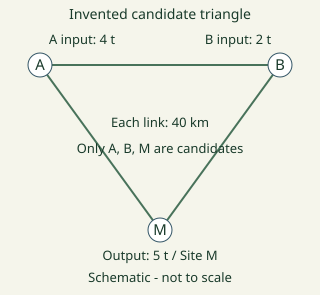
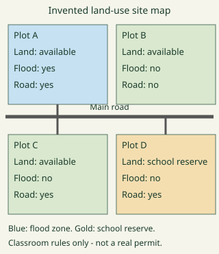
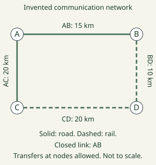

# Geography Form 5, Form Five Geography: drafts for review (Lessons 23 lessons (1–24))

Generated by `npm run review:f5-geography` from `content/form-5/geography/*.json`. Every question and drawing below was built by the engine.
All notes, teach cards, worked examples and paper tasks are **status: draft**. “Authored key” means a person fixed the
right answer (see `AUTHORED.md`); “computed by rule” means code worked it out (a formula, a conversion, a spelling rule).

Teach mode: cards (idea + example + 1 level-1 check) → worked example → practice (levels 1–3) → the note as a summary.

## Sample rendered lesson: Lesson 1 in teach mode

### Lesson 1: Manufacturing industries

**Card g5-1-c1** (draft)

> Distinguish the features before applying them.
>
> _material input: a substance used to make a product._  
> _manufacturing process: transformation or assembly that makes a product._  
> _manufactured output: a product resulting from transformation or assembly._  
> _service activity: work such as transport or retail rather than making this product._  

Check question: `g5-1-terms` · multiple choice, level 1 · **authored key**, reused from practice

> Which term means transformation or assembly that makes a product?

- ◻️ manufactured output  
  _↳ feedback if chosen: That concerns a product resulting from transformation or assembly, rather than the feature asked for._
- ◻️ material input  
  _↳ feedback if chosen: That concerns a substance used to make a product, rather than the feature asked for._
- ✅ manufacturing process
- ◻️ service activity  
  _↳ feedback if chosen: That concerns work such as transport or retail rather than making this product, rather than the feature asked for._

Full working after a second miss:

> The material is transformed into a manufactured output.  
> So the answer is “manufacturing process”.  

**Card g5-1-c2** (draft)

> Use the evidence in the example, not a place name alone.
>
> _A furniture workshop receives timber._  
> _Workers cut and join timber into tables._  
> _Finished tables leave the workshop._  
> _A carrier delivers the finished tables._  

Check question: `g5-1-cases` · multiple choice, level 1 · **authored key**, reused from practice

> Finished tables leave the workshop.
> Which feature is illustrated?

- ◻️ service activity  
  _↳ feedback if chosen: That identifies work such as transport or retail rather than making this product. Read the case for evidence of a product resulting from transformation or assembly._
- ◻️ material input  
  _↳ feedback if chosen: That identifies a substance used to make a product. Read the case for evidence of a product resulting from transformation or assembly._
- ✅ manufactured output
- ◻️ manufacturing process  
  _↳ feedback if chosen: That identifies transformation or assembly that makes a product. Read the case for evidence of a product resulting from transformation or assembly._

Full working after a second miss:

> An output is the result of the specified manufacturing process.  
> So the answer is “manufactured output”.  

**Card g5-1-c3** (draft)

> Explain how the process produces the stated effect.
>
> _Materials enter the production process._  
> _The material is transformed into a manufactured output._  
> _An output is the result of the specified manufacturing process._  
> _Delivery moves the product rather than making it._  

Check question: `g5-1-explain-card` · multiple choice, level 1 · **authored key**

> Finished tables leave the workshop.
> Which explanation follows?

- ◻️ The material is transformed into a manufactured output.  
  _↳ feedback if chosen: That explanation addresses manufacturing process, rather than the process or relationship in this case._
- ◻️ Materials enter the production process.  
  _↳ feedback if chosen: That explanation addresses material input, rather than the process or relationship in this case._
- ◻️ Delivery moves the product rather than making it.  
  _↳ feedback if chosen: That explanation addresses service activity, rather than the process or relationship in this case._
- ✅ An output is the result of the specified manufacturing process.

Full working after a second miss:

> a product resulting from transformation or assembly.  
> So the answer is “An output is the result of the specified manufacturing process.”.  

**Worked example** (draft)

> A furniture workshop receives timber. Explain the relationship.

1. a substance used to make a product.
2. Materials enter the production process.

**Answer:** material input

**Practice** (one generated question per template, easiest first)

Practice 1: `g5-1-terms` · multiple choice, level 1 · **authored key**

> Which term means a product resulting from transformation or assembly?

- ◻️ service activity  
  _↳ feedback if chosen: That concerns work such as transport or retail rather than making this product, rather than the feature asked for._
- ◻️ manufacturing process  
  _↳ feedback if chosen: That concerns transformation or assembly that makes a product, rather than the feature asked for._
- ✅ manufactured output
- ◻️ material input  
  _↳ feedback if chosen: That concerns a substance used to make a product, rather than the feature asked for._

Full working after a second miss:

> An output is the result of the specified manufacturing process.  
> So the answer is “manufactured output”.  

Practice 2: `g5-1-cases` · multiple choice, level 1 · **authored key**

> Workers cut and join timber into tables.
> Which feature is illustrated?

- ◻️ material input  
  _↳ feedback if chosen: That identifies a substance used to make a product. Read the case for evidence of transformation or assembly that makes a product._
- ✅ manufacturing process
- ◻️ manufactured output  
  _↳ feedback if chosen: That identifies a product resulting from transformation or assembly. Read the case for evidence of transformation or assembly that makes a product._
- ◻️ service activity  
  _↳ feedback if chosen: That identifies work such as transport or retail rather than making this product. Read the case for evidence of transformation or assembly that makes a product._

Full working after a second miss:

> The material is transformed into a manufactured output.  
> So the answer is “manufacturing process”.  

Practice 3: `g5-1-explain` · multiple choice, level 2 · **authored key**

> Workers cut and join timber into tables.
> Which explanation follows?

- ◻️ Materials enter the production process.  
  _↳ feedback if chosen: That explanation addresses material input, rather than the process or relationship in this case._
- ◻️ Delivery moves the product rather than making it.  
  _↳ feedback if chosen: That explanation addresses service activity, rather than the process or relationship in this case._
- ✅ The material is transformed into a manufactured output.
- ◻️ An output is the result of the specified manufacturing process.  
  _↳ feedback if chosen: That explanation addresses manufactured output, rather than the process or relationship in this case._

Full working after a second miss:

> transformation or assembly that makes a product.  
> So the answer is “The material is transformed into a manufactured output.”.  

Practice 4: `g5-1-apply` · multiple choice, level 2 · **authored key**

> Bih compares quarrying stone with making cement. Which operation transforms materials into a manufactured product?

- ◻️ Carrying cement  
  _↳ feedback if chosen: Transport moves an already made product._
- ✅ Making cement
- ◻️ Extracting stone alone  
  _↳ feedback if chosen: Extraction obtains a raw material._
- ◻️ Advertising cement  
  _↳ feedback if chosen: Advertising supplies a service._

Full working after a second miss:

> The distinction concerns the operation, not whether both firms use machinery.  
> So the answer is “Making cement”.  

Practice 5: `g5-1-assess` · spot the error, level 3 · **authored key**

> Find the incorrect geographical claim.

- ◻️ material input: a substance used to make a product.  
  _↳ explanation: This distinction is correct: Materials enter the production process. Look for a claim that reverses the process or makes an unsupported generalisation._
- ◻️ manufactured output: a product resulting from transformation or assembly.  
  _↳ explanation: This distinction is correct: An output is the result of the specified manufacturing process. Look for a claim that reverses the process or makes an unsupported generalisation._
- ◻️ manufacturing process: transformation or assembly that makes a product.  
  _↳ explanation: This distinction is correct: The material is transformed into a manufactured output. Look for a claim that reverses the process or makes an unsupported generalisation._
- ✅ The finished table is the same operation as felling a tree.  
  _↳ explanation: An output is the result of the specified manufacturing process._

Full working after a second miss:

> The wrong statement is “The finished table is the same operation as felling a tree.”.  
> An output is the result of the specified manufacturing process.  

**Summary (the note)**

> Manufacturing changes materials into new products or assembles components. A factory combines material, labour, energy and capital inputs through a process, then distributes outputs. Extraction supplies a material; it is not automatically manufacturing. Transport and retail provide services. A firm may combine these activities, so classify the operation described rather than its company name.

## All drafts

| Lesson | Title (sheet) | Status | Cards | Practice | Paper task |
|---|---|---|---|---|---|
| 1 | Manufacturing industries | draft | 3 | 5 | — |
| 2 | The Agglomeration of Industries (Meaning, Examples in the LICs & AICs, Factors for agglomeration) ) | draft | 3 | 5 | — |
| 3 | Industrialization in the LICs (characteristics, reasons for low level of industrilisation) | draft | 3 | 5 | — |
| 4 | Industrialisatiationon in AICs LICs (characteristics, reasons for high level industrilisation) | draft | 3 | 5 | — |
| 5 | Weber’s industrial location model (aims, main assumptions, some examples of areas applicable) | draft | 3 | 5 | — |
| 6 | Secondary industries in Cameroon | draft | 3 | 5 | — |
| 7 | PW 1: Location of economic activities and description of land use | draft | 3 | 5 | — |
| 8 | Communication | draft | 3 | 5 | — |
| 9 | Development of road transport | draft | 3 | 5 | — |
| 10 | O. Lesson 9: Development of Rail transport | draft | 3 | 5 | — |
| 11 | Impact of road and railway on the economy | draft | 3 | 5 | — |
| 12 | Air and Water Transport | draft | 3 | 5 | — |
| 14 | Specialized forms of Transport (MotorwaysCableways) | draft | 3 | 5 | — |
| 15 | Pipelines | draft | 3 | 5 | — |
| 16 | Globalisation | draft | 3 | 5 | — |
| 17 | Telecommunications | draft | 3 | 5 | — |
| 18 | Transport development in Cameroon | draft | 3 | 5 | — |
| 19 | Telecommunications | draft | 3 | 5 | — |
| 20 | Transport development in Cameroon | draft | 3 | 5 | — |
| 21 | PW2: Communication on maps | draft | 3 | 5 | — |
| 22 | Volume of Trade | draft | 3 | 5 | — |
| 23 | (PART 1): Trade blocs | draft | 3 | 5 | — |
| 24 | (PART 2) : Trade blocs | draft | 3 | 5 | — |

## Lesson 1: Manufacturing industries

Prerequisites: none · Skill: g5-1 (Manufacturing industries)

**Note** (draft)

> Manufacturing changes materials into new products or assembles components. A factory combines material, labour, energy and capital inputs through a process, then distributes outputs. Extraction supplies a material; it is not automatically manufacturing. Transport and retail provide services. A firm may combine these activities, so classify the operation described rather than its company name.

**Learn: Your goal and connections** (draft)

> By the end, you should be able to classify an activity from its transformation of inputs into manufactured outputs. Builds on: Form Four economic activities. Leads to: industrial clusters and location.

**Learn: Explain the geography** (draft)

> Manufacturing changes materials into new products or assembles components. A factory combines material, labour, energy and capital inputs through a process, then distributes outputs. Extraction supplies a material; it is not automatically manufacturing. Transport and retail provide services. A firm may combine these activities, so classify the operation described rather than its company name.

**Learn: Follow the local example or model** (draft)

> In an invented Douala enterprise, timber is delivered to a workshop, cut and joined into tables, then carried to shops. Making the tables is manufacturing. Felling the trees is primary production; carrying tables is transport; selling them is retail. Waste and energy use also belong in the production account.

**Learn: Apply and check** (draft)

> Name the input, describe the transformation, then name the output. Check whether the case instead extracts a resource or provides a service. Explain the process before choosing its sector.

**Learn: key words and examples** (draft)

- **material input**: a substance used to make a product
- **manufacturing process**: transformation or assembly that makes a product
- **manufactured output**: a product resulting from transformation or assembly
- **service activity**: work such as transport or retail rather than making this product

Common mistake: “An input must always be a finished retail product.” → “a substance used to make a product.”. Materials enter the production process.

**Card g5-1-c1** (draft)

> Distinguish the features before applying them.
>
> _material input: a substance used to make a product._  
> _manufacturing process: transformation or assembly that makes a product._  
> _manufactured output: a product resulting from transformation or assembly._  
> _service activity: work such as transport or retail rather than making this product._  

Check question: `g5-1-terms` · multiple choice, level 1 · **authored key**, reused from practice

> Which term means a product resulting from transformation or assembly?

- ◻️ manufacturing process  
  _↳ feedback if chosen: That concerns transformation or assembly that makes a product, rather than the feature asked for._
- ✅ manufactured output
- ◻️ material input  
  _↳ feedback if chosen: That concerns a substance used to make a product, rather than the feature asked for._
- ◻️ service activity  
  _↳ feedback if chosen: That concerns work such as transport or retail rather than making this product, rather than the feature asked for._

Full working after a second miss:

> An output is the result of the specified manufacturing process.  
> So the answer is “manufactured output”.  

**Card g5-1-c2** (draft)

> Use the evidence in the example, not a place name alone.
>
> _A furniture workshop receives timber._  
> _Workers cut and join timber into tables._  
> _Finished tables leave the workshop._  
> _A carrier delivers the finished tables._  

Check question: `g5-1-cases` · multiple choice, level 1 · **authored key**, reused from practice

> Finished tables leave the workshop.
> Which feature is illustrated?

- ◻️ material input  
  _↳ feedback if chosen: That identifies a substance used to make a product. Read the case for evidence of a product resulting from transformation or assembly._
- ◻️ manufacturing process  
  _↳ feedback if chosen: That identifies transformation or assembly that makes a product. Read the case for evidence of a product resulting from transformation or assembly._
- ✅ manufactured output
- ◻️ service activity  
  _↳ feedback if chosen: That identifies work such as transport or retail rather than making this product. Read the case for evidence of a product resulting from transformation or assembly._

Full working after a second miss:

> An output is the result of the specified manufacturing process.  
> So the answer is “manufactured output”.  

**Card g5-1-c3** (draft)

> Explain how the process produces the stated effect.
>
> _Materials enter the production process._  
> _The material is transformed into a manufactured output._  
> _An output is the result of the specified manufacturing process._  
> _Delivery moves the product rather than making it._  

Check question: `g5-1-explain-card` · multiple choice, level 1 · **authored key**

> Finished tables leave the workshop.
> Which explanation follows?

- ◻️ The material is transformed into a manufactured output.  
  _↳ feedback if chosen: That explanation addresses manufacturing process, rather than the process or relationship in this case._
- ◻️ Delivery moves the product rather than making it.  
  _↳ feedback if chosen: That explanation addresses service activity, rather than the process or relationship in this case._
- ✅ An output is the result of the specified manufacturing process.
- ◻️ Materials enter the production process.  
  _↳ feedback if chosen: That explanation addresses material input, rather than the process or relationship in this case._

Full working after a second miss:

> a product resulting from transformation or assembly.  
> So the answer is “An output is the result of the specified manufacturing process.”.  

**Worked example** (draft)

> A furniture workshop receives timber. Explain the relationship.

1. a substance used to make a product.
2. Materials enter the production process.

**Answer:** material input

**Practice** `g5-1-terms` · multiple choice, level 1 · **authored key**

> Which term means transformation or assembly that makes a product?

- ◻️ manufactured output  
  _↳ feedback if chosen: That concerns a product resulting from transformation or assembly, rather than the feature asked for._
- ◻️ service activity  
  _↳ feedback if chosen: That concerns work such as transport or retail rather than making this product, rather than the feature asked for._
- ✅ manufacturing process
- ◻️ material input  
  _↳ feedback if chosen: That concerns a substance used to make a product, rather than the feature asked for._

Full working after a second miss:

> The material is transformed into a manufactured output.  
> So the answer is “manufacturing process”.  

> Which term means a substance used to make a product?

- ◻️ service activity  
  _↳ feedback if chosen: That concerns work such as transport or retail rather than making this product, rather than the feature asked for._
- ◻️ manufacturing process  
  _↳ feedback if chosen: That concerns transformation or assembly that makes a product, rather than the feature asked for._
- ✅ material input
- ◻️ manufactured output  
  _↳ feedback if chosen: That concerns a product resulting from transformation or assembly, rather than the feature asked for._

Full working after a second miss:

> Materials enter the production process.  
> So the answer is “material input”.  

**Practice** `g5-1-cases` · multiple choice, level 1 · **authored key**

> Finished tables leave the workshop.
> Which feature is illustrated?

- ◻️ manufacturing process  
  _↳ feedback if chosen: That identifies transformation or assembly that makes a product. Read the case for evidence of a product resulting from transformation or assembly._
- ◻️ service activity  
  _↳ feedback if chosen: That identifies work such as transport or retail rather than making this product. Read the case for evidence of a product resulting from transformation or assembly._
- ✅ manufactured output
- ◻️ material input  
  _↳ feedback if chosen: That identifies a substance used to make a product. Read the case for evidence of a product resulting from transformation or assembly._

Full working after a second miss:

> An output is the result of the specified manufacturing process.  
> So the answer is “manufactured output”.  

> Finished tables leave the workshop.
> Which feature is illustrated?

- ◻️ manufacturing process  
  _↳ feedback if chosen: That identifies transformation or assembly that makes a product. Read the case for evidence of a product resulting from transformation or assembly._
- ◻️ service activity  
  _↳ feedback if chosen: That identifies work such as transport or retail rather than making this product. Read the case for evidence of a product resulting from transformation or assembly._
- ◻️ material input  
  _↳ feedback if chosen: That identifies a substance used to make a product. Read the case for evidence of a product resulting from transformation or assembly._
- ✅ manufactured output

Full working after a second miss:

> An output is the result of the specified manufacturing process.  
> So the answer is “manufactured output”.  

**Practice** `g5-1-explain` · multiple choice, level 2 · **authored key**

> A carrier delivers the finished tables.
> Which explanation follows?

- ◻️ Materials enter the production process.  
  _↳ feedback if chosen: That explanation addresses material input, rather than the process or relationship in this case._
- ◻️ An output is the result of the specified manufacturing process.  
  _↳ feedback if chosen: That explanation addresses manufactured output, rather than the process or relationship in this case._
- ◻️ The material is transformed into a manufactured output.  
  _↳ feedback if chosen: That explanation addresses manufacturing process, rather than the process or relationship in this case._
- ✅ Delivery moves the product rather than making it.

Full working after a second miss:

> work such as transport or retail rather than making this product.  
> So the answer is “Delivery moves the product rather than making it.”.  

> A furniture workshop receives timber.
> Which explanation follows?

- ◻️ An output is the result of the specified manufacturing process.  
  _↳ feedback if chosen: That explanation addresses manufactured output, rather than the process or relationship in this case._
- ◻️ Delivery moves the product rather than making it.  
  _↳ feedback if chosen: That explanation addresses service activity, rather than the process or relationship in this case._
- ✅ Materials enter the production process.
- ◻️ The material is transformed into a manufactured output.  
  _↳ feedback if chosen: That explanation addresses manufacturing process, rather than the process or relationship in this case._

Full working after a second miss:

> a substance used to make a product.  
> So the answer is “Materials enter the production process.”.  

**Practice** `g5-1-apply` · multiple choice, level 2 · **authored key**

> An invented firm washes, presses and packages fruit as juice. Which operation is manufacturing?

- ◻️ Carrying sealed cartons  
  _↳ feedback if chosen: Carrying goods is a transport service._
- ◻️ Selling the cartons  
  _↳ feedback if chosen: Selling is distribution rather than processing._
- ◻️ Growing the fruit  
  _↳ feedback if chosen: Growing fruit is primary production._
- ✅ Processing fruit into packaged juice

Full working after a second miss:

> Fruit is transformed into a different marketable product.  
> So the answer is “Processing fruit into packaged juice”.  

> An invented firm washes, presses and packages fruit as juice. Which operation is manufacturing?

- ◻️ Growing the fruit  
  _↳ feedback if chosen: Growing fruit is primary production._
- ◻️ Selling the cartons  
  _↳ feedback if chosen: Selling is distribution rather than processing._
- ◻️ Carrying sealed cartons  
  _↳ feedback if chosen: Carrying goods is a transport service._
- ✅ Processing fruit into packaged juice

Full working after a second miss:

> Fruit is transformed into a different marketable product.  
> So the answer is “Processing fruit into packaged juice”.  

**Practice** `g5-1-assess` · spot the error, level 3 · **authored key**

> Find the incorrect geographical claim.

- ◻️ manufacturing process: transformation or assembly that makes a product.  
  _↳ explanation: This distinction is correct: The material is transformed into a manufactured output. Look for a claim that reverses the process or makes an unsupported generalisation._
- ◻️ manufactured output: a product resulting from transformation or assembly.  
  _↳ explanation: This distinction is correct: An output is the result of the specified manufacturing process. Look for a claim that reverses the process or makes an unsupported generalisation._
- ◻️ service activity: work such as transport or retail rather than making this product.  
  _↳ explanation: This distinction is correct: Delivery moves the product rather than making it. Look for a claim that reverses the process or makes an unsupported generalisation._
- ✅ Cutting and assembling a table is retail alone.  
  _↳ explanation: The material is transformed into a manufactured output._

Full working after a second miss:

> The wrong statement is “Cutting and assembling a table is retail alone.”.  
> The material is transformed into a manufactured output.  

> Find the incorrect geographical claim.

- ◻️ service activity: work such as transport or retail rather than making this product.  
  _↳ explanation: This distinction is correct: Delivery moves the product rather than making it. Look for a claim that reverses the process or makes an unsupported generalisation._
- ◻️ material input: a substance used to make a product.  
  _↳ explanation: This distinction is correct: Materials enter the production process. Look for a claim that reverses the process or makes an unsupported generalisation._
- ◻️ manufacturing process: transformation or assembly that makes a product.  
  _↳ explanation: This distinction is correct: The material is transformed into a manufactured output. Look for a claim that reverses the process or makes an unsupported generalisation._
- ✅ The finished table is the same operation as felling a tree.  
  _↳ explanation: An output is the result of the specified manufacturing process._

Full working after a second miss:

> The wrong statement is “The finished table is the same operation as felling a tree.”.  
> An output is the result of the specified manufacturing process.  

## Lesson 2: The Agglomeration of Industries (Meaning, Examples in the LICs & AICs, Factors for agglomeration) )

Prerequisites: 1 · Skill: g5-2 (Agglomeration industries)

**Note** (draft)

> Agglomeration is the concentration of related firms and supporting activities. Shared suppliers, specialist workers, infrastructure and knowledge can reduce costs or improve coordination. A cluster is not simply any large city. Congestion, expensive land and pollution can create diseconomies. Benefits depend on actual links, capacity and management; clustering does not guarantee success.

**Learn: Your goal and connections** (draft)

> By the end, you should be able to explain a cluster benefit and a possible cost using evidence. Builds on: manufacturing inputs and services. Leads to: industrial development and location.

**Learn: Explain the geography** (draft)

> Agglomeration is the concentration of related firms and supporting activities. Shared suppliers, specialist workers, infrastructure and knowledge can reduce costs or improve coordination. A cluster is not simply any large city. Congestion, expensive land and pollution can create diseconomies. Benefits depend on actual links, capacity and management; clustering does not guarantee success.

**Learn: Follow the local example or model** (draft)

> Uganda Investment Authority lists industrial parks including Jinja. A serviced park can bring firms near shared infrastructure, but a proposed advantage is not proof of every firm’s performance. The historic Zollverein complex at Essen in Germany illustrates links between production, rail and worker settlements in an older industrial region. These are different contexts, not identical development paths.

**Learn: Apply and check** (draft)

> Identify what is shared and explain the mechanism. Then ask whether congestion or pressure on services could offset the saving. Separate a planned park, an operating cluster and a historical industrial landscape.

**Learn: key words and examples** (draft)

- **supplier linkage**: nearby firms supplying inputs or specialist services
- **labour pool**: a concentration of workers with relevant skills
- **shared infrastructure**: facilities serving several activities
- **agglomeration diseconomy**: a cost caused by excessive concentration or pressure

Common mistake: “Nearby firms never purchase services from each other.” → “nearby firms supplying inputs or specialist services.”. Proximity can support repeated specialist transactions.

**Card g5-2-c1** (draft)

> Distinguish the features before applying them.
>
> _supplier linkage: nearby firms supplying inputs or specialist services._  
> _labour pool: a concentration of workers with relevant skills._  
> _shared infrastructure: facilities serving several activities._  
> _agglomeration diseconomy: a cost caused by excessive concentration or pressure._  

Check question: `g5-2-terms` · multiple choice, level 1 · **authored key**, reused from practice

> Which term means a cost caused by excessive concentration or pressure?

- ◻️ shared infrastructure  
  _↳ feedback if chosen: That concerns facilities serving several activities, rather than the feature asked for._
- ✅ agglomeration diseconomy
- ◻️ labour pool  
  _↳ feedback if chosen: That concerns a concentration of workers with relevant skills, rather than the feature asked for._
- ◻️ supplier linkage  
  _↳ feedback if chosen: That concerns nearby firms supplying inputs or specialist services, rather than the feature asked for._

Full working after a second miss:

> Congestion can offset some benefits of proximity.  
> So the answer is “agglomeration diseconomy”.  

**Card g5-2-c2** (draft)

> Use the evidence in the example, not a place name alone.
>
> _An invented cluster shares a machinery-repair business._  
> _Several workshops recruit locally trained technicians._  
> _Firms use a common serviced access road._  
> _Delivery vehicles lose time in congestion._  

Check question: `g5-2-cases` · multiple choice, level 1 · **authored key**, reused from practice

> Firms use a common serviced access road.
> Which feature is illustrated?

- ◻️ agglomeration diseconomy  
  _↳ feedback if chosen: That identifies a cost caused by excessive concentration or pressure. Read the case for evidence of facilities serving several activities._
- ◻️ supplier linkage  
  _↳ feedback if chosen: That identifies nearby firms supplying inputs or specialist services. Read the case for evidence of facilities serving several activities._
- ✅ shared infrastructure
- ◻️ labour pool  
  _↳ feedback if chosen: That identifies a concentration of workers with relevant skills. Read the case for evidence of facilities serving several activities._

Full working after a second miss:

> Infrastructure can support activity without guaranteeing profit.  
> So the answer is “shared infrastructure”.  

**Card g5-2-c3** (draft)

> Explain how the process produces the stated effect.
>
> _Proximity can support repeated specialist transactions._  
> _Skills may be easier to find but wages still matter._  
> _Infrastructure can support activity without guaranteeing profit._  
> _Congestion can offset some benefits of proximity._  

Check question: `g5-2-explain-card` · multiple choice, level 1 · **authored key**

> Several workshops recruit locally trained technicians.
> Which explanation follows?

- ✅ Skills may be easier to find but wages still matter.
- ◻️ Proximity can support repeated specialist transactions.  
  _↳ feedback if chosen: That explanation addresses supplier linkage, rather than the process or relationship in this case._
- ◻️ Infrastructure can support activity without guaranteeing profit.  
  _↳ feedback if chosen: That explanation addresses shared infrastructure, rather than the process or relationship in this case._
- ◻️ Congestion can offset some benefits of proximity.  
  _↳ feedback if chosen: That explanation addresses agglomeration diseconomy, rather than the process or relationship in this case._

Full working after a second miss:

> a concentration of workers with relevant skills.  
> So the answer is “Skills may be easier to find but wages still matter.”.  

**Worked example** (draft)

> An invented cluster shares a machinery-repair business. Explain the relationship.

1. nearby firms supplying inputs or specialist services.
2. Proximity can support repeated specialist transactions.

**Answer:** supplier linkage

**Practice** `g5-2-terms` · multiple choice, level 1 · **authored key**

> Which term means a cost caused by excessive concentration or pressure?

- ◻️ shared infrastructure  
  _↳ feedback if chosen: That concerns facilities serving several activities, rather than the feature asked for._
- ✅ agglomeration diseconomy
- ◻️ supplier linkage  
  _↳ feedback if chosen: That concerns nearby firms supplying inputs or specialist services, rather than the feature asked for._
- ◻️ labour pool  
  _↳ feedback if chosen: That concerns a concentration of workers with relevant skills, rather than the feature asked for._

Full working after a second miss:

> Congestion can offset some benefits of proximity.  
> So the answer is “agglomeration diseconomy”.  

> Which term means nearby firms supplying inputs or specialist services?

- ◻️ agglomeration diseconomy  
  _↳ feedback if chosen: That concerns a cost caused by excessive concentration or pressure, rather than the feature asked for._
- ◻️ labour pool  
  _↳ feedback if chosen: That concerns a concentration of workers with relevant skills, rather than the feature asked for._
- ✅ supplier linkage
- ◻️ shared infrastructure  
  _↳ feedback if chosen: That concerns facilities serving several activities, rather than the feature asked for._

Full working after a second miss:

> Proximity can support repeated specialist transactions.  
> So the answer is “supplier linkage”.  

**Practice** `g5-2-cases` · multiple choice, level 1 · **authored key**

> An invented cluster shares a machinery-repair business.
> Which feature is illustrated?

- ◻️ shared infrastructure  
  _↳ feedback if chosen: That identifies facilities serving several activities. Read the case for evidence of nearby firms supplying inputs or specialist services._
- ✅ supplier linkage
- ◻️ agglomeration diseconomy  
  _↳ feedback if chosen: That identifies a cost caused by excessive concentration or pressure. Read the case for evidence of nearby firms supplying inputs or specialist services._
- ◻️ labour pool  
  _↳ feedback if chosen: That identifies a concentration of workers with relevant skills. Read the case for evidence of nearby firms supplying inputs or specialist services._

Full working after a second miss:

> Proximity can support repeated specialist transactions.  
> So the answer is “supplier linkage”.  

> Delivery vehicles lose time in congestion.
> Which feature is illustrated?

- ◻️ shared infrastructure  
  _↳ feedback if chosen: That identifies facilities serving several activities. Read the case for evidence of a cost caused by excessive concentration or pressure._
- ◻️ supplier linkage  
  _↳ feedback if chosen: That identifies nearby firms supplying inputs or specialist services. Read the case for evidence of a cost caused by excessive concentration or pressure._
- ✅ agglomeration diseconomy
- ◻️ labour pool  
  _↳ feedback if chosen: That identifies a concentration of workers with relevant skills. Read the case for evidence of a cost caused by excessive concentration or pressure._

Full working after a second miss:

> Congestion can offset some benefits of proximity.  
> So the answer is “agglomeration diseconomy”.  

**Practice** `g5-2-explain` · multiple choice, level 2 · **authored key**

> An invented cluster shares a machinery-repair business.
> Which explanation follows?

- ◻️ Infrastructure can support activity without guaranteeing profit.  
  _↳ feedback if chosen: That explanation addresses shared infrastructure, rather than the process or relationship in this case._
- ✅ Proximity can support repeated specialist transactions.
- ◻️ Congestion can offset some benefits of proximity.  
  _↳ feedback if chosen: That explanation addresses agglomeration diseconomy, rather than the process or relationship in this case._
- ◻️ Skills may be easier to find but wages still matter.  
  _↳ feedback if chosen: That explanation addresses labour pool, rather than the process or relationship in this case._

Full working after a second miss:

> nearby firms supplying inputs or specialist services.  
> So the answer is “Proximity can support repeated specialist transactions.”.  

> An invented cluster shares a machinery-repair business.
> Which explanation follows?

- ◻️ Skills may be easier to find but wages still matter.  
  _↳ feedback if chosen: That explanation addresses labour pool, rather than the process or relationship in this case._
- ✅ Proximity can support repeated specialist transactions.
- ◻️ Congestion can offset some benefits of proximity.  
  _↳ feedback if chosen: That explanation addresses agglomeration diseconomy, rather than the process or relationship in this case._
- ◻️ Infrastructure can support activity without guaranteeing profit.  
  _↳ feedback if chosen: That explanation addresses shared infrastructure, rather than the process or relationship in this case._

Full working after a second miss:

> nearby firms supplying inputs or specialist services.  
> So the answer is “Proximity can support repeated specialist transactions.”.  

**Practice** `g5-2-apply` · multiple choice, level 2 · **authored key**

> A map shows many unrelated buildings with no evidence of supplier or labour links. What can be concluded?

- ✅ Concentration is visible; the claimed linkages need evidence
- ◻️ The place has no service needs  
  _↳ feedback if chosen: Concentrated activity still needs services._
- ◻️ All firms have identical profits  
  _↳ feedback if chosen: Profit needs financial evidence._
- ◻️ All firms share specialist suppliers  
  _↳ feedback if chosen: The map alone does not show purchases._

Full working after a second miss:

> Do not infer every cluster benefit from proximity alone.  
> So the answer is “Concentration is visible; the claimed linkages need evidence”.  

> Fictional workshops share a repair supplier. Why might clustering help?

- ◻️ All inputs become free  
  _↳ feedback if chosen: Shared access still has a cost._
- ✅ Specialist repair services can serve several nearby customers
- ◻️ Every firm must make the same product  
  _↳ feedback if chosen: Related firms can perform different operations._
- ◻️ Competition disappears  
  _↳ feedback if chosen: Proximity can increase competition._

Full working after a second miss:

> A shared supplier is a mechanism, not a guarantee.  
> So the answer is “Specialist repair services can serve several nearby customers”.  

**Practice** `g5-2-assess` · spot the error, level 3 · **authored key**

> Find the incorrect geographical claim.

- ◻️ shared infrastructure: facilities serving several activities.  
  _↳ explanation: This distinction is correct: Infrastructure can support activity without guaranteeing profit. Look for a claim that reverses the process or makes an unsupported generalisation._
- ✅ A labour pool means all workers are free of cost.  
  _↳ explanation: Skills may be easier to find but wages still matter._
- ◻️ agglomeration diseconomy: a cost caused by excessive concentration or pressure.  
  _↳ explanation: This distinction is correct: Congestion can offset some benefits of proximity. Look for a claim that reverses the process or makes an unsupported generalisation._
- ◻️ labour pool: a concentration of workers with relevant skills.  
  _↳ explanation: This distinction is correct: Skills may be easier to find but wages still matter. Look for a claim that reverses the process or makes an unsupported generalisation._

Full working after a second miss:

> The wrong statement is “A labour pool means all workers are free of cost.”.  
> Skills may be easier to find but wages still matter.  

> Find the incorrect geographical claim.

- ◻️ shared infrastructure: facilities serving several activities.  
  _↳ explanation: This distinction is correct: Infrastructure can support activity without guaranteeing profit. Look for a claim that reverses the process or makes an unsupported generalisation._
- ◻️ labour pool: a concentration of workers with relevant skills.  
  _↳ explanation: This distinction is correct: Skills may be easier to find but wages still matter. Look for a claim that reverses the process or makes an unsupported generalisation._
- ◻️ supplier linkage: nearby firms supplying inputs or specialist services.  
  _↳ explanation: This distinction is correct: Proximity can support repeated specialist transactions. Look for a claim that reverses the process or makes an unsupported generalisation._
- ✅ Nearby firms never purchase services from each other.  
  _↳ explanation: Proximity can support repeated specialist transactions._

Full working after a second miss:

> The wrong statement is “Nearby firms never purchase services from each other.”.  
> Proximity can support repeated specialist transactions.  

## Lesson 3: Industrialization in the LICs (characteristics, reasons for low level of industrilisation)

Prerequisites: 2 · Skill: g5-3 (Industrialisation in less industrialised economies)

**Note** (draft)

> Industrialisation expands manufacturing capabilities and their links to the economy. Reliable electricity, skills, transport, finance and markets can support it. Where any of these is restricted, firms may face higher costs or uncertain output. These are conditions to investigate, not fixed qualities of a population. Resource exports can coexist with limited local processing.

**Learn: Your goal and connections** (draft)

> By the end, you should be able to explain how a stated constraint can limit manufacturing and propose a relevant response. Builds on: inputs and agglomeration. Leads to: comparison with advanced industrial profiles.

**Learn: Explain the geography** (draft)

> Industrialisation expands manufacturing capabilities and their links to the economy. Reliable electricity, skills, transport, finance and markets can support it. Where any of these is restricted, firms may face higher costs or uncertain output. These are conditions to investigate, not fixed qualities of a population. Resource exports can coexist with limited local processing.

**Learn: Follow the local example or model** (draft)

> In an invented processing business near Bafoussam, unreliable electricity interrupts machinery and poor roads delay inputs. Improved power reliability addresses one constraint; it does not automatically solve roads or finance. World Bank income groups measure income per person, not industrial structure. In its FY2027 table Uganda is low income and Cameroon lower-middle income; neither label describes every factory.

**Learn: Apply and check** (draft)

> Use a chain: constraint, effect on production, possible response, remaining limitation. Avoid treating income labels and industrial categories as interchangeable. Compare evidence within and between places.

**Learn: key words and examples** (draft)

- **power constraint**: unreliable energy supply interrupting production
- **transport constraint**: cost or unreliability in moving inputs and outputs
- **skills constraint**: a shortage of relevant technical capabilities
- **finance constraint**: limited access to funds for viable equipment or working needs

Common mistake: “Every interruption proves workers lack ability.” → “unreliable energy supply interrupting production.”. Energy reliability can limit output independently of workers’ ability.

**Card g5-3-c1** (draft)

> Distinguish the features before applying them.
>
> _power constraint: unreliable energy supply interrupting production._  
> _transport constraint: cost or unreliability in moving inputs and outputs._  
> _skills constraint: a shortage of relevant technical capabilities._  
> _finance constraint: limited access to funds for viable equipment or working needs._  

Check question: `g5-3-terms` · multiple choice, level 1 · **authored key**, reused from practice

> Which term means cost or unreliability in moving inputs and outputs?

- ◻️ finance constraint  
  _↳ feedback if chosen: That concerns limited access to funds for viable equipment or working needs, rather than the feature asked for._
- ◻️ power constraint  
  _↳ feedback if chosen: That concerns unreliable energy supply interrupting production, rather than the feature asked for._
- ✅ transport constraint
- ◻️ skills constraint  
  _↳ feedback if chosen: That concerns a shortage of relevant technical capabilities, rather than the feature asked for._

Full working after a second miss:

> Production also depends on links beyond the factory.  
> So the answer is “transport constraint”.  

**Card g5-3-c2** (draft)

> Use the evidence in the example, not a place name alone.
>
> _Machinery stops during outages in an invented workshop._  
> _Inputs arrive late over an unreliable access route._  
> _A firm cannot find technicians to maintain its equipment._  
> _A processor cannot fund suitable machinery._  

Check question: `g5-3-cases` · multiple choice, level 1 · **authored key**, reused from practice

> Inputs arrive late over an unreliable access route.
> Which feature is illustrated?

- ◻️ finance constraint  
  _↳ feedback if chosen: That identifies limited access to funds for viable equipment or working needs. Read the case for evidence of cost or unreliability in moving inputs and outputs._
- ◻️ power constraint  
  _↳ feedback if chosen: That identifies unreliable energy supply interrupting production. Read the case for evidence of cost or unreliability in moving inputs and outputs._
- ◻️ skills constraint  
  _↳ feedback if chosen: That identifies a shortage of relevant technical capabilities. Read the case for evidence of cost or unreliability in moving inputs and outputs._
- ✅ transport constraint

Full working after a second miss:

> Production also depends on links beyond the factory.  
> So the answer is “transport constraint”.  

**Card g5-3-c3** (draft)

> Explain how the process produces the stated effect.
>
> _Energy reliability can limit output independently of workers’ ability._  
> _Production also depends on links beyond the factory._  
> _Relevant training can help, but demand and other constraints remain._  
> _Resources and accessible investment finance are different._  

Check question: `g5-3-explain-card` · multiple choice, level 1 · **authored key**

> A processor cannot fund suitable machinery.
> Which explanation follows?

- ◻️ Relevant training can help, but demand and other constraints remain.  
  _↳ feedback if chosen: That explanation addresses skills constraint, rather than the process or relationship in this case._
- ◻️ Energy reliability can limit output independently of workers’ ability.  
  _↳ feedback if chosen: That explanation addresses power constraint, rather than the process or relationship in this case._
- ◻️ Production also depends on links beyond the factory.  
  _↳ feedback if chosen: That explanation addresses transport constraint, rather than the process or relationship in this case._
- ✅ Resources and accessible investment finance are different.

Full working after a second miss:

> limited access to funds for viable equipment or working needs.  
> So the answer is “Resources and accessible investment finance are different.”.  

**Worked example** (draft)

> Machinery stops during outages in an invented workshop. Explain the relationship.

1. unreliable energy supply interrupting production.
2. Energy reliability can limit output independently of workers’ ability.

**Answer:** power constraint

**Practice** `g5-3-terms` · multiple choice, level 1 · **authored key**

> Which term means limited access to funds for viable equipment or working needs?

- ◻️ power constraint  
  _↳ feedback if chosen: That concerns unreliable energy supply interrupting production, rather than the feature asked for._
- ◻️ transport constraint  
  _↳ feedback if chosen: That concerns cost or unreliability in moving inputs and outputs, rather than the feature asked for._
- ✅ finance constraint
- ◻️ skills constraint  
  _↳ feedback if chosen: That concerns a shortage of relevant technical capabilities, rather than the feature asked for._

Full working after a second miss:

> Resources and accessible investment finance are different.  
> So the answer is “finance constraint”.  

> Which term means unreliable energy supply interrupting production?

- ✅ power constraint
- ◻️ transport constraint  
  _↳ feedback if chosen: That concerns cost or unreliability in moving inputs and outputs, rather than the feature asked for._
- ◻️ skills constraint  
  _↳ feedback if chosen: That concerns a shortage of relevant technical capabilities, rather than the feature asked for._
- ◻️ finance constraint  
  _↳ feedback if chosen: That concerns limited access to funds for viable equipment or working needs, rather than the feature asked for._

Full working after a second miss:

> Energy reliability can limit output independently of workers’ ability.  
> So the answer is “power constraint”.  

**Practice** `g5-3-cases` · multiple choice, level 1 · **authored key**

> A processor cannot fund suitable machinery.
> Which feature is illustrated?

- ◻️ skills constraint  
  _↳ feedback if chosen: That identifies a shortage of relevant technical capabilities. Read the case for evidence of limited access to funds for viable equipment or working needs._
- ◻️ transport constraint  
  _↳ feedback if chosen: That identifies cost or unreliability in moving inputs and outputs. Read the case for evidence of limited access to funds for viable equipment or working needs._
- ✅ finance constraint
- ◻️ power constraint  
  _↳ feedback if chosen: That identifies unreliable energy supply interrupting production. Read the case for evidence of limited access to funds for viable equipment or working needs._

Full working after a second miss:

> Resources and accessible investment finance are different.  
> So the answer is “finance constraint”.  

> Inputs arrive late over an unreliable access route.
> Which feature is illustrated?

- ◻️ power constraint  
  _↳ feedback if chosen: That identifies unreliable energy supply interrupting production. Read the case for evidence of cost or unreliability in moving inputs and outputs._
- ◻️ skills constraint  
  _↳ feedback if chosen: That identifies a shortage of relevant technical capabilities. Read the case for evidence of cost or unreliability in moving inputs and outputs._
- ✅ transport constraint
- ◻️ finance constraint  
  _↳ feedback if chosen: That identifies limited access to funds for viable equipment or working needs. Read the case for evidence of cost or unreliability in moving inputs and outputs._

Full working after a second miss:

> Production also depends on links beyond the factory.  
> So the answer is “transport constraint”.  

**Practice** `g5-3-explain` · multiple choice, level 2 · **authored key**

> A processor cannot fund suitable machinery.
> Which explanation follows?

- ✅ Resources and accessible investment finance are different.
- ◻️ Energy reliability can limit output independently of workers’ ability.  
  _↳ feedback if chosen: That explanation addresses power constraint, rather than the process or relationship in this case._
- ◻️ Production also depends on links beyond the factory.  
  _↳ feedback if chosen: That explanation addresses transport constraint, rather than the process or relationship in this case._
- ◻️ Relevant training can help, but demand and other constraints remain.  
  _↳ feedback if chosen: That explanation addresses skills constraint, rather than the process or relationship in this case._

Full working after a second miss:

> limited access to funds for viable equipment or working needs.  
> So the answer is “Resources and accessible investment finance are different.”.  

> A firm cannot find technicians to maintain its equipment.
> Which explanation follows?

- ✅ Relevant training can help, but demand and other constraints remain.
- ◻️ Energy reliability can limit output independently of workers’ ability.  
  _↳ feedback if chosen: That explanation addresses power constraint, rather than the process or relationship in this case._
- ◻️ Production also depends on links beyond the factory.  
  _↳ feedback if chosen: That explanation addresses transport constraint, rather than the process or relationship in this case._
- ◻️ Resources and accessible investment finance are different.  
  _↳ feedback if chosen: That explanation addresses finance constraint, rather than the process or relationship in this case._

Full working after a second miss:

> a shortage of relevant technical capabilities.  
> So the answer is “Relevant training can help, but demand and other constraints remain.”.  

**Practice** `g5-3-apply` · multiple choice, level 2 · **authored key**

> A fictional machine repeatedly stops because supply voltage fails. Which response directly targets the stated constraint?

- ✅ Improve reliable power provision
- ◻️ Open an unrelated shop  
  _↳ feedback if chosen: An unrelated shop does not power the machine._
- ◻️ Change only the company logo  
  _↳ feedback if chosen: A logo does not restore electricity._
- ◻️ Assume workers are unwilling  
  _↳ feedback if chosen: The evidence identifies electricity, not motivation._

Full working after a second miss:

> Match the intervention to the observed mechanism.  
> So the answer is “Improve reliable power provision”.  

> A report calls Cameroon a World Bank low-income country and treats that as a manufacturing measure. What correction is needed?

- ◻️ Only factory names determine income classification  
  _↳ feedback if chosen: The income grouping uses income per person._
- ◻️ Every country has the same industrial structure  
  _↳ feedback if chosen: Industrial structures vary._
- ✅ The FY2027 income label is lower-middle income; industrial structure requires separate evidence
- ◻️ Income and industry are identical measures  
  _↳ feedback if chosen: Income groups and industrial measures answer different questions._

Full working after a second miss:

> Use the dated income classification accurately and assess industry separately.  
> So the answer is “The FY2027 income label is lower-middle income; industrial structure requires separate evidence”.  

**Practice** `g5-3-assess` · spot the error, level 3 · **authored key**

> Find the incorrect geographical claim.

- ◻️ skills constraint: a shortage of relevant technical capabilities.  
  _↳ explanation: This distinction is correct: Relevant training can help, but demand and other constraints remain. Look for a claim that reverses the process or makes an unsupported generalisation._
- ◻️ transport constraint: cost or unreliability in moving inputs and outputs.  
  _↳ explanation: This distinction is correct: Production also depends on links beyond the factory. Look for a claim that reverses the process or makes an unsupported generalisation._
- ◻️ finance constraint: limited access to funds for viable equipment or working needs.  
  _↳ explanation: This distinction is correct: Resources and accessible investment finance are different. Look for a claim that reverses the process or makes an unsupported generalisation._
- ✅ Any training guarantees an immediate job for everyone.  
  _↳ explanation: Relevant training can help, but demand and other constraints remain._

Full working after a second miss:

> The wrong statement is “Any training guarantees an immediate job for everyone.”.  
> Relevant training can help, but demand and other constraints remain.  

> Find the incorrect geographical claim.

- ◻️ transport constraint: cost or unreliability in moving inputs and outputs.  
  _↳ explanation: This distinction is correct: Production also depends on links beyond the factory. Look for a claim that reverses the process or makes an unsupported generalisation._
- ✅ Every interruption proves workers lack ability.  
  _↳ explanation: Energy reliability can limit output independently of workers’ ability._
- ◻️ skills constraint: a shortage of relevant technical capabilities.  
  _↳ explanation: This distinction is correct: Relevant training can help, but demand and other constraints remain. Look for a claim that reverses the process or makes an unsupported generalisation._
- ◻️ power constraint: unreliable energy supply interrupting production.  
  _↳ explanation: This distinction is correct: Energy reliability can limit output independently of workers’ ability. Look for a claim that reverses the process or makes an unsupported generalisation._

Full working after a second miss:

> The wrong statement is “Every interruption proves workers lack ability.”.  
> Energy reliability can limit output independently of workers’ ability.  

## Lesson 4: Industrialisatiationon in AICs LICs (characteristics, reasons for high level industrilisation)

Prerequisites: 3 · Skill: g5-4 (Advanced industrial profiles: capabilities and changing employment)

**Note** (draft)

> An advanced industrial profile may include specialised suppliers, skilled labour, research, reliable networks and high productivity. These features vary across regions and sectors. Higher output per worker can allow output to grow with fewer workers. A fall in manufacturing’s employment share does not by itself prove that manufacturing output fell. Outsourcing and service growth also affect the shares.

**Learn: Your goal and connections** (draft)

> By the end, you should be able to explain why productivity and employment shares can change differently. Builds on: constraints on industrialisation. Leads to: location models and industrial change.

**Learn: Explain the geography** (draft)

> An advanced industrial profile may include specialised suppliers, skilled labour, research, reliable networks and high productivity. These features vary across regions and sectors. Higher output per worker can allow output to grow with fewer workers. A fall in manufacturing’s employment share does not by itself prove that manufacturing output fell. Outsourcing and service growth also affect the shares.

**Learn: Follow the local example or model** (draft)

> In an invented comparison, a plant installs efficient equipment and produces more with fewer labour hours. Its productivity rises. A neighbouring research service may support the plant while being counted in services. The sheet’s AIC wording is treated as a school industrial category, not a World Bank income classification or a claim that every region is equally industrialised.

**Learn: Apply and check** (draft)

> Ask which indicator is changing: total output, output per worker, number of jobs or share of all jobs. Explain a mechanism and acknowledge uneven benefits, retraining needs and environmental costs.

**Learn: key words and examples** (draft)

- **labour productivity**: output produced per worker or unit of labour time
- **research linkage**: connections between investigation, design and production
- **employment share**: manufacturing jobs as a proportion of all employment
- **industrial restructuring**: changes in industrial activities, organisation or technology

Common mistake: “Productivity means the total population of the city.” → “output produced per worker or unit of labour time.”. Productivity relates output to labour input.

**Card g5-4-c1** (draft)

> Distinguish the features before applying them.
>
> _labour productivity: output produced per worker or unit of labour time._  
> _research linkage: connections between investigation, design and production._  
> _employment share: manufacturing jobs as a proportion of all employment._  
> _industrial restructuring: changes in industrial activities, organisation or technology._  

Check question: `g5-4-terms` · multiple choice, level 1 · **authored key**, reused from practice

> Which term means manufacturing jobs as a proportion of all employment?

- ◻️ labour productivity  
  _↳ feedback if chosen: That concerns output produced per worker or unit of labour time, rather than the feature asked for._
- ✅ employment share
- ◻️ industrial restructuring  
  _↳ feedback if chosen: That concerns changes in industrial activities, organisation or technology, rather than the feature asked for._
- ◻️ research linkage  
  _↳ feedback if chosen: That concerns connections between investigation, design and production, rather than the feature asked for._

Full working after a second miss:

> A share can fall because its denominator grows.  
> So the answer is “employment share”.  

**Card g5-4-c2** (draft)

> Use the evidence in the example, not a place name alone.
>
> _An invented plant produces more per labour hour._  
> _A laboratory helps a factory improve a process._  
> _Services grow faster while factory job numbers stay unchanged._  
> _A region moves from older heavy plants towards specialised production._  

Check question: `g5-4-cases` · multiple choice, level 1 · **authored key**, reused from practice

> Services grow faster while factory job numbers stay unchanged.
> Which feature is illustrated?

- ✅ employment share
- ◻️ labour productivity  
  _↳ feedback if chosen: That identifies output produced per worker or unit of labour time. Read the case for evidence of manufacturing jobs as a proportion of all employment._
- ◻️ industrial restructuring  
  _↳ feedback if chosen: That identifies changes in industrial activities, organisation or technology. Read the case for evidence of manufacturing jobs as a proportion of all employment._
- ◻️ research linkage  
  _↳ feedback if chosen: That identifies connections between investigation, design and production. Read the case for evidence of manufacturing jobs as a proportion of all employment._

Full working after a second miss:

> A share can fall because its denominator grows.  
> So the answer is “employment share”.  

**Card g5-4-c3** (draft)

> Explain how the process produces the stated effect.
>
> _Productivity relates output to labour input._  
> _Design support can improve capability without guaranteeing demand._  
> _A share can fall because its denominator grows._  
> _New activities and adjustment costs can be uneven._  

Check question: `g5-4-explain-card` · multiple choice, level 1 · **authored key**

> A region moves from older heavy plants towards specialised production.
> Which explanation follows?

- ◻️ Design support can improve capability without guaranteeing demand.  
  _↳ feedback if chosen: That explanation addresses research linkage, rather than the process or relationship in this case._
- ◻️ A share can fall because its denominator grows.  
  _↳ feedback if chosen: That explanation addresses employment share, rather than the process or relationship in this case._
- ✅ New activities and adjustment costs can be uneven.
- ◻️ Productivity relates output to labour input.  
  _↳ feedback if chosen: That explanation addresses labour productivity, rather than the process or relationship in this case._

Full working after a second miss:

> changes in industrial activities, organisation or technology.  
> So the answer is “New activities and adjustment costs can be uneven.”.  

**Worked example** (draft)

> An invented plant produces more per labour hour. Explain the relationship.

1. output produced per worker or unit of labour time.
2. Productivity relates output to labour input.

**Answer:** labour productivity

**Practice** `g5-4-terms` · multiple choice, level 1 · **authored key**

> Which term means manufacturing jobs as a proportion of all employment?

- ◻️ labour productivity  
  _↳ feedback if chosen: That concerns output produced per worker or unit of labour time, rather than the feature asked for._
- ◻️ industrial restructuring  
  _↳ feedback if chosen: That concerns changes in industrial activities, organisation or technology, rather than the feature asked for._
- ✅ employment share
- ◻️ research linkage  
  _↳ feedback if chosen: That concerns connections between investigation, design and production, rather than the feature asked for._

Full working after a second miss:

> A share can fall because its denominator grows.  
> So the answer is “employment share”.  

> Which term means manufacturing jobs as a proportion of all employment?

- ◻️ industrial restructuring  
  _↳ feedback if chosen: That concerns changes in industrial activities, organisation or technology, rather than the feature asked for._
- ✅ employment share
- ◻️ research linkage  
  _↳ feedback if chosen: That concerns connections between investigation, design and production, rather than the feature asked for._
- ◻️ labour productivity  
  _↳ feedback if chosen: That concerns output produced per worker or unit of labour time, rather than the feature asked for._

Full working after a second miss:

> A share can fall because its denominator grows.  
> So the answer is “employment share”.  

**Practice** `g5-4-cases` · multiple choice, level 1 · **authored key**

> A laboratory helps a factory improve a process.
> Which feature is illustrated?

- ◻️ labour productivity  
  _↳ feedback if chosen: That identifies output produced per worker or unit of labour time. Read the case for evidence of connections between investigation, design and production._
- ◻️ industrial restructuring  
  _↳ feedback if chosen: That identifies changes in industrial activities, organisation or technology. Read the case for evidence of connections between investigation, design and production._
- ✅ research linkage
- ◻️ employment share  
  _↳ feedback if chosen: That identifies manufacturing jobs as a proportion of all employment. Read the case for evidence of connections between investigation, design and production._

Full working after a second miss:

> Design support can improve capability without guaranteeing demand.  
> So the answer is “research linkage”.  

> An invented plant produces more per labour hour.
> Which feature is illustrated?

- ◻️ employment share  
  _↳ feedback if chosen: That identifies manufacturing jobs as a proportion of all employment. Read the case for evidence of output produced per worker or unit of labour time._
- ◻️ research linkage  
  _↳ feedback if chosen: That identifies connections between investigation, design and production. Read the case for evidence of output produced per worker or unit of labour time._
- ✅ labour productivity
- ◻️ industrial restructuring  
  _↳ feedback if chosen: That identifies changes in industrial activities, organisation or technology. Read the case for evidence of output produced per worker or unit of labour time._

Full working after a second miss:

> Productivity relates output to labour input.  
> So the answer is “labour productivity”.  

**Practice** `g5-4-explain` · multiple choice, level 2 · **authored key**

> Services grow faster while factory job numbers stay unchanged.
> Which explanation follows?

- ◻️ Productivity relates output to labour input.  
  _↳ feedback if chosen: That explanation addresses labour productivity, rather than the process or relationship in this case._
- ✅ A share can fall because its denominator grows.
- ◻️ New activities and adjustment costs can be uneven.  
  _↳ feedback if chosen: That explanation addresses industrial restructuring, rather than the process or relationship in this case._
- ◻️ Design support can improve capability without guaranteeing demand.  
  _↳ feedback if chosen: That explanation addresses research linkage, rather than the process or relationship in this case._

Full working after a second miss:

> manufacturing jobs as a proportion of all employment.  
> So the answer is “A share can fall because its denominator grows.”.  

> A laboratory helps a factory improve a process.
> Which explanation follows?

- ◻️ A share can fall because its denominator grows.  
  _↳ feedback if chosen: That explanation addresses employment share, rather than the process or relationship in this case._
- ✅ Design support can improve capability without guaranteeing demand.
- ◻️ New activities and adjustment costs can be uneven.  
  _↳ feedback if chosen: That explanation addresses industrial restructuring, rather than the process or relationship in this case._
- ◻️ Productivity relates output to labour input.  
  _↳ feedback if chosen: That explanation addresses labour productivity, rather than the process or relationship in this case._

Full working after a second miss:

> connections between investigation, design and production.  
> So the answer is “Design support can improve capability without guaranteeing demand.”.  

**Practice** `g5-4-apply` · multiple choice, level 2 · **authored key**

> Factory output rises while labour hours fall in an invented record. What follows?

- ◻️ Manufacturing has disappeared  
  _↳ feedback if chosen: The record still describes manufacturing._
- ◻️ The record proves every worker benefits  
  _↳ feedback if chosen: Distributional outcomes require additional evidence._
- ✅ Output per labour hour rises
- ◻️ Output per labour hour must fall  
  _↳ feedback if chosen: More output from less labour raises this ratio._

Full working after a second miss:

> Separate productivity from employment and welfare.  
> So the answer is “Output per labour hour rises”.  

> Factory output rises while labour hours fall in an invented record. What follows?

- ◻️ Output per labour hour must fall  
  _↳ feedback if chosen: More output from less labour raises this ratio._
- ◻️ The record proves every worker benefits  
  _↳ feedback if chosen: Distributional outcomes require additional evidence._
- ◻️ Manufacturing has disappeared  
  _↳ feedback if chosen: The record still describes manufacturing._
- ✅ Output per labour hour rises

Full working after a second miss:

> Separate productivity from employment and welfare.  
> So the answer is “Output per labour hour rises”.  

**Practice** `g5-4-assess` · spot the error, level 3 · **authored key**

> Find the incorrect geographical claim.

- ◻️ employment share: manufacturing jobs as a proportion of all employment.  
  _↳ explanation: This distinction is correct: A share can fall because its denominator grows. Look for a claim that reverses the process or makes an unsupported generalisation._
- ◻️ labour productivity: output produced per worker or unit of labour time.  
  _↳ explanation: This distinction is correct: Productivity relates output to labour input. Look for a claim that reverses the process or makes an unsupported generalisation._
- ✅ Industrial restructuring always benefits every worker equally.  
  _↳ explanation: New activities and adjustment costs can be uneven._
- ◻️ industrial restructuring: changes in industrial activities, organisation or technology.  
  _↳ explanation: This distinction is correct: New activities and adjustment costs can be uneven. Look for a claim that reverses the process or makes an unsupported generalisation._

Full working after a second miss:

> The wrong statement is “Industrial restructuring always benefits every worker equally.”.  
> New activities and adjustment costs can be uneven.  

> Find the incorrect geographical claim.

- ◻️ industrial restructuring: changes in industrial activities, organisation or technology.  
  _↳ explanation: This distinction is correct: New activities and adjustment costs can be uneven. Look for a claim that reverses the process or makes an unsupported generalisation._
- ◻️ labour productivity: output produced per worker or unit of labour time.  
  _↳ explanation: This distinction is correct: Productivity relates output to labour input. Look for a claim that reverses the process or makes an unsupported generalisation._
- ✅ Productivity means the total population of the city.  
  _↳ explanation: Productivity relates output to labour input._
- ◻️ research linkage: connections between investigation, design and production.  
  _↳ explanation: This distinction is correct: Design support can improve capability without guaranteeing demand. Look for a claim that reverses the process or makes an unsupported generalisation._

Full working after a second miss:

> The wrong statement is “Productivity means the total population of the city.”.  
> Productivity relates output to labour input.  

## Lesson 5: Weber’s industrial location model (aims, main assumptions, some examples of areas applicable)

Prerequisites: 1, 2, 4 · Skill: g5-5 (Weber’s industrial location model)

**Note** (draft)

> Weber’s classical model examines transport costs, labour costs and agglomeration in choosing an industrial location. A simplified starting model fixes material sources and market, assumes a uniform transport setting and compares weight-distance costs. Labour savings or agglomeration benefits can change the preferred location. A mathematical simplification is not a complete explanation of a real factory site.

**Learn: Your goal and connections** (draft)

> By the end, you should be able to calculate transport effort for listed candidate sites and state the model’s limits. Builds on: inputs, outputs and location factors. Leads to: Cameroon industry and land-use choices.

**Learn: Explain the geography** (draft)

> Weber’s classical model examines transport costs, labour costs and agglomeration in choosing an industrial location. A simplified starting model fixes material sources and market, assumes a uniform transport setting and compares weight-distance costs. Labour savings or agglomeration benefits can change the preferred location. A mathematical simplification is not a complete explanation of a real factory site.

**Learn: Follow the local example or model** (draft)

> Our invented triangle allows only sites A, B and M as candidates. Each link is 20 km. Input weights are 4 t at A and 2 t at B; output is 1 t to M. Candidate A requires 60 tonne-km, B 100, and M 120. A is least among these candidates. An unrestricted optimum could lie elsewhere; no such search is claimed.

**Learn: Apply and check** (draft)

> For each candidate, add every travelling flow’s weight multiplied by distance. A flow at its own origin or market has no link journey. Compare like charges, then state which omitted factors or candidate restrictions matter.

**Learn: key words and examples** (draft)

- **material source**: a fixed origin of an industrial input
- **market**: a destination where the model’s output is demanded
- **transport effort**: the sum of each flow’s weight multiplied by its distance
- **model assumption**: a simplifying condition used in an explanation

Common mistake: “Every raw material starts at the market.” → “a fixed origin of an industrial input.”. An input source and product destination can differ.

**Card g5-5-c1** (draft)

> Distinguish the features before applying them.
>
> _material source: a fixed origin of an industrial input._  
> _market: a destination where the model’s output is demanded._  
> _transport effort: the sum of each flow’s weight multiplied by its distance._  
> _model assumption: a simplifying condition used in an explanation._  

Check question: `g5-5-terms` · multiple choice, level 1 · **authored key**, reused from practice

> Which term means a simplifying condition used in an explanation?

- ◻️ market  
  _↳ feedback if chosen: That concerns a destination where the model’s output is demanded, rather than the feature asked for._
- ◻️ material source  
  _↳ feedback if chosen: That concerns a fixed origin of an industrial input, rather than the feature asked for._
- ◻️ transport effort  
  _↳ feedback if chosen: That concerns the sum of each flow’s weight multiplied by its distance, rather than the feature asked for._
- ✅ model assumption

Full working after a second miss:

> Real terrain, wages, policies and networks can alter location.  
> So the answer is “model assumption”.  

**Card g5-5-c2** (draft)

> Use the evidence in the example, not a place name alone.
>
> _A in the classroom triangle supplies an input._  
> _M receives the finished output._  
> _A candidate calculation includes inputs and finished product._  
> _Equal charges and fixed sites simplify the invented comparison._  

Check question: `g5-5-cases` · multiple choice, level 1 · **authored key**, reused from practice

> A candidate calculation includes inputs and finished product.
> Which feature is illustrated?

- ◻️ model assumption  
  _↳ feedback if chosen: That identifies a simplifying condition used in an explanation. Read the case for evidence of the sum of each flow’s weight multiplied by its distance._
- ◻️ market  
  _↳ feedback if chosen: That identifies a destination where the model’s output is demanded. Read the case for evidence of the sum of each flow’s weight multiplied by its distance._
- ◻️ material source  
  _↳ feedback if chosen: That identifies a fixed origin of an industrial input. Read the case for evidence of the sum of each flow’s weight multiplied by its distance._
- ✅ transport effort

Full working after a second miss:

> Both input and output journeys can create transport cost.  
> So the answer is “transport effort”.  

**Card g5-5-c3** (draft)

> Explain how the process produces the stated effect.
>
> _An input source and product destination can differ._  
> _Demand location differs from material supply._  
> _Both input and output journeys can create transport cost._  
> _Real terrain, wages, policies and networks can alter location._  

Check question: `g5-5-explain-card` · multiple choice, level 1 · **authored key**

> A in the classroom triangle supplies an input.
> Which explanation follows?

- ✅ An input source and product destination can differ.
- ◻️ Both input and output journeys can create transport cost.  
  _↳ feedback if chosen: That explanation addresses transport effort, rather than the process or relationship in this case._
- ◻️ Real terrain, wages, policies and networks can alter location.  
  _↳ feedback if chosen: That explanation addresses model assumption, rather than the process or relationship in this case._
- ◻️ Demand location differs from material supply.  
  _↳ feedback if chosen: That explanation addresses market, rather than the process or relationship in this case._

Full working after a second miss:

> a fixed origin of an industrial input.  
> So the answer is “An input source and product destination can differ.”.  

**Worked example** (draft)

> Compare only A, B and M with input weights 4 t and 2 t, output 1 t and equal 20 km links.

1. At A: (2+1) × 20 = 60 tonne-km.
2. At B: (4+1) × 20 = 100 tonne-km.
3. At M: (4+2) × 20 = 120 tonne-km.

**Answer:** A is least among the listed candidates, with 60 tonne-km.

**Practice** `g5-5-terms` · multiple choice, level 1 · **authored key**

> Which term means a simplifying condition used in an explanation?

- ✅ model assumption
- ◻️ material source  
  _↳ feedback if chosen: That concerns a fixed origin of an industrial input, rather than the feature asked for._
- ◻️ transport effort  
  _↳ feedback if chosen: That concerns the sum of each flow’s weight multiplied by its distance, rather than the feature asked for._
- ◻️ market  
  _↳ feedback if chosen: That concerns a destination where the model’s output is demanded, rather than the feature asked for._

Full working after a second miss:

> Real terrain, wages, policies and networks can alter location.  
> So the answer is “model assumption”.  

> Which term means the sum of each flow’s weight multiplied by its distance?

- ◻️ market  
  _↳ feedback if chosen: That concerns a destination where the model’s output is demanded, rather than the feature asked for._
- ✅ transport effort
- ◻️ material source  
  _↳ feedback if chosen: That concerns a fixed origin of an industrial input, rather than the feature asked for._
- ◻️ model assumption  
  _↳ feedback if chosen: That concerns a simplifying condition used in an explanation, rather than the feature asked for._

Full working after a second miss:

> Both input and output journeys can create transport cost.  
> So the answer is “transport effort”.  

**Practice** `g5-5-cases` · multiple choice, level 1 · **authored key**

> A candidate calculation includes inputs and finished product.
> Which feature is illustrated?

- ◻️ market  
  _↳ feedback if chosen: That identifies a destination where the model’s output is demanded. Read the case for evidence of the sum of each flow’s weight multiplied by its distance._
- ✅ transport effort
- ◻️ material source  
  _↳ feedback if chosen: That identifies a fixed origin of an industrial input. Read the case for evidence of the sum of each flow’s weight multiplied by its distance._
- ◻️ model assumption  
  _↳ feedback if chosen: That identifies a simplifying condition used in an explanation. Read the case for evidence of the sum of each flow’s weight multiplied by its distance._

Full working after a second miss:

> Both input and output journeys can create transport cost.  
> So the answer is “transport effort”.  

> Equal charges and fixed sites simplify the invented comparison.
> Which feature is illustrated?

- ✅ model assumption
- ◻️ material source  
  _↳ feedback if chosen: That identifies a fixed origin of an industrial input. Read the case for evidence of a simplifying condition used in an explanation._
- ◻️ transport effort  
  _↳ feedback if chosen: That identifies the sum of each flow’s weight multiplied by its distance. Read the case for evidence of a simplifying condition used in an explanation._
- ◻️ market  
  _↳ feedback if chosen: That identifies a destination where the model’s output is demanded. Read the case for evidence of a simplifying condition used in an explanation._

Full working after a second miss:

> Real terrain, wages, policies and networks can alter location.  
> So the answer is “model assumption”.  

**Practice** `g5-5-explain` · multiple choice, level 2 · **authored key**

> A candidate calculation includes inputs and finished product.
> Which explanation follows?

- ◻️ Real terrain, wages, policies and networks can alter location.  
  _↳ feedback if chosen: That explanation addresses model assumption, rather than the process or relationship in this case._
- ✅ Both input and output journeys can create transport cost.
- ◻️ An input source and product destination can differ.  
  _↳ feedback if chosen: That explanation addresses material source, rather than the process or relationship in this case._
- ◻️ Demand location differs from material supply.  
  _↳ feedback if chosen: That explanation addresses market, rather than the process or relationship in this case._

Full working after a second miss:

> the sum of each flow’s weight multiplied by its distance.  
> So the answer is “Both input and output journeys can create transport cost.”.  

> Equal charges and fixed sites simplify the invented comparison.
> Which explanation follows?

- ✅ Real terrain, wages, policies and networks can alter location.
- ◻️ Demand location differs from material supply.  
  _↳ feedback if chosen: That explanation addresses market, rather than the process or relationship in this case._
- ◻️ Both input and output journeys can create transport cost.  
  _↳ feedback if chosen: That explanation addresses transport effort, rather than the process or relationship in this case._
- ◻️ An input source and product destination can differ.  
  _↳ feedback if chosen: That explanation addresses material source, rather than the process or relationship in this case._

Full working after a second miss:

> a simplifying condition used in an explanation.  
> So the answer is “Real terrain, wages, policies and networks can alter location.”.  

**Practice** `g5-5-candidate` · multiple choice, level 2 · computed by rule

> Invented model: input A is 4 t, input B 2 t, and output 5 t. Every link is 40 km. Transport charge is equal per tonne-kilometre. Which of the listed sites A, B or M has the lowest transport effort?

- ◻️ Site B  
  _↳ feedback if chosen: Do not choose a site from its name. Compare all three weight-distance totals._
- ◻️ Zero cost at every site  
  _↳ feedback if chosen: Only the material or product at its own site travels no distance. The other flows still travel._
- ◻️ Site A  
  _↳ feedback if chosen: Calculate both incoming materials and outgoing product for this candidate; the largest fixed-site weight favours remaining at its own vertex in this equal-distance comparison._
- ✅ Site M

Full working after a second miss:

> At A: (2 + 5) × 40 = 280 tonne-km.  
> At B: (4 + 5) × 40 = 360 tonne-km.  
> At M: (4 + 2) × 40 = 240 tonne-km.  
> The least listed candidate is Site M. Compare these listed candidates only; this is not a search over every point in space.  

> Invented model: input A is 4 t, input B 2 t, and output 1 t. Every link is 10 km. Transport charge is equal per tonne-kilometre. Which of the listed sites A, B or M has the lowest transport effort?

- ◻️ Site B  
  _↳ feedback if chosen: Calculate both incoming materials and outgoing product for this candidate; the largest fixed-site weight favours remaining at its own vertex in this equal-distance comparison._
- ✅ Site A
- ◻️ Zero cost at every site  
  _↳ feedback if chosen: Only the material or product at its own site travels no distance. The other flows still travel._
- ◻️ Site M  
  _↳ feedback if chosen: Do not choose a site from its name. Compare all three weight-distance totals._

Full working after a second miss:

> At A: (2 + 1) × 10 = 30 tonne-km.  
> At B: (4 + 1) × 10 = 50 tonne-km.  
> At M: (4 + 2) × 10 = 60 tonne-km.  
> The least listed candidate is Site A. Compare these listed candidates only; this is not a search over every point in space.  

**Practice** `g5-5-assess` · spot the error, level 3 · **authored key**

> Find the incorrect geographical claim.

- ◻️ material source: a fixed origin of an industrial input.  
  _↳ explanation: This distinction is correct: An input source and product destination can differ. Look for a claim that reverses the process or makes an unsupported generalisation._
- ✅ Every raw material starts at the market.  
  _↳ explanation: An input source and product destination can differ._
- ◻️ transport effort: the sum of each flow’s weight multiplied by its distance.  
  _↳ explanation: This distinction is correct: Both input and output journeys can create transport cost. Look for a claim that reverses the process or makes an unsupported generalisation._
- ◻️ model assumption: a simplifying condition used in an explanation.  
  _↳ explanation: This distinction is correct: Real terrain, wages, policies and networks can alter location. Look for a claim that reverses the process or makes an unsupported generalisation._

Full working after a second miss:

> The wrong statement is “Every raw material starts at the market.”.  
> An input source and product destination can differ.  

> Find the incorrect geographical claim.

- ◻️ material source: a fixed origin of an industrial input.  
  _↳ explanation: This distinction is correct: An input source and product destination can differ. Look for a claim that reverses the process or makes an unsupported generalisation._
- ◻️ model assumption: a simplifying condition used in an explanation.  
  _↳ explanation: This distinction is correct: Real terrain, wages, policies and networks can alter location. Look for a claim that reverses the process or makes an unsupported generalisation._
- ◻️ market: a destination where the model’s output is demanded.  
  _↳ explanation: This distinction is correct: Demand location differs from material supply. Look for a claim that reverses the process or makes an unsupported generalisation._
- ✅ Every raw material starts at the market.  
  _↳ explanation: An input source and product destination can differ._

Full working after a second miss:

> The wrong statement is “Every raw material starts at the market.”.  
> An input source and product destination can differ.  

## Lesson 6: Secondary industries in Cameroon

Prerequisites: 5 · Skill: g5-6 (Secondary industries in Cameroon)

**Note** (draft)

> Cameroon’s secondary activities include food processing, wood products, cement and aluminium manufacture. The operation performed determines the sector: growing a crop differs from processing it; felling timber differs from making furniture. Location reflects combinations of materials, power, labour, markets and transport. Industries can create jobs and linkages while also creating waste, emissions or pressure on services.

**Learn: Your goal and connections** (draft)

> By the end, you should be able to connect a manufacturing activity to an input, location factor and possible impact. Builds on: manufacturing and location models. Leads to: guided land-use decisions.

**Learn: Explain the geography** (draft)

> Cameroon’s secondary activities include food processing, wood products, cement and aluminium manufacture. The operation performed determines the sector: growing a crop differs from processing it; felling timber differs from making furniture. Location reflects combinations of materials, power, labour, markets and transport. Industries can create jobs and linkages while also creating waste, emissions or pressure on services.

**Learn: Follow the local example or model** (draft)

> ALUCAM’s official material identifies its aluminium plant at Edéa. Douala provides a port and market context for industrial links. These examples do not imply every plant uses local minerals or operates at constant output. In a fictional food-processing proposal, reliable crop supply and access to customers matter alongside power, storage and waste management.

**Learn: Apply and check** (draft)

> Name the actual process, then connect a stated factor to its costs or reliability. Consider an environmental or social effect and the evidence needed to assess it. Do not infer present production statistics from a place name.

**Learn: key words and examples** (draft)

- **food processing**: manufacture that transforms agricultural products
- **wood manufacture**: making products from wood inputs
- **energy linkage**: dependence of a process on suitable power provision
- **industrial impact**: a consequence for people, services or the environment

Common mistake: “Growing fruit and making juice are the same sector operation.” → “manufacture that transforms agricultural products.”. Processing transforms agricultural inputs.

**Card g5-6-c1** (draft)

> Distinguish the features before applying them.
>
> _food processing: manufacture that transforms agricultural products._  
> _wood manufacture: making products from wood inputs._  
> _energy linkage: dependence of a process on suitable power provision._  
> _industrial impact: a consequence for people, services or the environment._  

Check question: `g5-6-terms` · multiple choice, level 1 · **authored key**, reused from practice

> Which term means manufacture that transforms agricultural products?

- ◻️ industrial impact  
  _↳ feedback if chosen: That concerns a consequence for people, services or the environment, rather than the feature asked for._
- ✅ food processing
- ◻️ energy linkage  
  _↳ feedback if chosen: That concerns dependence of a process on suitable power provision, rather than the feature asked for._
- ◻️ wood manufacture  
  _↳ feedback if chosen: That concerns making products from wood inputs, rather than the feature asked for._

Full working after a second miss:

> Processing transforms agricultural inputs.  
> So the answer is “food processing”.  

**Card g5-6-c2** (draft)

> Use the evidence in the example, not a place name alone.
>
> _An invented firm turns fruit into packaged juice._  
> _A workshop joins timber into doors._  
> _A metal-processing proposal assesses power reliability._  
> _A fictional processing site provides jobs but needs waste treatment._  

Check question: `g5-6-cases` · multiple choice, level 1 · **authored key**, reused from practice

> A fictional processing site provides jobs but needs waste treatment.
> Which feature is illustrated?

- ◻️ wood manufacture  
  _↳ feedback if chosen: That identifies making products from wood inputs. Read the case for evidence of a consequence for people, services or the environment._
- ◻️ food processing  
  _↳ feedback if chosen: That identifies manufacture that transforms agricultural products. Read the case for evidence of a consequence for people, services or the environment._
- ✅ industrial impact
- ◻️ energy linkage  
  _↳ feedback if chosen: That identifies dependence of a process on suitable power provision. Read the case for evidence of a consequence for people, services or the environment._

Full working after a second miss:

> Benefits and environmental costs can occur together.  
> So the answer is “industrial impact”.  

**Card g5-6-c3** (draft)

> Explain how the process produces the stated effect.
>
> _Processing transforms agricultural inputs._  
> _Making doors differs from extracting trees._  
> _Power is a factor alongside materials, labour and markets._  
> _Benefits and environmental costs can occur together._  

Check question: `g5-6-explain-card` · multiple choice, level 1 · **authored key**

> A fictional processing site provides jobs but needs waste treatment.
> Which explanation follows?

- ◻️ Making doors differs from extracting trees.  
  _↳ feedback if chosen: That explanation addresses wood manufacture, rather than the process or relationship in this case._
- ◻️ Processing transforms agricultural inputs.  
  _↳ feedback if chosen: That explanation addresses food processing, rather than the process or relationship in this case._
- ◻️ Power is a factor alongside materials, labour and markets.  
  _↳ feedback if chosen: That explanation addresses energy linkage, rather than the process or relationship in this case._
- ✅ Benefits and environmental costs can occur together.

Full working after a second miss:

> a consequence for people, services or the environment.  
> So the answer is “Benefits and environmental costs can occur together.”.  

**Worked example** (draft)

> An invented firm turns fruit into packaged juice. Explain the relationship.

1. manufacture that transforms agricultural products.
2. Processing transforms agricultural inputs.

**Answer:** food processing

**Practice** `g5-6-terms` · multiple choice, level 1 · **authored key**

> Which term means making products from wood inputs?

- ✅ wood manufacture
- ◻️ food processing  
  _↳ feedback if chosen: That concerns manufacture that transforms agricultural products, rather than the feature asked for._
- ◻️ industrial impact  
  _↳ feedback if chosen: That concerns a consequence for people, services or the environment, rather than the feature asked for._
- ◻️ energy linkage  
  _↳ feedback if chosen: That concerns dependence of a process on suitable power provision, rather than the feature asked for._

Full working after a second miss:

> Making doors differs from extracting trees.  
> So the answer is “wood manufacture”.  

> Which term means dependence of a process on suitable power provision?

- ◻️ industrial impact  
  _↳ feedback if chosen: That concerns a consequence for people, services or the environment, rather than the feature asked for._
- ✅ energy linkage
- ◻️ food processing  
  _↳ feedback if chosen: That concerns manufacture that transforms agricultural products, rather than the feature asked for._
- ◻️ wood manufacture  
  _↳ feedback if chosen: That concerns making products from wood inputs, rather than the feature asked for._

Full working after a second miss:

> Power is a factor alongside materials, labour and markets.  
> So the answer is “energy linkage”.  

**Practice** `g5-6-cases` · multiple choice, level 1 · **authored key**

> A fictional processing site provides jobs but needs waste treatment.
> Which feature is illustrated?

- ✅ industrial impact
- ◻️ food processing  
  _↳ feedback if chosen: That identifies manufacture that transforms agricultural products. Read the case for evidence of a consequence for people, services or the environment._
- ◻️ energy linkage  
  _↳ feedback if chosen: That identifies dependence of a process on suitable power provision. Read the case for evidence of a consequence for people, services or the environment._
- ◻️ wood manufacture  
  _↳ feedback if chosen: That identifies making products from wood inputs. Read the case for evidence of a consequence for people, services or the environment._

Full working after a second miss:

> Benefits and environmental costs can occur together.  
> So the answer is “industrial impact”.  

> A metal-processing proposal assesses power reliability.
> Which feature is illustrated?

- ◻️ wood manufacture  
  _↳ feedback if chosen: That identifies making products from wood inputs. Read the case for evidence of dependence of a process on suitable power provision._
- ✅ energy linkage
- ◻️ food processing  
  _↳ feedback if chosen: That identifies manufacture that transforms agricultural products. Read the case for evidence of dependence of a process on suitable power provision._
- ◻️ industrial impact  
  _↳ feedback if chosen: That identifies a consequence for people, services or the environment. Read the case for evidence of dependence of a process on suitable power provision._

Full working after a second miss:

> Power is a factor alongside materials, labour and markets.  
> So the answer is “energy linkage”.  

**Practice** `g5-6-explain` · multiple choice, level 2 · **authored key**

> An invented firm turns fruit into packaged juice.
> Which explanation follows?

- ✅ Processing transforms agricultural inputs.
- ◻️ Making doors differs from extracting trees.  
  _↳ feedback if chosen: That explanation addresses wood manufacture, rather than the process or relationship in this case._
- ◻️ Power is a factor alongside materials, labour and markets.  
  _↳ feedback if chosen: That explanation addresses energy linkage, rather than the process or relationship in this case._
- ◻️ Benefits and environmental costs can occur together.  
  _↳ feedback if chosen: That explanation addresses industrial impact, rather than the process or relationship in this case._

Full working after a second miss:

> manufacture that transforms agricultural products.  
> So the answer is “Processing transforms agricultural inputs.”.  

> A fictional processing site provides jobs but needs waste treatment.
> Which explanation follows?

- ◻️ Making doors differs from extracting trees.  
  _↳ feedback if chosen: That explanation addresses wood manufacture, rather than the process or relationship in this case._
- ✅ Benefits and environmental costs can occur together.
- ◻️ Processing transforms agricultural inputs.  
  _↳ feedback if chosen: That explanation addresses food processing, rather than the process or relationship in this case._
- ◻️ Power is a factor alongside materials, labour and markets.  
  _↳ feedback if chosen: That explanation addresses energy linkage, rather than the process or relationship in this case._

Full working after a second miss:

> a consequence for people, services or the environment.  
> So the answer is “Benefits and environmental costs can occur together.”.  

**Practice** `g5-6-apply` · multiple choice, level 2 · **authored key**

> A fictional Douala factory uses imported components. What does this show?

- ◻️ A port guarantees profit  
  _↳ feedback if chosen: Costs, demand and other factors still matter._
- ◻️ All manufacturing inputs must be mined locally  
  _↳ feedback if chosen: Industries can import inputs._
- ◻️ Imports make assembly a primary activity  
  _↳ feedback if chosen: Assembly remains manufacturing._
- ✅ Port access can matter even when inputs are imported

Full working after a second miss:

> A transport link connects sources and production.  
> So the answer is “Port access can matter even when inputs are imported”.  

> A fictional Douala factory uses imported components. What does this show?

- ✅ Port access can matter even when inputs are imported
- ◻️ Imports make assembly a primary activity  
  _↳ feedback if chosen: Assembly remains manufacturing._
- ◻️ All manufacturing inputs must be mined locally  
  _↳ feedback if chosen: Industries can import inputs._
- ◻️ A port guarantees profit  
  _↳ feedback if chosen: Costs, demand and other factors still matter._

Full working after a second miss:

> A transport link connects sources and production.  
> So the answer is “Port access can matter even when inputs are imported”.  

**Practice** `g5-6-assess` · spot the error, level 3 · **authored key**

> Find the incorrect geographical claim.

- ◻️ wood manufacture: making products from wood inputs.  
  _↳ explanation: This distinction is correct: Making doors differs from extracting trees. Look for a claim that reverses the process or makes an unsupported generalisation._
- ✅ All timber-related activity is forest extraction.  
  _↳ explanation: Making doors differs from extracting trees._
- ◻️ industrial impact: a consequence for people, services or the environment.  
  _↳ explanation: This distinction is correct: Benefits and environmental costs can occur together. Look for a claim that reverses the process or makes an unsupported generalisation._
- ◻️ food processing: manufacture that transforms agricultural products.  
  _↳ explanation: This distinction is correct: Processing transforms agricultural inputs. Look for a claim that reverses the process or makes an unsupported generalisation._

Full working after a second miss:

> The wrong statement is “All timber-related activity is forest extraction.”.  
> Making doors differs from extracting trees.  

> Find the incorrect geographical claim.

- ◻️ energy linkage: dependence of a process on suitable power provision.  
  _↳ explanation: This distinction is correct: Power is a factor alongside materials, labour and markets. Look for a claim that reverses the process or makes an unsupported generalisation._
- ✅ All timber-related activity is forest extraction.  
  _↳ explanation: Making doors differs from extracting trees._
- ◻️ wood manufacture: making products from wood inputs.  
  _↳ explanation: This distinction is correct: Making doors differs from extracting trees. Look for a claim that reverses the process or makes an unsupported generalisation._
- ◻️ food processing: manufacture that transforms agricultural products.  
  _↳ explanation: This distinction is correct: Processing transforms agricultural inputs. Look for a claim that reverses the process or makes an unsupported generalisation._

Full working after a second miss:

> The wrong statement is “All timber-related activity is forest extraction.”.  
> Making doors differs from extracting trees.  

## Lesson 7: PW 1: Location of economic activities and description of land use

Prerequisites: 6 · Skill: g5-7 (Practical: location of economic activities and land use)

**Note** (draft)

> A site decision needs evidence about suitability, access and competing land uses. A map can show constraints, but its legend and date determine what can be concluded. In this guided practical, classify each plot against all the given rules, reject unsuitable plots with a reason and record the eligible choice. Real site approval requires further information and authorised decisions.

**Learn: Your goal and connections** (draft)

> By the end, you should be able to read a site map and justify a choice against every stated criterion. Builds on: industrial location and competing land uses. Leads to: communication networks and route decisions.

**Learn: Explain the geography** (draft)

> A site decision needs evidence about suitability, access and competing land uses. A map can show constraints, but its legend and date determine what can be concluded. In this guided practical, classify each plot against all the given rules, reject unsuitable plots with a reason and record the eligible choice. Real site approval requires further information and authorised decisions.

**Learn: Follow the local example or model** (draft)

> The invented map marks available land, a school reserve, a flood zone and road access. Our classroom rules require available land outside the marked flood zone with road access. In this example Plot A passes; B is reserved, C is flood-marked and D lacks access. The rules and hazard boundary are teaching inventions, not a survey of a real town.

**Learn: Apply and check** (draft)

> Draw a record with plot, land status, flood status, access and decision. Read every label; do not choose from colour alone. State a rejection reason for each alternative, then name a real-world uncertainty such as soil, seasonal flooding or community needs.

**Learn: key words and examples** (draft)

- **land-use constraint**: a competing or reserved use limiting a proposal
- **hazard evidence**: information about a possible damaging process
- **access criterion**: a stated requirement for connection to transport
- **decision record**: a comparison showing how each option meets the criteria

Common mistake: “A reserved site is automatically available for a factory.” → “a competing or reserved use limiting a proposal.”. A competing designated use can rule out a classroom candidate.

**Card g5-7-c1** (draft)

> Distinguish the features before applying them.
>
> _land-use constraint: a competing or reserved use limiting a proposal._  
> _hazard evidence: information about a possible damaging process._  
> _access criterion: a stated requirement for connection to transport._  
> _decision record: a comparison showing how each option meets the criteria._  

Check question: `g5-7-terms` · multiple choice, level 1 · **authored key**, reused from practice

> Which term means a competing or reserved use limiting a proposal?

- ✅ land-use constraint
- ◻️ hazard evidence  
  _↳ feedback if chosen: That concerns information about a possible damaging process, rather than the feature asked for._
- ◻️ access criterion  
  _↳ feedback if chosen: That concerns a stated requirement for connection to transport, rather than the feature asked for._
- ◻️ decision record  
  _↳ feedback if chosen: That concerns a comparison showing how each option meets the criteria, rather than the feature asked for._

Full working after a second miss:

> A competing designated use can rule out a classroom candidate.  
> So the answer is “land-use constraint”.  

**Card g5-7-c2** (draft)

> Use the evidence in the example, not a place name alone.
>
> _The invented map marks a plot as a school reserve._  
> _A plot lies in the map’s marked flood zone._  
> _A plot has the required road connection._  
> _Bih records each plot’s land, flood and road status._  

Check question: `g5-7-cases` · multiple choice, level 1 · **authored key**, reused from practice

> Bih records each plot’s land, flood and road status.
> Which feature is illustrated?

- ◻️ hazard evidence  
  _↳ feedback if chosen: That identifies information about a possible damaging process. Read the case for evidence of a comparison showing how each option meets the criteria._
- ◻️ land-use constraint  
  _↳ feedback if chosen: That identifies a competing or reserved use limiting a proposal. Read the case for evidence of a comparison showing how each option meets the criteria._
- ◻️ access criterion  
  _↳ feedback if chosen: That identifies a stated requirement for connection to transport. Read the case for evidence of a comparison showing how each option meets the criteria._
- ✅ decision record

Full working after a second miss:

> Recording each criterion makes the choice checkable.  
> So the answer is “decision record”.  

**Card g5-7-c3** (draft)

> Explain how the process produces the stated effect.
>
> _A competing designated use can rule out a classroom candidate._  
> _Road access does not remove a separate flood constraint._  
> _Access is only one of the stated criteria._  
> _Recording each criterion makes the choice checkable._  

Check question: `g5-7-explain-card` · multiple choice, level 1 · **authored key**

> Bih records each plot’s land, flood and road status.
> Which explanation follows?

- ◻️ Access is only one of the stated criteria.  
  _↳ feedback if chosen: That explanation addresses access criterion, rather than the process or relationship in this case._
- ◻️ A competing designated use can rule out a classroom candidate.  
  _↳ feedback if chosen: That explanation addresses land-use constraint, rather than the process or relationship in this case._
- ◻️ Road access does not remove a separate flood constraint.  
  _↳ feedback if chosen: That explanation addresses hazard evidence, rather than the process or relationship in this case._
- ✅ Recording each criterion makes the choice checkable.

Full working after a second miss:

> a comparison showing how each option meets the criteria.  
> So the answer is “Recording each criterion makes the choice checkable.”.  

**Worked example** (draft)

> The invented map marks a plot as a school reserve. Explain the relationship.

1. a competing or reserved use limiting a proposal.
2. A competing designated use can rule out a classroom candidate.

**Answer:** land-use constraint

**Practice** `g5-7-terms` · multiple choice, level 1 · **authored key**

> Which term means a comparison showing how each option meets the criteria?

- ◻️ access criterion  
  _↳ feedback if chosen: That concerns a stated requirement for connection to transport, rather than the feature asked for._
- ◻️ hazard evidence  
  _↳ feedback if chosen: That concerns information about a possible damaging process, rather than the feature asked for._
- ◻️ land-use constraint  
  _↳ feedback if chosen: That concerns a competing or reserved use limiting a proposal, rather than the feature asked for._
- ✅ decision record

Full working after a second miss:

> Recording each criterion makes the choice checkable.  
> So the answer is “decision record”.  

> Which term means a competing or reserved use limiting a proposal?

- ◻️ access criterion  
  _↳ feedback if chosen: That concerns a stated requirement for connection to transport, rather than the feature asked for._
- ◻️ decision record  
  _↳ feedback if chosen: That concerns a comparison showing how each option meets the criteria, rather than the feature asked for._
- ✅ land-use constraint
- ◻️ hazard evidence  
  _↳ feedback if chosen: That concerns information about a possible damaging process, rather than the feature asked for._

Full working after a second miss:

> A competing designated use can rule out a classroom candidate.  
> So the answer is “land-use constraint”.  

**Practice** `g5-7-cases` · multiple choice, level 1 · **authored key**

> Bih records each plot’s land, flood and road status.
> Which feature is illustrated?

- ✅ decision record
- ◻️ hazard evidence  
  _↳ feedback if chosen: That identifies information about a possible damaging process. Read the case for evidence of a comparison showing how each option meets the criteria._
- ◻️ access criterion  
  _↳ feedback if chosen: That identifies a stated requirement for connection to transport. Read the case for evidence of a comparison showing how each option meets the criteria._
- ◻️ land-use constraint  
  _↳ feedback if chosen: That identifies a competing or reserved use limiting a proposal. Read the case for evidence of a comparison showing how each option meets the criteria._

Full working after a second miss:

> Recording each criterion makes the choice checkable.  
> So the answer is “decision record”.  

> A plot lies in the map’s marked flood zone.
> Which feature is illustrated?

- ◻️ access criterion  
  _↳ feedback if chosen: That identifies a stated requirement for connection to transport. Read the case for evidence of information about a possible damaging process._
- ◻️ decision record  
  _↳ feedback if chosen: That identifies a comparison showing how each option meets the criteria. Read the case for evidence of information about a possible damaging process._
- ◻️ land-use constraint  
  _↳ feedback if chosen: That identifies a competing or reserved use limiting a proposal. Read the case for evidence of information about a possible damaging process._
- ✅ hazard evidence

Full working after a second miss:

> Road access does not remove a separate flood constraint.  
> So the answer is “hazard evidence”.  

**Practice** `g5-7-explain` · multiple choice, level 2 · **authored key**

> A plot lies in the map’s marked flood zone.
> Which explanation follows?

- ◻️ Recording each criterion makes the choice checkable.  
  _↳ feedback if chosen: That explanation addresses decision record, rather than the process or relationship in this case._
- ◻️ Access is only one of the stated criteria.  
  _↳ feedback if chosen: That explanation addresses access criterion, rather than the process or relationship in this case._
- ✅ Road access does not remove a separate flood constraint.
- ◻️ A competing designated use can rule out a classroom candidate.  
  _↳ feedback if chosen: That explanation addresses land-use constraint, rather than the process or relationship in this case._

Full working after a second miss:

> information about a possible damaging process.  
> So the answer is “Road access does not remove a separate flood constraint.”.  

> A plot lies in the map’s marked flood zone.
> Which explanation follows?

- ◻️ A competing designated use can rule out a classroom candidate.  
  _↳ feedback if chosen: That explanation addresses land-use constraint, rather than the process or relationship in this case._
- ◻️ Access is only one of the stated criteria.  
  _↳ feedback if chosen: That explanation addresses access criterion, rather than the process or relationship in this case._
- ✅ Road access does not remove a separate flood constraint.
- ◻️ Recording each criterion makes the choice checkable.  
  _↳ feedback if chosen: That explanation addresses decision record, rather than the process or relationship in this case._

Full working after a second miss:

> information about a possible damaging process.  
> So the answer is “Road access does not remove a separate flood constraint.”.  

**Practice** `g5-7-map` · multiple choice, level 2 · **authored key**

> Invented map: use only available land outside the flood zone with road access. Which plot meets every classroom rule?

- ◻️ Plot A  
  _↳ feedback if chosen: This plot lies in the marked flood zone._
- ◻️ Plot B  
  _↳ feedback if chosen: This plot lacks the required road access._
- ◻️ Plot D  
  _↳ feedback if chosen: This plot is a school reserve._
- ✅ Plot C

Full working after a second miss:

> The selected plot is available, outside the marked flood zone and has road access. These are invented classroom rules, not a real planning permit.  
> So the answer is “Plot C”.  

> Invented map: use only available land outside the flood zone with road access. Which plot meets every classroom rule?

- ◻️ Plot D  
  _↳ feedback if chosen: This plot lies in the marked flood zone._
- ◻️ Plot A  
  _↳ feedback if chosen: This plot lacks the required road access._
- ◻️ Plot C  
  _↳ feedback if chosen: This plot is a school reserve._
- ✅ Plot B

Full working after a second miss:

> The selected plot is available, outside the marked flood zone and has road access. These are invented classroom rules, not a real planning permit.  
> So the answer is “Plot B”.  

**Practice** `g5-7-assess` · spot the error, level 3 · **authored key**

> Find the incorrect geographical claim.

- ◻️ decision record: a comparison showing how each option meets the criteria.  
  _↳ explanation: This distinction is correct: Recording each criterion makes the choice checkable. Look for a claim that reverses the process or makes an unsupported generalisation._
- ◻️ access criterion: a stated requirement for connection to transport.  
  _↳ explanation: This distinction is correct: Access is only one of the stated criteria. Look for a claim that reverses the process or makes an unsupported generalisation._
- ◻️ hazard evidence: information about a possible damaging process.  
  _↳ explanation: This distinction is correct: Road access does not remove a separate flood constraint. Look for a claim that reverses the process or makes an unsupported generalisation._
- ✅ Access alone satisfies every site rule.  
  _↳ explanation: Access is only one of the stated criteria._

Full working after a second miss:

> The wrong statement is “Access alone satisfies every site rule.”.  
> Access is only one of the stated criteria.  

> Find the incorrect geographical claim.

- ◻️ decision record: a comparison showing how each option meets the criteria.  
  _↳ explanation: This distinction is correct: Recording each criterion makes the choice checkable. Look for a claim that reverses the process or makes an unsupported generalisation._
- ◻️ land-use constraint: a competing or reserved use limiting a proposal.  
  _↳ explanation: This distinction is correct: A competing designated use can rule out a classroom candidate. Look for a claim that reverses the process or makes an unsupported generalisation._
- ✅ A decision requires no explanation of rejected options.  
  _↳ explanation: Recording each criterion makes the choice checkable._
- ◻️ access criterion: a stated requirement for connection to transport.  
  _↳ explanation: This distinction is correct: Access is only one of the stated criteria. Look for a claim that reverses the process or makes an unsupported generalisation._

Full working after a second miss:

> The wrong statement is “A decision requires no explanation of rejected options.”.  
> Recording each criterion makes the choice checkable.  

## Lesson 8: Communication

Prerequisites: 7 · Skill: g5-8 (Communication: information, transport and networks)

**Note** (draft)

> Communication exchanges information between senders and receivers through a channel. In the wider geographical study, communication systems include transport and telecommunications: transport moves people or goods, while telecommunications transmits information over distance. Networks connect nodes through links. A line on a map shows a connection only within its legend; it does not prove a reliable or affordable service.

**Learn: Your goal and connections** (draft)

> By the end, you should be able to distinguish information exchange from physical transport and identify network elements. Builds on: location and access. Leads to: road and rail development.

**Learn: Explain the geography** (draft)

> Communication exchanges information between senders and receivers through a channel. In the wider geographical study, communication systems include transport and telecommunications: transport moves people or goods, while telecommunications transmits information over distance. Networks connect nodes through links. A line on a map shows a connection only within its legend; it does not prove a reliable or affordable service.

**Learn: Follow the local example or model** (draft)

> In a fictional Buea trading case, Bih phones a supplier to place an order and a carrier later brings the goods. The call exchanges information; the vehicle transports goods. The shop and depot are nodes, while a road is a transport link. A reply can confirm that the message was received and understood.

**Learn: Apply and check** (draft)

> State what moves, identify its channel and name the connected nodes. Distinguish a connection’s existence from its quality. Check whether a reply gives feedback or whether the message could have been misunderstood.

**Learn: key words and examples** (draft)

- **information exchange**: sending and receiving a message
- **physical transport**: movement of people or goods between places
- **network node**: a place where links meet or movements begin or end
- **feedback**: a response that helps confirm or clarify a message

Common mistake: “A telephone call physically carries the ordered sacks.” → “sending and receiving a message.”. The message moves through the call; the sacks need transport.

**Card g5-8-c1** (draft)

> Distinguish the features before applying them.
>
> _information exchange: sending and receiving a message._  
> _physical transport: movement of people or goods between places._  
> _network node: a place where links meet or movements begin or end._  
> _feedback: a response that helps confirm or clarify a message._  

Check question: `g5-8-terms` · multiple choice, level 1 · **authored key**, reused from practice

> Which term means a response that helps confirm or clarify a message?

- ◻️ network node  
  _↳ feedback if chosen: That concerns a place where links meet or movements begin or end, rather than the feature asked for._
- ◻️ information exchange  
  _↳ feedback if chosen: That concerns sending and receiving a message, rather than the feature asked for._
- ◻️ physical transport  
  _↳ feedback if chosen: That concerns movement of people or goods between places, rather than the feature asked for._
- ✅ feedback

Full working after a second miss:

> A response can expose misunderstanding.  
> So the answer is “feedback”.  

**Card g5-8-c2** (draft)

> Use the evidence in the example, not a place name alone.
>
> _Bih phones a supplier with an order._  
> _A carrier delivers sacks from the depot to the shop._  
> _The depot connects several delivery routes._  
> _The supplier repeats the order to check it._  

Check question: `g5-8-cases` · multiple choice, level 1 · **authored key**, reused from practice

> A carrier delivers sacks from the depot to the shop.
> Which feature is illustrated?

- ◻️ network node  
  _↳ feedback if chosen: That identifies a place where links meet or movements begin or end. Read the case for evidence of movement of people or goods between places._
- ◻️ feedback  
  _↳ feedback if chosen: That identifies a response that helps confirm or clarify a message. Read the case for evidence of movement of people or goods between places._
- ✅ physical transport
- ◻️ information exchange  
  _↳ feedback if chosen: That identifies sending and receiving a message. Read the case for evidence of movement of people or goods between places._

Full working after a second miss:

> Goods and information use different movement processes.  
> So the answer is “physical transport”.  

**Card g5-8-c3** (draft)

> Explain how the process produces the stated effect.
>
> _The message moves through the call; the sacks need transport._  
> _Goods and information use different movement processes._  
> _A node is a connecting point rather than a route link._  
> _A response can expose misunderstanding._  

Check question: `g5-8-explain-card` · multiple choice, level 1 · **authored key**

> The supplier repeats the order to check it.
> Which explanation follows?

- ◻️ A node is a connecting point rather than a route link.  
  _↳ feedback if chosen: That explanation addresses network node, rather than the process or relationship in this case._
- ◻️ The message moves through the call; the sacks need transport.  
  _↳ feedback if chosen: That explanation addresses information exchange, rather than the process or relationship in this case._
- ◻️ Goods and information use different movement processes.  
  _↳ feedback if chosen: That explanation addresses physical transport, rather than the process or relationship in this case._
- ✅ A response can expose misunderstanding.

Full working after a second miss:

> a response that helps confirm or clarify a message.  
> So the answer is “A response can expose misunderstanding.”.  

**Worked example** (draft)

> Bih phones a supplier with an order. Explain the relationship.

1. sending and receiving a message.
2. The message moves through the call; the sacks need transport.

**Answer:** information exchange

**Practice** `g5-8-terms` · multiple choice, level 1 · **authored key**

> Which term means movement of people or goods between places?

- ◻️ information exchange  
  _↳ feedback if chosen: That concerns sending and receiving a message, rather than the feature asked for._
- ◻️ feedback  
  _↳ feedback if chosen: That concerns a response that helps confirm or clarify a message, rather than the feature asked for._
- ◻️ network node  
  _↳ feedback if chosen: That concerns a place where links meet or movements begin or end, rather than the feature asked for._
- ✅ physical transport

Full working after a second miss:

> Goods and information use different movement processes.  
> So the answer is “physical transport”.  

> Which term means sending and receiving a message?

- ◻️ network node  
  _↳ feedback if chosen: That concerns a place where links meet or movements begin or end, rather than the feature asked for._
- ✅ information exchange
- ◻️ physical transport  
  _↳ feedback if chosen: That concerns movement of people or goods between places, rather than the feature asked for._
- ◻️ feedback  
  _↳ feedback if chosen: That concerns a response that helps confirm or clarify a message, rather than the feature asked for._

Full working after a second miss:

> The message moves through the call; the sacks need transport.  
> So the answer is “information exchange”.  

**Practice** `g5-8-cases` · multiple choice, level 1 · **authored key**

> The depot connects several delivery routes.
> Which feature is illustrated?

- ◻️ information exchange  
  _↳ feedback if chosen: That identifies sending and receiving a message. Read the case for evidence of a place where links meet or movements begin or end._
- ◻️ feedback  
  _↳ feedback if chosen: That identifies a response that helps confirm or clarify a message. Read the case for evidence of a place where links meet or movements begin or end._
- ◻️ physical transport  
  _↳ feedback if chosen: That identifies movement of people or goods between places. Read the case for evidence of a place where links meet or movements begin or end._
- ✅ network node

Full working after a second miss:

> A node is a connecting point rather than a route link.  
> So the answer is “network node”.  

> Bih phones a supplier with an order.
> Which feature is illustrated?

- ◻️ feedback  
  _↳ feedback if chosen: That identifies a response that helps confirm or clarify a message. Read the case for evidence of sending and receiving a message._
- ◻️ physical transport  
  _↳ feedback if chosen: That identifies movement of people or goods between places. Read the case for evidence of sending and receiving a message._
- ✅ information exchange
- ◻️ network node  
  _↳ feedback if chosen: That identifies a place where links meet or movements begin or end. Read the case for evidence of sending and receiving a message._

Full working after a second miss:

> The message moves through the call; the sacks need transport.  
> So the answer is “information exchange”.  

**Practice** `g5-8-explain` · multiple choice, level 2 · **authored key**

> The depot connects several delivery routes.
> Which explanation follows?

- ◻️ The message moves through the call; the sacks need transport.  
  _↳ feedback if chosen: That explanation addresses information exchange, rather than the process or relationship in this case._
- ✅ A node is a connecting point rather than a route link.
- ◻️ A response can expose misunderstanding.  
  _↳ feedback if chosen: That explanation addresses feedback, rather than the process or relationship in this case._
- ◻️ Goods and information use different movement processes.  
  _↳ feedback if chosen: That explanation addresses physical transport, rather than the process or relationship in this case._

Full working after a second miss:

> a place where links meet or movements begin or end.  
> So the answer is “A node is a connecting point rather than a route link.”.  

> The depot connects several delivery routes.
> Which explanation follows?

- ◻️ Goods and information use different movement processes.  
  _↳ feedback if chosen: That explanation addresses physical transport, rather than the process or relationship in this case._
- ✅ A node is a connecting point rather than a route link.
- ◻️ The message moves through the call; the sacks need transport.  
  _↳ feedback if chosen: That explanation addresses information exchange, rather than the process or relationship in this case._
- ◻️ A response can expose misunderstanding.  
  _↳ feedback if chosen: That explanation addresses feedback, rather than the process or relationship in this case._

Full working after a second miss:

> a place where links meet or movements begin or end.  
> So the answer is “A node is a connecting point rather than a route link.”.  

**Practice** `g5-8-apply` · multiple choice, level 2 · **authored key**

> Ayuk sends a delivery address by message, then a truck takes cartons there. What does the message do?

- ◻️ Transports the cartons itself  
  _↳ feedback if chosen: The cartons still require physical movement._
- ✅ Transmits information to organise transport
- ◻️ Removes the need for a route  
  _↳ feedback if chosen: The vehicle still needs an accessible route._
- ◻️ Proves delivery is complete  
  _↳ feedback if chosen: An instruction is not proof of arrival._

Full working after a second miss:

> Communication can coordinate transport without replacing it.  
> So the answer is “Transmits information to organise transport”.  

> A supplier repeats a spoken order and Bih corrects an item. What function did the reply perform?

- ◻️ Physical delivery of the item  
  _↳ feedback if chosen: The reply concerns information, not delivery._
- ◻️ Proof no channel was used  
  _↳ feedback if chosen: Speech used a channel._
- ◻️ A substitute for every transport service  
  _↳ feedback if chosen: The ordered goods still need transport._
- ✅ Feedback that detected a misunderstanding

Full working after a second miss:

> Feedback checks interpretation rather than simply assuming success.  
> So the answer is “Feedback that detected a misunderstanding”.  

**Practice** `g5-8-assess` · spot the error, level 3 · **authored key**

> Find the incorrect geographical claim.

- ◻️ information exchange: sending and receiving a message.  
  _↳ explanation: This distinction is correct: The message moves through the call; the sacks need transport. Look for a claim that reverses the process or makes an unsupported generalisation._
- ◻️ physical transport: movement of people or goods between places.  
  _↳ explanation: This distinction is correct: Goods and information use different movement processes. Look for a claim that reverses the process or makes an unsupported generalisation._
- ◻️ network node: a place where links meet or movements begin or end.  
  _↳ explanation: This distinction is correct: A node is a connecting point rather than a route link. Look for a claim that reverses the process or makes an unsupported generalisation._
- ✅ Delivering goods is identical to sending their price by phone.  
  _↳ explanation: Goods and information use different movement processes._

Full working after a second miss:

> The wrong statement is “Delivering goods is identical to sending their price by phone.”.  
> Goods and information use different movement processes.  

> Find the incorrect geographical claim.

- ◻️ information exchange: sending and receiving a message.  
  _↳ explanation: This distinction is correct: The message moves through the call; the sacks need transport. Look for a claim that reverses the process or makes an unsupported generalisation._
- ◻️ network node: a place where links meet or movements begin or end.  
  _↳ explanation: This distinction is correct: A node is a connecting point rather than a route link. Look for a claim that reverses the process or makes an unsupported generalisation._
- ✅ Sending a message guarantees it is understood.  
  _↳ explanation: A response can expose misunderstanding._
- ◻️ physical transport: movement of people or goods between places.  
  _↳ explanation: This distinction is correct: Goods and information use different movement processes. Look for a claim that reverses the process or makes an unsupported generalisation._

Full working after a second miss:

> The wrong statement is “Sending a message guarantees it is understood.”.  
> A response can expose misunderstanding.  

## Lesson 9: Development of road transport

Prerequisites: 8 · Skill: g5-9 (Development of road transport)

**Note** (draft)

> Road development includes route planning, construction, drainage, surfacing and maintenance. Terrain, rainfall, finance, settlement and demand affect what is feasible. A road can provide flexible access to dispersed settlements, but a map line alone does not show its seasonal condition. Drainage and maintenance can be as important as initial construction.

**Learn: Your goal and connections** (draft)

> By the end, you should be able to explain a road-development factor and calculate a model journey time. Builds on: network links and access. Leads to: rail transport and economic impacts.

**Learn: Explain the geography** (draft)

> Road development includes route planning, construction, drainage, surfacing and maintenance. Terrain, rainfall, finance, settlement and demand affect what is feasible. A road can provide flexible access to dispersed settlements, but a map line alone does not show its seasonal condition. Drainage and maintenance can be as important as initial construction.

**Learn: Follow the local example or model** (draft)

> In an invented upland case near Bamenda, rain damages a poorly drained access road. Repairing the surface without drainage may give only temporary improvement. For arithmetic practice, a fictional vehicle travels 60 km at a constant model speed of 30 km per hour: time is 2 hours or 120 minutes. This is not a real journey estimate or speed recommendation.

**Learn: Apply and check** (draft)

> Connect the factor to the engineering or access problem. In calculations divide distance by speed, then convert hours to minutes. State the constant-speed assumption; real delays, stops and road conditions change travel time.

**Learn: key words and examples** (draft)

- **route alignment**: the chosen course of a road
- **drainage**: removal or control of water around a road
- **maintenance**: continued work to keep a road usable
- **accessibility**: the ease of reaching places or services

Common mistake: “Every straight line on a map is the easiest road to build.” → “the chosen course of a road.”. Terrain and access needs can favour a different alignment.

**Card g5-9-c1** (draft)

> Distinguish the features before applying them.
>
> _route alignment: the chosen course of a road._  
> _drainage: removal or control of water around a road._  
> _maintenance: continued work to keep a road usable._  
> _accessibility: the ease of reaching places or services._  

Check question: `g5-9-terms` · multiple choice, level 1 · **authored key**, reused from practice

> Which term means the ease of reaching places or services?

- ✅ accessibility
- ◻️ maintenance  
  _↳ feedback if chosen: That concerns continued work to keep a road usable, rather than the feature asked for._
- ◻️ route alignment  
  _↳ feedback if chosen: That concerns the chosen course of a road, rather than the feature asked for._
- ◻️ drainage  
  _↳ feedback if chosen: That concerns removal or control of water around a road, rather than the feature asked for._

Full working after a second miss:

> Service quality depends on condition, cost and available transport.  
> So the answer is “accessibility”.  

**Card g5-9-c2** (draft)

> Use the evidence in the example, not a place name alone.
>
> _A planner compares slopes and settlement connections._  
> _Side drains reduce water damage in an invented case._  
> _A community reports damage for planned repair._  
> _A reliable access road helps a village reach its market._  

Check question: `g5-9-cases` · multiple choice, level 1 · **authored key**, reused from practice

> Side drains reduce water damage in an invented case.
> Which feature is illustrated?

- ◻️ maintenance  
  _↳ feedback if chosen: That identifies continued work to keep a road usable. Read the case for evidence of removal or control of water around a road._
- ✅ drainage
- ◻️ accessibility  
  _↳ feedback if chosen: That identifies the ease of reaching places or services. Read the case for evidence of removal or control of water around a road._
- ◻️ route alignment  
  _↳ feedback if chosen: That identifies the chosen course of a road. Read the case for evidence of removal or control of water around a road._

Full working after a second miss:

> Water can weaken a road and interrupt access.  
> So the answer is “drainage”.  

**Card g5-9-c3** (draft)

> Explain how the process produces the stated effect.
>
> _Terrain and access needs can favour a different alignment._  
> _Water can weaken a road and interrupt access._  
> _Road condition changes through use and weather._  
> _Service quality depends on condition, cost and available transport._  

Check question: `g5-9-explain-card` · multiple choice, level 1 · **authored key**

> A reliable access road helps a village reach its market.
> Which explanation follows?

- ✅ Service quality depends on condition, cost and available transport.
- ◻️ Terrain and access needs can favour a different alignment.  
  _↳ feedback if chosen: That explanation addresses route alignment, rather than the process or relationship in this case._
- ◻️ Road condition changes through use and weather.  
  _↳ feedback if chosen: That explanation addresses maintenance, rather than the process or relationship in this case._
- ◻️ Water can weaken a road and interrupt access.  
  _↳ feedback if chosen: That explanation addresses drainage, rather than the process or relationship in this case._

Full working after a second miss:

> the ease of reaching places or services.  
> So the answer is “Service quality depends on condition, cost and available transport.”.  

**Worked example** (draft)

> A planner compares slopes and settlement connections. Explain the relationship.

1. the chosen course of a road.
2. Terrain and access needs can favour a different alignment.

**Answer:** route alignment

**Practice** `g5-9-terms` · multiple choice, level 1 · **authored key**

> Which term means the chosen course of a road?

- ◻️ drainage  
  _↳ feedback if chosen: That concerns removal or control of water around a road, rather than the feature asked for._
- ✅ route alignment
- ◻️ accessibility  
  _↳ feedback if chosen: That concerns the ease of reaching places or services, rather than the feature asked for._
- ◻️ maintenance  
  _↳ feedback if chosen: That concerns continued work to keep a road usable, rather than the feature asked for._

Full working after a second miss:

> Terrain and access needs can favour a different alignment.  
> So the answer is “route alignment”.  

> Which term means removal or control of water around a road?

- ✅ drainage
- ◻️ route alignment  
  _↳ feedback if chosen: That concerns the chosen course of a road, rather than the feature asked for._
- ◻️ accessibility  
  _↳ feedback if chosen: That concerns the ease of reaching places or services, rather than the feature asked for._
- ◻️ maintenance  
  _↳ feedback if chosen: That concerns continued work to keep a road usable, rather than the feature asked for._

Full working after a second miss:

> Water can weaken a road and interrupt access.  
> So the answer is “drainage”.  

**Practice** `g5-9-cases` · multiple choice, level 1 · **authored key**

> A planner compares slopes and settlement connections.
> Which feature is illustrated?

- ✅ route alignment
- ◻️ maintenance  
  _↳ feedback if chosen: That identifies continued work to keep a road usable. Read the case for evidence of the chosen course of a road._
- ◻️ accessibility  
  _↳ feedback if chosen: That identifies the ease of reaching places or services. Read the case for evidence of the chosen course of a road._
- ◻️ drainage  
  _↳ feedback if chosen: That identifies removal or control of water around a road. Read the case for evidence of the chosen course of a road._

Full working after a second miss:

> Terrain and access needs can favour a different alignment.  
> So the answer is “route alignment”.  

> A planner compares slopes and settlement connections.
> Which feature is illustrated?

- ✅ route alignment
- ◻️ maintenance  
  _↳ feedback if chosen: That identifies continued work to keep a road usable. Read the case for evidence of the chosen course of a road._
- ◻️ accessibility  
  _↳ feedback if chosen: That identifies the ease of reaching places or services. Read the case for evidence of the chosen course of a road._
- ◻️ drainage  
  _↳ feedback if chosen: That identifies removal or control of water around a road. Read the case for evidence of the chosen course of a road._

Full working after a second miss:

> Terrain and access needs can favour a different alignment.  
> So the answer is “route alignment”.  

**Practice** `g5-9-explain` · multiple choice, level 2 · **authored key**

> A planner compares slopes and settlement connections.
> Which explanation follows?

- ◻️ Road condition changes through use and weather.  
  _↳ feedback if chosen: That explanation addresses maintenance, rather than the process or relationship in this case._
- ◻️ Service quality depends on condition, cost and available transport.  
  _↳ feedback if chosen: That explanation addresses accessibility, rather than the process or relationship in this case._
- ◻️ Water can weaken a road and interrupt access.  
  _↳ feedback if chosen: That explanation addresses drainage, rather than the process or relationship in this case._
- ✅ Terrain and access needs can favour a different alignment.

Full working after a second miss:

> the chosen course of a road.  
> So the answer is “Terrain and access needs can favour a different alignment.”.  

> A community reports damage for planned repair.
> Which explanation follows?

- ◻️ Terrain and access needs can favour a different alignment.  
  _↳ feedback if chosen: That explanation addresses route alignment, rather than the process or relationship in this case._
- ◻️ Water can weaken a road and interrupt access.  
  _↳ feedback if chosen: That explanation addresses drainage, rather than the process or relationship in this case._
- ✅ Road condition changes through use and weather.
- ◻️ Service quality depends on condition, cost and available transport.  
  _↳ feedback if chosen: That explanation addresses accessibility, rather than the process or relationship in this case._

Full working after a second miss:

> continued work to keep a road usable.  
> So the answer is “Road condition changes through use and weather.”.  

**Practice** `g5-9-time` · number, level 2 · computed by rule

> Invented constant-speed model: distance 20 km, speed 20 km per hour. Find time in minutes. Ignore stops.

Answer: **60 minutes**
- Typed **400** (m0) → “Multiplying distance by speed does not give time.”
- Typed **1** (m1) → “That is the time in hours; convert it to minutes.”

Full working after a second miss:

> Time = distance ÷ speed = 20 ÷ 20 = 1 hours.  
> Minutes = 1 × 60 = 60.  

> Invented constant-speed model: distance 120 km, speed 40 km per hour. Find time in minutes. Ignore stops.

Answer: **180 minutes**
- Typed **4800** (m0) → “Multiplying distance by speed does not give time.”
- Typed **3** (m1) → “That is the time in hours; convert it to minutes.”

Full working after a second miss:

> Time = distance ÷ speed = 120 ÷ 40 = 3 hours.  
> Minutes = 3 × 60 = 180.  

**Practice** `g5-9-assess` · spot the error, level 3 · **authored key**

> Find the incorrect geographical claim.

- ◻️ maintenance: continued work to keep a road usable.  
  _↳ explanation: This distinction is correct: Road condition changes through use and weather. Look for a claim that reverses the process or makes an unsupported generalisation._
- ◻️ accessibility: the ease of reaching places or services.  
  _↳ explanation: This distinction is correct: Service quality depends on condition, cost and available transport. Look for a claim that reverses the process or makes an unsupported generalisation._
- ◻️ drainage: removal or control of water around a road.  
  _↳ explanation: This distinction is correct: Water can weaken a road and interrupt access. Look for a claim that reverses the process or makes an unsupported generalisation._
- ✅ Every straight line on a map is the easiest road to build.  
  _↳ explanation: Terrain and access needs can favour a different alignment._

Full working after a second miss:

> The wrong statement is “Every straight line on a map is the easiest road to build.”.  
> Terrain and access needs can favour a different alignment.  

> Find the incorrect geographical claim.

- ✅ A drawn road line proves affordable year-round service.  
  _↳ explanation: Service quality depends on condition, cost and available transport._
- ◻️ drainage: removal or control of water around a road.  
  _↳ explanation: This distinction is correct: Water can weaken a road and interrupt access. Look for a claim that reverses the process or makes an unsupported generalisation._
- ◻️ accessibility: the ease of reaching places or services.  
  _↳ explanation: This distinction is correct: Service quality depends on condition, cost and available transport. Look for a claim that reverses the process or makes an unsupported generalisation._
- ◻️ route alignment: the chosen course of a road.  
  _↳ explanation: This distinction is correct: Terrain and access needs can favour a different alignment. Look for a claim that reverses the process or makes an unsupported generalisation._

Full working after a second miss:

> The wrong statement is “A drawn road line proves affordable year-round service.”.  
> Service quality depends on condition, cost and available transport.  

## Lesson 10: O. Lesson 9: Development of Rail transport

Prerequisites: 9 · Skill: g5-10 (Development of rail transport)

**Note** (draft)

> Rail transport runs on fixed tracks and needs stations or terminals, signalling, maintenance and suitable rolling stock. It can move large flows along established corridors, but goods may still need road transport at the ends. Gradients, construction costs, demand and connections affect development. Rail is not automatically suitable for every small or scattered flow.

**Learn: Your goal and connections** (draft)

> By the end, you should be able to explain rail’s infrastructure requirements and compute freight tonne-kilometres. Builds on: road transport and networks. Leads to: comparison of transport impacts.

**Learn: Explain the geography** (draft)

> Rail transport runs on fixed tracks and needs stations or terminals, signalling, maintenance and suitable rolling stock. It can move large flows along established corridors, but goods may still need road transport at the ends. Gradients, construction costs, demand and connections affect development. Rail is not automatically suitable for every small or scattered flow.

**Learn: Follow the local example or model** (draft)

> Camrail’s network description includes Douala–Yaoundé and Yaoundé–Ngaoundéré connections. No timetable or current capacity is assumed here. In a fictional freight record, 20 tonnes travel 50 km. The work measured as freight tonne-kilometres is 1000, not a count of passengers, vehicles or money.

**Learn: Apply and check** (draft)

> Identify the flow and corridor, then examine terminal access and transfer needs. For freight tonne-kilometres multiply tonnes by kilometres. Do not add different units or interpret the result as tonnes of goods alone.

**Learn: key words and examples** (draft)

- **fixed track**: a dedicated rail path constraining the route
- **terminal**: a place where a transport movement begins, ends or transfers
- **freight tonne-kilometre**: movement of a tonne of freight through a kilometre
- **corridor demand**: a flow concentrated along a transport route

Common mistake: “A train can leave its track to serve any doorstep.” → “a dedicated rail path constraining the route.”. Fixed routes require connecting access for many destinations.

**Card g5-10-c1** (draft)

> Distinguish the features before applying them.
>
> _fixed track: a dedicated rail path constraining the route._  
> _terminal: a place where a transport movement begins, ends or transfers._  
> _freight tonne-kilometre: movement of a tonne of freight through a kilometre._  
> _corridor demand: a flow concentrated along a transport route._  

Check question: `g5-10-terms` · multiple choice, level 1 · **authored key**, reused from practice

> Which term means a dedicated rail path constraining the route?

- ◻️ corridor demand  
  _↳ feedback if chosen: That concerns a flow concentrated along a transport route, rather than the feature asked for._
- ◻️ freight tonne-kilometre  
  _↳ feedback if chosen: That concerns movement of a tonne of freight through a kilometre, rather than the feature asked for._
- ✅ fixed track
- ◻️ terminal  
  _↳ feedback if chosen: That concerns a place where a transport movement begins, ends or transfers, rather than the feature asked for._

Full working after a second miss:

> Fixed routes require connecting access for many destinations.  
> So the answer is “fixed track”.  

**Card g5-10-c2** (draft)

> Use the evidence in the example, not a place name alone.
>
> _A train follows rails between terminals._  
> _Goods are transferred between a truck and rail wagons._  
> _A freight record multiplies load by distance._  
> _A steady large freight flow uses a rail corridor._  

Check question: `g5-10-cases` · multiple choice, level 1 · **authored key**, reused from practice

> Goods are transferred between a truck and rail wagons.
> Which feature is illustrated?

- ◻️ corridor demand  
  _↳ feedback if chosen: That identifies a flow concentrated along a transport route. Read the case for evidence of a place where a transport movement begins, ends or transfers._
- ✅ terminal
- ◻️ freight tonne-kilometre  
  _↳ feedback if chosen: That identifies movement of a tonne of freight through a kilometre. Read the case for evidence of a place where a transport movement begins, ends or transfers._
- ◻️ fixed track  
  _↳ feedback if chosen: That identifies a dedicated rail path constraining the route. Read the case for evidence of a place where a transport movement begins, ends or transfers._

Full working after a second miss:

> Transfers can add handling and coordination needs.  
> So the answer is “terminal”.  

**Card g5-10-c3** (draft)

> Explain how the process produces the stated effect.
>
> _Fixed routes require connecting access for many destinations._  
> _Transfers can add handling and coordination needs._  
> _Weight-distance is a product of compatible quantities._  
> _A fixed network requires demand and cost assessment._  

Check question: `g5-10-explain-card` · multiple choice, level 1 · **authored key**

> A freight record multiplies load by distance.
> Which explanation follows?

- ◻️ Fixed routes require connecting access for many destinations.  
  _↳ feedback if chosen: That explanation addresses fixed track, rather than the process or relationship in this case._
- ◻️ Transfers can add handling and coordination needs.  
  _↳ feedback if chosen: That explanation addresses terminal, rather than the process or relationship in this case._
- ◻️ A fixed network requires demand and cost assessment.  
  _↳ feedback if chosen: That explanation addresses corridor demand, rather than the process or relationship in this case._
- ✅ Weight-distance is a product of compatible quantities.

Full working after a second miss:

> movement of a tonne of freight through a kilometre.  
> So the answer is “Weight-distance is a product of compatible quantities.”.  

**Worked example** (draft)

> A train follows rails between terminals. Explain the relationship.

1. a dedicated rail path constraining the route.
2. Fixed routes require connecting access for many destinations.

**Answer:** fixed track

**Practice** `g5-10-terms` · multiple choice, level 1 · **authored key**

> Which term means movement of a tonne of freight through a kilometre?

- ◻️ corridor demand  
  _↳ feedback if chosen: That concerns a flow concentrated along a transport route, rather than the feature asked for._
- ◻️ fixed track  
  _↳ feedback if chosen: That concerns a dedicated rail path constraining the route, rather than the feature asked for._
- ◻️ terminal  
  _↳ feedback if chosen: That concerns a place where a transport movement begins, ends or transfers, rather than the feature asked for._
- ✅ freight tonne-kilometre

Full working after a second miss:

> Weight-distance is a product of compatible quantities.  
> So the answer is “freight tonne-kilometre”.  

> Which term means a flow concentrated along a transport route?

- ✅ corridor demand
- ◻️ fixed track  
  _↳ feedback if chosen: That concerns a dedicated rail path constraining the route, rather than the feature asked for._
- ◻️ freight tonne-kilometre  
  _↳ feedback if chosen: That concerns movement of a tonne of freight through a kilometre, rather than the feature asked for._
- ◻️ terminal  
  _↳ feedback if chosen: That concerns a place where a transport movement begins, ends or transfers, rather than the feature asked for._

Full working after a second miss:

> A fixed network requires demand and cost assessment.  
> So the answer is “corridor demand”.  

**Practice** `g5-10-cases` · multiple choice, level 1 · **authored key**

> A train follows rails between terminals.
> Which feature is illustrated?

- ◻️ corridor demand  
  _↳ feedback if chosen: That identifies a flow concentrated along a transport route. Read the case for evidence of a dedicated rail path constraining the route._
- ✅ fixed track
- ◻️ terminal  
  _↳ feedback if chosen: That identifies a place where a transport movement begins, ends or transfers. Read the case for evidence of a dedicated rail path constraining the route._
- ◻️ freight tonne-kilometre  
  _↳ feedback if chosen: That identifies movement of a tonne of freight through a kilometre. Read the case for evidence of a dedicated rail path constraining the route._

Full working after a second miss:

> Fixed routes require connecting access for many destinations.  
> So the answer is “fixed track”.  

> A steady large freight flow uses a rail corridor.
> Which feature is illustrated?

- ◻️ freight tonne-kilometre  
  _↳ feedback if chosen: That identifies movement of a tonne of freight through a kilometre. Read the case for evidence of a flow concentrated along a transport route._
- ✅ corridor demand
- ◻️ terminal  
  _↳ feedback if chosen: That identifies a place where a transport movement begins, ends or transfers. Read the case for evidence of a flow concentrated along a transport route._
- ◻️ fixed track  
  _↳ feedback if chosen: That identifies a dedicated rail path constraining the route. Read the case for evidence of a flow concentrated along a transport route._

Full working after a second miss:

> A fixed network requires demand and cost assessment.  
> So the answer is “corridor demand”.  

**Practice** `g5-10-explain` · multiple choice, level 2 · **authored key**

> A train follows rails between terminals.
> Which explanation follows?

- ◻️ Transfers can add handling and coordination needs.  
  _↳ feedback if chosen: That explanation addresses terminal, rather than the process or relationship in this case._
- ◻️ A fixed network requires demand and cost assessment.  
  _↳ feedback if chosen: That explanation addresses corridor demand, rather than the process or relationship in this case._
- ◻️ Weight-distance is a product of compatible quantities.  
  _↳ feedback if chosen: That explanation addresses freight tonne-kilometre, rather than the process or relationship in this case._
- ✅ Fixed routes require connecting access for many destinations.

Full working after a second miss:

> a dedicated rail path constraining the route.  
> So the answer is “Fixed routes require connecting access for many destinations.”.  

> A steady large freight flow uses a rail corridor.
> Which explanation follows?

- ◻️ Transfers can add handling and coordination needs.  
  _↳ feedback if chosen: That explanation addresses terminal, rather than the process or relationship in this case._
- ◻️ Weight-distance is a product of compatible quantities.  
  _↳ feedback if chosen: That explanation addresses freight tonne-kilometre, rather than the process or relationship in this case._
- ✅ A fixed network requires demand and cost assessment.
- ◻️ Fixed routes require connecting access for many destinations.  
  _↳ feedback if chosen: That explanation addresses fixed track, rather than the process or relationship in this case._

Full working after a second miss:

> a flow concentrated along a transport route.  
> So the answer is “A fixed network requires demand and cost assessment.”.  

**Practice** `g5-10-freight` · number, level 2 · computed by rule

> A fictional train carries 30 tonnes for 100 km. Find its freight tonne-kilometres.

Answer: **3000 tonne-km**
- Typed **130** (m0) → “Adding tonnes and kilometres mixes unlike units.”
- Typed **100** (m1) → “Distance alone omits the load.”

Full working after a second miss:

> Freight movement = load × distance.  
> 30 × 100 = 3000 tonne-km.  

> A fictional train carries 40 tonnes for 80 km. Find its freight tonne-kilometres.

Answer: **3200 tonne-km**
- Typed **120** (m0) → “Adding tonnes and kilometres mixes unlike units.”
- Typed **80** (m1) → “Distance alone omits the load.”

Full working after a second miss:

> Freight movement = load × distance.  
> 40 × 80 = 3200 tonne-km.  

**Practice** `g5-10-assess` · spot the error, level 3 · **authored key**

> Find the incorrect geographical claim.

- ◻️ terminal: a place where a transport movement begins, ends or transfers.  
  _↳ explanation: This distinction is correct: Transfers can add handling and coordination needs. Look for a claim that reverses the process or makes an unsupported generalisation._
- ◻️ freight tonne-kilometre: movement of a tonne of freight through a kilometre.  
  _↳ explanation: This distinction is correct: Weight-distance is a product of compatible quantities. Look for a claim that reverses the process or makes an unsupported generalisation._
- ✅ A terminal removes every handling cost.  
  _↳ explanation: Transfers can add handling and coordination needs._
- ◻️ corridor demand: a flow concentrated along a transport route.  
  _↳ explanation: This distinction is correct: A fixed network requires demand and cost assessment. Look for a claim that reverses the process or makes an unsupported generalisation._

Full working after a second miss:

> The wrong statement is “A terminal removes every handling cost.”.  
> Transfers can add handling and coordination needs.  

> Find the incorrect geographical claim.

- ◻️ terminal: a place where a transport movement begins, ends or transfers.  
  _↳ explanation: This distinction is correct: Transfers can add handling and coordination needs. Look for a claim that reverses the process or makes an unsupported generalisation._
- ✅ A terminal removes every handling cost.  
  _↳ explanation: Transfers can add handling and coordination needs._
- ◻️ corridor demand: a flow concentrated along a transport route.  
  _↳ explanation: This distinction is correct: A fixed network requires demand and cost assessment. Look for a claim that reverses the process or makes an unsupported generalisation._
- ◻️ fixed track: a dedicated rail path constraining the route.  
  _↳ explanation: This distinction is correct: Fixed routes require connecting access for many destinations. Look for a claim that reverses the process or makes an unsupported generalisation._

Full working after a second miss:

> The wrong statement is “A terminal removes every handling cost.”.  
> Transfers can add handling and coordination needs.  

## Lesson 11: Impact of road and railway on the economy

Prerequisites: 9, 10 · Skill: g5-11 (Economic impacts of road and rail transport)

**Note** (draft)

> Reliable transport can connect producers to customers, reduce some distribution costs, widen access to services and support employment. Effects depend on prices, service availability and who can use the link. Construction may also displace activities, divide habitats or increase pollution. More infrastructure alone does not prove a net benefit for every community.

**Learn: Your goal and connections** (draft)

> By the end, you should be able to explain a transport benefit and cost without assuming equal outcomes. Builds on: road and rail development. Leads to: air and water transport decisions.

**Learn: Explain the geography** (draft)

> Reliable transport can connect producers to customers, reduce some distribution costs, widen access to services and support employment. Effects depend on prices, service availability and who can use the link. Construction may also displace activities, divide habitats or increase pollution. More infrastructure alone does not prove a net benefit for every community.

**Learn: Follow the local example or model** (draft)

> In an invented market record, delivery cost for the same load falls from CFA 12 000 to CFA 9000. The saving is CFA 3000. This is a cost comparison for an identical shipment, not proof that every retail price falls by the same amount. Market competition, other costs and household access affect the outcome.

**Learn: Apply and check** (draft)

> State the causal chain from the transport change to the effect. Compare equivalent loads and periods. Subtract the new cost from the old for the saving, and seek evidence about distribution of benefits and environmental costs.

**Learn: key words and examples** (draft)

- **market linkage**: a connection between producers and potential customers
- **distribution cost**: the expense of moving and handling goods for delivery
- **social access**: people’s ability to reach services and opportunities
- **external cost**: a cost imposed beyond the direct transport transaction

Common mistake: “A new route guarantees every crop sells at a profit.” → “a connection between producers and potential customers.”. Access expands opportunities, but demand and costs still matter.

**Card g5-11-c1** (draft)

> Distinguish the features before applying them.
>
> _market linkage: a connection between producers and potential customers._  
> _distribution cost: the expense of moving and handling goods for delivery._  
> _social access: people’s ability to reach services and opportunities._  
> _external cost: a cost imposed beyond the direct transport transaction._  

Check question: `g5-11-terms` · multiple choice, level 1 · **authored key**, reused from practice

> Which term means a connection between producers and potential customers?

- ✅ market linkage
- ◻️ social access  
  _↳ feedback if chosen: That concerns people’s ability to reach services and opportunities, rather than the feature asked for._
- ◻️ distribution cost  
  _↳ feedback if chosen: That concerns the expense of moving and handling goods for delivery, rather than the feature asked for._
- ◻️ external cost  
  _↳ feedback if chosen: That concerns a cost imposed beyond the direct transport transaction, rather than the feature asked for._

Full working after a second miss:

> Access expands opportunities, but demand and costs still matter.  
> So the answer is “market linkage”.  

**Card g5-11-c2** (draft)

> Use the evidence in the example, not a place name alone.
>
> _A fictional reliable route lets growers reach another market._  
> _A trader compares cost for the same load before and after a change._  
> _A reliable service can help households reach a clinic._  
> _Noise and emissions affect neighbouring homes._  

Check question: `g5-11-cases` · multiple choice, level 1 · **authored key**, reused from practice

> A reliable service can help households reach a clinic.
> Which feature is illustrated?

- ◻️ external cost  
  _↳ feedback if chosen: That identifies a cost imposed beyond the direct transport transaction. Read the case for evidence of people’s ability to reach services and opportunities._
- ◻️ market linkage  
  _↳ feedback if chosen: That identifies a connection between producers and potential customers. Read the case for evidence of people’s ability to reach services and opportunities._
- ✅ social access
- ◻️ distribution cost  
  _↳ feedback if chosen: That identifies the expense of moving and handling goods for delivery. Read the case for evidence of people’s ability to reach services and opportunities._

Full working after a second miss:

> Physical proximity and affordable usable access differ.  
> So the answer is “social access”.  

**Card g5-11-c3** (draft)

> Explain how the process produces the stated effect.
>
> _Access expands opportunities, but demand and costs still matter._  
> _A change in one cost component does not determine every price._  
> _Physical proximity and affordable usable access differ._  
> _Some costs are borne by people outside the transaction._  

Check question: `g5-11-explain-card` · multiple choice, level 1 · **authored key**

> Noise and emissions affect neighbouring homes.
> Which explanation follows?

- ◻️ Access expands opportunities, but demand and costs still matter.  
  _↳ feedback if chosen: That explanation addresses market linkage, rather than the process or relationship in this case._
- ◻️ A change in one cost component does not determine every price.  
  _↳ feedback if chosen: That explanation addresses distribution cost, rather than the process or relationship in this case._
- ◻️ Physical proximity and affordable usable access differ.  
  _↳ feedback if chosen: That explanation addresses social access, rather than the process or relationship in this case._
- ✅ Some costs are borne by people outside the transaction.

Full working after a second miss:

> a cost imposed beyond the direct transport transaction.  
> So the answer is “Some costs are borne by people outside the transaction.”.  

**Worked example** (draft)

> A fictional reliable route lets growers reach another market. Explain the relationship.

1. a connection between producers and potential customers.
2. Access expands opportunities, but demand and costs still matter.

**Answer:** market linkage

**Practice** `g5-11-terms` · multiple choice, level 1 · **authored key**

> Which term means people’s ability to reach services and opportunities?

- ◻️ market linkage  
  _↳ feedback if chosen: That concerns a connection between producers and potential customers, rather than the feature asked for._
- ◻️ external cost  
  _↳ feedback if chosen: That concerns a cost imposed beyond the direct transport transaction, rather than the feature asked for._
- ✅ social access
- ◻️ distribution cost  
  _↳ feedback if chosen: That concerns the expense of moving and handling goods for delivery, rather than the feature asked for._

Full working after a second miss:

> Physical proximity and affordable usable access differ.  
> So the answer is “social access”.  

> Which term means the expense of moving and handling goods for delivery?

- ◻️ external cost  
  _↳ feedback if chosen: That concerns a cost imposed beyond the direct transport transaction, rather than the feature asked for._
- ◻️ social access  
  _↳ feedback if chosen: That concerns people’s ability to reach services and opportunities, rather than the feature asked for._
- ◻️ market linkage  
  _↳ feedback if chosen: That concerns a connection between producers and potential customers, rather than the feature asked for._
- ✅ distribution cost

Full working after a second miss:

> A change in one cost component does not determine every price.  
> So the answer is “distribution cost”.  

**Practice** `g5-11-cases` · multiple choice, level 1 · **authored key**

> Noise and emissions affect neighbouring homes.
> Which feature is illustrated?

- ✅ external cost
- ◻️ social access  
  _↳ feedback if chosen: That identifies people’s ability to reach services and opportunities. Read the case for evidence of a cost imposed beyond the direct transport transaction._
- ◻️ market linkage  
  _↳ feedback if chosen: That identifies a connection between producers and potential customers. Read the case for evidence of a cost imposed beyond the direct transport transaction._
- ◻️ distribution cost  
  _↳ feedback if chosen: That identifies the expense of moving and handling goods for delivery. Read the case for evidence of a cost imposed beyond the direct transport transaction._

Full working after a second miss:

> Some costs are borne by people outside the transaction.  
> So the answer is “external cost”.  

> A fictional reliable route lets growers reach another market.
> Which feature is illustrated?

- ◻️ social access  
  _↳ feedback if chosen: That identifies people’s ability to reach services and opportunities. Read the case for evidence of a connection between producers and potential customers._
- ✅ market linkage
- ◻️ distribution cost  
  _↳ feedback if chosen: That identifies the expense of moving and handling goods for delivery. Read the case for evidence of a connection between producers and potential customers._
- ◻️ external cost  
  _↳ feedback if chosen: That identifies a cost imposed beyond the direct transport transaction. Read the case for evidence of a connection between producers and potential customers._

Full working after a second miss:

> Access expands opportunities, but demand and costs still matter.  
> So the answer is “market linkage”.  

**Practice** `g5-11-explain` · multiple choice, level 2 · **authored key**

> A fictional reliable route lets growers reach another market.
> Which explanation follows?

- ◻️ Physical proximity and affordable usable access differ.  
  _↳ feedback if chosen: That explanation addresses social access, rather than the process or relationship in this case._
- ◻️ A change in one cost component does not determine every price.  
  _↳ feedback if chosen: That explanation addresses distribution cost, rather than the process or relationship in this case._
- ✅ Access expands opportunities, but demand and costs still matter.
- ◻️ Some costs are borne by people outside the transaction.  
  _↳ feedback if chosen: That explanation addresses external cost, rather than the process or relationship in this case._

Full working after a second miss:

> a connection between producers and potential customers.  
> So the answer is “Access expands opportunities, but demand and costs still matter.”.  

> A reliable service can help households reach a clinic.
> Which explanation follows?

- ◻️ Some costs are borne by people outside the transaction.  
  _↳ feedback if chosen: That explanation addresses external cost, rather than the process or relationship in this case._
- ✅ Physical proximity and affordable usable access differ.
- ◻️ A change in one cost component does not determine every price.  
  _↳ feedback if chosen: That explanation addresses distribution cost, rather than the process or relationship in this case._
- ◻️ Access expands opportunities, but demand and costs still matter.  
  _↳ feedback if chosen: That explanation addresses market linkage, rather than the process or relationship in this case._

Full working after a second miss:

> people’s ability to reach services and opportunities.  
> So the answer is “Physical proximity and affordable usable access differ.”.  

**Practice** `g5-11-saving` · number, level 2 · computed by rule

> Invented identical-shipment record: old delivery cost CFA 5000; new cost CFA 4000. How many CFA francs are saved?

Answer: **1000 CFA francs**
- Typed **9000** (m0) → “Adding costs does not measure the reduction.”
- Typed **4000** (m1) → “That is the remaining cost, not the saving.”

Full working after a second miss:

> Saving = old cost − new cost.  
> CFA 5000 − CFA 4000 = CFA 1000.  

> Invented identical-shipment record: old delivery cost CFA 9000; new cost CFA 8000. How many CFA francs are saved?

Answer: **1000 CFA francs**
- Typed **17 000** (m0) → “Adding costs does not measure the reduction.”
- Typed **8000** (m1) → “That is the remaining cost, not the saving.”

Full working after a second miss:

> Saving = old cost − new cost.  
> CFA 9000 − CFA 8000 = CFA 1000.  

**Practice** `g5-11-assess` · spot the error, level 3 · **authored key**

> Find the incorrect geographical claim.

- ◻️ market linkage: a connection between producers and potential customers.  
  _↳ explanation: This distinction is correct: Access expands opportunities, but demand and costs still matter. Look for a claim that reverses the process or makes an unsupported generalisation._
- ◻️ external cost: a cost imposed beyond the direct transport transaction.  
  _↳ explanation: This distinction is correct: Some costs are borne by people outside the transaction. Look for a claim that reverses the process or makes an unsupported generalisation._
- ◻️ distribution cost: the expense of moving and handling goods for delivery.  
  _↳ explanation: This distinction is correct: A change in one cost component does not determine every price. Look for a claim that reverses the process or makes an unsupported generalisation._
- ✅ A new route guarantees every crop sells at a profit.  
  _↳ explanation: Access expands opportunities, but demand and costs still matter._

Full working after a second miss:

> The wrong statement is “A new route guarantees every crop sells at a profit.”.  
> Access expands opportunities, but demand and costs still matter.  

> Find the incorrect geographical claim.

- ◻️ social access: people’s ability to reach services and opportunities.  
  _↳ explanation: This distinction is correct: Physical proximity and affordable usable access differ. Look for a claim that reverses the process or makes an unsupported generalisation._
- ◻️ distribution cost: the expense of moving and handling goods for delivery.  
  _↳ explanation: This distinction is correct: A change in one cost component does not determine every price. Look for a claim that reverses the process or makes an unsupported generalisation._
- ✅ A nearby road guarantees everyone can afford transport.  
  _↳ explanation: Physical proximity and affordable usable access differ._
- ◻️ market linkage: a connection between producers and potential customers.  
  _↳ explanation: This distinction is correct: Access expands opportunities, but demand and costs still matter. Look for a claim that reverses the process or makes an unsupported generalisation._

Full working after a second miss:

> The wrong statement is “A nearby road guarantees everyone can afford transport.”.  
> Physical proximity and affordable usable access differ.  

## Lesson 12: Air and Water Transport

Prerequisites: 11 · Skill: g5-12 (Air and water transport)

**Note** (draft)

> Air transport can serve urgent, light or high-value flows but needs airports, suitable aircraft and connecting services. Water transport can suit large non-urgent freight flows where ports and navigable routes exist, but terminal handling and onward movement matter. Neither is always cheapest or fastest for every complete journey. Cargo needs, connections and reliability determine an appropriate choice.

**Learn: Your goal and connections** (draft)

> By the end, you should be able to choose a mode for a stated cargo and explain the trade-off. Builds on: road and rail impacts. Leads to: specialised transport and pipelines.

**Learn: Explain the geography** (draft)

> Air transport can serve urgent, light or high-value flows but needs airports, suitable aircraft and connecting services. Water transport can suit large non-urgent freight flows where ports and navigable routes exist, but terminal handling and onward movement matter. Neither is always cheapest or fastest for every complete journey. Cargo needs, connections and reliability determine an appropriate choice.

**Learn: Follow the local example or model** (draft)

> In fictional offers, urgent small documents can take an available air service, while non-urgent bulk machinery can use an available sea route between ports. A village away from either terminal still needs a connecting movement. These classroom offers are not live schedules, fares or navigation instructions.

**Learn: Apply and check** (draft)

> Read urgency, size, route availability and delivery destination. Compare the whole chain, including transfer and final access. Justify the chosen mode using the stated conditions rather than a universal slogan about speed or cost.

**Learn: key words and examples** (draft)

- **air transport**: movement by aircraft between suitable terminals
- **water transport**: movement by vessel over suitable water routes
- **intermodal transfer**: a change between transport modes in a journey
- **mode suitability**: fitness of a mode for the stated flow and conditions

Common mistake: “Every aircraft journey requires no airport or terminal.” → “movement by aircraft between suitable terminals.”. Air services depend on appropriate infrastructure and connections.

**Card g5-12-c1** (draft)

> Distinguish the features before applying them.
>
> _air transport: movement by aircraft between suitable terminals._  
> _water transport: movement by vessel over suitable water routes._  
> _intermodal transfer: a change between transport modes in a journey._  
> _mode suitability: fitness of a mode for the stated flow and conditions._  

Check question: `g5-12-terms` · multiple choice, level 1 · **authored key**, reused from practice

> Which term means movement by aircraft between suitable terminals?

- ◻️ mode suitability  
  _↳ feedback if chosen: That concerns fitness of a mode for the stated flow and conditions, rather than the feature asked for._
- ◻️ water transport  
  _↳ feedback if chosen: That concerns movement by vessel over suitable water routes, rather than the feature asked for._
- ✅ air transport
- ◻️ intermodal transfer  
  _↳ feedback if chosen: That concerns a change between transport modes in a journey, rather than the feature asked for._

Full working after a second miss:

> Air services depend on appropriate infrastructure and connections.  
> So the answer is “air transport”.  

**Card g5-12-c2** (draft)

> Use the evidence in the example, not a place name alone.
>
> _An available aircraft carries urgent small documents._  
> _A fictional sea service carries non-urgent bulk cargo._  
> _A truck takes a landed shipment from a port to a warehouse._  
> _A shipper compares urgency, bulk and terminal access._  

Check question: `g5-12-cases` · multiple choice, level 1 · **authored key**, reused from practice

> A shipper compares urgency, bulk and terminal access.
> Which feature is illustrated?

- ◻️ water transport  
  _↳ feedback if chosen: That identifies movement by vessel over suitable water routes. Read the case for evidence of fitness of a mode for the stated flow and conditions._
- ◻️ intermodal transfer  
  _↳ feedback if chosen: That identifies a change between transport modes in a journey. Read the case for evidence of fitness of a mode for the stated flow and conditions._
- ◻️ air transport  
  _↳ feedback if chosen: That identifies movement by aircraft between suitable terminals. Read the case for evidence of fitness of a mode for the stated flow and conditions._
- ✅ mode suitability

Full working after a second miss:

> Different flows and routes create different trade-offs.  
> So the answer is “mode suitability”.  

**Card g5-12-c3** (draft)

> Explain how the process produces the stated effect.
>
> _Air services depend on appropriate infrastructure and connections._  
> _Depth, route and vessel requirements constrain navigation._  
> _Many shipments need another mode after the port._  
> _Different flows and routes create different trade-offs._  

Check question: `g5-12-explain-card` · multiple choice, level 1 · **authored key**

> A shipper compares urgency, bulk and terminal access.
> Which explanation follows?

- ◻️ Many shipments need another mode after the port.  
  _↳ feedback if chosen: That explanation addresses intermodal transfer, rather than the process or relationship in this case._
- ◻️ Air services depend on appropriate infrastructure and connections.  
  _↳ feedback if chosen: That explanation addresses air transport, rather than the process or relationship in this case._
- ✅ Different flows and routes create different trade-offs.
- ◻️ Depth, route and vessel requirements constrain navigation.  
  _↳ feedback if chosen: That explanation addresses water transport, rather than the process or relationship in this case._

Full working after a second miss:

> fitness of a mode for the stated flow and conditions.  
> So the answer is “Different flows and routes create different trade-offs.”.  

**Worked example** (draft)

> An available aircraft carries urgent small documents. Explain the relationship.

1. movement by aircraft between suitable terminals.
2. Air services depend on appropriate infrastructure and connections.

**Answer:** air transport

**Practice** `g5-12-terms` · multiple choice, level 1 · **authored key**

> Which term means movement by vessel over suitable water routes?

- ◻️ intermodal transfer  
  _↳ feedback if chosen: That concerns a change between transport modes in a journey, rather than the feature asked for._
- ◻️ mode suitability  
  _↳ feedback if chosen: That concerns fitness of a mode for the stated flow and conditions, rather than the feature asked for._
- ✅ water transport
- ◻️ air transport  
  _↳ feedback if chosen: That concerns movement by aircraft between suitable terminals, rather than the feature asked for._

Full working after a second miss:

> Depth, route and vessel requirements constrain navigation.  
> So the answer is “water transport”.  

> Which term means fitness of a mode for the stated flow and conditions?

- ✅ mode suitability
- ◻️ intermodal transfer  
  _↳ feedback if chosen: That concerns a change between transport modes in a journey, rather than the feature asked for._
- ◻️ air transport  
  _↳ feedback if chosen: That concerns movement by aircraft between suitable terminals, rather than the feature asked for._
- ◻️ water transport  
  _↳ feedback if chosen: That concerns movement by vessel over suitable water routes, rather than the feature asked for._

Full working after a second miss:

> Different flows and routes create different trade-offs.  
> So the answer is “mode suitability”.  

**Practice** `g5-12-cases` · multiple choice, level 1 · **authored key**

> A fictional sea service carries non-urgent bulk cargo.
> Which feature is illustrated?

- ◻️ mode suitability  
  _↳ feedback if chosen: That identifies fitness of a mode for the stated flow and conditions. Read the case for evidence of movement by vessel over suitable water routes._
- ◻️ intermodal transfer  
  _↳ feedback if chosen: That identifies a change between transport modes in a journey. Read the case for evidence of movement by vessel over suitable water routes._
- ◻️ air transport  
  _↳ feedback if chosen: That identifies movement by aircraft between suitable terminals. Read the case for evidence of movement by vessel over suitable water routes._
- ✅ water transport

Full working after a second miss:

> Depth, route and vessel requirements constrain navigation.  
> So the answer is “water transport”.  

> A shipper compares urgency, bulk and terminal access.
> Which feature is illustrated?

- ◻️ intermodal transfer  
  _↳ feedback if chosen: That identifies a change between transport modes in a journey. Read the case for evidence of fitness of a mode for the stated flow and conditions._
- ◻️ water transport  
  _↳ feedback if chosen: That identifies movement by vessel over suitable water routes. Read the case for evidence of fitness of a mode for the stated flow and conditions._
- ◻️ air transport  
  _↳ feedback if chosen: That identifies movement by aircraft between suitable terminals. Read the case for evidence of fitness of a mode for the stated flow and conditions._
- ✅ mode suitability

Full working after a second miss:

> Different flows and routes create different trade-offs.  
> So the answer is “mode suitability”.  

**Practice** `g5-12-explain` · multiple choice, level 2 · **authored key**

> A truck takes a landed shipment from a port to a warehouse.
> Which explanation follows?

- ✅ Many shipments need another mode after the port.
- ◻️ Different flows and routes create different trade-offs.  
  _↳ feedback if chosen: That explanation addresses mode suitability, rather than the process or relationship in this case._
- ◻️ Depth, route and vessel requirements constrain navigation.  
  _↳ feedback if chosen: That explanation addresses water transport, rather than the process or relationship in this case._
- ◻️ Air services depend on appropriate infrastructure and connections.  
  _↳ feedback if chosen: That explanation addresses air transport, rather than the process or relationship in this case._

Full working after a second miss:

> a change between transport modes in a journey.  
> So the answer is “Many shipments need another mode after the port.”.  

> An available aircraft carries urgent small documents.
> Which explanation follows?

- ◻️ Different flows and routes create different trade-offs.  
  _↳ feedback if chosen: That explanation addresses mode suitability, rather than the process or relationship in this case._
- ✅ Air services depend on appropriate infrastructure and connections.
- ◻️ Many shipments need another mode after the port.  
  _↳ feedback if chosen: That explanation addresses intermodal transfer, rather than the process or relationship in this case._
- ◻️ Depth, route and vessel requirements constrain navigation.  
  _↳ feedback if chosen: That explanation addresses water transport, rather than the process or relationship in this case._

Full working after a second miss:

> movement by aircraft between suitable terminals.  
> So the answer is “Air services depend on appropriate infrastructure and connections.”.  

**Practice** `g5-12-apply` · multiple choice, level 2 · **authored key**

> Cargo lands at a port but its warehouse is inland. What must the plan include?

- ✅ An onward connection and transfer arrangements
- ◻️ Assume the port is the warehouse  
  _↳ feedback if chosen: The final destination is inland._
- ◻️ Assume every road is navigable by ship  
  _↳ feedback if chosen: Ships use suitable water routes._
- ◻️ Ignore handling costs  
  _↳ feedback if chosen: Handling can affect total cost and time._

Full working after a second miss:

> Compare the full journey rather than just its longest leg.  
> So the answer is “An onward connection and transfer arrangements”.  

> Invented offers: urgent small documents must arrive tomorrow; an air service meets that deadline and the offered sea service does not. Which fits?

- ◻️ Any mode regardless of deadline  
  _↳ feedback if chosen: The deadline is a selection condition._
- ◻️ No transport because a message was sent  
  _↳ feedback if chosen: Physical documents still need movement._
- ✅ The available air service
- ◻️ The offered sea service  
  _↳ feedback if chosen: The stated sea offer misses the deadline._

Full working after a second miss:

> Use the actual offers, not an unconditional claim about all aircraft.  
> So the answer is “The available air service”.  

**Practice** `g5-12-assess` · spot the error, level 3 · **authored key**

> Find the incorrect geographical claim.

- ◻️ air transport: movement by aircraft between suitable terminals.  
  _↳ explanation: This distinction is correct: Air services depend on appropriate infrastructure and connections. Look for a claim that reverses the process or makes an unsupported generalisation._
- ◻️ intermodal transfer: a change between transport modes in a journey.  
  _↳ explanation: This distinction is correct: Many shipments need another mode after the port. Look for a claim that reverses the process or makes an unsupported generalisation._
- ◻️ mode suitability: fitness of a mode for the stated flow and conditions.  
  _↳ explanation: This distinction is correct: Different flows and routes create different trade-offs. Look for a claim that reverses the process or makes an unsupported generalisation._
- ✅ Every aircraft journey requires no airport or terminal.  
  _↳ explanation: Air services depend on appropriate infrastructure and connections._

Full working after a second miss:

> The wrong statement is “Every aircraft journey requires no airport or terminal.”.  
> Air services depend on appropriate infrastructure and connections.  

> Find the incorrect geographical claim.

- ◻️ air transport: movement by aircraft between suitable terminals.  
  _↳ explanation: This distinction is correct: Air services depend on appropriate infrastructure and connections. Look for a claim that reverses the process or makes an unsupported generalisation._
- ◻️ water transport: movement by vessel over suitable water routes.  
  _↳ explanation: This distinction is correct: Depth, route and vessel requirements constrain navigation. Look for a claim that reverses the process or makes an unsupported generalisation._
- ◻️ mode suitability: fitness of a mode for the stated flow and conditions.  
  _↳ explanation: This distinction is correct: Different flows and routes create different trade-offs. Look for a claim that reverses the process or makes an unsupported generalisation._
- ✅ One transport mode is best for every possible shipment.  
  _↳ explanation: Different flows and routes create different trade-offs._

Full working after a second miss:

> The wrong statement is “One transport mode is best for every possible shipment.”.  
> Different flows and routes create different trade-offs.  

## Lesson 14: Specialized forms of Transport (MotorwaysCableways)

Prerequisites: 12 · Skill: g5-14 (Specialised transport: motorways and cableways)

**Note** (draft)

> A motorway is designed for controlled access and through movement, with connections concentrated at junctions. Its usefulness depends on demand and links to other roads; it does not provide a doorway to every settlement. A cableway moves supported cabins or loads along a cable route between terminals. It may cross difficult terrain but has capacity, weather, maintenance and safety constraints.

**Learn: Your goal and connections** (draft)

> By the end, you should be able to match specialised infrastructure to a stated need and limitation. Builds on: transport modes and route constraints. Leads to: pipeline networks.

**Learn: Explain the geography** (draft)

> A motorway is designed for controlled access and through movement, with connections concentrated at junctions. Its usefulness depends on demand and links to other roads; it does not provide a doorway to every settlement. A cableway moves supported cabins or loads along a cable route between terminals. It may cross difficult terrain but has capacity, weather, maintenance and safety constraints.

**Learn: Follow the local example or model** (draft)

> An invented corridor has heavy through traffic and a proposal for controlled-access movement. A separate steep-slope site considers a cableway between fixed terminals. These proposals solve different movement problems. Neither model authorises local construction or states that a particular Cameroonian project is operating.

**Learn: Apply and check** (draft)

> Identify traffic type, terrain and access need. Explain why a specialised system may help, then state a limitation and the connecting service needed. Do not assume a motorway junction or cable terminal serves every doorstep.

**Learn: key words and examples** (draft)

- **controlled access**: entry and exit through designed junctions
- **feeder connection**: a local link to a larger transport route
- **cableway**: a system moving supported loads or cabins along a cable route
- **specialisation limit**: a condition restricting a system’s usefulness

Common mistake: “Every adjacent field can open its own motorway entrance.” → “entry and exit through designed junctions.”. Controlled entry supports through movement but limits direct access.

**Card g5-14-c1** (draft)

> Distinguish the features before applying them.
>
> _controlled access: entry and exit through designed junctions._  
> _feeder connection: a local link to a larger transport route._  
> _cableway: a system moving supported loads or cabins along a cable route._  
> _specialisation limit: a condition restricting a system’s usefulness._  

Check question: `g5-14-terms` · multiple choice, level 1 · **authored key**, reused from practice

> Which term means entry and exit through designed junctions?

- ◻️ cableway  
  _↳ feedback if chosen: That concerns a system moving supported loads or cabins along a cable route, rather than the feature asked for._
- ✅ controlled access
- ◻️ feeder connection  
  _↳ feedback if chosen: That concerns a local link to a larger transport route, rather than the feature asked for._
- ◻️ specialisation limit  
  _↳ feedback if chosen: That concerns a condition restricting a system’s usefulness, rather than the feature asked for._

Full working after a second miss:

> Controlled entry supports through movement but limits direct access.  
> So the answer is “controlled access”.  

**Card g5-14-c2** (draft)

> Use the evidence in the example, not a place name alone.
>
> _An invented motorway proposal limits direct entry points._  
> _A local road joins a through route at a junction._  
> _A fictional steep site links fixed terminals by cable._  
> _A proposal checks traffic, maintenance and weather conditions._  

Check question: `g5-14-cases` · multiple choice, level 1 · **authored key**, reused from practice

> An invented motorway proposal limits direct entry points.
> Which feature is illustrated?

- ✅ controlled access
- ◻️ feeder connection  
  _↳ feedback if chosen: That identifies a local link to a larger transport route. Read the case for evidence of entry and exit through designed junctions._
- ◻️ specialisation limit  
  _↳ feedback if chosen: That identifies a condition restricting a system’s usefulness. Read the case for evidence of entry and exit through designed junctions._
- ◻️ cableway  
  _↳ feedback if chosen: That identifies a system moving supported loads or cabins along a cable route. Read the case for evidence of entry and exit through designed junctions._

Full working after a second miss:

> Controlled entry supports through movement but limits direct access.  
> So the answer is “controlled access”.  

**Card g5-14-c3** (draft)

> Explain how the process produces the stated effect.
>
> _Controlled entry supports through movement but limits direct access._  
> _Through routes still need local connections._  
> _Its fixed terminals and capacity limit the service area._  
> _Fitness depends on the particular demand and constraints._  

Check question: `g5-14-explain-card` · multiple choice, level 1 · **authored key**

> A fictional steep site links fixed terminals by cable.
> Which explanation follows?

- ◻️ Fitness depends on the particular demand and constraints.  
  _↳ feedback if chosen: That explanation addresses specialisation limit, rather than the process or relationship in this case._
- ◻️ Through routes still need local connections.  
  _↳ feedback if chosen: That explanation addresses feeder connection, rather than the process or relationship in this case._
- ◻️ Controlled entry supports through movement but limits direct access.  
  _↳ feedback if chosen: That explanation addresses controlled access, rather than the process or relationship in this case._
- ✅ Its fixed terminals and capacity limit the service area.

Full working after a second miss:

> a system moving supported loads or cabins along a cable route.  
> So the answer is “Its fixed terminals and capacity limit the service area.”.  

**Worked example** (draft)

> An invented motorway proposal limits direct entry points. Explain the relationship.

1. entry and exit through designed junctions.
2. Controlled entry supports through movement but limits direct access.

**Answer:** controlled access

**Practice** `g5-14-terms` · multiple choice, level 1 · **authored key**

> Which term means a condition restricting a system’s usefulness?

- ◻️ cableway  
  _↳ feedback if chosen: That concerns a system moving supported loads or cabins along a cable route, rather than the feature asked for._
- ◻️ controlled access  
  _↳ feedback if chosen: That concerns entry and exit through designed junctions, rather than the feature asked for._
- ✅ specialisation limit
- ◻️ feeder connection  
  _↳ feedback if chosen: That concerns a local link to a larger transport route, rather than the feature asked for._

Full working after a second miss:

> Fitness depends on the particular demand and constraints.  
> So the answer is “specialisation limit”.  

> Which term means entry and exit through designed junctions?

- ✅ controlled access
- ◻️ cableway  
  _↳ feedback if chosen: That concerns a system moving supported loads or cabins along a cable route, rather than the feature asked for._
- ◻️ specialisation limit  
  _↳ feedback if chosen: That concerns a condition restricting a system’s usefulness, rather than the feature asked for._
- ◻️ feeder connection  
  _↳ feedback if chosen: That concerns a local link to a larger transport route, rather than the feature asked for._

Full working after a second miss:

> Controlled entry supports through movement but limits direct access.  
> So the answer is “controlled access”.  

**Practice** `g5-14-cases` · multiple choice, level 1 · **authored key**

> An invented motorway proposal limits direct entry points.
> Which feature is illustrated?

- ◻️ feeder connection  
  _↳ feedback if chosen: That identifies a local link to a larger transport route. Read the case for evidence of entry and exit through designed junctions._
- ◻️ specialisation limit  
  _↳ feedback if chosen: That identifies a condition restricting a system’s usefulness. Read the case for evidence of entry and exit through designed junctions._
- ◻️ cableway  
  _↳ feedback if chosen: That identifies a system moving supported loads or cabins along a cable route. Read the case for evidence of entry and exit through designed junctions._
- ✅ controlled access

Full working after a second miss:

> Controlled entry supports through movement but limits direct access.  
> So the answer is “controlled access”.  

> A proposal checks traffic, maintenance and weather conditions.
> Which feature is illustrated?

- ◻️ cableway  
  _↳ feedback if chosen: That identifies a system moving supported loads or cabins along a cable route. Read the case for evidence of a condition restricting a system’s usefulness._
- ✅ specialisation limit
- ◻️ controlled access  
  _↳ feedback if chosen: That identifies entry and exit through designed junctions. Read the case for evidence of a condition restricting a system’s usefulness._
- ◻️ feeder connection  
  _↳ feedback if chosen: That identifies a local link to a larger transport route. Read the case for evidence of a condition restricting a system’s usefulness._

Full working after a second miss:

> Fitness depends on the particular demand and constraints.  
> So the answer is “specialisation limit”.  

**Practice** `g5-14-explain` · multiple choice, level 2 · **authored key**

> An invented motorway proposal limits direct entry points.
> Which explanation follows?

- ◻️ Its fixed terminals and capacity limit the service area.  
  _↳ feedback if chosen: That explanation addresses cableway, rather than the process or relationship in this case._
- ✅ Controlled entry supports through movement but limits direct access.
- ◻️ Through routes still need local connections.  
  _↳ feedback if chosen: That explanation addresses feeder connection, rather than the process or relationship in this case._
- ◻️ Fitness depends on the particular demand and constraints.  
  _↳ feedback if chosen: That explanation addresses specialisation limit, rather than the process or relationship in this case._

Full working after a second miss:

> entry and exit through designed junctions.  
> So the answer is “Controlled entry supports through movement but limits direct access.”.  

> A fictional steep site links fixed terminals by cable.
> Which explanation follows?

- ◻️ Fitness depends on the particular demand and constraints.  
  _↳ feedback if chosen: That explanation addresses specialisation limit, rather than the process or relationship in this case._
- ✅ Its fixed terminals and capacity limit the service area.
- ◻️ Controlled entry supports through movement but limits direct access.  
  _↳ feedback if chosen: That explanation addresses controlled access, rather than the process or relationship in this case._
- ◻️ Through routes still need local connections.  
  _↳ feedback if chosen: That explanation addresses feeder connection, rather than the process or relationship in this case._

Full working after a second miss:

> a system moving supported loads or cabins along a cable route.  
> So the answer is “Its fixed terminals and capacity limit the service area.”.  

**Practice** `g5-14-apply` · multiple choice, level 2 · **authored key**

> A fictional cableway links fixed hillside terminals. What is a relevant limitation?

- ◻️ Every nearby doorstep is automatically served  
  _↳ feedback if chosen: Fixed terminals constrain access._
- ◻️ No maintenance can be needed  
  _↳ feedback if chosen: Cables and equipment need maintenance._
- ◻️ Cableways have unlimited capacity  
  _↳ feedback if chosen: Equipment and operating conditions limit capacity._
- ✅ Loads must reach and leave those terminals

Full working after a second miss:

> A terrain advantage does not remove terminal constraints.  
> So the answer is “Loads must reach and leave those terminals”.  

> An invented motorway bypass has no junction beside a village. What should a planner investigate?

- ◻️ Ignore the village’s access needs  
  _↳ feedback if chosen: A bypass can change access for nearby people._
- ◻️ Assume every home has direct entry  
  _↳ feedback if chosen: Controlled access limits direct entry._
- ◻️ Replace all local roads with no connections  
  _↳ feedback if chosen: Local journeys still need connections._
- ✅ The village’s feeder connection to an authorised junction

Full working after a second miss:

> Assess through movement and local access separately.  
> So the answer is “The village’s feeder connection to an authorised junction”.  

**Practice** `g5-14-assess` · spot the error, level 3 · **authored key**

> Find the incorrect geographical claim.

- ◻️ controlled access: entry and exit through designed junctions.  
  _↳ explanation: This distinction is correct: Controlled entry supports through movement but limits direct access. Look for a claim that reverses the process or makes an unsupported generalisation._
- ✅ Every adjacent field can open its own motorway entrance.  
  _↳ explanation: Controlled entry supports through movement but limits direct access._
- ◻️ cableway: a system moving supported loads or cabins along a cable route.  
  _↳ explanation: This distinction is correct: Its fixed terminals and capacity limit the service area. Look for a claim that reverses the process or makes an unsupported generalisation._
- ◻️ feeder connection: a local link to a larger transport route.  
  _↳ explanation: This distinction is correct: Through routes still need local connections. Look for a claim that reverses the process or makes an unsupported generalisation._

Full working after a second miss:

> The wrong statement is “Every adjacent field can open its own motorway entrance.”.  
> Controlled entry supports through movement but limits direct access.  

> Find the incorrect geographical claim.

- ◻️ feeder connection: a local link to a larger transport route.  
  _↳ explanation: This distinction is correct: Through routes still need local connections. Look for a claim that reverses the process or makes an unsupported generalisation._
- ◻️ cableway: a system moving supported loads or cabins along a cable route.  
  _↳ explanation: This distinction is correct: Its fixed terminals and capacity limit the service area. Look for a claim that reverses the process or makes an unsupported generalisation._
- ✅ A motorway eliminates all local access roads.  
  _↳ explanation: Through routes still need local connections._
- ◻️ specialisation limit: a condition restricting a system’s usefulness.  
  _↳ explanation: This distinction is correct: Fitness depends on the particular demand and constraints. Look for a claim that reverses the process or makes an unsupported generalisation._

Full working after a second miss:

> The wrong statement is “A motorway eliminates all local access roads.”.  
> Through routes still need local connections.  

## Lesson 15: Pipelines

Prerequisites: 14 · Skill: g5-15 (Pipelines)

**Note** (draft)

> Pipelines carry suitable fluids, such as oil or gas, along fixed links using appropriate pressure and control systems. They can support continuous bulk movement, but require substantial construction, maintenance and monitoring. They do not carry every kind of freight or replace passenger transport. Leakage and route impacts require assessment; fixed infrastructure also makes changing destinations costly.

**Learn: Your goal and connections** (draft)

> By the end, you should be able to explain pipeline suitability and a related constraint. Builds on: specialised fixed-route transport. Leads to: global flows and telecommunications.

**Learn: Explain the geography** (draft)

> Pipelines carry suitable fluids, such as oil or gas, along fixed links using appropriate pressure and control systems. They can support continuous bulk movement, but require substantial construction, maintenance and monitoring. They do not carry every kind of freight or replace passenger transport. Leakage and route impacts require assessment; fixed infrastructure also makes changing destinations costly.

**Learn: Follow the local example or model** (draft)

> The Chad–Cameroon petroleum pipeline project connects oil-producing areas in Chad with an offshore loading facility near Kribi in Cameroon. This is a route example, not a current flow, tariff or operating claim. A fictional liquid-fuel route can illustrate fixed-link benefits while a furniture shipment illustrates a cargo that cannot use that system.

**Learn: Apply and check** (draft)

> Ask whether the material is suitable for the system, whether origins and destinations fit the fixed route and how leakage would be detected and managed. Compare both operating advantages and construction or environmental constraints.

**Learn: key words and examples** (draft)

- **fluid cargo**: material capable of flowing through the designed pipeline system
- **fixed pipeline route**: a constructed link between specified locations
- **continuous bulk flow**: sustained movement of suitable material through a system
- **leakage risk**: possible escape of material from the system

Common mistake: “A liquid pipeline can carry finished chairs unchanged.” → “material capable of flowing through the designed pipeline system.”. Cargo properties must match the transport system.

**Card g5-15-c1** (draft)

> Distinguish the features before applying them.
>
> _fluid cargo: material capable of flowing through the designed pipeline system._  
> _fixed pipeline route: a constructed link between specified locations._  
> _continuous bulk flow: sustained movement of suitable material through a system._  
> _leakage risk: possible escape of material from the system._  

Check question: `g5-15-terms` · multiple choice, level 1 · **authored key**, reused from practice

> Which term means sustained movement of suitable material through a system?

- ◻️ leakage risk  
  _↳ feedback if chosen: That concerns possible escape of material from the system, rather than the feature asked for._
- ◻️ fluid cargo  
  _↳ feedback if chosen: That concerns material capable of flowing through the designed pipeline system, rather than the feature asked for._
- ◻️ fixed pipeline route  
  _↳ feedback if chosen: That concerns a constructed link between specified locations, rather than the feature asked for._
- ✅ continuous bulk flow

Full working after a second miss:

> Maintenance and operating conditions can interrupt flow.  
> So the answer is “continuous bulk flow”.  

**Card g5-15-c2** (draft)

> Use the evidence in the example, not a place name alone.
>
> _An oil pipeline carries a suitable liquid product._  
> _A pipeline links a production area with a loading facility._  
> _An invented plant sends a fluid along a fixed link._  
> _A proposal includes monitoring and response arrangements._  

Check question: `g5-15-cases` · multiple choice, level 1 · **authored key**, reused from practice

> An oil pipeline carries a suitable liquid product.
> Which feature is illustrated?

- ◻️ fixed pipeline route  
  _↳ feedback if chosen: That identifies a constructed link between specified locations. Read the case for evidence of material capable of flowing through the designed pipeline system._
- ◻️ leakage risk  
  _↳ feedback if chosen: That identifies possible escape of material from the system. Read the case for evidence of material capable of flowing through the designed pipeline system._
- ◻️ continuous bulk flow  
  _↳ feedback if chosen: That identifies sustained movement of suitable material through a system. Read the case for evidence of material capable of flowing through the designed pipeline system._
- ✅ fluid cargo

Full working after a second miss:

> Cargo properties must match the transport system.  
> So the answer is “fluid cargo”.  

**Card g5-15-c3** (draft)

> Explain how the process produces the stated effect.
>
> _Cargo properties must match the transport system._  
> _Changing a fixed route needs additional infrastructure._  
> _Maintenance and operating conditions can interrupt flow._  
> _Leaks and construction can create environmental impacts._  

Check question: `g5-15-explain-card` · multiple choice, level 1 · **authored key**

> An invented plant sends a fluid along a fixed link.
> Which explanation follows?

- ◻️ Cargo properties must match the transport system.  
  _↳ feedback if chosen: That explanation addresses fluid cargo, rather than the process or relationship in this case._
- ◻️ Leaks and construction can create environmental impacts.  
  _↳ feedback if chosen: That explanation addresses leakage risk, rather than the process or relationship in this case._
- ◻️ Changing a fixed route needs additional infrastructure.  
  _↳ feedback if chosen: That explanation addresses fixed pipeline route, rather than the process or relationship in this case._
- ✅ Maintenance and operating conditions can interrupt flow.

Full working after a second miss:

> sustained movement of suitable material through a system.  
> So the answer is “Maintenance and operating conditions can interrupt flow.”.  

**Worked example** (draft)

> An oil pipeline carries a suitable liquid product. Explain the relationship.

1. material capable of flowing through the designed pipeline system.
2. Cargo properties must match the transport system.

**Answer:** fluid cargo

**Practice** `g5-15-terms` · multiple choice, level 1 · **authored key**

> Which term means sustained movement of suitable material through a system?

- ◻️ fixed pipeline route  
  _↳ feedback if chosen: That concerns a constructed link between specified locations, rather than the feature asked for._
- ◻️ fluid cargo  
  _↳ feedback if chosen: That concerns material capable of flowing through the designed pipeline system, rather than the feature asked for._
- ◻️ leakage risk  
  _↳ feedback if chosen: That concerns possible escape of material from the system, rather than the feature asked for._
- ✅ continuous bulk flow

Full working after a second miss:

> Maintenance and operating conditions can interrupt flow.  
> So the answer is “continuous bulk flow”.  

> Which term means possible escape of material from the system?

- ◻️ fixed pipeline route  
  _↳ feedback if chosen: That concerns a constructed link between specified locations, rather than the feature asked for._
- ✅ leakage risk
- ◻️ continuous bulk flow  
  _↳ feedback if chosen: That concerns sustained movement of suitable material through a system, rather than the feature asked for._
- ◻️ fluid cargo  
  _↳ feedback if chosen: That concerns material capable of flowing through the designed pipeline system, rather than the feature asked for._

Full working after a second miss:

> Leaks and construction can create environmental impacts.  
> So the answer is “leakage risk”.  

**Practice** `g5-15-cases` · multiple choice, level 1 · **authored key**

> An oil pipeline carries a suitable liquid product.
> Which feature is illustrated?

- ◻️ continuous bulk flow  
  _↳ feedback if chosen: That identifies sustained movement of suitable material through a system. Read the case for evidence of material capable of flowing through the designed pipeline system._
- ◻️ fixed pipeline route  
  _↳ feedback if chosen: That identifies a constructed link between specified locations. Read the case for evidence of material capable of flowing through the designed pipeline system._
- ◻️ leakage risk  
  _↳ feedback if chosen: That identifies possible escape of material from the system. Read the case for evidence of material capable of flowing through the designed pipeline system._
- ✅ fluid cargo

Full working after a second miss:

> Cargo properties must match the transport system.  
> So the answer is “fluid cargo”.  

> A proposal includes monitoring and response arrangements.
> Which feature is illustrated?

- ✅ leakage risk
- ◻️ continuous bulk flow  
  _↳ feedback if chosen: That identifies sustained movement of suitable material through a system. Read the case for evidence of possible escape of material from the system._
- ◻️ fluid cargo  
  _↳ feedback if chosen: That identifies material capable of flowing through the designed pipeline system. Read the case for evidence of possible escape of material from the system._
- ◻️ fixed pipeline route  
  _↳ feedback if chosen: That identifies a constructed link between specified locations. Read the case for evidence of possible escape of material from the system._

Full working after a second miss:

> Leaks and construction can create environmental impacts.  
> So the answer is “leakage risk”.  

**Practice** `g5-15-explain` · multiple choice, level 2 · **authored key**

> An oil pipeline carries a suitable liquid product.
> Which explanation follows?

- ✅ Cargo properties must match the transport system.
- ◻️ Maintenance and operating conditions can interrupt flow.  
  _↳ feedback if chosen: That explanation addresses continuous bulk flow, rather than the process or relationship in this case._
- ◻️ Changing a fixed route needs additional infrastructure.  
  _↳ feedback if chosen: That explanation addresses fixed pipeline route, rather than the process or relationship in this case._
- ◻️ Leaks and construction can create environmental impacts.  
  _↳ feedback if chosen: That explanation addresses leakage risk, rather than the process or relationship in this case._

Full working after a second miss:

> material capable of flowing through the designed pipeline system.  
> So the answer is “Cargo properties must match the transport system.”.  

> An invented plant sends a fluid along a fixed link.
> Which explanation follows?

- ◻️ Changing a fixed route needs additional infrastructure.  
  _↳ feedback if chosen: That explanation addresses fixed pipeline route, rather than the process or relationship in this case._
- ✅ Maintenance and operating conditions can interrupt flow.
- ◻️ Cargo properties must match the transport system.  
  _↳ feedback if chosen: That explanation addresses fluid cargo, rather than the process or relationship in this case._
- ◻️ Leaks and construction can create environmental impacts.  
  _↳ feedback if chosen: That explanation addresses leakage risk, rather than the process or relationship in this case._

Full working after a second miss:

> sustained movement of suitable material through a system.  
> So the answer is “Maintenance and operating conditions can interrupt flow.”.  

**Practice** `g5-15-apply` · multiple choice, level 2 · **authored key**

> A fictional oil route has stable endpoints and suitable fluid cargo. Why might a pipeline be considered?

- ✅ It can support bulk fluid movement along a fixed link
- ◻️ It carries every passenger directly home  
  _↳ feedback if chosen: It is not a passenger system._
- ◻️ It carries all furniture without transformation  
  _↳ feedback if chosen: Finished furniture is unsuitable for this liquid pipeline._
- ◻️ It avoids every construction cost  
  _↳ feedback if chosen: Construction requires capital and land works._

Full working after a second miss:

> Suitability depends on cargo and route conditions.  
> So the answer is “It can support bulk fluid movement along a fixed link”.  

> A pipeline proposal claims burial removes all environmental concerns. What is missing?

- ◻️ An assumption no land is used  
  _↳ feedback if chosen: Routes occupy and disturb land during construction._
- ◻️ Proof that fluids cannot leak  
  _↳ feedback if chosen: Fluids can escape if a system fails._
- ◻️ A claim maintenance is unnecessary  
  _↳ feedback if chosen: Maintenance remains necessary._
- ✅ Leakage, construction impacts and monitoring assessment

Full working after a second miss:

> Being underground does not eliminate impacts.  
> So the answer is “Leakage, construction impacts and monitoring assessment”.  

**Practice** `g5-15-assess` · spot the error, level 3 · **authored key**

> Find the incorrect geographical claim.

- ◻️ fixed pipeline route: a constructed link between specified locations.  
  _↳ explanation: This distinction is correct: Changing a fixed route needs additional infrastructure. Look for a claim that reverses the process or makes an unsupported generalisation._
- ◻️ continuous bulk flow: sustained movement of suitable material through a system.  
  _↳ explanation: This distinction is correct: Maintenance and operating conditions can interrupt flow. Look for a claim that reverses the process or makes an unsupported generalisation._
- ✅ A pipeline can turn freely towards any new customer.  
  _↳ explanation: Changing a fixed route needs additional infrastructure._
- ◻️ leakage risk: possible escape of material from the system.  
  _↳ explanation: This distinction is correct: Leaks and construction can create environmental impacts. Look for a claim that reverses the process or makes an unsupported generalisation._

Full working after a second miss:

> The wrong statement is “A pipeline can turn freely towards any new customer.”.  
> Changing a fixed route needs additional infrastructure.  

> Find the incorrect geographical claim.

- ◻️ fluid cargo: material capable of flowing through the designed pipeline system.  
  _↳ explanation: This distinction is correct: Cargo properties must match the transport system. Look for a claim that reverses the process or makes an unsupported generalisation._
- ✅ Continuous movement guarantees no interruption ever occurs.  
  _↳ explanation: Maintenance and operating conditions can interrupt flow._
- ◻️ fixed pipeline route: a constructed link between specified locations.  
  _↳ explanation: This distinction is correct: Changing a fixed route needs additional infrastructure. Look for a claim that reverses the process or makes an unsupported generalisation._
- ◻️ continuous bulk flow: sustained movement of suitable material through a system.  
  _↳ explanation: This distinction is correct: Maintenance and operating conditions can interrupt flow. Look for a claim that reverses the process or makes an unsupported generalisation._

Full working after a second miss:

> The wrong statement is “Continuous movement guarantees no interruption ever occurs.”.  
> Maintenance and operating conditions can interrupt flow.  

## Lesson 16: Globalisation

Prerequisites: 15 · Skill: g5-16 (Globalisation)

**Note** (draft)

> Globalisation is increasing interconnection across borders through goods, services, finance, people and information. It has historical roots; recent networks can intensify links without making distance or borders disappear. Production stages may take place in different countries. Opportunities and risks are uneven because capabilities, bargaining power, access and exposure differ.

**Learn: Your goal and connections** (draft)

> By the end, you should be able to trace a cross-border connection and explain an uneven effect. Builds on: transport and communication systems. Leads to: telecommunication networks and trade.

**Learn: Explain the geography** (draft)

> Globalisation is increasing interconnection across borders through goods, services, finance, people and information. It has historical roots; recent networks can intensify links without making distance or borders disappear. Production stages may take place in different countries. Opportunities and risks are uneven because capabilities, bargaining power, access and exposure differ.

**Learn: Follow the local example or model** (draft)

> An invented Douala clothing business receives designs electronically, imports fabric, sews garments locally and sells some abroad. Information and physical goods use different networks in the same value chain. A delayed imported input can interrupt local work; a wider market can also create opportunities. Neither outcome applies identically to every firm.

**Learn: Apply and check** (draft)

> Draw the production stages, places and connecting flows. Explain a benefit and a vulnerability using this chain. Distinguish global interconnection from equal outcomes or an absence of rules and borders.

**Learn: key words and examples** (draft)

- **global value chain**: production stages linked across national borders
- **information flow**: movement of messages or data between places
- **market opportunity**: access to additional potential buyers
- **interdependence risk**: exposure to disruption through a connection

Common mistake: “Every finished product must be made entirely in a single country.” → “production stages linked across national borders.”. Different stages can be connected across places.

**Card g5-16-c1** (draft)

> Distinguish the features before applying them.
>
> _global value chain: production stages linked across national borders._  
> _information flow: movement of messages or data between places._  
> _market opportunity: access to additional potential buyers._  
> _interdependence risk: exposure to disruption through a connection._  

Check question: `g5-16-terms` · multiple choice, level 1 · **authored key**, reused from practice

> Which term means access to additional potential buyers?

- ◻️ information flow  
  _↳ feedback if chosen: That concerns movement of messages or data between places, rather than the feature asked for._
- ✅ market opportunity
- ◻️ global value chain  
  _↳ feedback if chosen: That concerns production stages linked across national borders, rather than the feature asked for._
- ◻️ interdependence risk  
  _↳ feedback if chosen: That concerns exposure to disruption through a connection, rather than the feature asked for._

Full working after a second miss:

> Demand, competition and costs still affect outcomes.  
> So the answer is “market opportunity”.  

**Card g5-16-c2** (draft)

> Use the evidence in the example, not a place name alone.
>
> _The fictional clothing chain combines imported fabric and local sewing._  
> _A design file is sent to a clothing workshop._  
> _A fictional workshop reaches customers abroad._  
> _A delayed imported input interrupts the fictional workshop._  

Check question: `g5-16-cases` · multiple choice, level 1 · **authored key**, reused from practice

> A delayed imported input interrupts the fictional workshop.
> Which feature is illustrated?

- ✅ interdependence risk
- ◻️ market opportunity  
  _↳ feedback if chosen: That identifies access to additional potential buyers. Read the case for evidence of exposure to disruption through a connection._
- ◻️ global value chain  
  _↳ feedback if chosen: That identifies production stages linked across national borders. Read the case for evidence of exposure to disruption through a connection._
- ◻️ information flow  
  _↳ feedback if chosen: That identifies movement of messages or data between places. Read the case for evidence of exposure to disruption through a connection._

Full working after a second miss:

> Connected stages can transmit delays as well as opportunities.  
> So the answer is “interdependence risk”.  

**Card g5-16-c3** (draft)

> Explain how the process produces the stated effect.
>
> _Different stages can be connected across places._  
> _Information can coordinate production but materials still move._  
> _Demand, competition and costs still affect outcomes._  
> _Connected stages can transmit delays as well as opportunities._  

Check question: `g5-16-explain-card` · multiple choice, level 1 · **authored key**

> The fictional clothing chain combines imported fabric and local sewing.
> Which explanation follows?

- ✅ Different stages can be connected across places.
- ◻️ Connected stages can transmit delays as well as opportunities.  
  _↳ feedback if chosen: That explanation addresses interdependence risk, rather than the process or relationship in this case._
- ◻️ Information can coordinate production but materials still move.  
  _↳ feedback if chosen: That explanation addresses information flow, rather than the process or relationship in this case._
- ◻️ Demand, competition and costs still affect outcomes.  
  _↳ feedback if chosen: That explanation addresses market opportunity, rather than the process or relationship in this case._

Full working after a second miss:

> production stages linked across national borders.  
> So the answer is “Different stages can be connected across places.”.  

**Worked example** (draft)

> The fictional clothing chain combines imported fabric and local sewing. Explain the relationship.

1. production stages linked across national borders.
2. Different stages can be connected across places.

**Answer:** global value chain

**Practice** `g5-16-terms` · multiple choice, level 1 · **authored key**

> Which term means production stages linked across national borders?

- ◻️ market opportunity  
  _↳ feedback if chosen: That concerns access to additional potential buyers, rather than the feature asked for._
- ✅ global value chain
- ◻️ information flow  
  _↳ feedback if chosen: That concerns movement of messages or data between places, rather than the feature asked for._
- ◻️ interdependence risk  
  _↳ feedback if chosen: That concerns exposure to disruption through a connection, rather than the feature asked for._

Full working after a second miss:

> Different stages can be connected across places.  
> So the answer is “global value chain”.  

> Which term means access to additional potential buyers?

- ◻️ global value chain  
  _↳ feedback if chosen: That concerns production stages linked across national borders, rather than the feature asked for._
- ◻️ information flow  
  _↳ feedback if chosen: That concerns movement of messages or data between places, rather than the feature asked for._
- ◻️ interdependence risk  
  _↳ feedback if chosen: That concerns exposure to disruption through a connection, rather than the feature asked for._
- ✅ market opportunity

Full working after a second miss:

> Demand, competition and costs still affect outcomes.  
> So the answer is “market opportunity”.  

**Practice** `g5-16-cases` · multiple choice, level 1 · **authored key**

> A design file is sent to a clothing workshop.
> Which feature is illustrated?

- ✅ information flow
- ◻️ interdependence risk  
  _↳ feedback if chosen: That identifies exposure to disruption through a connection. Read the case for evidence of movement of messages or data between places._
- ◻️ global value chain  
  _↳ feedback if chosen: That identifies production stages linked across national borders. Read the case for evidence of movement of messages or data between places._
- ◻️ market opportunity  
  _↳ feedback if chosen: That identifies access to additional potential buyers. Read the case for evidence of movement of messages or data between places._

Full working after a second miss:

> Information can coordinate production but materials still move.  
> So the answer is “information flow”.  

> The fictional clothing chain combines imported fabric and local sewing.
> Which feature is illustrated?

- ◻️ information flow  
  _↳ feedback if chosen: That identifies movement of messages or data between places. Read the case for evidence of production stages linked across national borders._
- ◻️ interdependence risk  
  _↳ feedback if chosen: That identifies exposure to disruption through a connection. Read the case for evidence of production stages linked across national borders._
- ◻️ market opportunity  
  _↳ feedback if chosen: That identifies access to additional potential buyers. Read the case for evidence of production stages linked across national borders._
- ✅ global value chain

Full working after a second miss:

> Different stages can be connected across places.  
> So the answer is “global value chain”.  

**Practice** `g5-16-explain` · multiple choice, level 2 · **authored key**

> A design file is sent to a clothing workshop.
> Which explanation follows?

- ◻️ Connected stages can transmit delays as well as opportunities.  
  _↳ feedback if chosen: That explanation addresses interdependence risk, rather than the process or relationship in this case._
- ◻️ Different stages can be connected across places.  
  _↳ feedback if chosen: That explanation addresses global value chain, rather than the process or relationship in this case._
- ✅ Information can coordinate production but materials still move.
- ◻️ Demand, competition and costs still affect outcomes.  
  _↳ feedback if chosen: That explanation addresses market opportunity, rather than the process or relationship in this case._

Full working after a second miss:

> movement of messages or data between places.  
> So the answer is “Information can coordinate production but materials still move.”.  

> A design file is sent to a clothing workshop.
> Which explanation follows?

- ◻️ Different stages can be connected across places.  
  _↳ feedback if chosen: That explanation addresses global value chain, rather than the process or relationship in this case._
- ✅ Information can coordinate production but materials still move.
- ◻️ Connected stages can transmit delays as well as opportunities.  
  _↳ feedback if chosen: That explanation addresses interdependence risk, rather than the process or relationship in this case._
- ◻️ Demand, competition and costs still affect outcomes.  
  _↳ feedback if chosen: That explanation addresses market opportunity, rather than the process or relationship in this case._

Full working after a second miss:

> movement of messages or data between places.  
> So the answer is “Information can coordinate production but materials still move.”.  

**Practice** `g5-16-apply` · multiple choice, level 2 · **authored key**

> A fictional foreign supplier’s delay stops local sewing. What does this illustrate?

- ◻️ All international trade always stops production  
  _↳ feedback if chosen: One case does not prove a universal effect._
- ◻️ Every imported input is unnecessary  
  _↳ feedback if chosen: The process may depend on that input._
- ✅ Interdependence can transmit supply disruption
- ◻️ Local workers caused every foreign delay  
  _↳ feedback if chosen: The evidence identifies a supplier delay._

Full working after a second miss:

> A linked chain can transmit a specific disruption.  
> So the answer is “Interdependence can transmit supply disruption”.  

> A fictional foreign supplier’s delay stops local sewing. What does this illustrate?

- ◻️ Local workers caused every foreign delay  
  _↳ feedback if chosen: The evidence identifies a supplier delay._
- ◻️ Every imported input is unnecessary  
  _↳ feedback if chosen: The process may depend on that input._
- ✅ Interdependence can transmit supply disruption
- ◻️ All international trade always stops production  
  _↳ feedback if chosen: One case does not prove a universal effect._

Full working after a second miss:

> A linked chain can transmit a specific disruption.  
> So the answer is “Interdependence can transmit supply disruption”.  

**Practice** `g5-16-assess` · spot the error, level 3 · **authored key**

> Find the incorrect geographical claim.

- ◻️ information flow: movement of messages or data between places.  
  _↳ explanation: This distinction is correct: Information can coordinate production but materials still move. Look for a claim that reverses the process or makes an unsupported generalisation._
- ✅ Every finished product must be made entirely in a single country.  
  _↳ explanation: Different stages can be connected across places._
- ◻️ market opportunity: access to additional potential buyers.  
  _↳ explanation: This distinction is correct: Demand, competition and costs still affect outcomes. Look for a claim that reverses the process or makes an unsupported generalisation._
- ◻️ interdependence risk: exposure to disruption through a connection.  
  _↳ explanation: This distinction is correct: Connected stages can transmit delays as well as opportunities. Look for a claim that reverses the process or makes an unsupported generalisation._

Full working after a second miss:

> The wrong statement is “Every finished product must be made entirely in a single country.”.  
> Different stages can be connected across places.  

> Find the incorrect geographical claim.

- ✅ Cross-border links can never transmit disruption.  
  _↳ explanation: Connected stages can transmit delays as well as opportunities._
- ◻️ information flow: movement of messages or data between places.  
  _↳ explanation: This distinction is correct: Information can coordinate production but materials still move. Look for a claim that reverses the process or makes an unsupported generalisation._
- ◻️ global value chain: production stages linked across national borders.  
  _↳ explanation: This distinction is correct: Different stages can be connected across places. Look for a claim that reverses the process or makes an unsupported generalisation._
- ◻️ interdependence risk: exposure to disruption through a connection.  
  _↳ explanation: This distinction is correct: Connected stages can transmit delays as well as opportunities. Look for a claim that reverses the process or makes an unsupported generalisation._

Full working after a second miss:

> The wrong statement is “Cross-border links can never transmit disruption.”.  
> Connected stages can transmit delays as well as opportunities.  

## Lesson 17: Telecommunications

Prerequisites: 16 · Skill: g5-17 (Telecommunications: signals and networks)

**Note** (draft)

> Telecommunications transmits information over distance using signals. Networks may combine radio links, fibre-optic cables, satellites and switching equipment. A mobile handset can use a radio connection to a base station while later stages use other links. The device alone is not the entire network. Coverage, power, capacity and service conditions affect communication.

**Learn: Your goal and connections** (draft)

> By the end, you should be able to identify how a telecommunication channel connects users and state a limitation. Builds on: communication and globalisation. Leads to: Cameroon networks and digital access.

**Learn: Explain the geography** (draft)

> Telecommunications transmits information over distance using signals. Networks may combine radio links, fibre-optic cables, satellites and switching equipment. A mobile handset can use a radio connection to a base station while later stages use other links. The device alone is not the entire network. Coverage, power, capacity and service conditions affect communication.

**Learn: Follow the local example or model** (draft)

> In an invented Buea example, a trader’s phone sends an order through a mobile network; a distant receiver confirms the message. A broken connecting link can interrupt service even when the handset works. A fibre link carries information rather than cartons of goods. This lesson prepares network reasoning, not installation or account setup.

**Learn: Apply and check** (draft)

> Trace sender, local link, wider network and receiver. Identify the role of each medium and a possible point of failure. Distinguish a signal carrying information from the physical movement of the ordered goods.

**Learn: key words and examples** (draft)

- **radio link**: information transmission through electromagnetic waves without a cable on that link
- **fibre-optic link**: information transmission using light through optical fibre
- **satellite link**: a communication path using an orbiting relay
- **network reliability**: the ability of a system to provide dependable communication

Common mistake: “Every mobile-network stage must use the same local radio link.” → “information transmission through electromagnetic waves without a cable on that link.”. Different network stages can use different media.

**Card g5-17-c1** (draft)

> Distinguish the features before applying them.
>
> _radio link: information transmission through electromagnetic waves without a cable on that link._  
> _fibre-optic link: information transmission using light through optical fibre._  
> _satellite link: a communication path using an orbiting relay._  
> _network reliability: the ability of a system to provide dependable communication._  

Check question: `g5-17-terms` · multiple choice, level 1 · **authored key**, reused from practice

> Which term means a communication path using an orbiting relay?

- ✅ satellite link
- ◻️ radio link  
  _↳ feedback if chosen: That concerns information transmission through electromagnetic waves without a cable on that link, rather than the feature asked for._
- ◻️ network reliability  
  _↳ feedback if chosen: That concerns the ability of a system to provide dependable communication, rather than the feature asked for._
- ◻️ fibre-optic link  
  _↳ feedback if chosen: That concerns information transmission using light through optical fibre, rather than the feature asked for._

Full working after a second miss:

> Users still need suitable terminals and supporting systems.  
> So the answer is “satellite link”.  

**Card g5-17-c2** (draft)

> Use the evidence in the example, not a place name alone.
>
> _A mobile handset connects to a nearby base station._  
> _A fictional network carries data along a fibre cable._  
> _A remote service uses a suitable satellite connection._  
> _A damaged connecting link interrupts an otherwise working handset._  

Check question: `g5-17-cases` · multiple choice, level 1 · **authored key**, reused from practice

> A damaged connecting link interrupts an otherwise working handset.
> Which feature is illustrated?

- ◻️ radio link  
  _↳ feedback if chosen: That identifies information transmission through electromagnetic waves without a cable on that link. Read the case for evidence of the ability of a system to provide dependable communication._
- ◻️ fibre-optic link  
  _↳ feedback if chosen: That identifies information transmission using light through optical fibre. Read the case for evidence of the ability of a system to provide dependable communication._
- ◻️ satellite link  
  _↳ feedback if chosen: That identifies a communication path using an orbiting relay. Read the case for evidence of the ability of a system to provide dependable communication._
- ✅ network reliability

Full working after a second miss:

> Communication depends on connected system elements.  
> So the answer is “network reliability”.  

**Card g5-17-c3** (draft)

> Explain how the process produces the stated effect.
>
> _Different network stages can use different media._  
> _The cable carries signals, not the cargo described in a message._  
> _Users still need suitable terminals and supporting systems._  
> _Communication depends on connected system elements._  

Check question: `g5-17-explain-card` · multiple choice, level 1 · **authored key**

> A mobile handset connects to a nearby base station.
> Which explanation follows?

- ◻️ Communication depends on connected system elements.  
  _↳ feedback if chosen: That explanation addresses network reliability, rather than the process or relationship in this case._
- ◻️ Users still need suitable terminals and supporting systems.  
  _↳ feedback if chosen: That explanation addresses satellite link, rather than the process or relationship in this case._
- ◻️ The cable carries signals, not the cargo described in a message.  
  _↳ feedback if chosen: That explanation addresses fibre-optic link, rather than the process or relationship in this case._
- ✅ Different network stages can use different media.

Full working after a second miss:

> information transmission through electromagnetic waves without a cable on that link.  
> So the answer is “Different network stages can use different media.”.  

**Worked example** (draft)

> A mobile handset connects to a nearby base station. Explain the relationship.

1. information transmission through electromagnetic waves without a cable on that link.
2. Different network stages can use different media.

**Answer:** radio link

**Practice** `g5-17-terms` · multiple choice, level 1 · **authored key**

> Which term means information transmission using light through optical fibre?

- ◻️ network reliability  
  _↳ feedback if chosen: That concerns the ability of a system to provide dependable communication, rather than the feature asked for._
- ◻️ satellite link  
  _↳ feedback if chosen: That concerns a communication path using an orbiting relay, rather than the feature asked for._
- ✅ fibre-optic link
- ◻️ radio link  
  _↳ feedback if chosen: That concerns information transmission through electromagnetic waves without a cable on that link, rather than the feature asked for._

Full working after a second miss:

> The cable carries signals, not the cargo described in a message.  
> So the answer is “fibre-optic link”.  

> Which term means information transmission through electromagnetic waves without a cable on that link?

- ◻️ fibre-optic link  
  _↳ feedback if chosen: That concerns information transmission using light through optical fibre, rather than the feature asked for._
- ◻️ satellite link  
  _↳ feedback if chosen: That concerns a communication path using an orbiting relay, rather than the feature asked for._
- ◻️ network reliability  
  _↳ feedback if chosen: That concerns the ability of a system to provide dependable communication, rather than the feature asked for._
- ✅ radio link

Full working after a second miss:

> Different network stages can use different media.  
> So the answer is “radio link”.  

**Practice** `g5-17-cases` · multiple choice, level 1 · **authored key**

> A mobile handset connects to a nearby base station.
> Which feature is illustrated?

- ✅ radio link
- ◻️ fibre-optic link  
  _↳ feedback if chosen: That identifies information transmission using light through optical fibre. Read the case for evidence of information transmission through electromagnetic waves without a cable on that link._
- ◻️ network reliability  
  _↳ feedback if chosen: That identifies the ability of a system to provide dependable communication. Read the case for evidence of information transmission through electromagnetic waves without a cable on that link._
- ◻️ satellite link  
  _↳ feedback if chosen: That identifies a communication path using an orbiting relay. Read the case for evidence of information transmission through electromagnetic waves without a cable on that link._

Full working after a second miss:

> Different network stages can use different media.  
> So the answer is “radio link”.  

> A remote service uses a suitable satellite connection.
> Which feature is illustrated?

- ✅ satellite link
- ◻️ network reliability  
  _↳ feedback if chosen: That identifies the ability of a system to provide dependable communication. Read the case for evidence of a communication path using an orbiting relay._
- ◻️ fibre-optic link  
  _↳ feedback if chosen: That identifies information transmission using light through optical fibre. Read the case for evidence of a communication path using an orbiting relay._
- ◻️ radio link  
  _↳ feedback if chosen: That identifies information transmission through electromagnetic waves without a cable on that link. Read the case for evidence of a communication path using an orbiting relay._

Full working after a second miss:

> Users still need suitable terminals and supporting systems.  
> So the answer is “satellite link”.  

**Practice** `g5-17-explain` · multiple choice, level 2 · **authored key**

> A damaged connecting link interrupts an otherwise working handset.
> Which explanation follows?

- ◻️ Users still need suitable terminals and supporting systems.  
  _↳ feedback if chosen: That explanation addresses satellite link, rather than the process or relationship in this case._
- ◻️ The cable carries signals, not the cargo described in a message.  
  _↳ feedback if chosen: That explanation addresses fibre-optic link, rather than the process or relationship in this case._
- ✅ Communication depends on connected system elements.
- ◻️ Different network stages can use different media.  
  _↳ feedback if chosen: That explanation addresses radio link, rather than the process or relationship in this case._

Full working after a second miss:

> the ability of a system to provide dependable communication.  
> So the answer is “Communication depends on connected system elements.”.  

> A mobile handset connects to a nearby base station.
> Which explanation follows?

- ◻️ The cable carries signals, not the cargo described in a message.  
  _↳ feedback if chosen: That explanation addresses fibre-optic link, rather than the process or relationship in this case._
- ◻️ Users still need suitable terminals and supporting systems.  
  _↳ feedback if chosen: That explanation addresses satellite link, rather than the process or relationship in this case._
- ✅ Different network stages can use different media.
- ◻️ Communication depends on connected system elements.  
  _↳ feedback if chosen: That explanation addresses network reliability, rather than the process or relationship in this case._

Full working after a second miss:

> information transmission through electromagnetic waves without a cable on that link.  
> So the answer is “Different network stages can use different media.”.  

**Practice** `g5-17-apply` · multiple choice, level 2 · **authored key**

> A route combines a local radio link with a fibre backbone. Is that possible in a network model?

- ◻️ No; fibre can carry only raw materials  
  _↳ feedback if chosen: Fibre carries information signals._
- ✅ Yes; different links can use different media
- ◻️ No; every link must be radio  
  _↳ feedback if chosen: A network can combine media._
- ◻️ Yes; therefore network failures are impossible  
  _↳ feedback if chosen: Mixed media do not remove failures._

Full working after a second miss:

> Identify each link’s role rather than assuming one medium everywhere.  
> So the answer is “Yes; different links can use different media”.  

> A trader orders cartons over a fibre connection. What travels through the fibre?

- ◻️ Every worker from the factory  
  _↳ feedback if chosen: People require a different movement system._
- ◻️ The physical cartons  
  _↳ feedback if chosen: Goods need physical transport._
- ◻️ A road vehicle  
  _↳ feedback if chosen: Vehicles do not travel inside the optical fibre._
- ✅ Information encoded in signals

Full working after a second miss:

> Telecommunications carries the order information.  
> So the answer is “Information encoded in signals”.  

**Practice** `g5-17-assess` · spot the error, level 3 · **authored key**

> Find the incorrect geographical claim.

- ✅ Fibre carries the ordered sacks themselves.  
  _↳ explanation: The cable carries signals, not the cargo described in a message._
- ◻️ fibre-optic link: information transmission using light through optical fibre.  
  _↳ explanation: This distinction is correct: The cable carries signals, not the cargo described in a message. Look for a claim that reverses the process or makes an unsupported generalisation._
- ◻️ satellite link: a communication path using an orbiting relay.  
  _↳ explanation: This distinction is correct: Users still need suitable terminals and supporting systems. Look for a claim that reverses the process or makes an unsupported generalisation._
- ◻️ network reliability: the ability of a system to provide dependable communication.  
  _↳ explanation: This distinction is correct: Communication depends on connected system elements. Look for a claim that reverses the process or makes an unsupported generalisation._

Full working after a second miss:

> The wrong statement is “Fibre carries the ordered sacks themselves.”.  
> The cable carries signals, not the cargo described in a message.  

> Find the incorrect geographical claim.

- ◻️ network reliability: the ability of a system to provide dependable communication.  
  _↳ explanation: This distinction is correct: Communication depends on connected system elements. Look for a claim that reverses the process or makes an unsupported generalisation._
- ✅ A working handset proves every network link is available.  
  _↳ explanation: Communication depends on connected system elements._
- ◻️ radio link: information transmission through electromagnetic waves without a cable on that link.  
  _↳ explanation: This distinction is correct: Different network stages can use different media. Look for a claim that reverses the process or makes an unsupported generalisation._
- ◻️ satellite link: a communication path using an orbiting relay.  
  _↳ explanation: This distinction is correct: Users still need suitable terminals and supporting systems. Look for a claim that reverses the process or makes an unsupported generalisation._

Full working after a second miss:

> The wrong statement is “A working handset proves every network link is available.”.  
> Communication depends on connected system elements.  

## Lesson 18: Transport development in Cameroon

Prerequisites: 10, 17 · Skill: g5-18 (Transport development in Cameroon: routes and nodes)

**Note** (draft)

> Cameroon’s transport system combines roads, rail and water or air connections. A node’s role depends on links, terminals and its surrounding activities. Camrail identifies Douala–Yaoundé and Yaoundé–Ngaoundéré rail connections. The schematic selects these links and a Douala–Kribi road connection; it is incomplete and not to scale. It gives no timetable, condition or current travel guarantee.

**Learn: Your goal and connections** (draft)

> By the end, you should be able to read selected Cameroon transport links without inventing missing connections. Builds on: road and rail networks. Leads to: access inequalities and multimodal planning.

**Learn: Explain the geography** (draft)

> Cameroon’s transport system combines roads, rail and water or air connections. A node’s role depends on links, terminals and its surrounding activities. Camrail identifies Douala–Yaoundé and Yaoundé–Ngaoundéré rail connections. The schematic selects these links and a Douala–Kribi road connection; it is incomplete and not to scale. It gives no timetable, condition or current travel guarantee.

**Learn: Follow the local example or model** (draft)

> The diagram distinguishes selected rail links from a road link and identifies Douala and Kribi as port nodes. It does not draw a rail connection to every port. A producer beyond these lines still needs access to a terminal. Actual travel planning requires current route, service and safety information beyond a classroom schematic.

**Learn: Apply and check** (draft)

> Read the legend before tracing a link. State what the drawing includes and what it cannot prove. Explain how a node could connect flows, then ask about local access, handling and service reliability.

**Learn: key words and examples** (draft)

- **selected rail link**: a named rail connection included in this schematic
- **port node**: a terminal connecting suitable land and water movements
- **schematic limit**: a restriction in what a simplified diagram can show
- **terminal access**: the connection from a producer or customer to a terminal

Common mistake: “Every line in the schematic is railway.” → “a named rail connection included in this schematic.”. The legend distinguishes road from rail.

**Card g5-18-c1** (draft)

> Distinguish the features before applying them.
>
> _selected rail link: a named rail connection included in this schematic._  
> _port node: a terminal connecting suitable land and water movements._  
> _schematic limit: a restriction in what a simplified diagram can show._  
> _terminal access: the connection from a producer or customer to a terminal._  

Check question: `g5-18-terms` · multiple choice, level 1 · **authored key**, reused from practice

> Which term means a named rail connection included in this schematic?

- ◻️ port node  
  _↳ feedback if chosen: That concerns a terminal connecting suitable land and water movements, rather than the feature asked for._
- ◻️ terminal access  
  _↳ feedback if chosen: That concerns the connection from a producer or customer to a terminal, rather than the feature asked for._
- ◻️ schematic limit  
  _↳ feedback if chosen: That concerns a restriction in what a simplified diagram can show, rather than the feature asked for._
- ✅ selected rail link

Full working after a second miss:

> The legend distinguishes road from rail.  
> So the answer is “selected rail link”.  

**Card g5-18-c2** (draft)

> Use the evidence in the example, not a place name alone.
>
> _The drawing links Douala and Yaoundé by a dashed rail line._  
> _Douala and Kribi appear as selected port nodes._  
> _The selected drawing omits many routes and is not to scale._  
> _A grower outside the rail corridor needs an onward link._  

Check question: `g5-18-cases` · multiple choice, level 1 · **authored key**, reused from practice

> The drawing links Douala and Yaoundé by a dashed rail line.
> Which feature is illustrated?

- ✅ selected rail link
- ◻️ port node  
  _↳ feedback if chosen: That identifies a terminal connecting suitable land and water movements. Read the case for evidence of a named rail connection included in this schematic._
- ◻️ schematic limit  
  _↳ feedback if chosen: That identifies a restriction in what a simplified diagram can show. Read the case for evidence of a named rail connection included in this schematic._
- ◻️ terminal access  
  _↳ feedback if chosen: That identifies the connection from a producer or customer to a terminal. Read the case for evidence of a named rail connection included in this schematic._

Full working after a second miss:

> The legend distinguishes road from rail.  
> So the answer is “selected rail link”.  

**Card g5-18-c3** (draft)

> Explain how the process produces the stated effect.
>
> _The legend distinguishes road from rail._  
> _Each actual inland connection needs separate evidence._  
> _A simplified network does not establish current travel performance._  
> _Fixed routes need local connections for dispersed origins._  

Check question: `g5-18-explain-card` · multiple choice, level 1 · **authored key**

> A grower outside the rail corridor needs an onward link.
> Which explanation follows?

- ◻️ A simplified network does not establish current travel performance.  
  _↳ feedback if chosen: That explanation addresses schematic limit, rather than the process or relationship in this case._
- ✅ Fixed routes need local connections for dispersed origins.
- ◻️ Each actual inland connection needs separate evidence.  
  _↳ feedback if chosen: That explanation addresses port node, rather than the process or relationship in this case._
- ◻️ The legend distinguishes road from rail.  
  _↳ feedback if chosen: That explanation addresses selected rail link, rather than the process or relationship in this case._

Full working after a second miss:

> the connection from a producer or customer to a terminal.  
> So the answer is “Fixed routes need local connections for dispersed origins.”.  

**Worked example** (draft)

> The drawing links Douala and Yaoundé by a dashed rail line. Explain the relationship.

1. a named rail connection included in this schematic.
2. The legend distinguishes road from rail.

**Answer:** selected rail link

**Practice** `g5-18-terms` · multiple choice, level 1 · **authored key**

> Which term means a terminal connecting suitable land and water movements?

- ◻️ terminal access  
  _↳ feedback if chosen: That concerns the connection from a producer or customer to a terminal, rather than the feature asked for._
- ✅ port node
- ◻️ selected rail link  
  _↳ feedback if chosen: That concerns a named rail connection included in this schematic, rather than the feature asked for._
- ◻️ schematic limit  
  _↳ feedback if chosen: That concerns a restriction in what a simplified diagram can show, rather than the feature asked for._

Full working after a second miss:

> Each actual inland connection needs separate evidence.  
> So the answer is “port node”.  

> Which term means a named rail connection included in this schematic?

- ✅ selected rail link
- ◻️ terminal access  
  _↳ feedback if chosen: That concerns the connection from a producer or customer to a terminal, rather than the feature asked for._
- ◻️ port node  
  _↳ feedback if chosen: That concerns a terminal connecting suitable land and water movements, rather than the feature asked for._
- ◻️ schematic limit  
  _↳ feedback if chosen: That concerns a restriction in what a simplified diagram can show, rather than the feature asked for._

Full working after a second miss:

> The legend distinguishes road from rail.  
> So the answer is “selected rail link”.  

**Practice** `g5-18-cases` · multiple choice, level 1 · **authored key**

> A grower outside the rail corridor needs an onward link.
> Which feature is illustrated?

- ◻️ selected rail link  
  _↳ feedback if chosen: That identifies a named rail connection included in this schematic. Read the case for evidence of the connection from a producer or customer to a terminal._
- ✅ terminal access
- ◻️ schematic limit  
  _↳ feedback if chosen: That identifies a restriction in what a simplified diagram can show. Read the case for evidence of the connection from a producer or customer to a terminal._
- ◻️ port node  
  _↳ feedback if chosen: That identifies a terminal connecting suitable land and water movements. Read the case for evidence of the connection from a producer or customer to a terminal._

Full working after a second miss:

> Fixed routes need local connections for dispersed origins.  
> So the answer is “terminal access”.  

> The drawing links Douala and Yaoundé by a dashed rail line.
> Which feature is illustrated?

- ◻️ port node  
  _↳ feedback if chosen: That identifies a terminal connecting suitable land and water movements. Read the case for evidence of a named rail connection included in this schematic._
- ◻️ schematic limit  
  _↳ feedback if chosen: That identifies a restriction in what a simplified diagram can show. Read the case for evidence of a named rail connection included in this schematic._
- ◻️ terminal access  
  _↳ feedback if chosen: That identifies the connection from a producer or customer to a terminal. Read the case for evidence of a named rail connection included in this schematic._
- ✅ selected rail link

Full working after a second miss:

> The legend distinguishes road from rail.  
> So the answer is “selected rail link”.  

**Practice** `g5-18-explain` · multiple choice, level 2 · **authored key**

> The selected drawing omits many routes and is not to scale.
> Which explanation follows?

- ◻️ Fixed routes need local connections for dispersed origins.  
  _↳ feedback if chosen: That explanation addresses terminal access, rather than the process or relationship in this case._
- ◻️ Each actual inland connection needs separate evidence.  
  _↳ feedback if chosen: That explanation addresses port node, rather than the process or relationship in this case._
- ✅ A simplified network does not establish current travel performance.
- ◻️ The legend distinguishes road from rail.  
  _↳ feedback if chosen: That explanation addresses selected rail link, rather than the process or relationship in this case._

Full working after a second miss:

> a restriction in what a simplified diagram can show.  
> So the answer is “A simplified network does not establish current travel performance.”.  

> A grower outside the rail corridor needs an onward link.
> Which explanation follows?

- ◻️ A simplified network does not establish current travel performance.  
  _↳ feedback if chosen: That explanation addresses schematic limit, rather than the process or relationship in this case._
- ✅ Fixed routes need local connections for dispersed origins.
- ◻️ Each actual inland connection needs separate evidence.  
  _↳ feedback if chosen: That explanation addresses port node, rather than the process or relationship in this case._
- ◻️ The legend distinguishes road from rail.  
  _↳ feedback if chosen: That explanation addresses selected rail link, rather than the process or relationship in this case._

Full working after a second miss:

> the connection from a producer or customer to a terminal.  
> So the answer is “Fixed routes need local connections for dispersed origins.”.  

**Practice** `g5-18-apply` · multiple choice, level 2 · **authored key**

> A shipment begins away from the drawn rail nodes. What does the diagram leave to investigate?

- ✅ How it reaches a terminal and completes the final connection
- ◻️ Assume every farm lies on a rail platform  
  _↳ feedback if chosen: The origin is away from the nodes._
- ◻️ Use the drawn line lengths as actual kilometres  
  _↳ feedback if chosen: The diagram is not to scale._
- ◻️ Assume no transfer costs exist  
  _↳ feedback if chosen: Transfers may create costs._

Full working after a second miss:

> A national corridor is only part of a full journey.  
> So the answer is “How it reaches a terminal and completes the final connection”.  

> Which rail sequence is explicitly selected in the classroom diagram?

- ◻️ Douala–Kribi–Ngaoundéré entirely by rail  
  _↳ feedback if chosen: The selected Douala–Kribi link is road._
- ◻️ No rail links are shown  
  _↳ feedback if chosen: Its dashed lines represent selected rail._
- ✅ Douala–Yaoundé–Ngaoundéré
- ◻️ Every village linked directly to Kribi by rail  
  _↳ feedback if chosen: The diagram does not show village rail links._

Full working after a second miss:

> Read selected links using the legend.  
> So the answer is “Douala–Yaoundé–Ngaoundéré”.  

**Practice** `g5-18-assess` · spot the error, level 3 · **authored key**

> Find the incorrect geographical claim.

- ◻️ selected rail link: a named rail connection included in this schematic.  
  _↳ explanation: This distinction is correct: The legend distinguishes road from rail. Look for a claim that reverses the process or makes an unsupported generalisation._
- ✅ A railway line serves every field directly.  
  _↳ explanation: Fixed routes need local connections for dispersed origins._
- ◻️ port node: a terminal connecting suitable land and water movements.  
  _↳ explanation: This distinction is correct: Each actual inland connection needs separate evidence. Look for a claim that reverses the process or makes an unsupported generalisation._
- ◻️ terminal access: the connection from a producer or customer to a terminal.  
  _↳ explanation: This distinction is correct: Fixed routes need local connections for dispersed origins. Look for a claim that reverses the process or makes an unsupported generalisation._

Full working after a second miss:

> The wrong statement is “A railway line serves every field directly.”.  
> Fixed routes need local connections for dispersed origins.  

> Find the incorrect geographical claim.

- ✅ A port automatically has every mode of inland connection.  
  _↳ explanation: Each actual inland connection needs separate evidence._
- ◻️ terminal access: the connection from a producer or customer to a terminal.  
  _↳ explanation: This distinction is correct: Fixed routes need local connections for dispersed origins. Look for a claim that reverses the process or makes an unsupported generalisation._
- ◻️ schematic limit: a restriction in what a simplified diagram can show.  
  _↳ explanation: This distinction is correct: A simplified network does not establish current travel performance. Look for a claim that reverses the process or makes an unsupported generalisation._
- ◻️ selected rail link: a named rail connection included in this schematic.  
  _↳ explanation: This distinction is correct: The legend distinguishes road from rail. Look for a claim that reverses the process or makes an unsupported generalisation._

Full working after a second miss:

> The wrong statement is “A port automatically has every mode of inland connection.”.  
> Each actual inland connection needs separate evidence.  

## Lesson 19: Telecommunications

Prerequisites: 17, 18 · Skill: g5-19 (Telecommunications: access and the digital divide)

**Note** (draft)

> The digital divide concerns unequal ability to access and use digital communication. Coverage is one condition; affordability, reliable power, suitable devices, skills, language and accessibility also matter. Owning a phone does not prove that a person can use a needed online service. Differences can occur within a town, between rural and urban places or among age and income groups.

**Learn: Your goal and connections** (draft)

> By the end, you should be able to compare barriers to meaningful digital access and propose a matched response. Builds on: signals and networks. Leads to: Cameroon access planning and trade information.

**Learn: Explain the geography** (draft)

> The digital divide concerns unequal ability to access and use digital communication. Coverage is one condition; affordability, reliable power, suitable devices, skills, language and accessibility also matter. Owning a phone does not prove that a person can use a needed online service. Differences can occur within a town, between rural and urban places or among age and income groups.

**Learn: Follow the local example or model** (draft)

> In an invented village comparison, the network reaches both households. One cannot afford regular data; another has access but needs help using the service language. Coverage expansion alone does not solve either problem. ITU’s meaningful-connectivity approach considers capabilities and usable access, rather than treating signal coverage as complete inclusion.

**Learn: Apply and check** (draft)

> Specify the barrier from the evidence. Match a response to affordability, skills, accessibility or reliability, and say what else remains. Do not infer ability, interest or income from residence alone.

**Learn: key words and examples** (draft)

- **coverage barrier**: absence of a usable network signal in a place
- **affordability barrier**: a cost that prevents practical use
- **skills barrier**: difficulty using a service because relevant capabilities are missing
- **accessibility barrier**: a design or format obstacle excluding some users

Common mistake: “Every access problem is caused only by poor motivation.” → “absence of a usable network signal in a place.”. A missing connection can prevent access regardless of motivation.

**Card g5-19-c1** (draft)

> Distinguish the features before applying them.
>
> _coverage barrier: absence of a usable network signal in a place._  
> _affordability barrier: a cost that prevents practical use._  
> _skills barrier: difficulty using a service because relevant capabilities are missing._  
> _accessibility barrier: a design or format obstacle excluding some users._  

Check question: `g5-19-terms` · multiple choice, level 1 · **authored key**, reused from practice

> Which term means a cost that prevents practical use?

- ◻️ skills barrier  
  _↳ feedback if chosen: That concerns difficulty using a service because relevant capabilities are missing, rather than the feature asked for._
- ◻️ accessibility barrier  
  _↳ feedback if chosen: That concerns a design or format obstacle excluding some users, rather than the feature asked for._
- ◻️ coverage barrier  
  _↳ feedback if chosen: That concerns absence of a usable network signal in a place, rather than the feature asked for._
- ✅ affordability barrier

Full working after a second miss:

> Coverage and ability to meet costs differ.  
> So the answer is “affordability barrier”.  

**Card g5-19-c2** (draft)

> Use the evidence in the example, not a place name alone.
>
> _A fictional settlement has no available network connection._  
> _A household has coverage but cannot afford regular data._  
> _A user needs guided practice with the service interface._  
> _A service lacks a usable format for a particular user._  

Check question: `g5-19-cases` · multiple choice, level 1 · **authored key**, reused from practice

> A user needs guided practice with the service interface.
> Which feature is illustrated?

- ◻️ accessibility barrier  
  _↳ feedback if chosen: That identifies a design or format obstacle excluding some users. Read the case for evidence of difficulty using a service because relevant capabilities are missing._
- ◻️ coverage barrier  
  _↳ feedback if chosen: That identifies absence of a usable network signal in a place. Read the case for evidence of difficulty using a service because relevant capabilities are missing._
- ✅ skills barrier
- ◻️ affordability barrier  
  _↳ feedback if chosen: That identifies a cost that prevents practical use. Read the case for evidence of difficulty using a service because relevant capabilities are missing._

Full working after a second miss:

> Device ownership does not establish ability to use all services.  
> So the answer is “skills barrier”.  

**Card g5-19-c3** (draft)

> Explain how the process produces the stated effect.
>
> _A missing connection can prevent access regardless of motivation._  
> _Coverage and ability to meet costs differ._  
> _Device ownership does not establish ability to use all services._  
> _Design and format affect who can use a service._  

Check question: `g5-19-explain-card` · multiple choice, level 1 · **authored key**

> A household has coverage but cannot afford regular data.
> Which explanation follows?

- ✅ Coverage and ability to meet costs differ.
- ◻️ A missing connection can prevent access regardless of motivation.  
  _↳ feedback if chosen: That explanation addresses coverage barrier, rather than the process or relationship in this case._
- ◻️ Device ownership does not establish ability to use all services.  
  _↳ feedback if chosen: That explanation addresses skills barrier, rather than the process or relationship in this case._
- ◻️ Design and format affect who can use a service.  
  _↳ feedback if chosen: That explanation addresses accessibility barrier, rather than the process or relationship in this case._

Full working after a second miss:

> a cost that prevents practical use.  
> So the answer is “Coverage and ability to meet costs differ.”.  

**Worked example** (draft)

> A fictional settlement has no available network connection. Explain the relationship.

1. absence of a usable network signal in a place.
2. A missing connection can prevent access regardless of motivation.

**Answer:** coverage barrier

**Practice** `g5-19-terms` · multiple choice, level 1 · **authored key**

> Which term means difficulty using a service because relevant capabilities are missing?

- ◻️ coverage barrier  
  _↳ feedback if chosen: That concerns absence of a usable network signal in a place, rather than the feature asked for._
- ◻️ accessibility barrier  
  _↳ feedback if chosen: That concerns a design or format obstacle excluding some users, rather than the feature asked for._
- ✅ skills barrier
- ◻️ affordability barrier  
  _↳ feedback if chosen: That concerns a cost that prevents practical use, rather than the feature asked for._

Full working after a second miss:

> Device ownership does not establish ability to use all services.  
> So the answer is “skills barrier”.  

> Which term means difficulty using a service because relevant capabilities are missing?

- ◻️ accessibility barrier  
  _↳ feedback if chosen: That concerns a design or format obstacle excluding some users, rather than the feature asked for._
- ◻️ coverage barrier  
  _↳ feedback if chosen: That concerns absence of a usable network signal in a place, rather than the feature asked for._
- ✅ skills barrier
- ◻️ affordability barrier  
  _↳ feedback if chosen: That concerns a cost that prevents practical use, rather than the feature asked for._

Full working after a second miss:

> Device ownership does not establish ability to use all services.  
> So the answer is “skills barrier”.  

**Practice** `g5-19-cases` · multiple choice, level 1 · **authored key**

> A fictional settlement has no available network connection.
> Which feature is illustrated?

- ◻️ affordability barrier  
  _↳ feedback if chosen: That identifies a cost that prevents practical use. Read the case for evidence of absence of a usable network signal in a place._
- ✅ coverage barrier
- ◻️ accessibility barrier  
  _↳ feedback if chosen: That identifies a design or format obstacle excluding some users. Read the case for evidence of absence of a usable network signal in a place._
- ◻️ skills barrier  
  _↳ feedback if chosen: That identifies difficulty using a service because relevant capabilities are missing. Read the case for evidence of absence of a usable network signal in a place._

Full working after a second miss:

> A missing connection can prevent access regardless of motivation.  
> So the answer is “coverage barrier”.  

> A household has coverage but cannot afford regular data.
> Which feature is illustrated?

- ◻️ accessibility barrier  
  _↳ feedback if chosen: That identifies a design or format obstacle excluding some users. Read the case for evidence of a cost that prevents practical use._
- ✅ affordability barrier
- ◻️ skills barrier  
  _↳ feedback if chosen: That identifies difficulty using a service because relevant capabilities are missing. Read the case for evidence of a cost that prevents practical use._
- ◻️ coverage barrier  
  _↳ feedback if chosen: That identifies absence of a usable network signal in a place. Read the case for evidence of a cost that prevents practical use._

Full working after a second miss:

> Coverage and ability to meet costs differ.  
> So the answer is “affordability barrier”.  

**Practice** `g5-19-explain` · multiple choice, level 2 · **authored key**

> A fictional settlement has no available network connection.
> Which explanation follows?

- ◻️ Coverage and ability to meet costs differ.  
  _↳ feedback if chosen: That explanation addresses affordability barrier, rather than the process or relationship in this case._
- ◻️ Device ownership does not establish ability to use all services.  
  _↳ feedback if chosen: That explanation addresses skills barrier, rather than the process or relationship in this case._
- ◻️ Design and format affect who can use a service.  
  _↳ feedback if chosen: That explanation addresses accessibility barrier, rather than the process or relationship in this case._
- ✅ A missing connection can prevent access regardless of motivation.

Full working after a second miss:

> absence of a usable network signal in a place.  
> So the answer is “A missing connection can prevent access regardless of motivation.”.  

> A user needs guided practice with the service interface.
> Which explanation follows?

- ◻️ Coverage and ability to meet costs differ.  
  _↳ feedback if chosen: That explanation addresses affordability barrier, rather than the process or relationship in this case._
- ✅ Device ownership does not establish ability to use all services.
- ◻️ Design and format affect who can use a service.  
  _↳ feedback if chosen: That explanation addresses accessibility barrier, rather than the process or relationship in this case._
- ◻️ A missing connection can prevent access regardless of motivation.  
  _↳ feedback if chosen: That explanation addresses coverage barrier, rather than the process or relationship in this case._

Full working after a second miss:

> difficulty using a service because relevant capabilities are missing.  
> So the answer is “Device ownership does not establish ability to use all services.”.  

**Practice** `g5-19-apply` · multiple choice, level 2 · **authored key**

> Both fictional households have signal; one cannot afford data. Which response targets the stated obstacle?

- ◻️ Only build another mast without assessing costs  
  _↳ feedback if chosen: Another mast alone does not address the stated cost._
- ✅ Assess affordable access arrangements
- ◻️ Assume the user has no interest  
  _↳ feedback if chosen: The evidence concerns cost, not interest._
- ◻️ Count device ownership as full inclusion  
  _↳ feedback if chosen: Ownership is only one condition._

Full working after a second miss:

> Match the response to affordability.  
> So the answer is “Assess affordable access arrangements”.  

> Both fictional households have signal; one cannot afford data. Which response targets the stated obstacle?

- ◻️ Count device ownership as full inclusion  
  _↳ feedback if chosen: Ownership is only one condition._
- ◻️ Only build another mast without assessing costs  
  _↳ feedback if chosen: Another mast alone does not address the stated cost._
- ◻️ Assume the user has no interest  
  _↳ feedback if chosen: The evidence concerns cost, not interest._
- ✅ Assess affordable access arrangements

Full working after a second miss:

> Match the response to affordability.  
> So the answer is “Assess affordable access arrangements”.  

**Practice** `g5-19-assess` · spot the error, level 3 · **authored key**

> Find the incorrect geographical claim.

- ◻️ skills barrier: difficulty using a service because relevant capabilities are missing.  
  _↳ explanation: This distinction is correct: Device ownership does not establish ability to use all services. Look for a claim that reverses the process or makes an unsupported generalisation._
- ✅ A visible signal proves everyone can pay for service.  
  _↳ explanation: Coverage and ability to meet costs differ._
- ◻️ coverage barrier: absence of a usable network signal in a place.  
  _↳ explanation: This distinction is correct: A missing connection can prevent access regardless of motivation. Look for a claim that reverses the process or makes an unsupported generalisation._
- ◻️ affordability barrier: a cost that prevents practical use.  
  _↳ explanation: This distinction is correct: Coverage and ability to meet costs differ. Look for a claim that reverses the process or makes an unsupported generalisation._

Full working after a second miss:

> The wrong statement is “A visible signal proves everyone can pay for service.”.  
> Coverage and ability to meet costs differ.  

> Find the incorrect geographical claim.

- ◻️ skills barrier: difficulty using a service because relevant capabilities are missing.  
  _↳ explanation: This distinction is correct: Device ownership does not establish ability to use all services. Look for a claim that reverses the process or makes an unsupported generalisation._
- ✅ One interface is automatically usable by everyone.  
  _↳ explanation: Design and format affect who can use a service._
- ◻️ coverage barrier: absence of a usable network signal in a place.  
  _↳ explanation: This distinction is correct: A missing connection can prevent access regardless of motivation. Look for a claim that reverses the process or makes an unsupported generalisation._
- ◻️ affordability barrier: a cost that prevents practical use.  
  _↳ explanation: This distinction is correct: Coverage and ability to meet costs differ. Look for a claim that reverses the process or makes an unsupported generalisation._

Full working after a second miss:

> The wrong statement is “One interface is automatically usable by everyone.”.  
> Design and format affect who can use a service.  

## Lesson 20: Transport development in Cameroon

Prerequisites: 18, 19 · Skill: g5-20 (Transport development in Cameroon: connecting the full journey)

**Note** (draft)

> Developing a transport system requires more than adding a major corridor. Local access, terminal capacity, maintenance, transfers and reliable services determine whether a complete journey works. Different users may gain or lose differently. A port improvement does not automatically repair inland roads; a railway corridor does not automatically provide collection from every farm.

**Learn: Your goal and connections** (draft)

> By the end, you should be able to evaluate a multimodal proposal using access, transfers and maintenance. Builds on: Cameroon routes and access inequalities. Leads to: map-network practicals.

**Learn: Explain the geography** (draft)

> Developing a transport system requires more than adding a major corridor. Local access, terminal capacity, maintenance, transfers and reliable services determine whether a complete journey works. Different users may gain or lose differently. A port improvement does not automatically repair inland roads; a railway corridor does not automatically provide collection from every farm.

**Learn: Follow the local example or model** (draft)

> In an invented Cameroon proposal, produce travels by a local road to a depot and continues towards a port. The trunk connection improves, but the access road still floods seasonally. The whole-chain assessment includes spoilage, transfer handling and environmental effects as well as the improved link. No actual project performance or present road condition is claimed.

**Learn: Apply and check** (draft)

> Trace origin, access link, transfer node, trunk link and destination. Identify the weakest stated connection. Compare a proposed intervention against that constraint, then record remaining uncertainties and affected users.

**Learn: key words and examples** (draft)

- **last-mile connection**: the local access stage linking an origin or destination to a wider network
- **transfer handling**: work and coordination when goods change vehicles or modes
- **bottleneck**: a constrained stage limiting the full journey
- **whole-chain assessment**: evaluation of connected stages and their combined effects

Common mistake: “A trunk railway automatically reaches every farm gate.” → “the local access stage linking an origin or destination to a wider network.”. Dispersed origins need local access to the main corridor.

**Card g5-20-c1** (draft)

> Distinguish the features before applying them.
>
> _last-mile connection: the local access stage linking an origin or destination to a wider network._  
> _transfer handling: work and coordination when goods change vehicles or modes._  
> _bottleneck: a constrained stage limiting the full journey._  
> _whole-chain assessment: evaluation of connected stages and their combined effects._  

Check question: `g5-20-terms` · multiple choice, level 1 · **authored key**, reused from practice

> Which term means a constrained stage limiting the full journey?

- ✅ bottleneck
- ◻️ transfer handling  
  _↳ feedback if chosen: That concerns work and coordination when goods change vehicles or modes, rather than the feature asked for._
- ◻️ last-mile connection  
  _↳ feedback if chosen: That concerns the local access stage linking an origin or destination to a wider network, rather than the feature asked for._
- ◻️ whole-chain assessment  
  _↳ feedback if chosen: That concerns evaluation of connected stages and their combined effects, rather than the feature asked for._

Full working after a second miss:

> A remaining weak stage can restrict the full movement.  
> So the answer is “bottleneck”.  

**Card g5-20-c2** (draft)

> Use the evidence in the example, not a place name alone.
>
> _A fictional farm road joins a freight depot._  
> _Produce is moved from a local carrier at a depot._  
> _A seasonally blocked access link limits an improved corridor._  
> _A proposal records access, transfer, trunk movement and destination needs._  

Check question: `g5-20-cases` · multiple choice, level 1 · **authored key**, reused from practice

> Produce is moved from a local carrier at a depot.
> Which feature is illustrated?

- ◻️ bottleneck  
  _↳ feedback if chosen: That identifies a constrained stage limiting the full journey. Read the case for evidence of work and coordination when goods change vehicles or modes._
- ◻️ whole-chain assessment  
  _↳ feedback if chosen: That identifies evaluation of connected stages and their combined effects. Read the case for evidence of work and coordination when goods change vehicles or modes._
- ◻️ last-mile connection  
  _↳ feedback if chosen: That identifies the local access stage linking an origin or destination to a wider network. Read the case for evidence of work and coordination when goods change vehicles or modes._
- ✅ transfer handling

Full working after a second miss:

> Handling can affect cost, time and condition.  
> So the answer is “transfer handling”.  

**Card g5-20-c3** (draft)

> Explain how the process produces the stated effect.
>
> _Dispersed origins need local access to the main corridor._  
> _Handling can affect cost, time and condition._  
> _A remaining weak stage can restrict the full movement._  
> _Short links and transfers can materially affect a journey._  

Check question: `g5-20-explain-card` · multiple choice, level 1 · **authored key**

> A proposal records access, transfer, trunk movement and destination needs.
> Which explanation follows?

- ✅ Short links and transfers can materially affect a journey.
- ◻️ A remaining weak stage can restrict the full movement.  
  _↳ feedback if chosen: That explanation addresses bottleneck, rather than the process or relationship in this case._
- ◻️ Handling can affect cost, time and condition.  
  _↳ feedback if chosen: That explanation addresses transfer handling, rather than the process or relationship in this case._
- ◻️ Dispersed origins need local access to the main corridor.  
  _↳ feedback if chosen: That explanation addresses last-mile connection, rather than the process or relationship in this case._

Full working after a second miss:

> evaluation of connected stages and their combined effects.  
> So the answer is “Short links and transfers can materially affect a journey.”.  

**Worked example** (draft)

> A fictional farm road joins a freight depot. Explain the relationship.

1. the local access stage linking an origin or destination to a wider network.
2. Dispersed origins need local access to the main corridor.

**Answer:** last-mile connection

**Practice** `g5-20-terms` · multiple choice, level 1 · **authored key**

> Which term means the local access stage linking an origin or destination to a wider network?

- ✅ last-mile connection
- ◻️ bottleneck  
  _↳ feedback if chosen: That concerns a constrained stage limiting the full journey, rather than the feature asked for._
- ◻️ whole-chain assessment  
  _↳ feedback if chosen: That concerns evaluation of connected stages and their combined effects, rather than the feature asked for._
- ◻️ transfer handling  
  _↳ feedback if chosen: That concerns work and coordination when goods change vehicles or modes, rather than the feature asked for._

Full working after a second miss:

> Dispersed origins need local access to the main corridor.  
> So the answer is “last-mile connection”.  

> Which term means a constrained stage limiting the full journey?

- ◻️ last-mile connection  
  _↳ feedback if chosen: That concerns the local access stage linking an origin or destination to a wider network, rather than the feature asked for._
- ✅ bottleneck
- ◻️ transfer handling  
  _↳ feedback if chosen: That concerns work and coordination when goods change vehicles or modes, rather than the feature asked for._
- ◻️ whole-chain assessment  
  _↳ feedback if chosen: That concerns evaluation of connected stages and their combined effects, rather than the feature asked for._

Full working after a second miss:

> A remaining weak stage can restrict the full movement.  
> So the answer is “bottleneck”.  

**Practice** `g5-20-cases` · multiple choice, level 1 · **authored key**

> Produce is moved from a local carrier at a depot.
> Which feature is illustrated?

- ✅ transfer handling
- ◻️ last-mile connection  
  _↳ feedback if chosen: That identifies the local access stage linking an origin or destination to a wider network. Read the case for evidence of work and coordination when goods change vehicles or modes._
- ◻️ whole-chain assessment  
  _↳ feedback if chosen: That identifies evaluation of connected stages and their combined effects. Read the case for evidence of work and coordination when goods change vehicles or modes._
- ◻️ bottleneck  
  _↳ feedback if chosen: That identifies a constrained stage limiting the full journey. Read the case for evidence of work and coordination when goods change vehicles or modes._

Full working after a second miss:

> Handling can affect cost, time and condition.  
> So the answer is “transfer handling”.  

> A proposal records access, transfer, trunk movement and destination needs.
> Which feature is illustrated?

- ◻️ last-mile connection  
  _↳ feedback if chosen: That identifies the local access stage linking an origin or destination to a wider network. Read the case for evidence of evaluation of connected stages and their combined effects._
- ✅ whole-chain assessment
- ◻️ bottleneck  
  _↳ feedback if chosen: That identifies a constrained stage limiting the full journey. Read the case for evidence of evaluation of connected stages and their combined effects._
- ◻️ transfer handling  
  _↳ feedback if chosen: That identifies work and coordination when goods change vehicles or modes. Read the case for evidence of evaluation of connected stages and their combined effects._

Full working after a second miss:

> Short links and transfers can materially affect a journey.  
> So the answer is “whole-chain assessment”.  

**Practice** `g5-20-explain` · multiple choice, level 2 · **authored key**

> Produce is moved from a local carrier at a depot.
> Which explanation follows?

- ◻️ Dispersed origins need local access to the main corridor.  
  _↳ feedback if chosen: That explanation addresses last-mile connection, rather than the process or relationship in this case._
- ◻️ A remaining weak stage can restrict the full movement.  
  _↳ feedback if chosen: That explanation addresses bottleneck, rather than the process or relationship in this case._
- ◻️ Short links and transfers can materially affect a journey.  
  _↳ feedback if chosen: That explanation addresses whole-chain assessment, rather than the process or relationship in this case._
- ✅ Handling can affect cost, time and condition.

Full working after a second miss:

> work and coordination when goods change vehicles or modes.  
> So the answer is “Handling can affect cost, time and condition.”.  

> Produce is moved from a local carrier at a depot.
> Which explanation follows?

- ◻️ A remaining weak stage can restrict the full movement.  
  _↳ feedback if chosen: That explanation addresses bottleneck, rather than the process or relationship in this case._
- ◻️ Dispersed origins need local access to the main corridor.  
  _↳ feedback if chosen: That explanation addresses last-mile connection, rather than the process or relationship in this case._
- ◻️ Short links and transfers can materially affect a journey.  
  _↳ feedback if chosen: That explanation addresses whole-chain assessment, rather than the process or relationship in this case._
- ✅ Handling can affect cost, time and condition.

Full working after a second miss:

> work and coordination when goods change vehicles or modes.  
> So the answer is “Handling can affect cost, time and condition.”.  

**Practice** `g5-20-apply` · multiple choice, level 2 · **authored key**

> A fictional proposal changes from road to rail at a depot. What should its cost comparison include?

- ✅ Transfer handling and connecting services
- ◻️ Only the colour of each vehicle  
  _↳ feedback if chosen: Vehicle colour does not establish transport performance._
- ◻️ Assume all transfers are free and instant  
  _↳ feedback if chosen: Transfers may add cost or time._
- ◻️ Ignore how goods reach the depot  
  _↳ feedback if chosen: Origin access is part of the journey._

Full working after a second miss:

> Include terminal and connecting stages.  
> So the answer is “Transfer handling and connecting services”.  

> An invented trunk route improves, but the farm access road is blocked. What limits delivery?

- ◻️ A port name removes the blockage  
  _↳ feedback if chosen: A name does not create access._
- ◻️ Only straight-line distance matters  
  _↳ feedback if chosen: Usable connections matter, not distance alone._
- ✅ The remaining access bottleneck
- ◻️ The trunk improvement proves delivery is guaranteed  
  _↳ feedback if chosen: The chain still contains a blocked link._

Full working after a second miss:

> Trace every required stage.  
> So the answer is “The remaining access bottleneck”.  

**Practice** `g5-20-assess` · spot the error, level 3 · **authored key**

> Find the incorrect geographical claim.

- ✅ Improving any single link guarantees the entire chain works.  
  _↳ explanation: A remaining weak stage can restrict the full movement._
- ◻️ transfer handling: work and coordination when goods change vehicles or modes.  
  _↳ explanation: This distinction is correct: Handling can affect cost, time and condition. Look for a claim that reverses the process or makes an unsupported generalisation._
- ◻️ last-mile connection: the local access stage linking an origin or destination to a wider network.  
  _↳ explanation: This distinction is correct: Dispersed origins need local access to the main corridor. Look for a claim that reverses the process or makes an unsupported generalisation._
- ◻️ whole-chain assessment: evaluation of connected stages and their combined effects.  
  _↳ explanation: This distinction is correct: Short links and transfers can materially affect a journey. Look for a claim that reverses the process or makes an unsupported generalisation._

Full working after a second miss:

> The wrong statement is “Improving any single link guarantees the entire chain works.”.  
> A remaining weak stage can restrict the full movement.  

> Find the incorrect geographical claim.

- ◻️ whole-chain assessment: evaluation of connected stages and their combined effects.  
  _↳ explanation: This distinction is correct: Short links and transfers can materially affect a journey. Look for a claim that reverses the process or makes an unsupported generalisation._
- ✅ The longest route segment alone determines every outcome.  
  _↳ explanation: Short links and transfers can materially affect a journey._
- ◻️ bottleneck: a constrained stage limiting the full journey.  
  _↳ explanation: This distinction is correct: A remaining weak stage can restrict the full movement. Look for a claim that reverses the process or makes an unsupported generalisation._
- ◻️ last-mile connection: the local access stage linking an origin or destination to a wider network.  
  _↳ explanation: This distinction is correct: Dispersed origins need local access to the main corridor. Look for a claim that reverses the process or makes an unsupported generalisation._

Full working after a second miss:

> The wrong statement is “The longest route segment alone determines every outcome.”.  
> Short links and transfers can materially affect a journey.  

## Lesson 21: PW2: Communication on maps

Prerequisites: 20 · Skill: g5-21 (Practical: communication on maps)

**Note** (draft)

> A network map represents nodes and links. Its legend identifies modes; link labels can give distances independently of the drawing’s scale. A route must use connected open links. When transfers are explicitly allowed, different modes can form a route. For a distance comparison add the distances of its links; do not infer time or fare without further data.

**Learn: Your goal and connections** (draft)

> By the end, you should be able to read a network legend and select a shortest open route with working. Builds on: network links, transfers and constraints. Leads to: trade flows and volume.

**Learn: Explain the geography** (draft)

> A network map represents nodes and links. Its legend identifies modes; link labels can give distances independently of the drawing’s scale. A route must use connected open links. When transfers are explicitly allowed, different modes can form a route. For a distance comparison add the distances of its links; do not infer time or fare without further data.

**Learn: Follow the local example or model** (draft)

> The invented map uses solid roads and dashed rail links. Transfers at nodes are allowed. With no closure, A–B–D totals 10+15 = 25 km and A–C–D totals 20+15 = 35 km. The top route is shorter in this example. Other practice maps change distances or close a link. These are invented models, not travel instructions.

**Learn: Apply and check** (draft)

> Record each link’s mode and distance. Cross out any route containing a closed link; total each remaining route. State the shortest open listed route and its distance. Explain why a shorter-looking drawing or a non-existent direct link is not evidence.

**Learn: key words and examples** (draft)

- **network legend**: a key explaining symbols and line styles
- **connected route**: a sequence of links joining the required nodes
- **closure constraint**: a restriction removing a link from usable routes
- **route distance**: the sum of distances on the route’s links

Common mistake: “A dashed line must always mean a closed route.” → “a key explaining symbols and line styles.”. The given legend defines its meaning.

**Card g5-21-c1** (draft)

> Distinguish the features before applying them.
>
> _network legend: a key explaining symbols and line styles._  
> _connected route: a sequence of links joining the required nodes._  
> _closure constraint: a restriction removing a link from usable routes._  
> _route distance: the sum of distances on the route’s links._  

Check question: `g5-21-terms` · multiple choice, level 1 · **authored key**, reused from practice

> Which term means a key explaining symbols and line styles?

- ◻️ closure constraint  
  _↳ feedback if chosen: That concerns a restriction removing a link from usable routes, rather than the feature asked for._
- ◻️ route distance  
  _↳ feedback if chosen: That concerns the sum of distances on the route’s links, rather than the feature asked for._
- ◻️ connected route  
  _↳ feedback if chosen: That concerns a sequence of links joining the required nodes, rather than the feature asked for._
- ✅ network legend

Full working after a second miss:

> The given legend defines its meaning.  
> So the answer is “network legend”.  

**Card g5-21-c2** (draft)

> Use the evidence in the example, not a place name alone.
>
> _The invented map uses solid road and dashed rail links._  
> _A–B–D joins A to D through B._  
> _A marked closure excludes any route using that link._  
> _Bih adds link labels rather than measuring the sketch._  

Check question: `g5-21-cases` · multiple choice, level 1 · **authored key**, reused from practice

> A marked closure excludes any route using that link.
> Which feature is illustrated?

- ◻️ route distance  
  _↳ feedback if chosen: That identifies the sum of distances on the route’s links. Read the case for evidence of a restriction removing a link from usable routes._
- ✅ closure constraint
- ◻️ connected route  
  _↳ feedback if chosen: That identifies a sequence of links joining the required nodes. Read the case for evidence of a restriction removing a link from usable routes._
- ◻️ network legend  
  _↳ feedback if chosen: That identifies a key explaining symbols and line styles. Read the case for evidence of a restriction removing a link from usable routes._

Full working after a second miss:

> Feasibility must be checked before distance comparison.  
> So the answer is “closure constraint”.  

**Card g5-21-c3** (draft)

> Explain how the process produces the stated effect.
>
> _The given legend defines its meaning._  
> _A route needs links supported by the map._  
> _Feasibility must be checked before distance comparison._  
> _Labelled distances take priority in a not-to-scale model._  

Check question: `g5-21-explain-card` · multiple choice, level 1 · **authored key**

> A marked closure excludes any route using that link.
> Which explanation follows?

- ✅ Feasibility must be checked before distance comparison.
- ◻️ Labelled distances take priority in a not-to-scale model.  
  _↳ feedback if chosen: That explanation addresses route distance, rather than the process or relationship in this case._
- ◻️ The given legend defines its meaning.  
  _↳ feedback if chosen: That explanation addresses network legend, rather than the process or relationship in this case._
- ◻️ A route needs links supported by the map.  
  _↳ feedback if chosen: That explanation addresses connected route, rather than the process or relationship in this case._

Full working after a second miss:

> a restriction removing a link from usable routes.  
> So the answer is “Feasibility must be checked before distance comparison.”.  

**Worked example** (draft)

> No links are closed. AB is 10 km, BD 15 km, AC 20 km and CD 15 km. Transfers are allowed.

1. A–B–D: 10+15 = 25 km.
2. A–C–D: 20+15 = 35 km.
3. Compare open listed routes only.

**Answer:** A–B–D is shorter at 25 km.

**Practice** `g5-21-terms` · multiple choice, level 1 · **authored key**

> Which term means a sequence of links joining the required nodes?

- ◻️ network legend  
  _↳ feedback if chosen: That concerns a key explaining symbols and line styles, rather than the feature asked for._
- ✅ connected route
- ◻️ route distance  
  _↳ feedback if chosen: That concerns the sum of distances on the route’s links, rather than the feature asked for._
- ◻️ closure constraint  
  _↳ feedback if chosen: That concerns a restriction removing a link from usable routes, rather than the feature asked for._

Full working after a second miss:

> A route needs links supported by the map.  
> So the answer is “connected route”.  

> Which term means a key explaining symbols and line styles?

- ✅ network legend
- ◻️ closure constraint  
  _↳ feedback if chosen: That concerns a restriction removing a link from usable routes, rather than the feature asked for._
- ◻️ connected route  
  _↳ feedback if chosen: That concerns a sequence of links joining the required nodes, rather than the feature asked for._
- ◻️ route distance  
  _↳ feedback if chosen: That concerns the sum of distances on the route’s links, rather than the feature asked for._

Full working after a second miss:

> The given legend defines its meaning.  
> So the answer is “network legend”.  

**Practice** `g5-21-cases` · multiple choice, level 1 · **authored key**

> Bih adds link labels rather than measuring the sketch.
> Which feature is illustrated?

- ◻️ network legend  
  _↳ feedback if chosen: That identifies a key explaining symbols and line styles. Read the case for evidence of the sum of distances on the route’s links._
- ✅ route distance
- ◻️ closure constraint  
  _↳ feedback if chosen: That identifies a restriction removing a link from usable routes. Read the case for evidence of the sum of distances on the route’s links._
- ◻️ connected route  
  _↳ feedback if chosen: That identifies a sequence of links joining the required nodes. Read the case for evidence of the sum of distances on the route’s links._

Full working after a second miss:

> Labelled distances take priority in a not-to-scale model.  
> So the answer is “route distance”.  

> The invented map uses solid road and dashed rail links.
> Which feature is illustrated?

- ✅ network legend
- ◻️ connected route  
  _↳ feedback if chosen: That identifies a sequence of links joining the required nodes. Read the case for evidence of a key explaining symbols and line styles._
- ◻️ route distance  
  _↳ feedback if chosen: That identifies the sum of distances on the route’s links. Read the case for evidence of a key explaining symbols and line styles._
- ◻️ closure constraint  
  _↳ feedback if chosen: That identifies a restriction removing a link from usable routes. Read the case for evidence of a key explaining symbols and line styles._

Full working after a second miss:

> The given legend defines its meaning.  
> So the answer is “network legend”.  

**Practice** `g5-21-explain` · multiple choice, level 2 · **authored key**

> Bih adds link labels rather than measuring the sketch.
> Which explanation follows?

- ◻️ The given legend defines its meaning.  
  _↳ feedback if chosen: That explanation addresses network legend, rather than the process or relationship in this case._
- ◻️ Feasibility must be checked before distance comparison.  
  _↳ feedback if chosen: That explanation addresses closure constraint, rather than the process or relationship in this case._
- ◻️ A route needs links supported by the map.  
  _↳ feedback if chosen: That explanation addresses connected route, rather than the process or relationship in this case._
- ✅ Labelled distances take priority in a not-to-scale model.

Full working after a second miss:

> the sum of distances on the route’s links.  
> So the answer is “Labelled distances take priority in a not-to-scale model.”.  

> A marked closure excludes any route using that link.
> Which explanation follows?

- ✅ Feasibility must be checked before distance comparison.
- ◻️ Labelled distances take priority in a not-to-scale model.  
  _↳ feedback if chosen: That explanation addresses route distance, rather than the process or relationship in this case._
- ◻️ The given legend defines its meaning.  
  _↳ feedback if chosen: That explanation addresses network legend, rather than the process or relationship in this case._
- ◻️ A route needs links supported by the map.  
  _↳ feedback if chosen: That explanation addresses connected route, rather than the process or relationship in this case._

Full working after a second miss:

> a restriction removing a link from usable routes.  
> So the answer is “Feasibility must be checked before distance comparison.”.  

**Practice** `g5-21-network` · multiple choice, level 2 · **authored key**

> Invented map: transfers at nodes are allowed. Choose the shortest OPEN listed route from A to D. Use link distances, not drawn lengths.

- ◻️ No open route  
  _↳ feedback if chosen: At least one of A–B–D and A–C–D is open._
- ◻️ Direct A–D  
  _↳ feedback if chosen: No direct A–D link is drawn._
- ✅ A–C–D
- ◻️ A–B–D  
  _↳ feedback if chosen: That route uses the closed link._

Full working after a second miss:

> Top route distance = 15 + 10 = 25 km. Bottom = 20 + 20 = 40 km. Closed link: AB. Compare only usable routes; transfer time is not modelled.  
> So the answer is “A–C–D”.  

> Invented map: transfers at nodes are allowed. Choose the shortest OPEN listed route from A to D. Use link distances, not drawn lengths.

- ✅ A–C–D
- ◻️ No open route  
  _↳ feedback if chosen: At least one of A–B–D and A–C–D is open._
- ◻️ Direct A–D  
  _↳ feedback if chosen: No direct A–D link is drawn._
- ◻️ A–B–D  
  _↳ feedback if chosen: That route uses the closed link._

Full working after a second miss:

> Top route distance = 15 + 10 = 25 km. Bottom = 20 + 20 = 40 km. Closed link: AB. Compare only usable routes; transfer time is not modelled.  
> So the answer is “A–C–D”.  

**Practice** `g5-21-assess` · spot the error, level 3 · **authored key**

> Find the incorrect geographical claim.

- ◻️ network legend: a key explaining symbols and line styles.  
  _↳ explanation: This distinction is correct: The given legend defines its meaning. Look for a claim that reverses the process or makes an unsupported generalisation._
- ✅ A dashed line must always mean a closed route.  
  _↳ explanation: The given legend defines its meaning._
- ◻️ closure constraint: a restriction removing a link from usable routes.  
  _↳ explanation: This distinction is correct: Feasibility must be checked before distance comparison. Look for a claim that reverses the process or makes an unsupported generalisation._
- ◻️ connected route: a sequence of links joining the required nodes.  
  _↳ explanation: This distinction is correct: A route needs links supported by the map. Look for a claim that reverses the process or makes an unsupported generalisation._

Full working after a second miss:

> The wrong statement is “A dashed line must always mean a closed route.”.  
> The given legend defines its meaning.  

> Find the incorrect geographical claim.

- ◻️ closure constraint: a restriction removing a link from usable routes.  
  _↳ explanation: This distinction is correct: Feasibility must be checked before distance comparison. Look for a claim that reverses the process or makes an unsupported generalisation._
- ◻️ network legend: a key explaining symbols and line styles.  
  _↳ explanation: This distinction is correct: The given legend defines its meaning. Look for a claim that reverses the process or makes an unsupported generalisation._
- ✅ The numerically shortest route is usable even when closed.  
  _↳ explanation: Feasibility must be checked before distance comparison._
- ◻️ connected route: a sequence of links joining the required nodes.  
  _↳ explanation: This distinction is correct: A route needs links supported by the map. Look for a claim that reverses the process or makes an unsupported generalisation._

Full working after a second miss:

> The wrong statement is “The numerically shortest route is usable even when closed.”.  
> Feasibility must be checked before distance comparison.  

## Lesson 22: Volume of Trade

Prerequisites: 21 · Skill: g5-22 (Volume of trade)

**Note** (draft)

> Trade can be measured as physical quantities or as monetary values. A total physical tonnage requires compatible units and a specified period and boundary. Adding exports and imports gives a total flow measure when defined that way; subtracting gives a balance instead. Monetary trade value can change with prices even when physical quantities do not. Published volume indices may use constant-price methods rather than raw tonnage.

**Learn: Your goal and connections** (draft)

> By the end, you should be able to distinguish physical trade quantity from money value and calculate a comparable total. Builds on: transport flows and network maps. Leads to: regional trade arrangements.

**Learn: Explain the geography** (draft)

> Trade can be measured as physical quantities or as monetary values. A total physical tonnage requires compatible units and a specified period and boundary. Adding exports and imports gives a total flow measure when defined that way; subtracting gives a balance instead. Monetary trade value can change with prices even when physical quantities do not. Published volume indices may use constant-price methods rather than raw tonnage.

**Learn: Follow the local example or model** (draft)

> In an invented port-month record, exports weigh 120 tonnes and imports 180 tonnes. Combined handled trade is 300 tonnes. This does not measure export earnings, an export-minus-import balance or value added. If prices change while these weights stay fixed, trade money values may change without the physical tonnage changing.

**Learn: Apply and check** (draft)

> Name the measure, units, area and period before calculating. Add compatible physical quantities for the stated combined flow. Do not add tonnes to CFA francs or assume every published use of volume means a simple total weight.

**Learn: key words and examples** (draft)

- **physical quantity**: an amount measured in a physical unit
- **trade value**: a monetary measure of traded goods or services
- **combined trade flow**: exports plus imports under the stated definition
- **comparison basis**: the boundary, period and units making a comparison meaningful

Common mistake: “Tonnes are a monetary price unit.” → “an amount measured in a physical unit.”. Weight differs from money value.

**Card g5-22-c1** (draft)

> Distinguish the features before applying them.
>
> _physical quantity: an amount measured in a physical unit._  
> _trade value: a monetary measure of traded goods or services._  
> _combined trade flow: exports plus imports under the stated definition._  
> _comparison basis: the boundary, period and units making a comparison meaningful._  

Check question: `g5-22-terms` · multiple choice, level 1 · **authored key**, reused from practice

> Which term means an amount measured in a physical unit?

- ◻️ trade value  
  _↳ feedback if chosen: That concerns a monetary measure of traded goods or services, rather than the feature asked for._
- ◻️ comparison basis  
  _↳ feedback if chosen: That concerns the boundary, period and units making a comparison meaningful, rather than the feature asked for._
- ✅ physical quantity
- ◻️ combined trade flow  
  _↳ feedback if chosen: That concerns exports plus imports under the stated definition, rather than the feature asked for._

Full working after a second miss:

> Weight differs from money value.  
> So the answer is “physical quantity”.  

**Card g5-22-c2** (draft)

> Use the evidence in the example, not a place name alone.
>
> _A record states tonnes moved in a month._  
> _A report records a shipment’s money value._  
> _A fictional record adds compatible outward and inward tonnage._  
> _Bih compares the same port-month and unit._  

Check question: `g5-22-cases` · multiple choice, level 1 · **authored key**, reused from practice

> A report records a shipment’s money value.
> Which feature is illustrated?

- ◻️ comparison basis  
  _↳ feedback if chosen: That identifies the boundary, period and units making a comparison meaningful. Read the case for evidence of a monetary measure of traded goods or services._
- ✅ trade value
- ◻️ physical quantity  
  _↳ feedback if chosen: That identifies an amount measured in a physical unit. Read the case for evidence of a monetary measure of traded goods or services._
- ◻️ combined trade flow  
  _↳ feedback if chosen: That identifies exports plus imports under the stated definition. Read the case for evidence of a monetary measure of traded goods or services._

Full working after a second miss:

> Prices can change independently of physical quantity.  
> So the answer is “trade value”.  

**Card g5-22-c3** (draft)

> Explain how the process produces the stated effect.
>
> _Weight differs from money value._  
> _Prices can change independently of physical quantity._  
> _Addition measures this defined total; subtraction measures a difference._  
> _Compatible definitions and units are necessary._  

Check question: `g5-22-explain-card` · multiple choice, level 1 · **authored key**

> A fictional record adds compatible outward and inward tonnage.
> Which explanation follows?

- ◻️ Weight differs from money value.  
  _↳ feedback if chosen: That explanation addresses physical quantity, rather than the process or relationship in this case._
- ◻️ Compatible definitions and units are necessary.  
  _↳ feedback if chosen: That explanation addresses comparison basis, rather than the process or relationship in this case._
- ✅ Addition measures this defined total; subtraction measures a difference.
- ◻️ Prices can change independently of physical quantity.  
  _↳ feedback if chosen: That explanation addresses trade value, rather than the process or relationship in this case._

Full working after a second miss:

> exports plus imports under the stated definition.  
> So the answer is “Addition measures this defined total; subtraction measures a difference.”.  

**Worked example** (draft)

> A record states tonnes moved in a month. Explain the relationship.

1. an amount measured in a physical unit.
2. Weight differs from money value.

**Answer:** physical quantity

**Practice** `g5-22-terms` · multiple choice, level 1 · **authored key**

> Which term means a monetary measure of traded goods or services?

- ◻️ comparison basis  
  _↳ feedback if chosen: That concerns the boundary, period and units making a comparison meaningful, rather than the feature asked for._
- ✅ trade value
- ◻️ physical quantity  
  _↳ feedback if chosen: That concerns an amount measured in a physical unit, rather than the feature asked for._
- ◻️ combined trade flow  
  _↳ feedback if chosen: That concerns exports plus imports under the stated definition, rather than the feature asked for._

Full working after a second miss:

> Prices can change independently of physical quantity.  
> So the answer is “trade value”.  

> Which term means exports plus imports under the stated definition?

- ✅ combined trade flow
- ◻️ comparison basis  
  _↳ feedback if chosen: That concerns the boundary, period and units making a comparison meaningful, rather than the feature asked for._
- ◻️ trade value  
  _↳ feedback if chosen: That concerns a monetary measure of traded goods or services, rather than the feature asked for._
- ◻️ physical quantity  
  _↳ feedback if chosen: That concerns an amount measured in a physical unit, rather than the feature asked for._

Full working after a second miss:

> Addition measures this defined total; subtraction measures a difference.  
> So the answer is “combined trade flow”.  

**Practice** `g5-22-cases` · multiple choice, level 1 · **authored key**

> A record states tonnes moved in a month.
> Which feature is illustrated?

- ◻️ combined trade flow  
  _↳ feedback if chosen: That identifies exports plus imports under the stated definition. Read the case for evidence of an amount measured in a physical unit._
- ◻️ trade value  
  _↳ feedback if chosen: That identifies a monetary measure of traded goods or services. Read the case for evidence of an amount measured in a physical unit._
- ✅ physical quantity
- ◻️ comparison basis  
  _↳ feedback if chosen: That identifies the boundary, period and units making a comparison meaningful. Read the case for evidence of an amount measured in a physical unit._

Full working after a second miss:

> Weight differs from money value.  
> So the answer is “physical quantity”.  

> A report records a shipment’s money value.
> Which feature is illustrated?

- ◻️ physical quantity  
  _↳ feedback if chosen: That identifies an amount measured in a physical unit. Read the case for evidence of a monetary measure of traded goods or services._
- ◻️ comparison basis  
  _↳ feedback if chosen: That identifies the boundary, period and units making a comparison meaningful. Read the case for evidence of a monetary measure of traded goods or services._
- ✅ trade value
- ◻️ combined trade flow  
  _↳ feedback if chosen: That identifies exports plus imports under the stated definition. Read the case for evidence of a monetary measure of traded goods or services._

Full working after a second miss:

> Prices can change independently of physical quantity.  
> So the answer is “trade value”.  

**Practice** `g5-22-explain` · multiple choice, level 2 · **authored key**

> A record states tonnes moved in a month.
> Which explanation follows?

- ✅ Weight differs from money value.
- ◻️ Addition measures this defined total; subtraction measures a difference.  
  _↳ feedback if chosen: That explanation addresses combined trade flow, rather than the process or relationship in this case._
- ◻️ Compatible definitions and units are necessary.  
  _↳ feedback if chosen: That explanation addresses comparison basis, rather than the process or relationship in this case._
- ◻️ Prices can change independently of physical quantity.  
  _↳ feedback if chosen: That explanation addresses trade value, rather than the process or relationship in this case._

Full working after a second miss:

> an amount measured in a physical unit.  
> So the answer is “Weight differs from money value.”.  

> Bih compares the same port-month and unit.
> Which explanation follows?

- ◻️ Prices can change independently of physical quantity.  
  _↳ feedback if chosen: That explanation addresses trade value, rather than the process or relationship in this case._
- ◻️ Weight differs from money value.  
  _↳ feedback if chosen: That explanation addresses physical quantity, rather than the process or relationship in this case._
- ✅ Compatible definitions and units are necessary.
- ◻️ Addition measures this defined total; subtraction measures a difference.  
  _↳ feedback if chosen: That explanation addresses combined trade flow, rather than the process or relationship in this case._

Full working after a second miss:

> the boundary, period and units making a comparison meaningful.  
> So the answer is “Compatible definitions and units are necessary.”.  

**Practice** `g5-22-tonnage` · number, level 2 · computed by rule

> Invented monthly port record: exports 200 tonnes and imports 220 tonnes. Find combined export-plus-import tonnage.

Answer: **420 tonnes**
- Typed **−20** (m0) → “Subtraction measures a difference, not the requested combined flow.”
- Typed **200** (m1) → “Exports alone omit imports.”

Full working after a second miss:

> Combined flow = exports + imports.  
> 200 + 220 = 420 tonnes.  

> Invented monthly port record: exports 80 tonnes and imports 220 tonnes. Find combined export-plus-import tonnage.

Answer: **300 tonnes**
- Typed **−140** (m0) → “Subtraction measures a difference, not the requested combined flow.”
- Typed **80** (m1) → “Exports alone omit imports.”

Full working after a second miss:

> Combined flow = exports + imports.  
> 80 + 220 = 300 tonnes.  

**Practice** `g5-22-assess` · spot the error, level 3 · **authored key**

> Find the incorrect geographical claim.

- ◻️ comparison basis: the boundary, period and units making a comparison meaningful.  
  _↳ explanation: This distinction is correct: Compatible definitions and units are necessary. Look for a claim that reverses the process or makes an unsupported generalisation._
- ✅ Tonnes and currency may be added directly.  
  _↳ explanation: Compatible definitions and units are necessary._
- ◻️ physical quantity: an amount measured in a physical unit.  
  _↳ explanation: This distinction is correct: Weight differs from money value. Look for a claim that reverses the process or makes an unsupported generalisation._
- ◻️ combined trade flow: exports plus imports under the stated definition.  
  _↳ explanation: This distinction is correct: Addition measures this defined total; subtraction measures a difference. Look for a claim that reverses the process or makes an unsupported generalisation._

Full working after a second miss:

> The wrong statement is “Tonnes and currency may be added directly.”.  
> Compatible definitions and units are necessary.  

> Find the incorrect geographical claim.

- ◻️ physical quantity: an amount measured in a physical unit.  
  _↳ explanation: This distinction is correct: Weight differs from money value. Look for a claim that reverses the process or makes an unsupported generalisation._
- ◻️ combined trade flow: exports plus imports under the stated definition.  
  _↳ explanation: This distinction is correct: Addition measures this defined total; subtraction measures a difference. Look for a claim that reverses the process or makes an unsupported generalisation._
- ◻️ trade value: a monetary measure of traded goods or services.  
  _↳ explanation: This distinction is correct: Prices can change independently of physical quantity. Look for a claim that reverses the process or makes an unsupported generalisation._
- ✅ Combined flow is always exports minus imports.  
  _↳ explanation: Addition measures this defined total; subtraction measures a difference._

Full working after a second miss:

> The wrong statement is “Combined flow is always exports minus imports.”.  
> Addition measures this defined total; subtraction measures a difference.  

## Lesson 23: (PART 1): Trade blocs

Prerequisites: 22 · Skill: g5-23 (Trade blocs: forms and distinguishing features)

**Note** (draft)

> A trade bloc is an arrangement between economies to organise aspects of exchange. In a simplified comparison, a free-trade area removes agreed internal trade barriers while members retain their own external tariffs. A customs union adds a common external tariff. A common market adds freer factor movement. A monetary union shares monetary arrangements. Actual agreements vary and implementation can differ from stated aims.

**Learn: Your goal and connections** (draft)

> By the end, you should be able to classify an invented arrangement from its stated integration features. Builds on: trade measures and cross-border connections. Leads to: regional opportunities and limitations.

**Learn: Explain the geography** (draft)

> A trade bloc is an arrangement between economies to organise aspects of exchange. In a simplified comparison, a free-trade area removes agreed internal trade barriers while members retain their own external tariffs. A customs union adds a common external tariff. A common market adds freer factor movement. A monetary union shares monetary arrangements. Actual agreements vary and implementation can differ from stated aims.

**Learn: Follow the local example or model** (draft)

> Invented Region K removes agreed internal tariffs but keeps separate external tariffs: it fits our free-trade-area model. Region L also adopts a common external tariff: it fits the customs-union model. Neither description proves all border checks disappear or that every person has unrestricted movement. These are feature cards, not current rules for travellers or traders.

**Learn: Apply and check** (draft)

> Underline the distinguishing feature. Separate internal trade from treatment of non-members, and goods movement from labour or capital movement. Use the stated model rather than assuming every bloc follows an identical compulsory sequence.

**Learn: key words and examples** (draft)

- **free-trade area**: an arrangement removing agreed internal trade barriers while retaining separate external tariffs
- **customs union**: an arrangement combining internal trade liberalisation with a common external tariff
- **common market**: an arrangement adding freer movement of factors of production
- **monetary union**: an arrangement sharing a currency or monetary institutions

Common mistake: “Every free-trade area must have a single external tariff.” → “an arrangement removing agreed internal trade barriers while retaining separate external tariffs.”. Separate external tariffs distinguish the simplified free-trade-area model.

**Card g5-23-c1** (draft)

> Distinguish the features before applying them.
>
> _free-trade area: an arrangement removing agreed internal trade barriers while retaining separate external tariffs._  
> _customs union: an arrangement combining internal trade liberalisation with a common external tariff._  
> _common market: an arrangement adding freer movement of factors of production._  
> _monetary union: an arrangement sharing a currency or monetary institutions._  

Check question: `g5-23-terms` · multiple choice, level 1 · **authored key**, reused from practice

> Which term means an arrangement sharing a currency or monetary institutions?

- ✅ monetary union
- ◻️ customs union  
  _↳ feedback if chosen: That concerns an arrangement combining internal trade liberalisation with a common external tariff, rather than the feature asked for._
- ◻️ free-trade area  
  _↳ feedback if chosen: That concerns an arrangement removing agreed internal trade barriers while retaining separate external tariffs, rather than the feature asked for._
- ◻️ common market  
  _↳ feedback if chosen: That concerns an arrangement adding freer movement of factors of production, rather than the feature asked for._

Full working after a second miss:

> Common money does not eliminate differences in productivity or income.  
> So the answer is “monetary union”.  

**Card g5-23-c2** (draft)

> Use the evidence in the example, not a place name alone.
>
> _Invented Region K retains members’ separate external tariffs._  
> _Invented Region L agrees a common tariff towards non-members._  
> _An invented agreement includes freer labour and capital movement._  
> _An invented region shares a currency and monetary authority._  

Check question: `g5-23-cases` · multiple choice, level 1 · **authored key**, reused from practice

> Invented Region K retains members’ separate external tariffs.
> Which feature is illustrated?

- ✅ free-trade area
- ◻️ common market  
  _↳ feedback if chosen: That identifies an arrangement adding freer movement of factors of production. Read the case for evidence of an arrangement removing agreed internal trade barriers while retaining separate external tariffs._
- ◻️ customs union  
  _↳ feedback if chosen: That identifies an arrangement combining internal trade liberalisation with a common external tariff. Read the case for evidence of an arrangement removing agreed internal trade barriers while retaining separate external tariffs._
- ◻️ monetary union  
  _↳ feedback if chosen: That identifies an arrangement sharing a currency or monetary institutions. Read the case for evidence of an arrangement removing agreed internal trade barriers while retaining separate external tariffs._

Full working after a second miss:

> Separate external tariffs distinguish the simplified free-trade-area model.  
> So the answer is “free-trade area”.  

**Card g5-23-c3** (draft)

> Explain how the process produces the stated effect.
>
> _Separate external tariffs distinguish the simplified free-trade-area model._  
> _Shared external tariff treatment is a distinguishing feature._  
> _Movement of factors is a further feature, not implied by goods trade alone._  
> _Common money does not eliminate differences in productivity or income._  

Check question: `g5-23-explain-card` · multiple choice, level 1 · **authored key**

> Invented Region L agrees a common tariff towards non-members.
> Which explanation follows?

- ◻️ Common money does not eliminate differences in productivity or income.  
  _↳ feedback if chosen: That explanation addresses monetary union, rather than the process or relationship in this case._
- ✅ Shared external tariff treatment is a distinguishing feature.
- ◻️ Separate external tariffs distinguish the simplified free-trade-area model.  
  _↳ feedback if chosen: That explanation addresses free-trade area, rather than the process or relationship in this case._
- ◻️ Movement of factors is a further feature, not implied by goods trade alone.  
  _↳ feedback if chosen: That explanation addresses common market, rather than the process or relationship in this case._

Full working after a second miss:

> an arrangement combining internal trade liberalisation with a common external tariff.  
> So the answer is “Shared external tariff treatment is a distinguishing feature.”.  

**Worked example** (draft)

> Invented Region K retains members’ separate external tariffs. Explain the relationship.

1. an arrangement removing agreed internal trade barriers while retaining separate external tariffs.
2. Separate external tariffs distinguish the simplified free-trade-area model.

**Answer:** free-trade area

**Practice** `g5-23-terms` · multiple choice, level 1 · **authored key**

> Which term means an arrangement sharing a currency or monetary institutions?

- ◻️ free-trade area  
  _↳ feedback if chosen: That concerns an arrangement removing agreed internal trade barriers while retaining separate external tariffs, rather than the feature asked for._
- ✅ monetary union
- ◻️ common market  
  _↳ feedback if chosen: That concerns an arrangement adding freer movement of factors of production, rather than the feature asked for._
- ◻️ customs union  
  _↳ feedback if chosen: That concerns an arrangement combining internal trade liberalisation with a common external tariff, rather than the feature asked for._

Full working after a second miss:

> Common money does not eliminate differences in productivity or income.  
> So the answer is “monetary union”.  

> Which term means an arrangement sharing a currency or monetary institutions?

- ✅ monetary union
- ◻️ common market  
  _↳ feedback if chosen: That concerns an arrangement adding freer movement of factors of production, rather than the feature asked for._
- ◻️ customs union  
  _↳ feedback if chosen: That concerns an arrangement combining internal trade liberalisation with a common external tariff, rather than the feature asked for._
- ◻️ free-trade area  
  _↳ feedback if chosen: That concerns an arrangement removing agreed internal trade barriers while retaining separate external tariffs, rather than the feature asked for._

Full working after a second miss:

> Common money does not eliminate differences in productivity or income.  
> So the answer is “monetary union”.  

**Practice** `g5-23-cases` · multiple choice, level 1 · **authored key**

> An invented agreement includes freer labour and capital movement.
> Which feature is illustrated?

- ◻️ monetary union  
  _↳ feedback if chosen: That identifies an arrangement sharing a currency or monetary institutions. Read the case for evidence of an arrangement adding freer movement of factors of production._
- ✅ common market
- ◻️ customs union  
  _↳ feedback if chosen: That identifies an arrangement combining internal trade liberalisation with a common external tariff. Read the case for evidence of an arrangement adding freer movement of factors of production._
- ◻️ free-trade area  
  _↳ feedback if chosen: That identifies an arrangement removing agreed internal trade barriers while retaining separate external tariffs. Read the case for evidence of an arrangement adding freer movement of factors of production._

Full working after a second miss:

> Movement of factors is a further feature, not implied by goods trade alone.  
> So the answer is “common market”.  

> Invented Region K retains members’ separate external tariffs.
> Which feature is illustrated?

- ✅ free-trade area
- ◻️ common market  
  _↳ feedback if chosen: That identifies an arrangement adding freer movement of factors of production. Read the case for evidence of an arrangement removing agreed internal trade barriers while retaining separate external tariffs._
- ◻️ monetary union  
  _↳ feedback if chosen: That identifies an arrangement sharing a currency or monetary institutions. Read the case for evidence of an arrangement removing agreed internal trade barriers while retaining separate external tariffs._
- ◻️ customs union  
  _↳ feedback if chosen: That identifies an arrangement combining internal trade liberalisation with a common external tariff. Read the case for evidence of an arrangement removing agreed internal trade barriers while retaining separate external tariffs._

Full working after a second miss:

> Separate external tariffs distinguish the simplified free-trade-area model.  
> So the answer is “free-trade area”.  

**Practice** `g5-23-explain` · multiple choice, level 2 · **authored key**

> An invented agreement includes freer labour and capital movement.
> Which explanation follows?

- ◻️ Shared external tariff treatment is a distinguishing feature.  
  _↳ feedback if chosen: That explanation addresses customs union, rather than the process or relationship in this case._
- ◻️ Common money does not eliminate differences in productivity or income.  
  _↳ feedback if chosen: That explanation addresses monetary union, rather than the process or relationship in this case._
- ✅ Movement of factors is a further feature, not implied by goods trade alone.
- ◻️ Separate external tariffs distinguish the simplified free-trade-area model.  
  _↳ feedback if chosen: That explanation addresses free-trade area, rather than the process or relationship in this case._

Full working after a second miss:

> an arrangement adding freer movement of factors of production.  
> So the answer is “Movement of factors is a further feature, not implied by goods trade alone.”.  

> Invented Region L agrees a common tariff towards non-members.
> Which explanation follows?

- ◻️ Separate external tariffs distinguish the simplified free-trade-area model.  
  _↳ feedback if chosen: That explanation addresses free-trade area, rather than the process or relationship in this case._
- ◻️ Movement of factors is a further feature, not implied by goods trade alone.  
  _↳ feedback if chosen: That explanation addresses common market, rather than the process or relationship in this case._
- ✅ Shared external tariff treatment is a distinguishing feature.
- ◻️ Common money does not eliminate differences in productivity or income.  
  _↳ feedback if chosen: That explanation addresses monetary union, rather than the process or relationship in this case._

Full working after a second miss:

> an arrangement combining internal trade liberalisation with a common external tariff.  
> So the answer is “Shared external tariff treatment is a distinguishing feature.”.  

**Practice** `g5-23-apply` · multiple choice, level 2 · **authored key**

> Invented members remove agreed internal tariffs but keep separate external tariffs. Which simplified category fits?

- ◻️ Customs union with a common external tariff  
  _↳ feedback if chosen: A common external tariff is not stated._
- ✅ Free-trade area
- ◻️ No trade arrangement is possible  
  _↳ feedback if chosen: Internal liberalisation can form an arrangement._
- ◻️ Monetary union proved by this fact alone  
  _↳ feedback if chosen: Currency sharing is not stated._

Full working after a second miss:

> Classify the features actually given.  
> So the answer is “Free-trade area”.  

> Invented members liberalise internal goods trade and adopt a common external tariff. Which distinguishing category fits?

- ◻️ A guaranteed equal-income region  
  _↳ feedback if chosen: Tariff arrangements do not guarantee equal incomes._
- ◻️ A telephone network  
  _↳ feedback if chosen: The features describe trade institutions._
- ◻️ Free-trade area retaining separate external tariffs  
  _↳ feedback if chosen: Separate external tariffs contradict the stated common tariff._
- ✅ Customs union

Full working after a second miss:

> The shared external tariff distinguishes this model.  
> So the answer is “Customs union”.  

**Practice** `g5-23-assess` · spot the error, level 3 · **authored key**

> Find the incorrect geographical claim.

- ◻️ common market: an arrangement adding freer movement of factors of production.  
  _↳ explanation: This distinction is correct: Movement of factors is a further feature, not implied by goods trade alone. Look for a claim that reverses the process or makes an unsupported generalisation._
- ◻️ customs union: an arrangement combining internal trade liberalisation with a common external tariff.  
  _↳ explanation: This distinction is correct: Shared external tariff treatment is a distinguishing feature. Look for a claim that reverses the process or makes an unsupported generalisation._
- ✅ Sharing monetary arrangements guarantees identical incomes everywhere.  
  _↳ explanation: Common money does not eliminate differences in productivity or income._
- ◻️ monetary union: an arrangement sharing a currency or monetary institutions.  
  _↳ explanation: This distinction is correct: Common money does not eliminate differences in productivity or income. Look for a claim that reverses the process or makes an unsupported generalisation._

Full working after a second miss:

> The wrong statement is “Sharing monetary arrangements guarantees identical incomes everywhere.”.  
> Common money does not eliminate differences in productivity or income.  

> Find the incorrect geographical claim.

- ◻️ common market: an arrangement adding freer movement of factors of production.  
  _↳ explanation: This distinction is correct: Movement of factors is a further feature, not implied by goods trade alone. Look for a claim that reverses the process or makes an unsupported generalisation._
- ◻️ monetary union: an arrangement sharing a currency or monetary institutions.  
  _↳ explanation: This distinction is correct: Common money does not eliminate differences in productivity or income. Look for a claim that reverses the process or makes an unsupported generalisation._
- ◻️ customs union: an arrangement combining internal trade liberalisation with a common external tariff.  
  _↳ explanation: This distinction is correct: Shared external tariff treatment is a distinguishing feature. Look for a claim that reverses the process or makes an unsupported generalisation._
- ✅ Goods liberalisation alone proves full factor mobility.  
  _↳ explanation: Movement of factors is a further feature, not implied by goods trade alone._

Full working after a second miss:

> The wrong statement is “Goods liberalisation alone proves full factor mobility.”.  
> Movement of factors is a further feature, not implied by goods trade alone.  

## Lesson 24: (PART 2) : Trade blocs

Prerequisites: 23 · Skill: g5-24 (Trade blocs: opportunities, implementation and limits)

**Note** (draft)

> Regional integration can widen markets, support production links and coordinate some rules. Benefits depend on implementation, infrastructure and firms’ capabilities. Trade creation replaces a higher-cost domestic source with a lower-cost partner; trade diversion shifts purchases from an efficient non-member towards a less efficient member because of preferences. An agreement’s objectives are not proof that all barriers have disappeared.

**Learn: Your goal and connections** (draft)

> By the end, you should be able to assess a regional trade proposal and calculate an invented within-region share. Builds on: forms of trade integration. Leads to: later trade case studies and development comparisons.

**Learn: Explain the geography** (draft)

> Regional integration can widen markets, support production links and coordinate some rules. Benefits depend on implementation, infrastructure and firms’ capabilities. Trade creation replaces a higher-cost domestic source with a lower-cost partner; trade diversion shifts purchases from an efficient non-member towards a less efficient member because of preferences. An agreement’s objectives are not proof that all barriers have disappeared.

**Learn: Follow the local example or model** (draft)

> CEMAC provides a regional institutional example for Cameroon. The AfCFTA agreement seeks a wider African market and progressive liberalisation; its objectives do not mean identical implementation everywhere. In an invented regional record, within-region exports are 30 units out of total exports of 120; the share is 25 per cent. These are not official statistics.

**Learn: Apply and check** (draft)

> Separate an institution’s aim from evidence of results. Check internal and external costs before naming trade creation or diversion. For the stated within-region export share, divide within-region exports by all exports and multiply by 100; use the same period and valuation basis.

**Learn: key words and examples** (draft)

- **market enlargement**: access to a wider potential customer base
- **trade creation**: replacement of higher-cost domestic production by a lower-cost partner supply
- **trade diversion**: a preference-induced shift from an efficient outside source to a less efficient partner
- **implementation gap**: a difference between agreed objectives and realised conditions

Common mistake: “A larger potential market guarantees every producer succeeds.” → “access to a wider potential customer base.”. Capabilities, competition and implementation affect results.

**Card g5-24-c1** (draft)

> Distinguish the features before applying them.
>
> _market enlargement: access to a wider potential customer base._  
> _trade creation: replacement of higher-cost domestic production by a lower-cost partner supply._  
> _trade diversion: a preference-induced shift from an efficient outside source to a less efficient partner._  
> _implementation gap: a difference between agreed objectives and realised conditions._  

Check question: `g5-24-terms` · multiple choice, level 1 · **authored key**, reused from practice

> Which term means replacement of higher-cost domestic production by a lower-cost partner supply?

- ◻️ trade diversion  
  _↳ feedback if chosen: That concerns a preference-induced shift from an efficient outside source to a less efficient partner, rather than the feature asked for._
- ✅ trade creation
- ◻️ implementation gap  
  _↳ feedback if chosen: That concerns a difference between agreed objectives and realised conditions, rather than the feature asked for._
- ◻️ market enlargement  
  _↳ feedback if chosen: That concerns access to a wider potential customer base, rather than the feature asked for._

Full working after a second miss:

> Compare the previous and new sources and their costs.  
> So the answer is “trade creation”.  

**Card g5-24-c2** (draft)

> Use the evidence in the example, not a place name alone.
>
> _An invented producer can seek customers in partner economies._  
> _An invented model switches to a lower-cost partner source._  
> _An invented tariff preference changes sourcing towards a higher-cost partner._  
> _An agreement exists but a fictional border procedure still delays goods._  

Check question: `g5-24-cases` · multiple choice, level 1 · **authored key**, reused from practice

> An invented tariff preference changes sourcing towards a higher-cost partner.
> Which feature is illustrated?

- ◻️ trade creation  
  _↳ feedback if chosen: That identifies replacement of higher-cost domestic production by a lower-cost partner supply. Read the case for evidence of a preference-induced shift from an efficient outside source to a less efficient partner._
- ✅ trade diversion
- ◻️ implementation gap  
  _↳ feedback if chosen: That identifies a difference between agreed objectives and realised conditions. Read the case for evidence of a preference-induced shift from an efficient outside source to a less efficient partner._
- ◻️ market enlargement  
  _↳ feedback if chosen: That identifies access to a wider potential customer base. Read the case for evidence of a preference-induced shift from an efficient outside source to a less efficient partner._

Full working after a second miss:

> Preferences may alter the relative price of member and non-member supplies.  
> So the answer is “trade diversion”.  

**Card g5-24-c3** (draft)

> Explain how the process produces the stated effect.
>
> _Capabilities, competition and implementation affect results._  
> _Compare the previous and new sources and their costs._  
> _Preferences may alter the relative price of member and non-member supplies._  
> _Institutions and actual practices must be assessed separately._  

Check question: `g5-24-explain-card` · multiple choice, level 1 · **authored key**

> An invented producer can seek customers in partner economies.
> Which explanation follows?

- ◻️ Institutions and actual practices must be assessed separately.  
  _↳ feedback if chosen: That explanation addresses implementation gap, rather than the process or relationship in this case._
- ◻️ Compare the previous and new sources and their costs.  
  _↳ feedback if chosen: That explanation addresses trade creation, rather than the process or relationship in this case._
- ◻️ Preferences may alter the relative price of member and non-member supplies.  
  _↳ feedback if chosen: That explanation addresses trade diversion, rather than the process or relationship in this case._
- ✅ Capabilities, competition and implementation affect results.

Full working after a second miss:

> access to a wider potential customer base.  
> So the answer is “Capabilities, competition and implementation affect results.”.  

**Worked example** (draft)

> An invented producer can seek customers in partner economies. Explain the relationship.

1. access to a wider potential customer base.
2. Capabilities, competition and implementation affect results.

**Answer:** market enlargement

**Practice** `g5-24-terms` · multiple choice, level 1 · **authored key**

> Which term means replacement of higher-cost domestic production by a lower-cost partner supply?

- ◻️ implementation gap  
  _↳ feedback if chosen: That concerns a difference between agreed objectives and realised conditions, rather than the feature asked for._
- ✅ trade creation
- ◻️ market enlargement  
  _↳ feedback if chosen: That concerns access to a wider potential customer base, rather than the feature asked for._
- ◻️ trade diversion  
  _↳ feedback if chosen: That concerns a preference-induced shift from an efficient outside source to a less efficient partner, rather than the feature asked for._

Full working after a second miss:

> Compare the previous and new sources and their costs.  
> So the answer is “trade creation”.  

> Which term means replacement of higher-cost domestic production by a lower-cost partner supply?

- ◻️ implementation gap  
  _↳ feedback if chosen: That concerns a difference between agreed objectives and realised conditions, rather than the feature asked for._
- ◻️ market enlargement  
  _↳ feedback if chosen: That concerns access to a wider potential customer base, rather than the feature asked for._
- ✅ trade creation
- ◻️ trade diversion  
  _↳ feedback if chosen: That concerns a preference-induced shift from an efficient outside source to a less efficient partner, rather than the feature asked for._

Full working after a second miss:

> Compare the previous and new sources and their costs.  
> So the answer is “trade creation”.  

**Practice** `g5-24-cases` · multiple choice, level 1 · **authored key**

> An invented tariff preference changes sourcing towards a higher-cost partner.
> Which feature is illustrated?

- ◻️ implementation gap  
  _↳ feedback if chosen: That identifies a difference between agreed objectives and realised conditions. Read the case for evidence of a preference-induced shift from an efficient outside source to a less efficient partner._
- ◻️ trade creation  
  _↳ feedback if chosen: That identifies replacement of higher-cost domestic production by a lower-cost partner supply. Read the case for evidence of a preference-induced shift from an efficient outside source to a less efficient partner._
- ◻️ market enlargement  
  _↳ feedback if chosen: That identifies access to a wider potential customer base. Read the case for evidence of a preference-induced shift from an efficient outside source to a less efficient partner._
- ✅ trade diversion

Full working after a second miss:

> Preferences may alter the relative price of member and non-member supplies.  
> So the answer is “trade diversion”.  

> An invented producer can seek customers in partner economies.
> Which feature is illustrated?

- ✅ market enlargement
- ◻️ implementation gap  
  _↳ feedback if chosen: That identifies a difference between agreed objectives and realised conditions. Read the case for evidence of access to a wider potential customer base._
- ◻️ trade creation  
  _↳ feedback if chosen: That identifies replacement of higher-cost domestic production by a lower-cost partner supply. Read the case for evidence of access to a wider potential customer base._
- ◻️ trade diversion  
  _↳ feedback if chosen: That identifies a preference-induced shift from an efficient outside source to a less efficient partner. Read the case for evidence of access to a wider potential customer base._

Full working after a second miss:

> Capabilities, competition and implementation affect results.  
> So the answer is “market enlargement”.  

**Practice** `g5-24-explain` · multiple choice, level 2 · **authored key**

> An invented producer can seek customers in partner economies.
> Which explanation follows?

- ◻️ Preferences may alter the relative price of member and non-member supplies.  
  _↳ feedback if chosen: That explanation addresses trade diversion, rather than the process or relationship in this case._
- ◻️ Compare the previous and new sources and their costs.  
  _↳ feedback if chosen: That explanation addresses trade creation, rather than the process or relationship in this case._
- ◻️ Institutions and actual practices must be assessed separately.  
  _↳ feedback if chosen: That explanation addresses implementation gap, rather than the process or relationship in this case._
- ✅ Capabilities, competition and implementation affect results.

Full working after a second miss:

> access to a wider potential customer base.  
> So the answer is “Capabilities, competition and implementation affect results.”.  

> An invented model switches to a lower-cost partner source.
> Which explanation follows?

- ◻️ Capabilities, competition and implementation affect results.  
  _↳ feedback if chosen: That explanation addresses market enlargement, rather than the process or relationship in this case._
- ◻️ Institutions and actual practices must be assessed separately.  
  _↳ feedback if chosen: That explanation addresses implementation gap, rather than the process or relationship in this case._
- ✅ Compare the previous and new sources and their costs.
- ◻️ Preferences may alter the relative price of member and non-member supplies.  
  _↳ feedback if chosen: That explanation addresses trade diversion, rather than the process or relationship in this case._

Full working after a second miss:

> replacement of higher-cost domestic production by a lower-cost partner supply.  
> So the answer is “Compare the previous and new sources and their costs.”.  

**Practice** `g5-24-share` · number, level 2 · computed by rule

> Invented record on the same valuation basis: within-region exports 20; all exports 100. Find the within-region export share as a percentage.

Answer: **20 per cent**
- Typed **0.2** (m0) → “That is a fraction; multiply by a hundred to express it as a percentage.”
- Typed **80** (m1) → “That is an outside-region amount, not a share.”

Full working after a second miss:

> Share = within-region exports ÷ all exports × 100.  
> 20 ÷ 100 × 100 = 20 per cent.  

> Invented record on the same valuation basis: within-region exports 25; all exports 100. Find the within-region export share as a percentage.

Answer: **25 per cent**
- Typed **0.25** (m0) → “That is a fraction; multiply by a hundred to express it as a percentage.”
- Typed **75** (m1) → “That is an outside-region amount, not a share.”

Full working after a second miss:

> Share = within-region exports ÷ all exports × 100.  
> 25 ÷ 100 × 100 = 25 per cent.  

**Practice** `g5-24-assess` · spot the error, level 3 · **authored key**

> Find the incorrect geographical claim.

- ◻️ implementation gap: a difference between agreed objectives and realised conditions.  
  _↳ explanation: This distinction is correct: Institutions and actual practices must be assessed separately. Look for a claim that reverses the process or makes an unsupported generalisation._
- ◻️ trade diversion: a preference-induced shift from an efficient outside source to a less efficient partner.  
  _↳ explanation: This distinction is correct: Preferences may alter the relative price of member and non-member supplies. Look for a claim that reverses the process or makes an unsupported generalisation._
- ✅ Signing an agreement proves every barrier is gone.  
  _↳ explanation: Institutions and actual practices must be assessed separately._
- ◻️ trade creation: replacement of higher-cost domestic production by a lower-cost partner supply.  
  _↳ explanation: This distinction is correct: Compare the previous and new sources and their costs. Look for a claim that reverses the process or makes an unsupported generalisation._

Full working after a second miss:

> The wrong statement is “Signing an agreement proves every barrier is gone.”.  
> Institutions and actual practices must be assessed separately.  

> Find the incorrect geographical claim.

- ◻️ implementation gap: a difference between agreed objectives and realised conditions.  
  _↳ explanation: This distinction is correct: Institutions and actual practices must be assessed separately. Look for a claim that reverses the process or makes an unsupported generalisation._
- ✅ Every partner purchase is automatically trade diversion.  
  _↳ explanation: Compare the previous and new sources and their costs._
- ◻️ trade creation: replacement of higher-cost domestic production by a lower-cost partner supply.  
  _↳ explanation: This distinction is correct: Compare the previous and new sources and their costs. Look for a claim that reverses the process or makes an unsupported generalisation._
- ◻️ market enlargement: access to a wider potential customer base.  
  _↳ explanation: This distinction is correct: Capabilities, competition and implementation affect results. Look for a claim that reverses the process or makes an unsupported generalisation._

Full working after a second miss:

> The wrong statement is “Every partner purchase is automatically trade diversion.”.  
> Compare the previous and new sources and their costs.  

